# PROJECT3D — 몰려오는 몹 무리를 증강 카드로 버티는 3인칭 3D 뱀서라이크 기술 문서

| 항목 | 내용 |
|---|---|
| 장르 | PC · 3인칭 3D 뱀서라이크 |
| 기간 · 형태 | 2주 (프로토타입, 제작 중) · 3주 더 진행 예정 · 1인 개인 프로젝트 |
| Engine | Unity **6000.3.15f1** · URP 17.3 |
| Language | C# (네임스페이스 `PROJECT3D`) |
| 데이터 | **TSV 표 10종** (`StreamingAssets/Table/PROJECT3D`) + JSON 저장 |
| 주요 패키지 | UniTask, DOTween, Cinemachine 3.1.7, Input System, DTT Area of Effect Regions(범위 표시), lilToon |
| 규모 | 본인 스크립트 136개 · 약 16,200줄 (그중 맵 에디터 툴 약 3,200줄) |
| AI 활용 | AI(Claude Code)와 함께 (7.3) |
| 링크 | [GitHub](https://github.com/KooHoo-Dev/3rd_3D_1-3D-Project-NaJungWon) · [시연 영상](https://youtube.com/shorts/uTDo9jlmVg4) · [전체 영상](https://youtu.be/wTZqKaKA7gA) |

**다루는 범위**: DGS(팀 졸업작품)를 1인으로 다시 만들면서 **"몹 1000마리 · 최대 4인"을 버티도록 바꾼 구조**와, 그 과정의 고민을 다룹니다. 절 제목의 🧭는 제가 정한 것, 🤝는 AI와 주고받으며 정한 것, 🔍는 AI의 처음 제안을 제가 바꾼 것입니다(AI와 일한 방식은 7.3). 본문에는 핵심 코드만 싣고, 전체 코드는 절마다 GitHub 링크로 걸었습니다. 전체 구조 · 게임을 시작할 때의 준비 순서 · 다른 코드가 부르는 함수는 부록 A에 모았습니다.

---

## 1. 개요

### 1.1 게임 소개

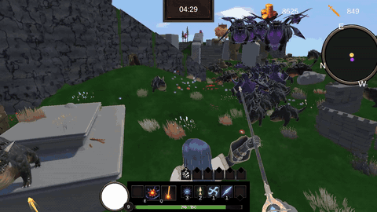

**PROJECT3D**는 **몰려오는 몹 무리를 증강 카드로 버티는** PC용 3인칭 3D 뱀서라이크로, 리그 오브 레전드 '집중포화' 모드와 '메가봉크'를 모티브로 했습니다. 이전 팀 프로젝트 DGS를 **몹 1000마리 · 최대 4인**을 버티도록 구조부터 다시 설계해 1인으로 만들고 있습니다.
플레이어는 직업(전사 · 마법사)을 고르고, 기본 무기 · 스킬 2개(E · Q) · 패시브 1개를 가지고 시작해 몰려오는 몬스터를 처치합니다.
레벨업마다 증강 카드를 골라 무기와 능력치를 키우고, 맵의 지형과 솟아오르는 구조물(회복 · 자석)을 활용하며 버팁니다.

**시점과 맵**


메가봉크처럼 캐릭터 뒤에서 보는 3인칭 시점입니다. 맵은 고원 · 비탈 · 장애물이 있는 3D 지형이라, 플레이어는 점프로 오르내리고 높은 곳에서 뛰어내리면 낙하 데미지를 받습니다.

**조작** — 기본 무기는 자동으로 공격하고, 플레이어는 움직이며 스킬을 씁니다.

| 키 | 하는 일 |
|---|---|
| WASD · 방향키 | 이동 |
| 마우스 | 시점 돌리기 |
| Space | 점프 |
| E · Q | 스킬. 누르고 있는 동안 화면 중앙으로 조준하고, 떼면 사용 (6.2) |
| F (누르고 있기) | 가까운 구조물(회복 · 자석) 사용 |
| Esc | 옵션 창 (로비로 · 게임 종료) |

**목표한 경험** — 4명이 **지형을 읽으며 협동해 살아남고, 보스를 토벌해 클리어하는** 경험입니다.
총 5주 계획 중 2주 프로토타입이라 멀티와 보스는 아직 없고, 끝은 무한런으로 임시 구현해 두었습니다. 다만 **지형을 보고 움직여야 살아남는** 부분은 지금도 들어가 있습니다. 지상 몹이 흐름장으로 경사를 따라 쫓아오고(2장), 공중 몹과 기믹이 한곳에서 버티지 못하게 막습니다(5장).

**게임 루프**

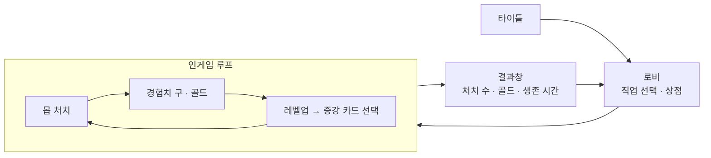

게임이 끝나면 로비로 돌아와, 판에서 얻은 골드로 능력치를 업그레이드하고 다시 도전합니다.

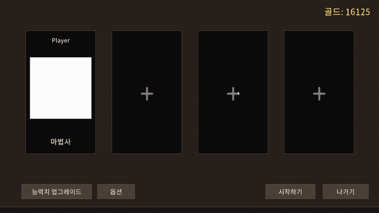

| 레퍼런스 | 가져온 것 | 내 프로젝트에서 다른 점 |
|---|---|---|
| 롤 집중포화 | 증강 카드 · 무기 진화 · 상점 영구 강화 | 3D 지형(고원 · 비탈)에서 높이가 있는 전투 |
| 메가봉크 | 3인칭 3D 맵, 레벨업 시 좌우에 진화 목록 · 스탯 창 | 직업별 E/Q 스킬, 화면 정중앙 조준 |
| DGS(이전 팀 프로젝트) | 증강 · 진화 규칙, 몹 공격 방식 | **구조를 처음부터 다시 설계** (아래 1.2) |

### 1.2 목표

| 목표 | 기준 | 지금 상태 |
|---|---|---|
| 몹이 많아도 버티는 구조 | **몹 1000마리 · 최대 4인**을 기준으로 설계 | 같은 PC 빌드에서 **몹 1000마리 이상 평균 27.2 FPS** — DGS와 비교는 7.2. 게임 설정 상한은 300마리(레벨 디자인 값), 멀티는 구조만 준비 |
| 제가 읽고 설명할 수 있는 코드 | 제가 읽고 설명할 수 있는 패턴만 사용 | AI와 일하는 규칙으로 지킴 (7.3) |

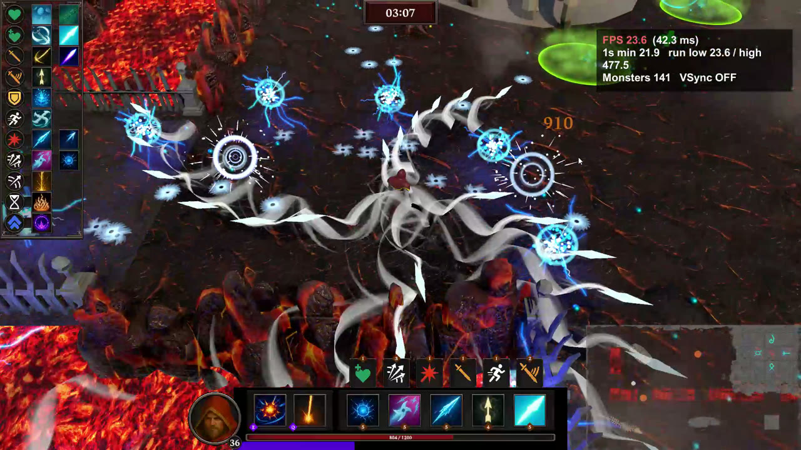

DGS는 몹이 많아지면 **프레임이 떨어져 화면이 끊겼습니다.** 완성 후 빌드를 측정해 보니 **몬스터 100마리 이상 · 경험치 구가 쌓이는 후반에 최저 20.7 FPS**까지 떨어졌습니다(같은 PC에서 PROJECT3D와 비교한 그래프는 7.2).
원인은 몹을 만드는 비용이 아니라 **살아 있는 몹 하나하나가 매 프레임 길을 찾고 충돌을 검사하는 비용**이었습니다(몹마다 NavMeshAgent 경로 · Rigidbody · 트리거 Collider).

처음 기획할 때는 DGS 코드를 고쳐서 쓸 생각이었습니다. 하지만 DGS는 몹 이동이 NavMesh + Collider 기반이고, **경사가 없는 평지 · 탑다운 시점**이라 모든 공격이 수평으로만 나갔으며, 공격을 묶는 디자인 패턴이나 상속 구조도 없었습니다. 높이가 있는 3D 지형으로 옮기려면 고칠 곳이 너무 많아, **몹 이동 · 공격 같은 전체 시스템을 먼저 짜고 그 기준으로 다시 만들기로** 했습니다.
이 프로젝트는 그 측정 결과와 판단에서 출발했습니다.

이 문서는 기능마다 **몹 1000마리 · 4인일 때 매 프레임 무엇이 비용이 되는지**, 그래서 DGS의 무엇을 바꿨는지를 중심으로 씁니다. 직접 잰 값과 계산상 추정은 나눠 적고, 7.5에서 한데 모읍니다.

| 시스템 (장) | DGS에서 들던 비용 | 여기서 바꾼 방식 | 1000마리 기준 근거 |
|---|---|---|---|
| 몹 이동 (2장) | 몹마다 NavMeshAgent가 경로 계산 + Rigidbody | 맵을 **격자로 한 번 굽고**, 흐름장 **하나를 모든 몹이 공유**, 몹끼리는 2m 공간 격자로 분리 | 경로 계산이 몹 수만큼 → 0.2초마다 1번 |
| 공격 판정 (3장) | 몹 · 투사체마다 물리 콜라이더 | 콜라이더 없이 **피격 원통 + 수학 판정**, 투사체 · 범위를 부모(`HitUnit`) 하나로 | 후보는 공간 격자로 좁히고 정밀 판정만 계산 |
| 증강 · 스탯 (4장) | 무기 수치를 이름으로 찾아 주입, 진화 판정이 흩어짐 | 공통 부모 `WeaponAugment` + **TSV 레벨 표**, 스탯은 출처별로 **매번 처음부터 다시 계산** | 프레임 비용이 아니라 무기가 늘 때 고칠 곳의 수 |
| 소환 · 경험치 (5장) | 경험치 구마다 Rigidbody + 트리거 | **상시 + 이벤트 소환**, 경험치 구는 물리 없이 직접 이동 | 구가 쌓이면 여전히 무거움 — 남은 병목 (7.2) |
| 시간 · 조작 (6장) | `Time.timeScale`로 일시정지 | 게임 시계 `WorldClock`, 화면 중앙 조준 | 4인이면 한 사람이 엔진 시간을 멈출 수 없음 |
| 초기화 (부록 A.2) | "몇 프레임 뒤면 끝났겠지" 대기 | `GameManager.BootAsync`에서 **순서를 한 줄씩 명시** | — |

---

## 2. 몬스터 무리의 이동 제어

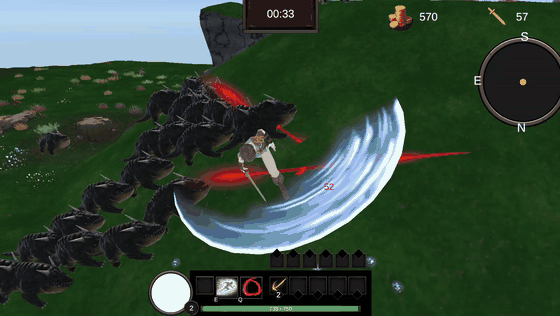

몹 무리가 고원 · 비탈을 따라 플레이어를 쫓아오는 움직임입니다. DGS처럼 몹마다 길을 찾게 하지 않고, 맵을 한 번 굽고 흐름장 하나를 모든 몹이 함께 읽게 만들었습니다.

목표한 경험(1.1) 중 「지형을 보고 움직여야 살아남는」 부분이 이 장에서 시작됩니다. 땅 몹 무리는 비탈을 따라 오르내리고, 절벽처럼 높이차가 큰 곳은 흐름장이 가리키는 길로 돌아서 옵니다(2.5). 그래서 플레이어는 고원 · 비탈 · 장애물을 보고 피할 길을 골라야 합니다.

### 2.1 몹들을 어떻게 이동시킬 것인가

추적 방식은 세 번 바뀌었습니다.

| | [A] 몹마다 NavMeshAgent (DGS) | [B] 콜라이더 · 레이 기반 추적 | **[C] MapGrid + 흐름장 하나 공유** ✓ |
|---|---|---|---|
| 방식 | 엔진 AI Navigation이 몹마다 경로 계산 | 몹이 플레이어 쪽으로 이동하며 콜라이더 · 레이로 장애물을 감지해 피함 | 맵을 격자로 한 번 굽고, 플레이어 칸에서 퍼져 나간 방향을 모든 몹이 읽음 |
| 경로 계산 | 몹 수만큼 | 몹 수만큼 (매 프레임 감지) | 0.2초마다 **한 번** |
| 장점 | 엔진 기능 그대로, 정확한 경로 | 구현이 단순 | 몹 수가 늘어도 경로 비용이 그대로. 맵 그리드 · 타일 추적 방식 |
| 단점 | 몹이 많으면 경로 · 회피 비용이 쌓임 (DGS 실측 최저 20.7 FPS) | 몹마다 물리 검사가 쌓이고, 막다른 곳에서 길을 못 찾음 | 칸 단위라 방향이 각져서 보간이 필요. 흐름장 밖(못 오르는 곳)을 따로 처리해야 함 |

**[최종 결정]** [C].
DGS 빌드 측정에서 병목이 "살아 있는 몹마다 드는 비용"이었기 때문에, 몹 하나하나가 길을 찾지도, 물리로 주변을 감지하지도 않게 하는 쪽을 골랐습니다.
칸 단위 방향 때문에 회전이 어색한 문제는 방향을 지수 보간(`1 - Exp(-속도 × dt)`)해서 줄였습니다.
그 뒤 몹끼리 겹치는 문제를 풀려고 밀어내기(separation) 방식을 여러 가지 비교했고, 그 과정에서 처음 설계에는 없던 **공간 격자(`EnemyRegistry`)를 추가**했습니다(2.4). 최종 구조는 2.3의 그림과 같습니다.

### 2.2 흐름장(Flow Field)이란

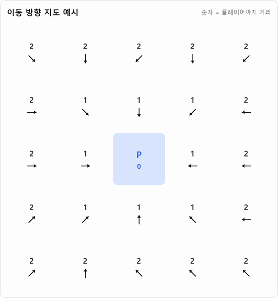

흐름장은 맵의 모든 칸에 **"목표(플레이어)에 가려면 어느 쪽으로 가야 하는지"를 미리 적어 둔 지도**입니다. 두 단계로 만듭니다.

1. **거리 채우기** — 플레이어가 선 칸을 0으로 두고, 이웃 칸으로 한 칸씩 퍼져 나가며 거리를 1, 2, 3… 적습니다(BFS, 너비 우선 탐색). 이웃은 직선 4방향 · 대각선 4방향의 8칸이고, 몹이 넘어갈 수 없는 칸(장애물, 높이차가 큰 칸)은 건너뜁니다.
2. **방향 적기** — 각 칸은 이웃 중 거리가 가장 작은 칸을 가리킵니다.

그러면 몹은 길을 찾지 않고 **자기가 선 칸의 화살표만 따라가면** 플레이어에게 도착합니다. 몹이 1000마리여도 계산은 0.2초마다 한 번입니다.

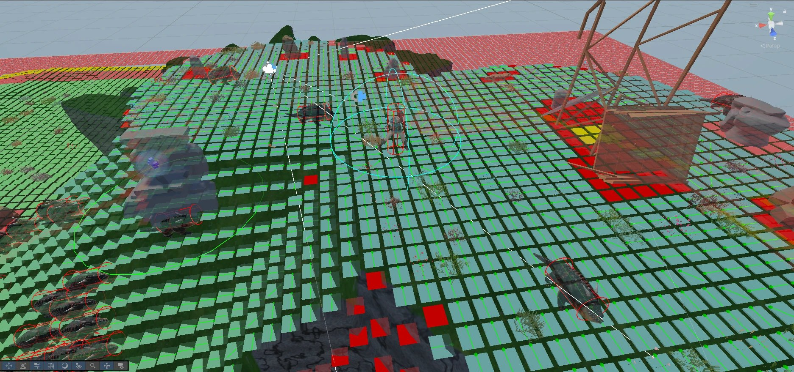

흐름장은 시작할 때 한 번 구워 둔 칸 정보 위에서 계산합니다. 실제 맵은 200×200칸(한 칸 1m)이고, 이웃 칸으로 넘어갈 수 있는지는 높이 · 경사까지 봅니다(경사 40° · 한 칸 1m 오르기까지).

| 칸(`Tile`)에 굽는 값 | 쓰는 곳 |
|---|---|
| `Kind` (Walkable / Blocked) | 흐름장 · 스폰 위치 · 구조물 위치 |
| `GroundHeight` · `GroundNormal` | 몹 높이 · 기울기, 경험치 구 낙하, 범위 스킬 바닥 |
| `SurfaceHeight` (바닥 + 장애물 꼭대기) | 공중 몹 고도, 포격 착탄 높이 |
| `Distance` · `Direction` | 흐름장 결과 (몹 이동 방향) |

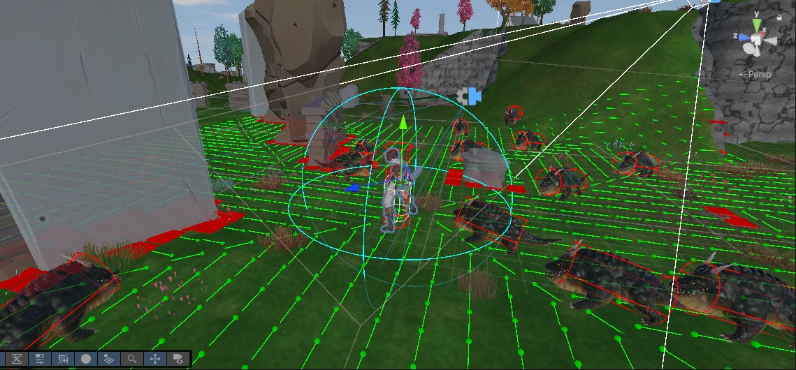

```csharp
// FlowField.cs:14 — 필드
private readonly MapGrid     map;                            // 이동 가능 판정
private readonly SquareGrid  grid;                           // 칸 데이터
private readonly Queue<Tile> searchQueue = new Queue<Tile>(); // 거리 계산(BFS) 대기열 (재사용)

// FlowField.cs:28 — 흐름장 한 번 계산하기
public void Build(List<Vector3> targets)
{
    ResetTiles();
    AddTargets(targets);           // 플레이어가 선 칸들 (멀티면 여러 개)
    FillDistances();               // 거리 채우기 (BFS)
    AddUnreachedTargets(targets);  // 몹이 못 오르는 곳에 플레이어가 있을 때 (아래 만들며 생긴 문제)
    FillDirections();              // 방향 적기
}
```

- 전체 코드: [FlowField.cs](https://github.com/KooHoo-Dev/3rd_3D_1-3D-Project-NaJungWon/blob/main/Assets/10.%20Scripts/Map/FlowField/FlowField.cs) · [MapGrid.cs](https://github.com/KooHoo-Dev/3rd_3D_1-3D-Project-NaJungWon/blob/main/Assets/10.%20Scripts/Map/MapGrid.cs)

**만들며 생긴 문제 — 플레이어가 비탈 위에 있으면 몹이 멈춤.** 흐름장에서 길이 없는 칸은 방향이 0입니다. 장애물 칸은 "가장 가까운 걸을 수 있는 칸"으로 목표를 옮기고 있었지만, **가파른 Ground 칸은 걸을 수 있는 칸으로 분류돼** 목표가 옮겨지지 않았습니다. AI는 처음에 "길이 없으면 플레이어 쪽으로 직진"을 넣었는데, 제가 **장애물 위에서 쓰던 "근처로 모이기"를 그대로 재사용**하자고 했습니다. 플레이어 주변 10칸 안에서 아직 길이 없는 칸 중 가장 가까운 칸을 보조 목표로 추가해(`AddUnreachedTargets`, 끊긴 땅 덩어리 최대 4개), 몹이 멈추지 않고 오를 수 없는 비탈 아래 · 플레이어 근처로 모여듭니다.

예외 상황마다 새 규칙을 만들기보다, **이미 있는 규칙이 왜 이 경우를 못 잡는지**를 먼저 보면 코드가 늘지 않는다는 것을 배웠습니다.

### 2.3 몹 하나가 움직이는 순서

몹 하나는 아래 순서로 움직입니다. 위 두 단계(Map Grid · Flow Field)는 **모든 몹이 함께 쓰는 값**이고, 아래 네 단계만 몹마다 실행합니다.

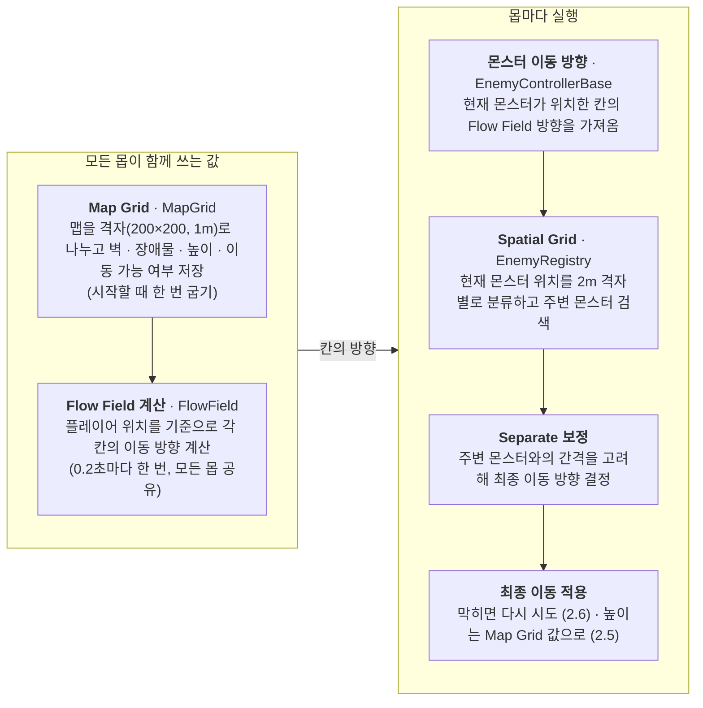

몹 컨트롤러는 땅 몹(`GroundNormal`)과 공중 몹(`AirNormal`) 두 가지이고, 공통 이동 순서는 부모 `EnemyControllerBase`가 갖습니다(차이는 2.5).

### 2.4 몹의 추적을 어떻게 자연스럽게 할 것인가 🧭

몹 무리가 한 점에 겹치지 않고 자연스럽게 쫓아오도록, 흐름장 방향에 **분리(Separate)** 를 더했습니다. 분리는 1.5m 안에 있는 몹에게서 멀어지는 방향을 이동 방향에 더하는 방식이고, 주변 몹은 **공간 격자(Spatial Grid: 맵을 2m 칸으로 나눠 칸마다 들어 있는 몹을 적어 두는 표, `EnemyRegistry`)** 에서 내 주변 9칸만 가져옵니다.

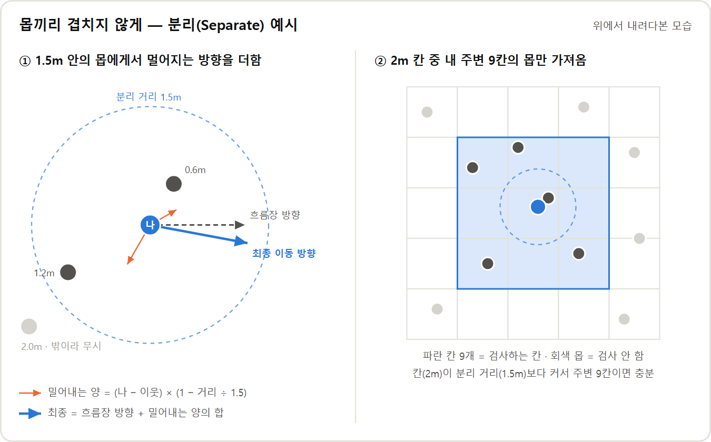

```csharp
// EnemyControllerBase.cs:11, 49 — 필드
[Header("분리(Separate) 설정")]
[SerializeField] protected float separationDistance = 1.5f; // 몹끼리 멀어지는 거리
private List<Enemy> nearMonsters = new List<Enemy>(); // 분리 계산 때 주변 몹 (매 프레임 새로 만들지 않고 재사용)

// EnemyControllerBase.cs:210 — 흐름장 방향 + 분리
Vector3 direction = smoothChase + GetSeparationDirection();

// EnemyControllerBase.cs:285
protected Vector3 GetSeparationDirection()
{
    Vector3 sum = Vector3.zero;

    // 전체 몹이 아니라 내 주변 칸에 있는 몹만 가져온다 (EnemyRegistry 공간 격자)
    EnemyRegistry.FindInRange(transform.position, separationDistance, ref nearMonsters);

    foreach (Enemy other in nearMonsters)
    {
        if (other == Enemy) continue; //본인은 포함x

        Vector3 toOther = transform.position - other.transform.position;
        toOther.y = 0f;

        float distance = toOther.magnitude;
        if (distance > 0f && distance < separationDistance)
            sum += toOther * (1f - distance / separationDistance);
    }

    return sum;
}
```

- 전체 코드: [EnemyControllerBase.cs](https://github.com/KooHoo-Dev/3rd_3D_1-3D-Project-NaJungWon/blob/main/Assets/10.%20Scripts/Enemy%20And%20Wave/EnemyControllerBase.cs) · [EnemyRegistry.cs](https://github.com/KooHoo-Dev/3rd_3D_1-3D-Project-NaJungWon/blob/main/Assets/10.%20Scripts/Enemy%20And%20Wave/EnemyRegistry.cs)

**겹치지 않게 하는 방법 고르기** 🧭 — 몹마다 Collider를 붙이면 물리 비용이 몹 수만큼 쌓여 리팩토링의 목표(최적화)에 맞지 않고, 몰리면 서로 밀어내며 진동하기 쉬워서 Collider 없는 분리를 골랐습니다. 처음에는 주변 몹을 모든 몹과 비교해 찾았는데, 비교 횟수가 몹 수의 제곱으로 늘어 프레임이 떨어져 공간 격자를 더했습니다.

| | [A] 몹마다 Collider | [B] Separate + 모든 몹끼리 비교 | **[C] Separate + 2m 공간 격자 (`EnemyRegistry`)** ✓ |
|---|---|---|---|
| 방식 | 물리 엔진이 몹끼리 밀어냄 | 매 프레임 다른 모든 몹과 거리를 재서 멀어짐 | 내 주변 9칸에 있는 몹만 가져와 멀어짐 |
| 비교 횟수 (1000마리) | — (물리 엔진) | 1000 × 1000 = 약 100만 번 / 프레임 | 주변 9칸만 → 수천 번 수준 (계산상) |
| 단점 | Collider 비용, 몰리면 진동현상이 생기기 쉬움 | 비교 횟수가 몹 수의 제곱으로 늘어남 | 몹이 칸을 옮길 때마다 갱신해야 함 |

칸 크기 2m는 분리 거리(1.5m)보다 크게 잡아 **주변 9칸만 보면 되도록** 했습니다. 이 격자는 이후 **공격 판정 · 가장 가까운 적 찾기**에도 그대로 재사용했습니다(3장).

### 2.5 몹 높이를 어떻게 정할 것인가

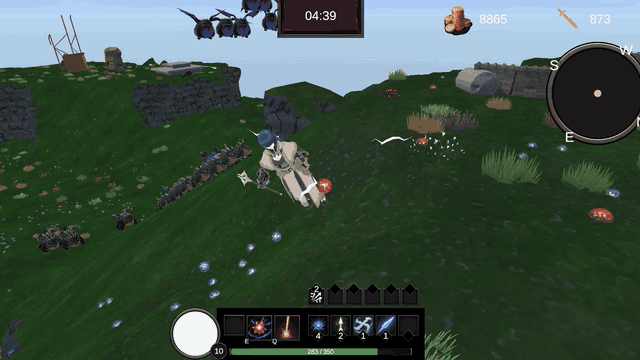

땅 몹은 비탈을 따라 오르내리고, 공중 몹은 장애물 위로 고도를 올려 넘어옵니다. 두 종류는 높이를 다르게 정합니다.

| | 땅 몹 (`GroundNormal`) | 공중 몹 (`AirNormal`) |
|---|---|---|
| 이동 방향 | 흐름장이 가리키는 방향 | 흐름장을 쓰지 않고 플레이어에게 직진 |
| 높이 | 발밑 `GroundHeight`를 주변 4칸으로 보간 | "발밑 표면(`SurfaceHeight`) + 비행 높이"와 "앞쪽 장애물 꼭대기 + 여유"(접지한 플레이어보다 위) 중 큰 값 |
| 경사 · 장애물 | 경사 40°까지 따라 오르내림, 절벽처럼 높이차가 큰 곳은 흐름장을 따라 돌아감 | 앞이 높으면 수평 이동을 멈추고 먼저 올라감 |

공중 몹은 처음 코드에서 장애물을 옆으로 돌아가게 했는데, 그게 지그재그로 움직이는 원인이라 "높으면 올라가서 넘는다"로 바꿨습니다.
경사에서는 본체는 위치와 좌우 회전만 갖고, 자식 모델(플레이어는 `BodyPivot`, 몹은 `Model`)만 칸에 구워 둔 `GroundNormal`에 맞춰 기울입니다(최대 30°, Slerp).

땅 몹의 바닥 높이를 어떻게 구할지는 한 번 뒤집혔습니다.

| | [A] 몹마다 매 프레임 아래로 레이 | **[B] MapGrid 4칸 쌍선형 보간** ✓ |
|---|---|---|
| 1000마리 비용 | 레이 1000번 / 프레임 | 배열 읽기 4번 × 1000 |
| 정확도 | 정확 | 칸 중심값 기준이라 경사 시작 · 끝에서 오차 |
| 한계 | — | **1층 · 2층 사이 터널은 표현 불가**, 칸보다 가는 장애물은 빠질 수 있음 |

**[최종 결정]** [B].
처음에는 AI 제안대로 몹마다 레이를 쐈는데, 이후 AI가 "몹 1000마리 레이는 비싸다"고 말을 바꿨고, 제가 "몹 1000마리 · 4인이 처음부터 목표인데 지금 설계는 그게 아니라는 거냐"고 짚었습니다. 정리해 보니 큰 틀은 맞고 **몹별 매 프레임 레이만 어긋나 있었습니다**.
구조물을 제외한 장애물 배치는 바뀌지 않으니 처음 구울 때 높이도 같이 저장하면 된다고 판단해 [B]로 바꿨고, 공중 몹 고도 · 포격 착탄 높이까지 같은 값(`SurfaceHeight`)으로 통일했습니다.

```csharp
// MapGrid.cs:22, 33 — 필드
public float maxStepUp = 1f;   // 옆 칸으로 오를 수 있는 높이
public SquareGrid Grid { get; private set; } // 칸 데이터

// MapGrid.cs:128 — 몹 위치의 바닥 높이를 주변 4칸으로 보간 (일부 줄 합침)
public bool TryGetGroundHeight(Vector3 position, out float height, out Vector3 normal)
{
    Tile own = Grid.GetTileOrNull(position);
    float fx = (position.x - Grid.Origin.x) / Grid.CellSize - 0.5f;
    float fz = (position.z - Grid.Origin.z) / Grid.CellSize - 0.5f;
    int x0 = Mathf.FloorToInt(fx); int z0 = Mathf.FloorToInt(fz);
    float tx = fx - x0; float tz = fz - z0;
    // 막혔거나 maxStepUp보다 높이차가 큰 절벽 칸은 섞지 않고 내 칸 값으로 대체
    Tile t00 = GetBlendTile(own, x0, z0);     Tile t10 = GetBlendTile(own, x0 + 1, z0);
    Tile t01 = GetBlendTile(own, x0, z0 + 1); Tile t11 = GetBlendTile(own, x0 + 1, z0 + 1);
    float bottom = Mathf.Lerp(t00.GroundHeight, t10.GroundHeight, tx);
    float top    = Mathf.Lerp(t01.GroundHeight, t11.GroundHeight, tx);
    height = Mathf.Lerp(bottom, top, tz);
    // ... normal도 같은 방식
}
```

### 2.6 이동이 막혔을 때 빠져나오기

몹은 움직이기 전에 아래 순서로 막힌 칸을 확인하고, 2단계에서 **막힌 칸으로 들어가는 이동을 먼저 막습니다**.

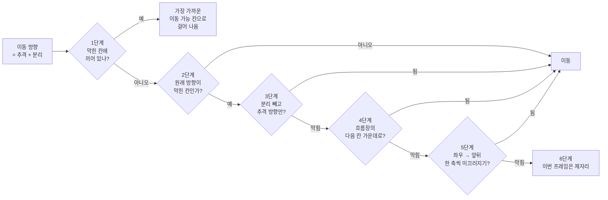

처음 Separate를 넣었을 때는 서로 멀어지는 방향이 장애물 쪽이어도 막는 처리가 없어서, 몹이 장애물 때문에 이동할 수 없는 영역으로 밀려 들어가 **움직이지 못하는 상황**이 생겼습니다. 그래서 `EnemyControllerBase.ApplyMovement`가 막힌 칸으로 들어가는 이동을 **미리 막고**(2단계), 이동이 막히면 위 순서로 다시 시도하게 했습니다. 3단계는 대부분 "분리 방향이 장애물 쪽"이라 막힌 경우를 풉니다.

---

## 3. 공격이 맞았는지 판정하기

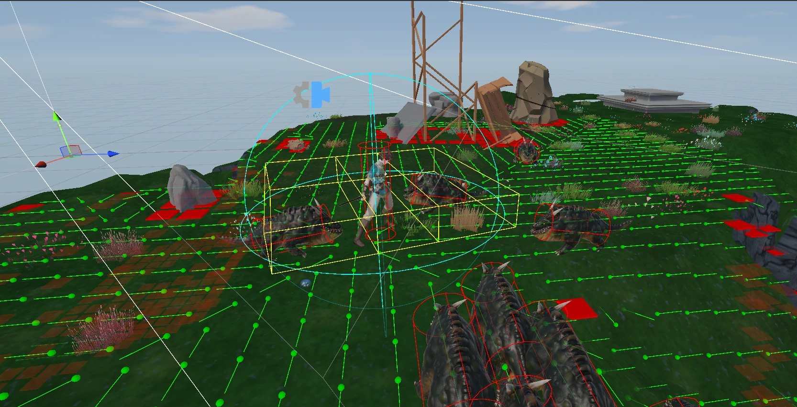

플레이어의 무기 · 스킬과 몹의 공격은 모두 같은 흐름으로 맞았는지를 판정합니다. 몹에는 물리 콜라이더가 없어서, 모든 유닛(`CombatEntity`)이 **피격 원통**(반경 · 반높이 · 기울기)을 갖고, 공격은 모양(구 · 기둥 · 직육면체)과 크기만 들고 와서 `IsHitBy` 하나로 판정합니다. 후보는 공간 격자로 좁히고(2.4), 정밀 판정만 수학으로 합니다.

1.1의 레퍼런스 표에서 다른 점으로 꼽은 「3D 지형(고원 · 비탈)에서 높이가 있는 전투」가 이 장입니다. 판정이 높이까지 보기 때문에 수평으로 쏜 기본 공격은 공중 몹을 맞히지 못하고, 이것을 일부러 남겨 범위 증가 · 스킬 · 타겟팅 증강을 고를 이유로 삼았습니다(3.7).

### 3.1 공격 하나가 데미지가 되기까지

몹의 공격 하나는 아래 **다섯 단계**를 거쳐 데미지가 됩니다.

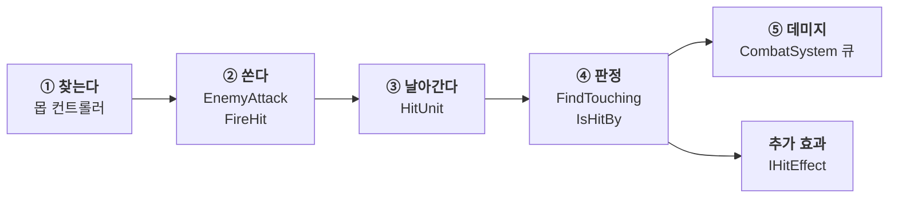

플레이어의 무기 · 스킬도 ②부터는 같은 흐름입니다.

| 단계 | 맡는 곳 | 하는 일 | 절 |
|---|---|---|---|
| ① 찾는다 | 몹 컨트롤러 | 쿨타임 · 사거리 판정, 대상 정하기 | 3.3 |
| ② 쏜다 | `EnemyAttack` (`UnitAttack` 계열) | 공격 컴포넌트가 `FireHit` 입구 하나로 발사 — 논타겟 · 타겟팅 · 범위 중 무엇으로 쏠지 | 3.3 · 3.4 |
| ③ 날아간다 | `HitUnit` 계열 | 직진 / 추적 / 지정 위치 소환, 플레이어 · 몹이 같은 투사체를 씀 | 3.4 |
| ④ 판정 | `HitUnit.FindTouching` → `CombatEntity.IsHitBy` | 후보 찾기 → 공격 모양(구 · 기둥 · 직육면체)별 피격 원통 판정 (직육면체는 OBB) | 3.5 · 3.6 · 3.7 |
| ⑤ 데미지 | `CombatSystem` · `IHitEffect` | 데미지 큐, 스턴 같은 추가 효과 | 3.8 |

> 한 줄로: **"쏘는 방법은 합치고, 언제 · 왜 쏘는지는 나눈다."**

### 3.2 어떤 공격과 판정 대상이 있나

**① 쏘는 쪽 — `UnitAttack` 계열**

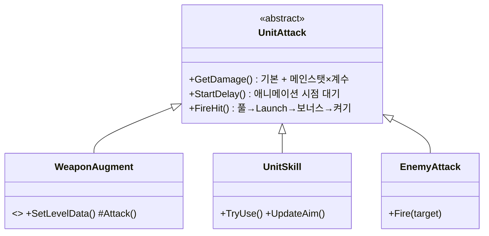

| 부모 | 자식 클래스 (원본 코드) |
|---|---|
| `WeaponAugment` | `Slash` · `WizardBolt` · `Bounce` · `LightArrow` · `IceMagic` (4장) |
| `UnitSkill` | `AreaSkill` · `DashSkill` · `FireBallSkill` · `GroundBombSkill` · `SkillSwordWave` |
| `EnemyAttack` | `SingleShot` · `TripleShot` · `Artillery` |

**② 날아가서 맞히는 쪽 — `HitUnit` 계열**

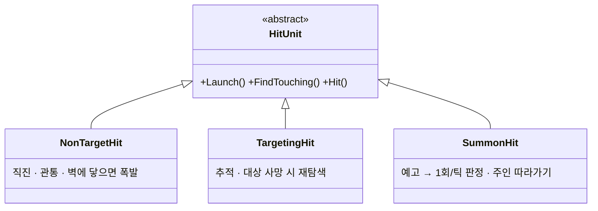

**③ 맞는 쪽과 추가 효과 — `CombatEntity` · `IHitEffect`**

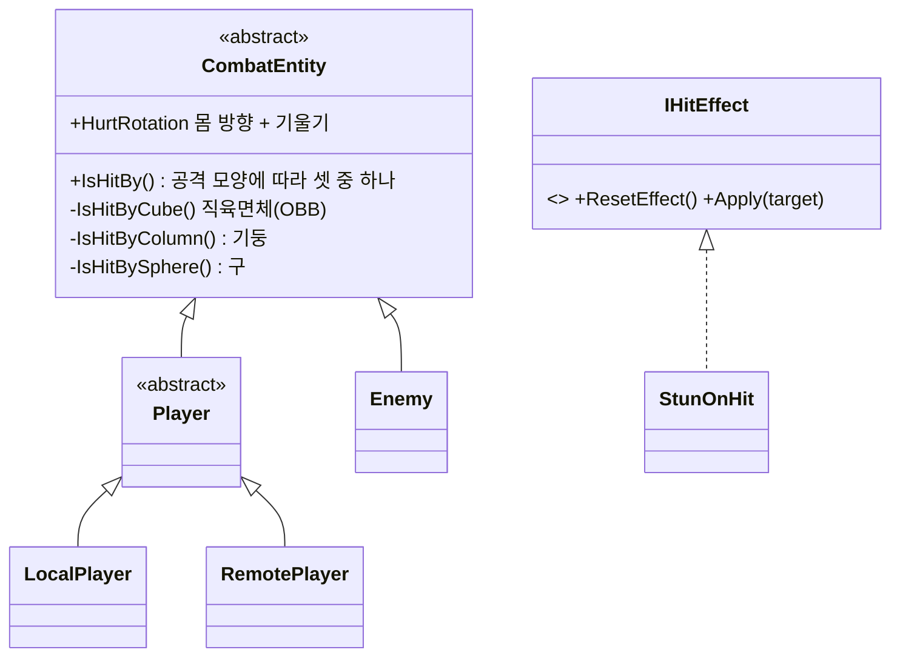

**만들며 생긴 문제 — 몹 원거리 공격이 플레이어에게 안 맞음.** 피격 판정을 `CombatEntity`로 옮긴 뒤부터 플레이어 피격 로그가 아예 뜨지 않았습니다. 플레이어 체력이 0이라 **이미 죽은 것으로 판정돼** 피격이 건너뛰어지고 있었고, 이유는 두 가지였습니다. ① `TableLoader`에서 유닛 표 로드가 주석 처리돼 최대 체력부터 0 ② `LocalPlayer.Awake`가 부모 `Player.Awake`를 **가려서** 체력을 채우는 코드가 실행되지 않음. 1차(10.25)로 부모 `Awake`를 `virtual`로 열어 `base.Awake()`를 부르게 했고, 2차(10.27)로 체력을 채우는 일을 `Awake`에서 빼서 `Player.Init` → `StatHandler.Init`으로 옮겨, 자식 클래스가 `Awake`를 따로 가져도 초기화가 빠지지 않게 했습니다.

판정을 옮겨서 생긴 버그가 아니라, **옮기면서 추가한 검사(사망 여부)가 숨어 있던 버그를 드러낸 것**이었습니다. 초기화는 Unity 생명주기 함수가 아니라 **순서가 보이는 `Init`** 에 두는 편이 안전했습니다.

### 3.3 몹의 공격은 어디에 둘 것인가 🧭

몹의 공격은 **컨트롤러**와 **공격 컴포넌트** 두 곳으로 나눴고, 나누는 기준은 **"언제 쏠지"와 "무엇을 쏠지"** 입니다. 아래는 포격 몹의 예로, 빨간 원이 공격 사거리입니다.

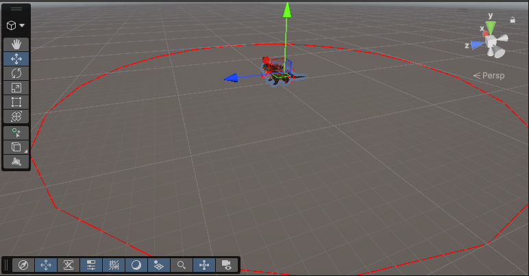

| 컨트롤러 — `GroundNormal` (언제 쏠지) | 공격 컴포넌트 — `Artillery` (무엇을 쏠지) |
|---|---|
| 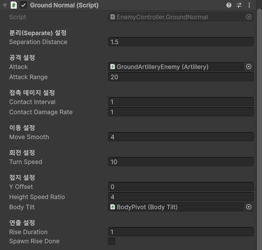 | 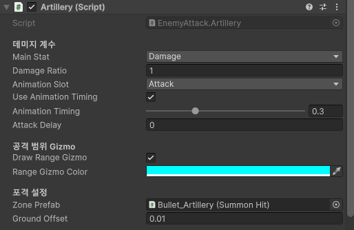 |

컨트롤러는 사거리 안에 들어오면 멈춰서 공속마다 "쏴라"만 전하고, 공격 컴포넌트는 애니메이션 시점에 맞춰 쏘기만 합니다. 포격은 대상 발밑에 범위 투사체를 떨어뜨리고, 예고 원과 판정은 그 투사체(`SummonHit`, 3.4 ③)가 맡습니다.

- 전체 코드: [EnemyControllerBase.cs](https://github.com/KooHoo-Dev/3rd_3D_1-3D-Project-NaJungWon/blob/main/Assets/10.%20Scripts/Enemy%20And%20Wave/EnemyControllerBase.cs) · [EnemyAttack.cs](https://github.com/KooHoo-Dev/3rd_3D_1-3D-Project-NaJungWon/blob/main/Assets/10.%20Scripts/Enemy%20And%20Wave/Enemy_Attack/EnemyAttack.cs) · [EnemyAttack.Artillery.cs](https://github.com/KooHoo-Dev/3rd_3D_1-3D-Project-NaJungWon/blob/main/Assets/10.%20Scripts/Enemy%20And%20Wave/Enemy_Attack/EnemyAttack.Artillery.cs)

**몹 공격은 공격 컴포넌트로** 🧭 — 몹의 공격을 어디에 둘지는 세 번 바뀌었습니다.

| | [A] 컨트롤러에서 `ProcessAttack` override | [B] enum + Strategy + Factory | **[C] 공격 컴포넌트** ✓ |
|---|---|---|---|
| 수치 위치 | 컨트롤러 자식 클래스 | 일반 클래스라 인스펙터에 안 보임 | **공격 프리팹 인스펙터** |
| 사망 효과 여러 개 | 어려움 | Factory 분기 추가 | 컴포넌트를 여러 개 붙이면 됨 |
| 판정 위치 | — | — | 쿨타임 · 사거리 판정은 컨트롤러, 공격 컴포넌트는 발사만 (`Update`는 공격 시점을 기다리는 동안만 일함) |

AI는 처음에 Strategy + Factory를 권했다가, 제가 "몬스터별로 스크립트를 따로 만들어 수치를 override하겠다"고 하자 판단을 바꿨습니다. 이어서 제가 `weapon.Fire()` 구조를 꺼냈고, **프리팹에 붙인 컴포넌트가 곧 선택**이라 enum · Factory가 필요 없어 [C]로 확정했습니다. 다만 **돌진**은 여러 프레임에 걸친 이동이라 컨트롤러(`EnemyController.Dash.cs`)에 두고, 판정만 범위(`SummonHit`)에 맡겼습니다.

### 3.4 논타겟 · 타겟팅 · 범위 🔍

공격이 날아가서 맞히는 방식은 **논타겟 · 타겟팅 · 범위** 세 가지로 나눴고, 나누는 기준은 **"생성된 뒤 어떻게 움직이는가"** 입니다. 몹 공격은 타겟팅(유도)을 쓰지 않습니다 — 몹이 타겟팅 공격을 하면 피할 수 없기 때문입니다.

**① 논타겟 (`NonTargetHit`)** — 직진하다가 지형 · 장애물에 닿으면 사라지고, 관통이 아니면 첫 대상에서 사라집니다.

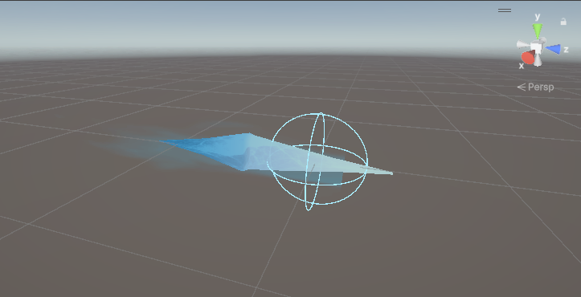

| 관통형 — 얼음 마법 `Bullet_IceMagic` | 폭발형 — 파이어볼 `Wizard_FireBall` |
|---|---|
| 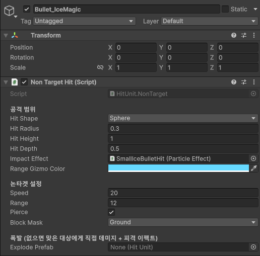 | 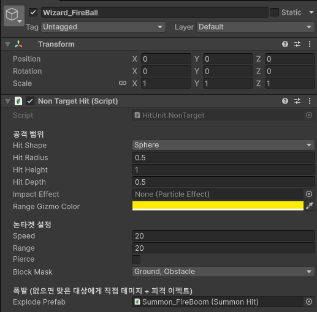 |

같은 `NonTargetHit`를 인스펙터 값으로 나눠 씁니다. 얼음 마법은 관통(Pierce)을 켜서 적을 뚫고 지나가고, 파이어볼은 폭발 프리팹(`Summon_FireBoom`)을 넣어 닿은 자리에 범위 판정을 만듭니다. 폭발 프리팹이 없으면 맞은 대상에게 직접 데미지를 줍니다.

**② 타겟팅 (`TargetingHit`, 플레이어 전용)** — 대상의 몸 중심으로 날아가고, 대상이 죽으면 범위 안에서 가장 가까운 적을 다시 찾습니다. 맞힐 횟수만큼 다음 대상으로 넘어갑니다.

| 빛의 화살 `Bullet_LightArrow` 기즈모 | 인스펙터 |
|---|---|
| 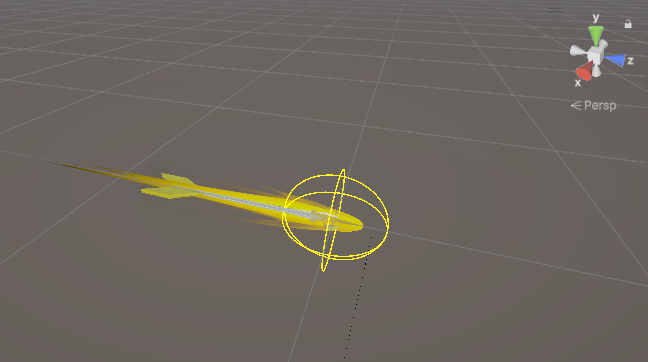 | 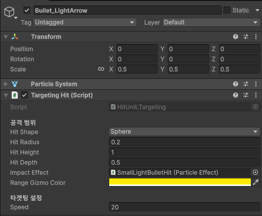 |

**③ 범위 (`SummonHit`)** — 정한 자리에 생겨 예고 시간 뒤에 한 번, 또는 지속시간 동안 일정 간격(틱)마다 판정합니다. 돌진처럼 주인을 따라가며 판정할 수도 있습니다.

| 판정 구 기즈모 | 포격 몹 포탄 `Bullet_Artillery` 인스펙터 |
|---|---|
| 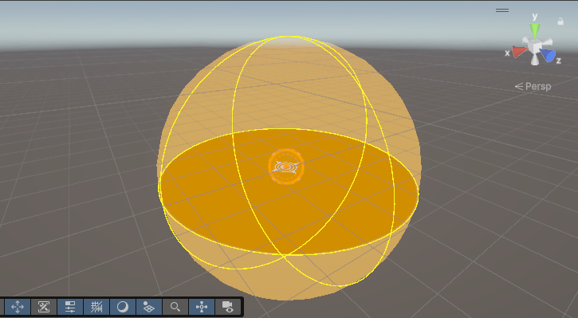 | 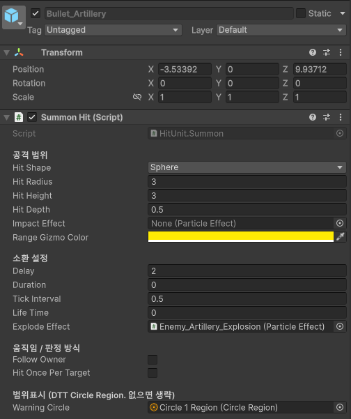 |

포격 몹의 포탄은 반경 3의 범위로, 바닥에 예고 원을 띄운 뒤 2초(Delay) 뒤 한 번 판정하고 폭발 이펙트를 터뜨립니다. 지속시간(Duration)을 주면 틱 간격(Tick Interval)마다 판정하고, 주인 따라가기(Follow Owner)를 켜면 돌진처럼 주인과 함께 움직이며 판정합니다.

세 종류 모두 판정 모양 · 크기 · 피격 이펙트 칸은 부모(`HitUnit`)의 「공격 범위」에서 같고, 아래쪽 설정만 종류마다 다릅니다. 논타겟은 매 프레임, 범위는 판정 시각마다 닿은 대상을 찾고(3.5), 타겟팅은 쫓는 대상 하나만 확인합니다. 맞힌 대상에게는 셋 다 `Hit`을 부릅니다(3.8).

- 전체 코드: [HitUnit.cs](https://github.com/KooHoo-Dev/3rd_3D_1-3D-Project-NaJungWon/blob/main/Assets/10.%20Scripts/CombatSystem/Projectile/HitUnit.cs) · [HitUnit.NonTarget.cs](https://github.com/KooHoo-Dev/3rd_3D_1-3D-Project-NaJungWon/blob/main/Assets/10.%20Scripts/CombatSystem/Projectile/HitUnit.NonTarget.cs) · [HitUnit.Targeting.cs](https://github.com/KooHoo-Dev/3rd_3D_1-3D-Project-NaJungWon/blob/main/Assets/10.%20Scripts/CombatSystem/Projectile/HitUnit.Targeting.cs) · [HitUnit.Summon.cs](https://github.com/KooHoo-Dev/3rd_3D_1-3D-Project-NaJungWon/blob/main/Assets/10.%20Scripts/CombatSystem/Projectile/HitUnit.Summon.cs) · [UnitAttack.cs](https://github.com/KooHoo-Dev/3rd_3D_1-3D-Project-NaJungWon/blob/main/Assets/10.%20Scripts/CombatSystem/Attack/UnitAttack.cs)

**세 가지로 나뉘기까지** — 투사체 구조는 다섯 번 바뀌었고, 마지막 두 번은 제 제안이었습니다.

| 순서 | 구조 | 계기 |
|---|---|---|
| ① | 투사체 하나에 관통 수 · 유도 켜고 끄기 | AI 첫 구현 |
| ② | 논타겟 / 타겟팅 클래스 두 개 | AI |
| ③ | 한 클래스 안에서 enum으로 분기 | AI |
| ④ | 부모 + 직진 · 추적 · 지정 소환 자식 셋 | 제가 "코드가 너무 무거워진다. 타겟팅 / 논타겟팅 / 지정 소환식으로" |
| ⑤ | **`HitUnit` + 자식 셋, 생성은 `UnitAttack.FireHit` 입구 하나** (풀 → `Launch` → 보너스 → 켜기, 자식은 `Launch`만 override) | AI가 공격마다 생성 입구를 따로 만들어서, 제가 "모든 공격의 입구를 하나로 모으고, 공격 방식이 달라지는 부분(`Launch`)만 override"하자고 함. 이름도 `HitUnit`으로 |

"공격 방식과 타겟팅 방식을 나눠 만든다"는 원칙을 근거로 삼았습니다. 새 종류가 생기면 자식만 추가하면 됩니다. 입구 이름을 `Fire`가 아니라 `FireHit`로 한 것은 `EnemyAttack.Fire` 안에서 `Fire`를 부르는 모양이 헷갈리기 때문입니다.
투사체는 플레이어용 · 몹용으로 나누지 않았습니다 🔍. 제가 "둘 다 `CombatEntity`인데 굳이 나눌 필요가 있나?"라고 물어 하나로 합치고 주인(Owner)으로 대상을 가리게 했고, "`EnemyAttack`도 `UnitAttack`으로" 바꿔 몹 공격도 같은 부모를 쓰게 했습니다. 몹 쪽에 안 쓰는 값은 0으로 둡니다.

### 3.5 무엇을 맞혔는지 찾기

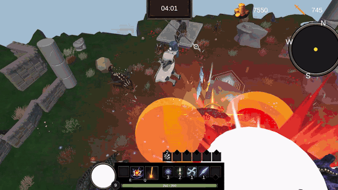

몹이 쏜 것은 플레이어(최대 4명)를 전부 검사하고, 플레이어가 쏜 것은 공간 격자(`EnemyRegistry.FindHitTargets`)로 후보를 좁힙니다(`HitUnit.FindTouching`). 공격은 모양(`hitShape`)과 크기 · 회전만 들고 오고, 맞는 쪽(`CombatEntity.IsHitBy`)이 **공격 모양에 따라 셋 중 하나**로 자기 피격 원통과 비교합니다. `IsHitBy`는 모양을 보고 함수 하나를 부르기만 하고, 계산은 모양마다 함수로 나눴습니다.

| 공격 모양 | 쓰는 공격 | 판정 함수 | 검사 |
|---|---|---|---|
| 직육면체 (Cube) | 전사 베기 · 검기 (플레이어 → 몹) | `IsHitByCube` | 공격 상자와 내 원통이 겹치는지 (**OBB**) |
| 기둥 (Column) | 돌진 판정 (플레이어 · 몹) | `IsHitByColumn` | 세로로 선 기둥과 내 원통이 겹치는지 |
| 구 (Sphere) | 투사체 · 폭발 대부분 | `IsHitBySphere` | 구와 내 원통이 겹치는지 |

```csharp
// HitUnit.cs:10~35 — 필드 (일부)
protected CombatEntity owner;
[SerializeField] private HitShape hitShape = HitShape.Sphere;
[SerializeField] private float hitHeight = 1f;          // 기둥 / 직육면체일 때만 사용 (절반 높이)
protected float currentHitRadius;        // 이번 생성의 반경 (범위 증가 적용 후)
protected float currentHitDepth;         // 이번 생성의 앞뒤 두께 (직육면체. 범위 증가 적용 후)
private List<Enemy> enemyBuffer = new List<Enemy>();               // 격자 검색 결과 (재사용)
private List<CombatEntity> touching = new List<CombatEntity>();     // 이번에 닿은 대상 (재사용)

// HitUnit.cs:122
protected List<CombatEntity> FindTouching()
{
    touching.Clear();
    if (owner is Enemy)
    {
        IReadOnlyList<Player> players = PlayerRegistry.All; // 최대 4명이라 전부 검사
        for (int i = 0; i < players.Count; i++)
        {
            if (players[i].Stat.IsDead) continue;
            if (players[i].IsHitBy(transform.position, currentHitRadius, hitShape, hitHeight,
                                   transform.rotation, currentHitDepth))
                touching.Add(players[i]);
        }
        return touching;
    }
    EnemyRegistry.FindHitTargets(transform.position, currentHitRadius, hitShape, hitHeight,
                                 transform.rotation, currentHitDepth, ref enemyBuffer);
    for (int i = 0; i < enemyBuffer.Count; i++) touching.Add(enemyBuffer[i]);
    return touching;
}
```

모양마다 겹치는지 계산하는 수학 부분은 AI와 함께 구현했습니다 (AI 활용). 판정 모양은 공격마다 고정이 아니라 **검사할 때마다 넘기는 값**이라 한 공격 안에서도 섞어 쓸 수 있습니다.

- 전체 코드: [HitUnit.cs](https://github.com/KooHoo-Dev/3rd_3D_1-3D-Project-NaJungWon/blob/main/Assets/10.%20Scripts/CombatSystem/Projectile/HitUnit.cs) · [CombatEntity.cs](https://github.com/KooHoo-Dev/3rd_3D_1-3D-Project-NaJungWon/blob/main/Assets/10.%20Scripts/CombatSystem/CombatEntity.cs)

### 3.6 피격 판정을 어떤 모양으로 할 것인가 🧭

| OBB 적용 전 — 회전 · 기울기 없이 세운 원통 | OBB 적용 후 — 몸에 맞춰 돌리고 눕힌 원통 |
|---|---|
| 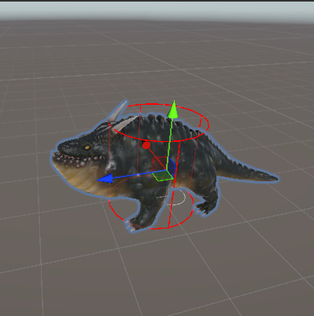 | 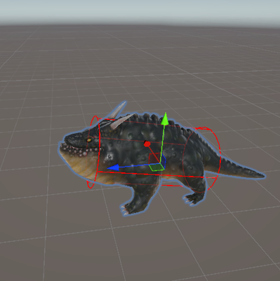 |

판정 모양은 구 → 원통 → 회전 원통 + OBB(Oriented Bounding Box: 돌아간 상자끼리 겹치는지 보는 판정) 순서로 바뀌었습니다. 위 그림의 왼쪽이 두 번째 방식, 오른쪽이 지금 방식입니다.

**① 콜라이더를 쓸 것인가, 직접 계산할 것인가**

| | [A] Unity 콜라이더 (물리 시스템) | **[B] 직접 구현한 계산 판정** ✓ |
|---|---|---|
| 얻는 것 | 별도 구현 없이 유니티 물리 시스템으로 판정 → **공격 판정의 개발 속도**가 빠름 | 물리 시스템보다 **가벼운 판정** |
| 잃는 것 | 몹마다 붙은 콜라이더 · Rigidbody를 물리 시스템이 계속 계산 | 판정 모양(`HitShape`) · 후보 범위(`maxHitReach`) · 기즈모 · 화면 중앙 조준(6.2)을 직접 만들어야 함 |

[B]를 골랐습니다. 목표가 **몹 1000마리 · 최대 4인**이었고, DGS 측정에서 병목이 몹마다 붙은 NavMeshAgent · Rigidbody · 트리거 Collider였기 때문입니다(1.2). 느린 진짜 이유는 모양이 아니라 **전부를 검사하는 것**이라, 판정을 **후보 고르기(공간 격자) + 정밀 판정(모양 계산)** 두 단계로 나눴습니다.

**② 처음에는 구(Sphere) → ③ 원통으로**

직접 계산하는 판정 중 가장 싸다고 생각한 **구**로 시작했는데, 반경 하나뿐이라 모델에 따라 몹 몸통과 피격 범위가 크게 어긋났습니다. 그래서 **높이를 따로 조절할 수 있는 원통**(위 그림 왼쪽)으로 바꾸고, 기즈모로 원통을 그려 크기를 눈으로 맞췄습니다.

```csharp
// CombatEntity.cs:19 — 필드 (맞는 쪽의 피격 원통)
[SerializeField] private float hurtRadius = 0.5f;            // 원통 반경
[SerializeField] private float hurtHalfHeight = 1f;          // 원통 절반 높이
public Vector3 HitCenter => HitPivot != null ? HitPivot.position : transform.position;

// CombatEntity.cs:84 — 구(Sphere) · 기둥(Column) 판정 (직육면체 부분 생략)
public bool IsHitBy(Vector3 center, float radius, HitShape info, float height, Quaternion rotation, float depth)
{
    Vector3 toMe = HitCenter - center;
    // ... 직육면체(Cube) 판정 생략
    float dy = Mathf.Abs(toMe.y);      // 높이차
    toMe.y = 0f;
    float dxz = toMe.magnitude;        // 바닥 평면 거리

    if (info == HitShape.Column)
        return dxz <= radius + hurtRadius && dy <= height + hurtHalfHeight;

    float outXZ = Mathf.Max(0f, dxz - hurtRadius);     // 원통 옆면 바깥으로 나간 거리
    float outY = Mathf.Max(0f, dy - hurtHalfHeight);   // 원통 위/아래 바깥으로 나간 거리
    return outXZ * outXZ + outY * outY <= radius * radius;
}
```

**④ 원통만으로는 의도에 맞지 않음 → 회전 원통 + OBB**

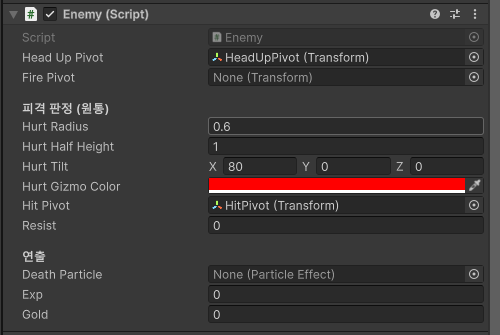

강사님께 "정확도를 높이려고 원통으로 바꿨다면 아예 OBB로 가서 정확도를 챙겨야 했고, 그게 아니라면 콜라이더 기반의 단순 점 거리 계산으로 처리했어야 했다"는 피드백을 받았습니다. 원통은 정확도를 위해 계산을 늘리면서도 회전 · 몸 기울기는 반영하지 못했기 때문입니다. 그래서 피격 원통이 **몸과 함께 돌고 기울어지게** 하고, 사각형 공격에는 **OBB 판정**을 붙였습니다.

- **회전 · 기울기** — 피격 원통의 회전 = 몸 정면 방향 + 프리팹마다 정하는 기울기(`hurtTilt`, 위 그림 오른쪽).
- **사각형(Cube) 공격 = OBB** — 공격 상자와 돌아간 내 원통이 겹치는지 검사합니다(계산 구현은 AI 활용). 직육면체는 처음에 AI가 검기 전용 판정 클래스를 따로 만들었는데, 제가 "판정 모양에 사각형을 추가해서 논타겟 투사체로 처리하면 되잖아"라고 해서 `HitShape`에 추가했습니다 🔍.
- **구 공격** — 공격 중심을 내 원통 기준으로 바꿔, 기울어진 원통에도 맞게 계산합니다.
- **기둥 공격(돌진 판정)** — 처음에는 기둥까지 눕힌 몸통 방향으로 같이 눕혀 비교해서 머리 쪽을 스치는 돌진이 빠졌습니다. 기둥은 세로 그대로 두고 눕힌 원통과 비교하도록 바꿨습니다(계산 구현은 AI 활용).

**⑤ 캡슐로 바꿀 것인가** — 원통과 캡슐은 **양 끝 모양만** 다르고 옆면 판정은 같았으며, 계산은 기둥 · 사각형 공격에서 오히려 복잡해졌습니다. 정확도를 크게 바꾼 것은 모양보다 **원통을 몸에 맞게 돌리고 눕힌 것**이라 원통을 유지했습니다.

> 지금 방식의 한계 — 계산을 단순하게 하려고 모서리 근처는 근사합니다(조금 넉넉하거나 둥글게 봄). 경사에서는 모델만 기울고(최대 30°) 피격 원통은 평지 기준 그대로입니다(7.4).

### 3.7 수평 탄과 공중 몹 🧭

AI는 "바닥 반경 + 높이차"로 판정을 통일해 수평 탄도 공중 몹을 맞히게 하자고 제안했습니다. 저는 **의도된 사항**이라고 판단했습니다.

| | [A] 높이 무시하고 맞힘 | **[B] 높이까지 판정 (공중 몹은 따로 처리)** ✓ |
|---|---|---|
| 플레이 | 공중 몹도 기본 공격으로 정리됨 | 범위 증가 · 스킬 · 타겟팅 증강으로 잡아야 함 |
| 의도 | — | 공중 몹은 **적게 나오는 대신 처리하기 귀찮게** 해서 증강 선택에 이유를 줌 |

대신 **범위 증가 스탯이 투사체 명중 반경에도 적용**되게 해서, 범위를 키우면 공중 몹도 맞힐 수 있게 했습니다.

### 3.8 맞힌 대상에게 데미지 주기

맞힌 대상에게는 `Hit`에서 데미지를 보내고, 피격 이펙트와 추가 효과를 차례로 적용합니다. 데미지는 바로 깎지 않고 `CombatSystem` 큐에 넣었다가 처리합니다.

**한 프레임에 몇 개 처리할 것인가** 🧭🤝 — 처음에는 **프레임당 10개**로 제한했습니다. 뱀서류는 한 번에 처리할 것이 많으니 **상한을 걸면 안 된다는 판단은 제가 했고**(🧭), 그 대신 어떻게 처리할지([B]와 [C])는 AI와 주고받으며 정했습니다(🤝).

| | [A] 프레임당 10개 | [B] 큐가 빌 때까지 | **[C] 프레임 시작 때 쌓인 개수만큼** ✓ |
|---|---|---|---|
| 문제 | 범위기 한 방에 50마리가 맞으면 데미지가 5프레임에 나뉨. 그 사이 풀로 돌아갔다 다시 나온 몹이 **예전 데미지를 받을 수 있음** | 폭발 몹이 연쇄로 터지면 처리 중에 이벤트가 계속 추가돼 한 프레임이 끝나지 않을 수 있음 | — |
| 결과 | — | — | 한 번에 맞은 것은 같은 프레임에 들어가고, 처리 중에 생긴 연쇄는 다음 프레임으로 |

**스턴 같은 추가 효과는 컴포넌트로** 🔍 — AI는 처음에 스턴을 `HitUnit`에 바로 넣었는데, 진화 무기 두 개(전격 · 빙결 마법)만 쓰는 효과라 그러면 모든 투사체에 필드가 생깁니다. 제가 "스턴은 인터페이스로 다른 기능으로 빼서 적용하는 게 맞다"고 판단해 투사체 옆에 붙이는 컴포넌트(`IHitEffect`)로 뺐고, 둔화 · 화상이 늘어도 부모는 그대로입니다.

- 전체 코드: [CombatSystem.cs](https://github.com/KooHoo-Dev/3rd_3D_1-3D-Project-NaJungWon/blob/main/Assets/10.%20Scripts/CombatSystem/CombatSystem.cs)

---

## 4. 증강 카드와 스탯

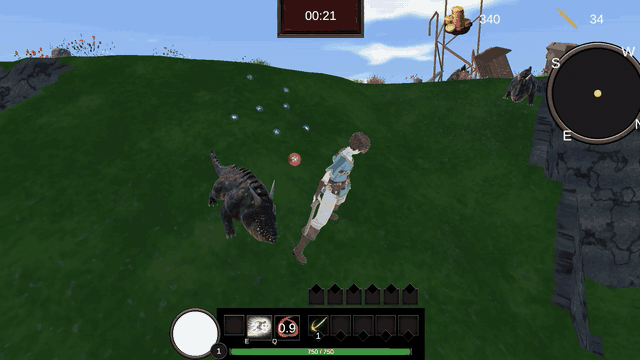

레벨업하면 게임이 멈추고 카드 3장 중 1장을 고릅니다. 무기를 새로 얻거나 레벨을 올리고 능력치를 키우며, 무기 만렙과 짝이 되는 능력치를 모으면 진화(Arousal)합니다. 무기 5칸 · 능력치 6칸 슬롯과 진화 규칙은 DGS의 규칙을 그대로 가져오고 **구조만** 바꿨습니다.

게임 루프(1.1)의 「레벨업 → 증강 카드 선택」이 이 장입니다. 수평 공격으로 잡기 어려운 공중 몹처럼, 몹 구성이 어떤 카드를 고를지의 이유가 됩니다(3.7).

진화 카드는 레벨업 카드가 아니라 **상자 카드**(`BuildChestOffers`)로만 나오도록 설계했고, 상자는 자석 · 회복 구조물처럼 F키로 여는 구조물로 넣을 예정입니다(지금은 에디터 메뉴로만 시험).

### 4.1 증강 데이터는 어디서 오나

증강 데이터는 **표에서 읽은 값이 보유 증강(`OwnedAugment`)을 거쳐 무기에 들어가고, 능력치 · 상점 · 버프는 `PlayerStatHandler` 한 곳에서 합쳐집니다**.

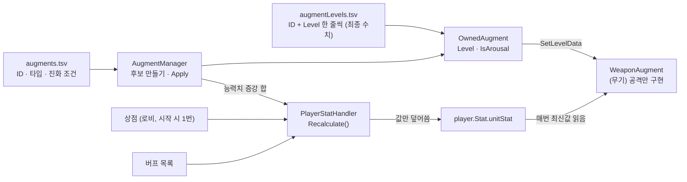

TSV 10종은 `TableLoader`가 게임 시작 때 **한 번만** 읽어 Def로 보관하고(씬마다 다시 읽지 않음), 증강은 그중 두 표를 씁니다. 무기 증강은 모두 `WeaponAugment`를 상속하고 공격만 구현하며(자식 다섯은 3.2 표), 패시브는 `PassiveSkill`을 상속합니다(`KillHealPassive`).

**레벨 수치를 어떻게 적을까** 🤝

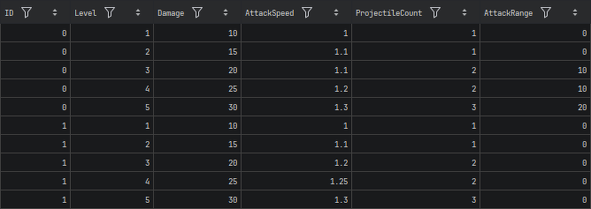

처음에는 DGS처럼 무기 프리팹 인스펙터에 **레벨당 증가량** 목록을 두었습니다. 제가 "레벨마다 한 줄씩 두고 `level - 1`로 꺼내자"고 제안했고, AI가 **증가량이 아니라 그 레벨의 최종 수치**를 적고 표를 기본 정보(`augments`)와 레벨 수치(`augmentLevels`)로 나누자고 보완했습니다. 최대 레벨은 상수가 아니라 **줄 수**로 정해집니다.

| | [A] ScriptableObject (DGS) | **[B] TSV 표** ✓ |
|---|---|---|
| 장점 | 인스펙터에서 바로 수정 | **TSV 표 한 파일에서 모든 무기 수치를** 비교 · 수정 |
| 단점 | 무기가 늘수록 에셋을 하나씩 열어야 함 | 열이 빠지거나 이름이 틀리면 **오류 없이 0으로 읽힘** (5.3) |

표를 쓸 때는 증강 ID를 구간으로 나눠 적습니다. 구간은 표를 쓸 때의 규칙이고, 전용 무기 판정은 코드에서 `OwnerUnitID` 열로 합니다.

| 증강 ID | 구분 | 예 |
|---|---|---|
| 0 ~ 99 | 직업 전용 무기 (`OwnerUnitID` 열 = 유닛 ID) | 0 검기(전사), 1 전격(마법사) |
| 100 ~ 199 | 공용 무기 | 100 바운스, 101 빛의 화살, 102 빙결 마법 |
| 200 ~ 299 | 능력치 | 200 공격력 ~ 204 투사체 |
| 300 ~ | 특수 (후보가 없을 때) | 300 회복 25%, 301 골드 150 |

### 4.2 레벨업 카드를 어떻게 만들 것인가 🤝

카드 한 장은 보여 줄 내용만 담은 데이터(`AugmentOffer`)이고, 카드 UI(`AugmentCardUI`)는 받은 `AugmentOffer`를 그리기만 합니다.

```csharp
// AugmentManager.cs:17 — 카드 한 장에 담길 정보
public class AugmentOffer
{
    public OfferKind Kind;       // New / LevelUp / Arousal / Special
    public AugmentDef Def;
    public OwnedAugment Target;  // LevelUp, Arousal일 때 대상이 되는 보유 증강
}

// AugmentManager.cs:60 — 레벨업했을 때 보여줄 카드 (새 증강 + 레벨업. 진화는 상자에서만)
public List<AugmentOffer> BuildLevelUpOffers(int cardCount)
{
    List<AugmentOffer> candidates = new List<AugmentOffer>();
    AddLevelUpOffers(candidates);
    AddNewOffers(candidates);   // 이미 있음 · 다른 캐릭터 전용 · 슬롯이 꽉 참이면 건너뜀

    // 무기, 능력치 증강을 전부 고르고 만렙까지 찍었으면 특수카드만
    if (candidates.Count == 0)
    {
        AddSpecialOffers(candidates);
        cardCount = specialCardCount;
    }

    // 후보가 cardCount보다 적으면 후보 수만큼만 (3 -> 2 -> 1)
    return PickRandom(candidates, cardCount);
}
```

DGS에서는 카드 한 장이 씬에 놓인 카드 오브젝트(`CardInfo`)였고, 카드가 강화 단계 · 진화 여부 · 만든 무기를 직접 들고 **카드 스크립트 안에서** 무기 생성 · 강화 · 진화까지 처리했습니다. 증강 데이터를 ScriptableObject에서 TSV로 옮기면서(4.1) 레벨 수치와 진화 조건 · 진화 설명도 표로 옮겼고, 그에 맞춰 카드 구조도 AI와 함께 바꿨습니다.

| | DGS | PROJECT3D |
|---|---|---|
| 카드 한 장 | 씬의 카드 오브젝트(`CardInfo`)가 강화 단계 · 진화 여부 · 무기를 들고 직접 처리 | 보여 줄 내용만 담은 데이터(`AugmentOffer`: 종류 · 증강 정의 · 대상). 레벨 · 진화 상태는 보유 증강(`OwnedAugment`)이, 적용은 `Apply` 한 곳(4.3)이 맡음 |
| 데이터 | 카드마다 ScriptableObject (단계별 증가량 · 진화 짝) | `augments.tsv`(진화 조건 `NeedArousal` · 진화 설명) + `augmentLevels.tsv`(레벨별 최종 수치) |
| 후보 고르기 | 무기 · 능력치 슬롯이 찼는지에 따라 4가지 경우로 나눠 뽑기 | 레벨업 후보 + 새 증강 후보를 한 목록에 모아 겹치지 않게 뽑기. 슬롯이 찼거나 다른 직업 전용인 증강은 새 증강 후보에서만 뺌 |
| 후보가 없을 때 | 회복 · 골드 카드 2장 | 같음 |
| 진화 카드 | 레벨업 후보에 섞여 나옴 | 레벨업과 분리, 상자 카드(`BuildChestOffers`)로만 |

- 전체 코드: [AugmentManager.cs](https://github.com/KooHoo-Dev/3rd_3D_1-3D-Project-NaJungWon/blob/main/Assets/10.%20Scripts/Augment%20And%20Card/AugmentManager.cs) · [OwnedAugment.cs](https://github.com/KooHoo-Dev/3rd_3D_1-3D-Project-NaJungWon/blob/main/Assets/10.%20Scripts/Augment%20And%20Card/OwnedAugment.cs)

### 4.3 고른 카드를 어떻게 적용하나

카드 종류만 나누고, 적용한 뒤에는 능력치를 처음부터 다시 합칩니다.

```csharp
// AugmentManager.cs:42 — 필드
public event Action OnAugmentChanged;

// AugmentManager.cs:108
public void Apply(AugmentOffer offer)
{
    switch (offer.Kind)
    {
        case OfferKind.New:     AddAugment(offer.Def);   break;
        case OfferKind.LevelUp: offer.Target.LevelUp();  break; // → Weapon.SetLevelData
        case OfferKind.Arousal: offer.Target.Arousal();  break; // isArousal = true → 무기별 분기
        case OfferKind.Special: ApplySpecial(offer.Def); break;
    }
    RefreshAbilityStat();          // 능력치 증강 합 → PlayerStatHandler.Recalculate()
    OnAugmentChanged?.Invoke();    // HUD 슬롯 갱신
}
```

**진화는 어떻게 바꿀까** 🤝 — 지금은 다섯 무기 모두 `isArousal` 분기로 수치 · 효과만 바꿉니다. 진화하면 공격 · 피격 이펙트도 바뀔 예정이라, TSV에 진화 증강을 따로 두어 지금 증강을 진화 증강으로 교체하는 방식으로 바꿀 예정입니다(상자를 아직 열 수 없어 지금 진화 데이터는 더미).

**공격 속도 단위를 무엇으로 통일할까** 🧭 — 같은 `AttackInterval`이 몹에서는 "초당 횟수", 플레이어에서는 "+%", 무기에서는 "초"로 세 가지 뜻이었습니다. 롤처럼 "공속 2.5 = 초당 2.5번"으로 **유닛 · 몹 · 무기 전체를 `AttackSpeed`로 통일**했고, 스킬 쿨타임만 표에 초(`Cooldown`)로 두고 **공속이 오른 비율**만큼 줄입니다. AI는 공속만 고르게 될 수 있다고 우려했지만, 쿨감 효과를 공속에 묶는 쪽으로 제가 정했습니다(밸런스는 7.4 과제).

**만들며 생긴 문제 — 공속을 통일한 뒤 무기 속도가 뒤집힘.** 이름만 바꾸고 표 값(간격)을 그대로 둬서, 레벨이 오를수록 무기가 느려지고 상점 공속 +10%에 무기가 11배 빨라졌습니다. 값을 1 ÷ 간격으로 바꾸고 곱하기 스탯에 공속을 넣어 고쳤습니다 🤝. 문서를 쓰며 기본 공속 0.8인 마법사의 쿨타임이 표보다 길던 것(10초 → 12.5초)도 찾아, 공속이 오른 비율로 나누도록(`GetAttackSpeedRate`) 고쳤습니다.

### 4.4 스탯을 어떻게 합칠 것인가

출처별로 따로 보관하고, 바뀔 때마다 처음부터 계산합니다.

<table style="table-layout:fixed;width:100%">
<colgroup><col style="width:63%"><col style="width:37%"></colgroup>
<thead><tr><th>코드 — 출처별로 보관하고 처음부터 다시 계산</th><th>인스펙터 — 플레이 중 <code>PlayerStatHandler</code></th></tr></thead>
<tbody><tr><td style="vertical-align:top">

<pre><code class="language-csharp" style="font-size:12px;padding:14px">// PlayerStatHandler.cs:25 — 출처별 스탯
public StatClass ChrStat = new StatClass();
public StatClass AbilityStat = new StatClass();
public StatClass SkillStat = new StatClass();
public StatClass ShopStat = new StatClass();
public StatClass BuffStat = new StatClass();

// PlayerStatHandler.cs:94 Recalculate() 안 (일부)
// 2. 더하기 단계 : 캐릭터 + 능력증강 + 스킬
StatClass sum = new StatClass();
sum.Add(ChrStat);
sum.Add(AbilityStat);
sum.Add(SkillStat);

StatClass final = player.Stat.unitStat;
// 3. 스탯마다 곱할지 더할지 정해서 계산
for (int i = 1; i &lt; (int)StatType.Count; i++)
{
    StatType type = (StatType)i;
    float baseValue = sum.Get(type);
    float shop = ShopStat.Get(type);
    float buff = BuffStat.Get(type);
    // 수치형 : 기본값 × (1 + 상점%) × (1 + 버프%)
    if (IsMultiplyStat(type))
        final.Set(type, baseValue * Rate(shop) * Rate(buff));
    // %형/개수 : 그냥 더한다
    else
        final.Set(type, baseValue + shop + buff);
}
</code></pre>

</td><td style="vertical-align:top">


</td></tr></tbody>
</table>

**상점 강화는 더할까, 곱할까** 🧭 — 상점 스탯은 로비에서 사고 **게임 시작 때 한 번만** 반영합니다.

| 스탯 | 방식 | 이유 |
|---|---|---|
| 체력 · 공격력 · 공속 · 이속 | 곱하기 | 상점 강화가 증강 성장과 함께 커지도록 |
| **방어력** | **곱하기** | DGS처럼 능력치 증강으로 얻은 방어력까지 상점 배율이 붙어야 상점 강화의 의미가 있다고 판단. 크게 오르는 만큼 받는 데미지는 빼기가 아니라 `데미지 × 100 / (100 + 방어력)` 비율식으로 바꿀 예정 (7.4) |
| 치명 · 범위 등 % 스탯, 체력 재생(초당 회복량), 투사체 개수 | 더하기 | %는 곱하면 단위가 섞이고, 재생 · 개수는 작은 고정 수치라 더하는 편이 예측하기 쉬움 |

그 밖에 합칠 때 정한 규칙은 셋입니다.

- **최대 체력이 늘어도 현재 체력은 채우지 않음** 🔍 — AI는 "최대 체력이 늘면 현재 체력도 채워야 한다"며 빠진 버그라고 두 번 넣으려 했지만, 체력 증강이 회복 수단이 되지 않도록 제가 빼기로 정했습니다.
- **버프는 목록으로** 🤝 — 제 처음 생각은 버프를 받을 때 더하고 끝날 때 빼는 것이었는데, AI가 **빼는 값이 어긋나거나 순서에 따라 결과가 달라지는** 문제를 짚어, 버프를 목록으로 들고 있다가 바뀔 때마다 처음부터 다시 계산하게 했습니다.
- **4인 멀티를 위해 스탯은 플레이어마다** — 스탯 원본(표의 캐릭터 스탯)은 복사해서 씁니다(참조를 넘기면 같은 캐릭터를 고른 플레이어끼리 스탯이 섞임). 스탯 계산기(`PlayerStatHandler`)도 싱글톤에서 **플레이어 프리팹의 컴포넌트**로 바꿨습니다.

- 전체 코드: [PlayerStatHandler.cs](https://github.com/KooHoo-Dev/3rd_3D_1-3D-Project-NaJungWon/blob/main/Assets/10.%20Scripts/Player/PlayerStatHandler.cs)

### 4.5 공격 수치는 어디서 계산할 것인가 🔍

공격 수치의 계산식은 **공통 부모 `UnitAttack`에만** 두고, 무기(자식)는 자기 변수만 정한 뒤 부모의 함수를 부릅니다. 아래는 바운스 무기의 예로, 인스펙터도 **부모의 칸(데미지 계수) · 무기 공통 `WeaponAugment`의 칸(증강 설정) · 이 무기만의 칸(무기 설정 · 진화 설정)**으로 나뉩니다.

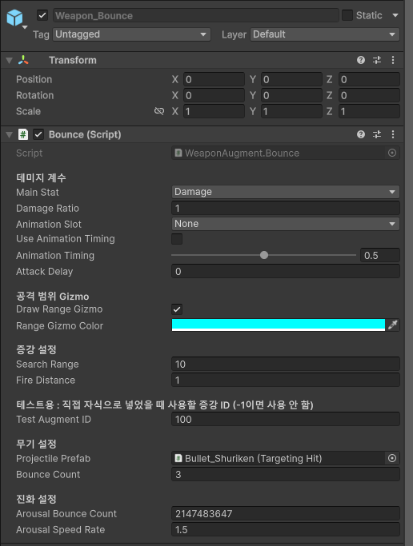

<table style="table-layout:fixed;width:100%">
<thead><tr><th>부모 — <code>UnitAttack</code> (계산식)</th><th>자식 — <code>WeaponAugment</code> → <code>Bounce</code> (자기 변수만)</th></tr></thead>
<tbody><tr><td style="vertical-align:top">

<pre><code class="language-csharp" style="font-size:12px;padding:14px">// UnitAttack.cs:27 — 데미지 계수
[Header("데미지 계수")]
[SerializeField]
protected StatType mainStat
    = StatType.Damage;
[SerializeField]
protected float damageRatio = 1f;

// UnitAttack.cs:112 — 데미지
protected int GetDamage()
{
    float damage = AttackStat.Damage
        + OwnerStat.Get(mainStat)
        * damageRatio;
    return Mathf.RoundToInt(damage);
}

// UnitAttack.cs:41 — 범위 배율
protected float RangeRate =&gt; 1f
    + (AttackStat.AttackRange
    + OwnerStat.AttackRange) / 100f;
</code></pre>

</td><td style="vertical-align:top">

<pre><code class="language-csharp" style="font-size:12px;padding:14px">// WeaponAugment.cs:9 — 무기 공통
[Header("증강 설정")]
[SerializeField]
protected float searchRange = 10f;

// WeaponAugment.cs:71 — 레벨 수치를 부모로
public void SetLevelData(
    AugmentLevelDef data)
{
    levelData = data;
    SetAttackStat(data.AugmentLevelStat);
    OnLevelChanged();
}

// WeaponAugment.Bounce.cs:9 — 바운스만
[Header("무기 설정")]
[SerializeField]
private TargetingHit projectilePrefab;
[SerializeField]
private int bounceCount = 3;

// WeaponAugment.Bounce.cs:19 — 공격
protected override void Attack()
{
    Enemy target = FindTarget(searchRange);
    if (target == null) return;

    int count = bounceCount
        + GetExtraProjectileCount();
    if (isArousal)
        count = arousalBounceCount;

    HitUnit hit = FireFromBody(
        projectilePrefab,
        GetFlatDirectionTo(target),
        target, GetDamage());
    // ... 튕길 횟수 · 범위 넘기기 (생략)
}
</code></pre>

</td></tr></tbody>
</table>

- 전체 코드: [UnitAttack.cs](https://github.com/KooHoo-Dev/3rd_3D_1-3D-Project-NaJungWon/blob/main/Assets/10.%20Scripts/CombatSystem/Attack/UnitAttack.cs) · [WeaponAugment.cs](https://github.com/KooHoo-Dev/3rd_3D_1-3D-Project-NaJungWon/blob/main/Assets/10.%20Scripts/Augment%20And%20Card/WeaponAugment/WeaponAugment.cs) · [WeaponAugment.Bounce.cs](https://github.com/KooHoo-Dev/3rd_3D_1-3D-Project-NaJungWon/blob/main/Assets/10.%20Scripts/Augment%20And%20Card/WeaponAugment/WeaponAugment.Bounce.cs)

**이렇게 나누기까지** — 처음 설계에서 두 가지를 바꿨습니다.

- **계산식은 주인이 아니라 공통 부모로** — 제가 처음에는 "상위인 Owner에 넣어서 Owner에서 가져오게" 하자고 했는데, AI가 **주인은 하나인데 무기는 여러 개이고 무기마다 수치가 다르다**는 점을 짚었습니다. 그래서 주인은 최종 스탯만 들고, `UnitAttack`이 쓸 때마다 주인 스탯을 읽어 계산합니다(필드에 저장하지 않아 능력치 증강이 바로 반영됨). 무기 · 스킬 · 몹이 이 계산식을 같이 쓰고, 메인 스탯을 무기마다 정할 수 있어 방어력 · 체력으로 데미지를 내는 탱커형 무기도 넣을 수 있습니다.
- **탐색 범위는 투사체가 아니라 무기로** 🔍 — 처음 코드는 대상을 찾는 범위를 투사체가 들고 있었는데, 제가 "상위 증강에서 범위를 찾고 범위에 있으면 쏴야 하는데 순서가 거꾸로"라고 짚어 `searchRange`를 무기로 옮겼습니다. 플레이어의 공격 범위 스탯은 모든 무기의 사거리 · 투사체 크기 · 명중 반경을 함께 키우는 배율(`RangeRate`)로 정리했습니다.

---

## 5. 몹 소환과 경험치


시간이 지날수록 몹이 계속 나오고, 정해진 시각에는 무리가 한꺼번에 몰려옵니다. 처치한 몹은 경험치 구를 떨어뜨리고, 맵에는 회복 · 자석 구조물이 솟아오릅니다.

목표한 경험(1.1)에서 「공중 몹과 기믹이 한곳에서 버티지 못하게 막는」 부분입니다. 정해진 시각에 몰려오는 무리와 공중 몹 · 기믹 때문에, 플레이어는 한자리에 머무르지 않고 고원 · 비탈 · 장애물을 오가며 버텨야 합니다.

| 시스템 | 방식 | 표 |
|---|---|---|
| 상시 소환 | 시간 구간마다 몹 종류 · 주기 · 수, **최소 / 최대 생존 수** 유지 | `spawnRules.tsv` (구간 18개) |
| 이벤트 소환 | 특정 시각에 몹 무리 (예: 600초에 지상 몹 150 · 돌진 40 · 공중 40 · 포격 15) | `waves.tsv` (23줄) |
| 시간 강화 | 분마다 몹 체력 ×1.2, 공격력 ×1.15 (복리) | `WaveManager` |
| 경험치 구 | 물리 없이 직접 이동 · 낙하 · 흡수, 큰 구슬 확률은 분당 +2% (최대 80%) | `levels.tsv` (Lv 1~40) |
| 구조물 | 회복(최대 체력 30%) · 자석(모든 구 흡수), F키 1.5초 홀드 | `structures.tsv` |

### 5.1 몹이 소환되고 경험치 구가 되기까지

몹은 **땅에서 솟아오르는 1초 동안은 명부에 등록되지 않고**, 죽으면 static 이벤트로 경험치 구가 나옵니다.

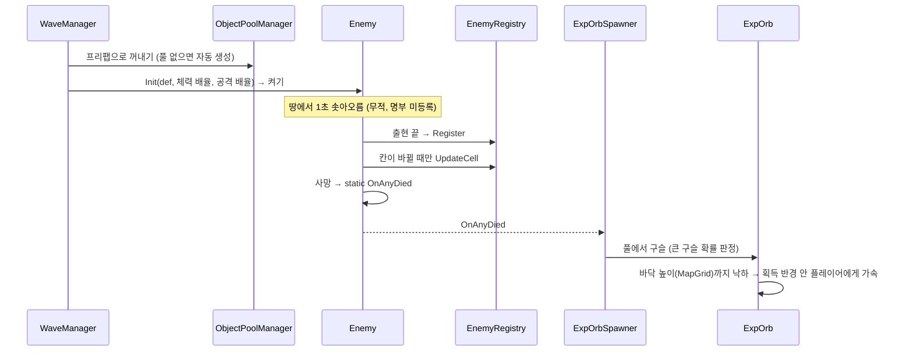

몹 · 투사체 · 이펙트 · 경험치 구 · 구조물은 `ObjectPoolManager`가 **프리팹 이름 키**로 풀링합니다(풀링: 다 쓴 오브젝트를 지우지 않고 꺼 두었다가 다시 쓰는 방식). 프리팹 종류가 너무 많아 미리 등록하지 않고 **처음 요청할 때 풀을 자동으로 만들게** 했습니다. 사망 효과(`EnemyDeath` → `Explode`)와 구조물(`Structure` → `HealStructure` · `MagnetStructure`)도 부모를 하나 두고 종류마다 상속합니다.

### 5.2 몹을 어떤 방식으로 소환할 것인가 🤝

몹 소환은 표 두 개로 정합니다. **상시 소환**(`spawnRules.tsv`)은 시간 구간마다 정한 몹을 주기마다 내보내며 살아 있는 수를 최소 · 최대 사이로 맞추고, **이벤트 소환**(`waves.tsv`)은 정한 시각에 정한 몹을 정한 수만큼 한꺼번에 내보냅니다.

| 상시 소환 | 이벤트 소환 |
|---|---|
| 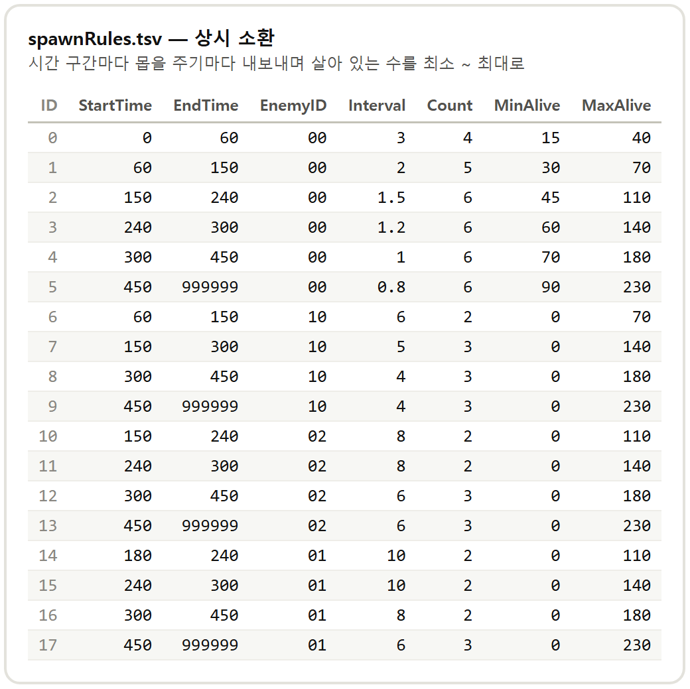 | 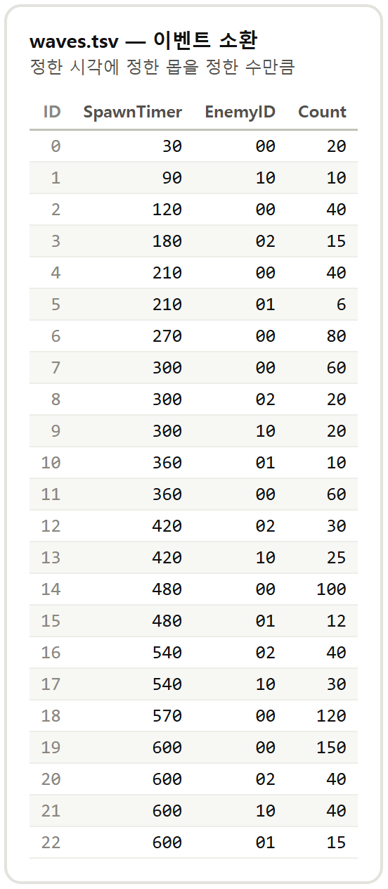 |

처음에는 이벤트 소환만 있었는데, 시간마다 몹 수를 일일이 적으면 표를 채우고 조절하기가 번거로울 것 같았습니다. 제가 "뱀서류는 특정 주기마다 특정 몹을 소환하는 코드가 따로 있지 않나"라고 묻고 AI가 두 방식을 비교한 뒤, **둘을 섞어 쓰기로** 정하고 웨이브 반복은 없앴습니다. 시간 강화는 플레이어 성장이 몹 성장을 따라잡지 않게 더하기가 아니라 곱하기로 했습니다.

**만들며 생긴 문제 — 최대 몹 수가 적용되지 않고 상시 소환이 끝없이 나옴.** 플레이하다가 제가 "최대수가 전혀 적용이 안 되는 것 같다"고 발견했습니다. `EnemyRegistry.UpdateCell`이 칸을 옮길 때 `Unregister`(몹 수 −1)를 부르고 다시 더하지 않아, **몹이 움직일수록 몹 수가 줄어** 최소 생존 수 조건이 항상 참이 되어 매 프레임 소환하고 있었습니다. 칸을 옮길 때는 이전 칸 리스트에서만 빼고 몹 수는 건드리지 않게 고쳤습니다.

```csharp
// EnemyRegistry.cs:20 — 필드
private static readonly Dictionary<Vector2Int, List<Enemy>> cells = new Dictionary<Vector2Int, List<Enemy>>(); // 칸 좌표 → 그 칸에 있는 몹들

// EnemyRegistry.cs:69
public static void UpdateCell(Enemy enemy)
{
    Vector2Int now = ToCell(enemy.transform.position);
    if (now == enemy.RegistryCell) return; // 같은 칸이면 할 일 없음

    // Unregister(enemy) → 이전 칸 리스트에서만 빼기
    //  Unregister는 몹 수(Count)도 줄여서, 칸을 옮길 때마다 Count가 1씩 줄었다
    if (cells.TryGetValue(enemy.RegistryCell, out List<Enemy> oldList)) oldList.Remove(enemy);
    enemy.RegistryCell = now;
    GetOrCreateCell(now).Add(enemy);
}
```

같은 함수(`Unregister`)를 "완전히 빼기"와 "칸만 옮기기"에 같이 쓰면, 함수가 하는 부수 효과(몹 수 감소)까지 따라옵니다. 이름이 같은 일을 하는지 확인하고 재사용해야 한다는 것을 배웠습니다. 이벤트 소환에서도 `waves.tsv`의 ID가 모두 0이라 Dictionary에서 덮어써 웨이브 3개가 빠진 적이 있어, ID는 0부터 연속 · 시간 순으로 적는 표 규칙을 두었습니다(위 그림의 ID 열).

- 전체 코드: [WaveManager.cs](https://github.com/KooHoo-Dev/3rd_3D_1-3D-Project-NaJungWon/blob/main/Assets/10.%20Scripts/Enemy%20And%20Wave/WaveManager.cs) · [EnemyRegistry.cs](https://github.com/KooHoo-Dev/3rd_3D_1-3D-Project-NaJungWon/blob/main/Assets/10.%20Scripts/Enemy%20And%20Wave/EnemyRegistry.cs)

### 5.3 경험치 구를 어떻게 떨굴 것인가

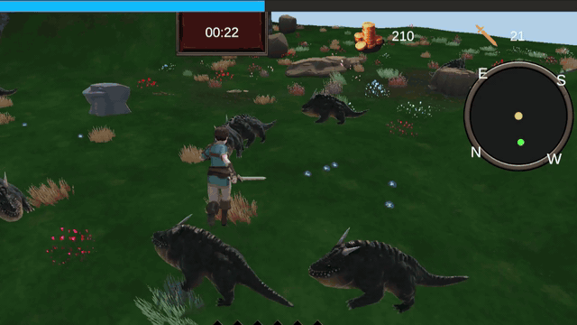

[DGS](../04-dgs/기술문서.md)에서는 경험치 구마다 비키네마틱 `Rigidbody`와 트리거 Collider를 붙여 처리했습니다. 구가 쌓이면 프레임이 떨어졌고, 풀에서 재사용하는 구에 보너스 배율이 계속 곱해지는 버그도 있었습니다(DGS 문서 5.2 · 8.2). 경험치 구는 바닥에 떨어졌다가 플레이어에게 끌려오기만 하면 되므로 물리가 필요 없다고 보고, 이번에는 **물리 없이 코드로 직접** 떨어뜨리고 끌어당겼습니다.

| | DGS | PROJECT3D |
|---|---|---|
| 구성 | 구마다 비키네마틱 `Rigidbody` + 트리거 Collider | 물리 없음, `Update`에서 직접 이동 |
| 낙하 · 흡수 | `Rigidbody` 물리로 처리 | 생길 때 받은 바닥 높이(`landY`)까지 떨어지고, 획득 반경 안 플레이어가 생기면 점점 빨라지며 따라가다 충분히 가까워지면 획득 |
| 구가 쌓였을 때 | 자석으로 구를 한 번에 회수하자 몹 수는 비슷한데 **27.8 → 44.4 FPS** (빌드 측정) | 같은 몹 수(600~799마리)에서도 구가 500개 이상이면 평균 33.3 FPS, 50개 미만이면 97.0 FPS (빌드 측정, 7.2) |
| 경험치 값 | 풀에서 재사용하는 구 자체에 배율을 곱해 값이 누적되는 버그 | 꺼낼 때마다 `Init(exp, landY)`로 값을 새로 넣음 |

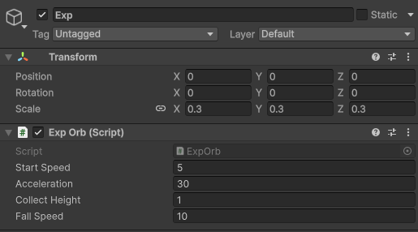

```csharp
// ExpOrb.cs:15 — 필드 (일부, 인스펙터 값은 위 그림)
[SerializeField] private float startSpeed = 5f;     // 빨려 들어가기 시작할 때 속도
[SerializeField] private float acceleration = 30f;  // 초당 속도 증가량 (점점 빨라져서 결국 따라잡는다)
private Player target; // 따라가는 플레이어 (null = 바닥에 가만히 있음)

// ExpOrb.cs:138 — 따라가며 점점 빨라지다가, 충분히 가까우면 획득
private void MoveToTarget()
{
    float delta = WorldClock.Instance.DeltaTime;
    speed += acceleration * delta;

    Vector3 goal = target.transform.position + Vector3.up * collectHeight;
    transform.position = Vector3.MoveTowards(transform.position, goal, speed * delta);

    if ((goal - transform.position).sqrMagnitude <= CollectDistance)
    {
        ExpManager.Instance.AddExp(exp, target);
        ReturnToPool();
    }
}
```

- **바닥은 격자 높이로** 🔍 — 공중 몹이 죽으면 구가 공중에 뜨는 문제가 있었습니다. AI는 아래로 레이를 쏘자고 했지만, 제가 "생성됐을 때 격자 지형 높이를 확인해서 현재보다 낮으면 거기까지 떨어지면 된다"고 해서 **레이 없이** `Tile.GroundHeight`까지 떨어뜨렸습니다.
- **큰 구슬 확률만, 시간당 배율은 빼기** 🤝 — 메가봉크처럼 큰 구슬을 일정 확률로 떨어뜨리고 확률은 시간이 지날수록 오르게 했습니다. "시간당 경험치 배율"까지 넣으려다, **큰 구슬 확률 증가가 이미 평균 경험치를 올리는 효과**라 변수가 4개가 되면 원인을 추적하기 어렵다고 보고 빼고, 대신 최대 확률 상한을 두었습니다. 확률은 몹이 아니라 Spawner가 판정합니다(몹은 경험치 양만 앎).
- **만들며 생긴 문제** — 경험치 구와 골드가 나오지 않은 적이 있었는데, `enemies.tsv`에 Exp · Gold 열이 없어 **오류 없이 0으로 읽히고** 있었습니다(4.1의 TSV 단점). 열을 추가해 고쳤습니다.

- 전체 코드: [ExpOrb.cs](https://github.com/KooHoo-Dev/3rd_3D_1-3D-Project-NaJungWon/blob/main/Assets/10.%20Scripts/Exp/ExpOrb.cs)

### 5.4 경험치 · 골드 · 킬 나누기 (멀티 대비) 🧭

| 항목 | 규칙 |
|---|---|
| 경험치 | 모든 플레이어가 **바 하나를 공유**(합산), 동시에 레벨업 |
| 골드 · 킬 | **막타 친 플레이어만**, 본인의 골드 획득 증가율 적용 |
| 골드 계산 위치 | `Player.AddGold` 한 곳 (몹 처치 · 골드 증강 두 경로 공통) |

**언제 저장할까** 🧭 — 획득할 때마다 저장 → 끝날 때 저장 → 보스 처치 후 저장으로 네 번 바꾼 끝에, **씬을 이동할 때(로비 ↔ 인게임), 인게임 옵션 창의 "게임 종료", 인게임이 아닐 때 종료하면** 저장하는 것으로 정했습니다. 인게임 도중 비정상 종료하면 그 판 골드는 버립니다. 매 킬마다 저장하면 몹 1000마리 기준 파일 쓰기가 너무 잦기 때문입니다.

---

## 6. 그 밖의 기능

핵심 흐름(2~5장)에는 들어가지 않지만, 만들면서 고민하고 정한 기능들입니다. 셋은 짧은 절로, 나머지는 6.4 표에 한 줄씩 정리했습니다.

### 6.1 게임만 멈추는 게임 시계 🧭

| | [A] `Time.timeScale = 0` | **[B] 게임 시계 `WorldClock`** ✓ |
|---|---|---|
| 방식 | 엔진 전체 시간을 멈춤 | 게임 로직만 자체 배율이 곱해진 시간을 씀 |
| 장점 | 한 줄로 끝남 | 멈출 대상이 분명함. 감속(연출) 단계도 같은 방식 |
| 단점 | UI 연출까지 멈춤. **멀티에서는 한 사람이 멈출 수 없음** | 모든 `deltaTime`을 바꿔야 하고, Animator · 파티클은 따로 맞춰야 함 |

**[최종 결정]** [B]. DGS에서 `timeScale`로 멈추면서 "UI만 움직이고 전투는 멈춤"을 따로 제어하기 어려웠고, `timeScale`을 건드리면 UI 연출까지 같이 멈춥니다. 그래서 게임 로직만 따로 멈추는 게임 시계를 두었습니다. 배속은 쓸 일이 거의 없지만 **감속은 연출에 쓸 계획**이라 단계표로 두었습니다.

```csharp
// WorldClock.cs:24 — 0번 정지, 1번 보통, 2번 감속(연출), 3번 배속
[SerializeField] private float[] timeScales = { 0f, 1f, 0.3f, 2f };
public int ScaleStep { get; private set; } = DEFAULT_STEP; // 지금 몇 번 단계인지
public float Scale => timeScales[ScaleStep];
// Time.timeScale은 건드리지 않기로 했으므로, 그 값과 상관없이 흐르는 시계
public float DeltaTime => Time.unscaledDeltaTime * Scale;
```

게임 로직은 모두 `WorldClock.Instance.DeltaTime`을 씁니다. 카드 선택 창 · 사망 연출 · 옵션 창은 `WorldClock.Pause()`로 게임만 멈추고, UI 연출은 실제 시간으로 움직입니다. DOTween도 `DOTween.timeScale`을 게임 배율에 맞춥니다.

- 전체 코드: [WorldClock.cs](https://github.com/KooHoo-Dev/3rd_3D_1-3D-Project-NaJungWon/blob/main/Assets/10.%20Scripts/Time/WorldClock.cs)

### 6.2 3인칭 조작과 화면 중앙 조준

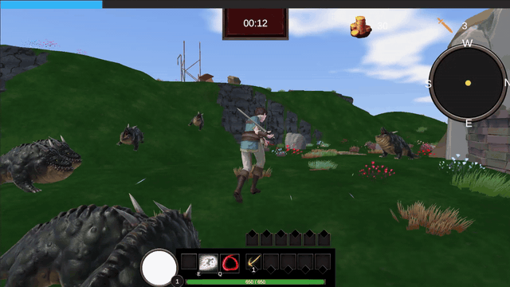

캐릭터 뒤에서 보는 3인칭 시점이고, 점프로 고원을 오르내리며, 모든 공격 · 스킬은 화면 정중앙을 기준으로 조준합니다.

| 기능 | 방식 |
|---|---|
| 점프 · 낙하 | 이동 컨트롤러는 **사실만 이벤트로**(점프 시작 · 낙하 시작 · 착지), 판단은 `PlayerController` |
| 낙하 데미지 | 공중 **최고점 − 착지점** 기준, 15m 넘으면 1m당 5 (고원 18m에서 뛰어내리면 데미지) |
| 스킬 조준 | 모든 스킬은 화면 정중앙 기준. 조준 스킬은 누르고 있는 동안 줌인 카메라 |
| 공격 시점 | 애니메이션 진행률(0~1) 또는 초 단위 지연 후 발사, 시점 값은 공격 프리팹 인스펙터 |

- **접지 · 낙하 판단은 컨트롤러 밖으로** 🤝 — AI가 처음에는 이동 컨트롤러 안에 "떨어지는 중" 판단을 넣었는데, 제가 역할이 섞였다고 짚었습니다. 이동 컨트롤러(`CharacterController3D`)는 **사실**(접지 여부 · 수직 속도)만 이벤트로 알리고, 판단(애니메이션 · 낙하 데미지)은 `PlayerController`가 합니다. 반대로 낙하 데미지 기준은 AI에게 정정받아, 제가 말한 "떨어지기 시작한 좌표 − 착지 좌표"(점프해 올라설 때 음수가 됨) 대신 **공중 최고점 − 착지점**으로 바꿨습니다.
- **조준 카메라는 Cinemachine 2대 + Priority** 🤝 — 처음에는 조준 카메라 오브젝트를 켜고 끄는(`SetActive`) 방식이었는데, 제가 "굳이 카메라 2개를 써야 하나"를 묻고 Priority 전환으로 바꾸자고 했습니다(블렌드가 자동, 인스펙터로 조절). 줌인 후 발사 위치가 틀어지는 문제가 있었는데, 발사 시점에 화면 중앙 레이를 계산하면 그때 카메라가 이미 복귀 중이었기 때문이라 **스킬을 쓴 순간(조준 스킬은 키를 뗀 순간)의 레이를 저장해** 발사에 썼습니다.
- **콜라이더 없는 몹을 화면 중앙으로 조준하기** 🔍 — 제가 "몹은 콜라이더가 없어서 화면 중앙 레이에 맞지 않으면 아무 의미 없는 거 아닌가"를 짚었습니다. 몹에 콜라이더를 붙이는 대신 **레이를 따라 두께 0인 직육면체를 눕혀 공간 격자 판정(`FindHitTargets`)에 그대로 넣고** 가장 가까운 몹의 몸 중심을 노리게 했습니다(40m까지, 지형 레이가 맞은 거리 안만 → 벽 뒤 몹 제외).
- **스킬 모션 중에도 기본 공격은 나가게** 🧭 — "스킬이 끝날 때까지 기다렸다 발사"와 "공격은 그대로 나가고 모션만 생략" 사이에서 두 번 번복한 끝에 뒤쪽을 골랐습니다. 뱀서에서 자동 공격은 딜과 생존의 대부분이라, 스킬 때문에 공격이 멈추면 스킬 자체를 쓰지 않게 된다고 판단했습니다.
- **공격 애니메이션은 레이어 가중치만** 🔍 — AI가 처음에는 공속에 맞춰 애니메이션 배속을 "모션 길이 ÷ (간격 × 0.8)"로 계산하는 복잡한 구현을 넣었습니다. 제가 "전용 증강일 때만 레이어 가중치만 바꾸면 되는 거 아니냐, 너무 어렵게 짰다"고 짚어 **전부 롤백**하고, `WeaponAugment`에서 가중치와 공속 파라미터만 바꾸게 했습니다. 애니메이션에 영향을 주는 건 캐릭터마다 하나뿐인 기본 무기 증강이기 때문입니다.

**공격이 나가는 시점을 애니메이션에 맞추기** 🧭 — 공격 시점은 애니메이션 상태에 신호를 보내는 쪽(Sender)을 달고 스크립트가 받는 방식으로 맞출 수 있지만, 저는 **기본 컨트롤러 하나 + Override Controller**로 직업 · 몹마다 클립만 바꿔 쓰고 있어서 그대로 쓸 수 없었습니다.

| | [A] 상태에 Sender, 시점도 상태에 | [B] 클립마다 Animation Event | **[C] 공통 Sender + 시점 값은 공격 쪽 인스펙터** ✓ |
|---|---|---|---|
| 방식 | 상태(State)에 붙은 Sender가 정해진 시점에 신호 | 클립의 특정 프레임에 이벤트를 찍음 | 기본 컨트롤러의 공격 상태에 `AttackTimingSender` 하나, **시점(0~1)은 각 공격(`UnitAttack`)이 들고 있음** |
| 장점 | 상태에 붙이기만 하면 되어 단순 | 클립마다 정확한 프레임 | 클립을 바꿔도 시점을 캐릭터 · 몹마다 따로 줄 수 있음 |
| 단점 | 상태는 기본 컨트롤러에 하나뿐이라 **Override로 클립을 바꿔도 시점은 못 바꿈** | 클립(FBX)마다 이벤트를 찍어야 하고, 같은 클립을 쓰는 공격끼리 시점을 다르게 못 줌 | 공격 쪽에 설정 칸이 늘어남 |

[C]를 골랐습니다. Sender는 "지금 애니메이션이 몇 % 진행됐는지"만 보고, **그 공격이 기다리는 시점을 넘었을 때만** 신호를 보냅니다.

```csharp
// UnitAttack.cs:34 — 공격마다 갖는 애니메이션 설정 칸
[SerializeField] private AnimationSlot animationSlot = AnimationSlot.None; // 재생할 공격 애니메이션 (None = 재생 안 함)
[SerializeField] private bool useAnimationTiming = false;                  // 켜면 : 애니메이션 진행률(0~1)에서 공격 / 끄면 : attackDelay(초) 후 공격
[SerializeField] [Range(0f, 1f)] private float animationTiming = 0.5f;     // 공격 애니메이션의 이 지점(0~1)에서 공격
[SerializeField] private float attackDelay = 0f;                           // 토글을 끈 경우 : 공격까지 시간(초)
```

처음에는 스킬에만 지연 시간을 넣었는데, **몹도 공격 모션을 한 뒤 투사체를 쏘기 때문에** 공통 부모 `UnitAttack`으로 옮겼습니다. 그래서 무기 · 스킬 · 몹 공격이 같은 설정 칸을 씁니다. 애니메이션이 없는 공용 무기는 `None` + 초 지연으로 처리합니다.

- 전체 코드: [UnitAttack.cs](https://github.com/KooHoo-Dev/3rd_3D_1-3D-Project-NaJungWon/blob/main/Assets/10.%20Scripts/CombatSystem/Attack/UnitAttack.cs) · [AttackTimingSender.cs](https://github.com/KooHoo-Dev/3rd_3D_1-3D-Project-NaJungWon/blob/main/Assets/10.%20Scripts/CombatSystem/Attack/AttackTimingSender.cs)

### 6.3 맵 제작을 AI와 어떻게 나눌 것인가 🧭🤝


맵은 씬에서 손으로 하나씩 배치하지 않고, **에디터 메뉴 하나로 언제든 다시 만들 수 있는 빌더 스크립트**로 만들었습니다. 제가 컨셉과 규칙(수치)을 말하면 AI가 빌더 코드를 고치고, 저는 메뉴를 다시 눌러 결과를 본 뒤 다음 요청을 하는 식입니다. 코드는 채팅으로 받는 것이 규칙이었지만(7.3), 빌더만은 "mapWhiteBuilder는 너가 직접 수정해"라고 해서 AI가 직접 고치게 했습니다(11.02).

| 제가 정한 것 | 빌더에 들어간 것 |
|---|---|
| 용의 둥지 + 산맥 컨셉, 평지 + 경사, 최대 2층, 터널 없음 | Terrain 대신 콜라이더 오브젝트로 생성 (MapGrid가 레이로 굽기 때문) |
| 조작감 수치(중력 −30 · 점프 높이 4 · 이동 속도 7)는 직접 맞춰 보고 정함 | 그 값에 맞춰 단차 · 경사 수치를 추천받고, 2층 높이는 20으로 |
| 지형 자체가 장애물이 되면 안 됨 | 경사는 고원과 너비를 맞춘 언덕으로, 막는 역할은 지형 위 오브젝트(폐허 · 나무)만 |
| 경사 아래 빈 곳은 반드시 채움 | 레이가 닿지 않는 터널이 생기지 않게 |
| 장애물 두 종류를 50:50, 큰 것일수록 적게 | 플레이어만 올라설 수 있는 장애물 / 땅 몹도 타고 올라오는 지형 |
| 모든 칸을 눈으로 확인할 도구 | 칸마다 이동 가능 여부를 기즈모로 그리는 `MapTester` (1.1 · 2.2의 격자 그림) |

화이트박스를 만든 뒤 AI는 그 콜라이더 위에 아트만 덮자고 제안했지만, 저는 "기존 배치를 그대로 가져가지 말고 컨셉만" 가져가 에셋 메쉬로 바닥부터 다시 만들기로 했습니다. 이 맵도 에디터 툴(`DragonNestMapBuilder`)로 만들고, 위가 튀어나온 지형 금지 · 비탈 34° 이하 · 고원마다 오르내리는 길 2개 이상 같은 맵 규칙을 툴에 넣었습니다.

### 6.4 나머지 기능

깊게 다룬 기능 외에는 한 줄씩 정리합니다.

| 기능 | 요점 |
|---|---|
| 장애물 콜라이더 🧭 | 큐브 · 원통 근사(보이는 장애물과 막히는 위치가 달라짐) → AI의 자동 선택(Box · 원통 · Mesh, 영역이 이상하게 잡힘)을 거쳐, 제가 **에셋 자체 콜라이더를 그대로 켜는 방식**(`SetupColliders`)으로 정함. 몹 1000마리는 격자로만 움직여 콜라이더를 보지 않고, 매 프레임 콜라이더를 쓰는 건 플레이어 4명 · 투사체 벽 충돌 레이 · 조준 레이 정도라 정지 MeshCollider로 충분 |
| 이펙트는 누가 터뜨리나 🔍 | AI가 투사체 안에 폭발 이펙트 칸과 투사체 프리팹 칸을 따로 만들어, 같은 폭발을 투사체 · 범위 · 돌진이 제각각 들게 되자 제가 규칙을 정함(11.14 검수): 맞은 **대상마다** 피격 원통 표면에 `impactEffect`, 범위는 **첫 판정 순간** 한 번 `explodeEffect`, 논타겟 폭발형은 범위(`SummonHit`)를 만들고 폭발은 범위가 터뜨림(3.4의 파이어볼) |
| 이펙트 버그 정리 | 범위 이펙트가 중심 한 곳에 겹치던 것 → 맞은 대상마다 **피격 원통 표면**에 생성 / 풀에서 다시 쓴 이펙트가 두 번째부터 안 보이던 것 → 자식이 자기 오브젝트를 끄던 컴포넌트 제거 / 자폭 몹 사망 효과 → `GetComponents` 빈 배열을 `== null`로 검사하던 조건 제거 |
| UI 카메라 분리 | 레벨업 카드 파티클을 UI에 띄우려고 캔버스를 Screen Space - Camera로 바꾸자 투사체가 UI 위에 그려지고 일부 UI가 안 보임 → 카메라를 **인게임 · UI 두 대로 분리**(UI 카메라를 인게임 카메라 스택에 올림) |

---

## 7. 회고

### 7.1 지금 어디까지 왔나 (2026.11.14)

| 목표 | 상태 |
|---|---|
| 목표한 경험 (1.1) | **지형을 보고 움직여야 살아남는 부분은 동작** — 경사를 따라 쫓아오는 몹, 고원 · 비탈 · 장애물을 오가는 회피, 버티기를 막는 공중 몹 · 기믹. **4인 협동과 보스 토벌 클리어는 아직** (5주 계획 중 2주 프로토타입이라 멀티 · 보스 없이 무한런으로 임시 구현) |
| 몹 1000마리 기준 구조 | 흐름장 공유 · 공간 격자 · 구운 높이 · 공용 풀 · 콜라이더 없는 판정 **적용 완료**. 같은 PC 빌드에서 몹 1000마리 이상 평균 27.2 FPS(7.2). 게임 설정 상한은 300마리(레벨 디자인 값) |
| 최대 4인 멀티 | **구조만 준비** — 흐름장 다중 목표, `PlayerSlot`, `PlayerRegistry`(4명), 경험치 공유 · 골드 개인 규칙. 네트워크 코드는 없음 (`RemotePlayer`는 빈 클래스, 몹 대상은 아직 로컬 플레이어) |
| 게임 루프 · 콘텐츠 | 타이틀 → 로비(직업 · 상점) → 인게임(무한런) → 결과창 → 로비, 저장까지 동작. 직업 2 · 스킬 4 + 패시브 1 · 무기 증강 5 · 능력치 5 · 몹 6종(지상 · 공중 · 포격 · 돌진 + 테스트용 더미 2) · 구조물 2 |
| DGS 기술 부채 | 이동 상태 분리(DGS 8.4)를 뺀 나머지를 이 프로젝트에서 바꿈 (DGS 문서 8.5) |

### 7.2 DGS와 같은 PC에서 잰 프레임 비교

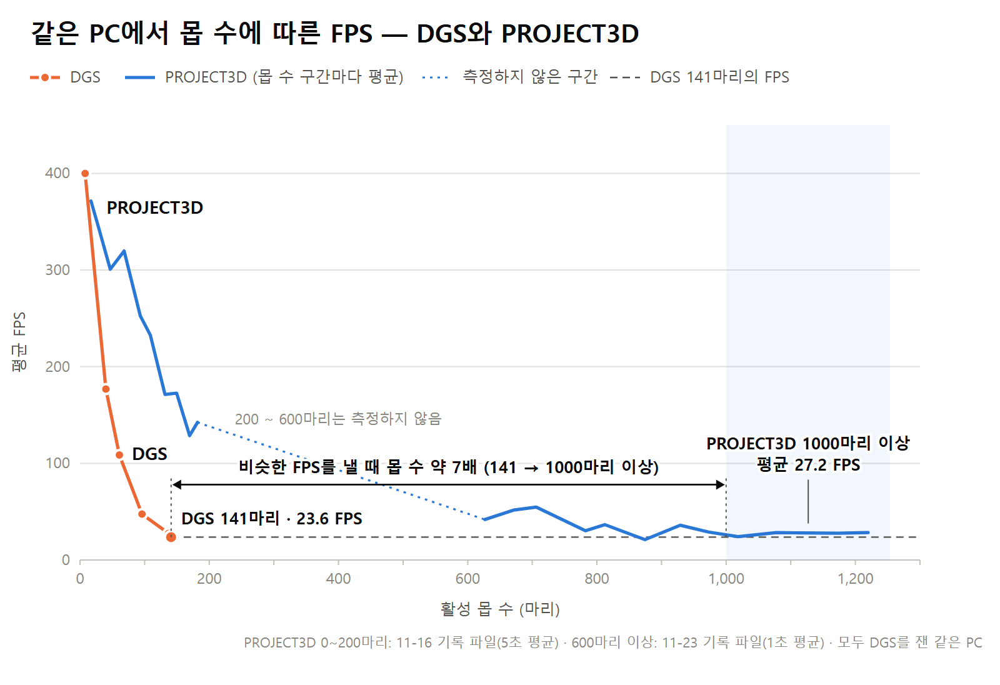

비슷한 FPS(약 24 ~ 28)를 낼 때 **DGS는 몹 141마리, PROJECT3D는 1000마리 이상**이었습니다. 같은 FPS에서 몹을 약 7배 버틴 셈입니다. 같은 몹 수로 보면, DGS가 141마리에서 23.6 FPS까지 떨어질 때 PROJECT3D는 몹 140 ~ 159마리 구간에서 평균 172.7 FPS였습니다.

**어떻게 쟀나** — 모두 DGS를 잰 같은 PC(Ryzen 5 7500F · RTX 4060)의 빌드에서 잰 값입니다(DGS는 DGS 문서 8.2). 1000마리 이상은 측정용으로 최대 몹 수를 300 → 1500으로 올려 한 판을 플레이했고, 200 ~ 600마리는 재지 않아 점선으로 이었습니다.

1000마리 이상은 232초 동안 평균 **27.2 FPS**였고, 이 판은 최대 1254마리까지 쌓였습니다.

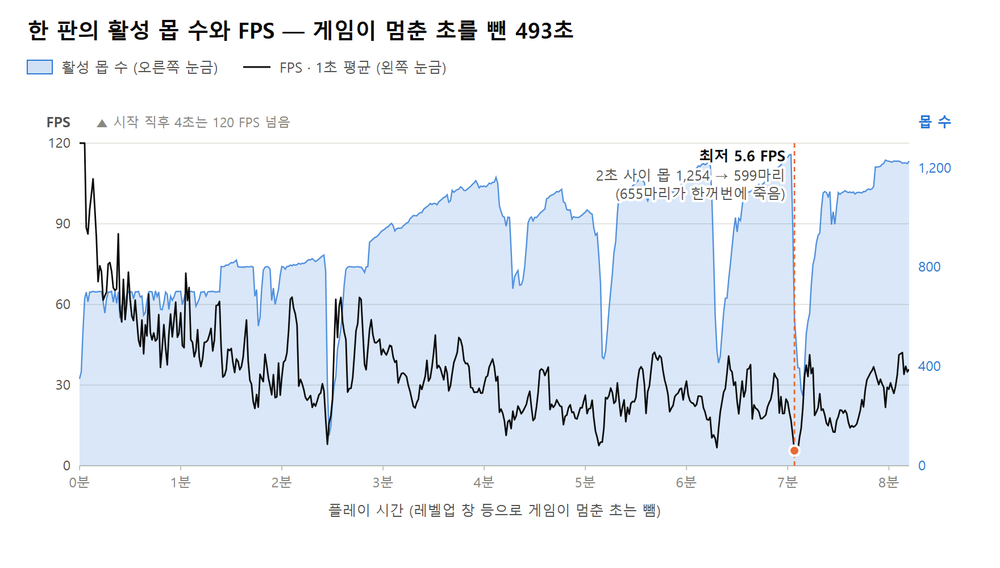

**몹이 많이 있을 때와 한꺼번에 죽을 때** — 1001마리가 살아 있을 때는 27.7 FPS였지만, **가장 낮았던 순간은 5.6 FPS**로 범위 공격으로 2초 사이 **655마리가 한꺼번에 죽은 순간**이었습니다. 몹이 많이 **있을 때**보다 한꺼번에 **죽을 때**(사망 처리 · 경험치 구 생성 · 데미지 숫자)가 더 무거웠습니다.

| 1000마리 — 1001마리 · 27.7 FPS | 대량 사망 — 604마리 · 5.6 FPS |
|---|---|
| 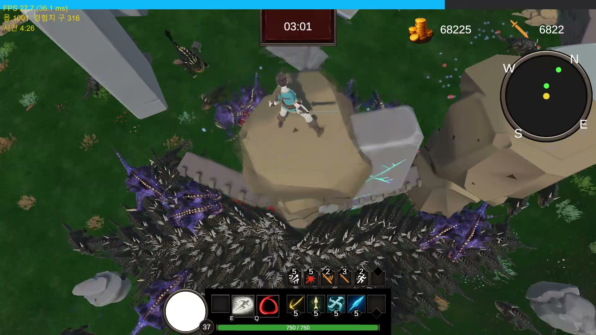 | 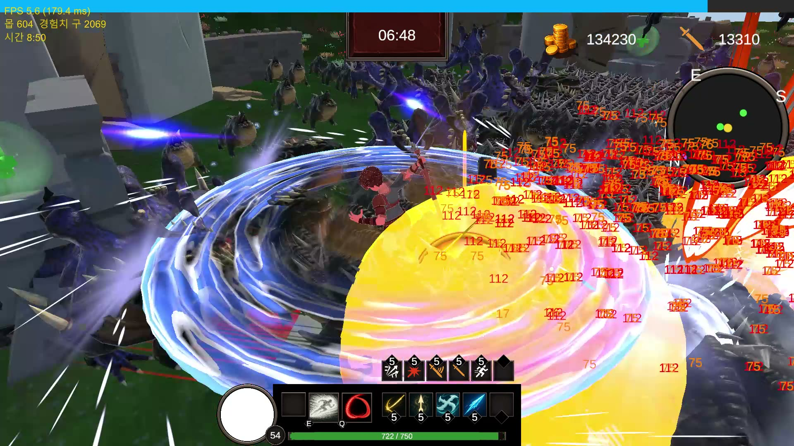 |

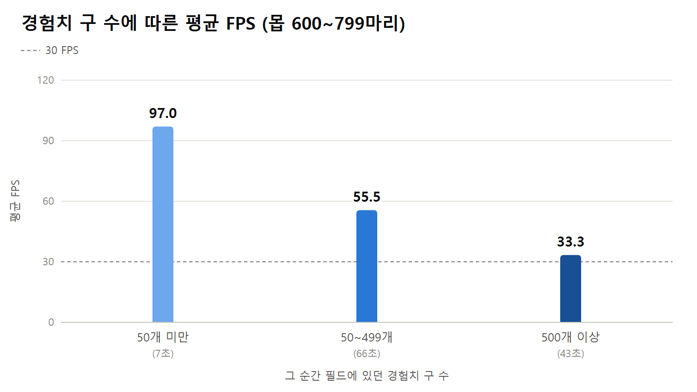

같은 몹 수라도 경험치 구가 쌓이면 프레임이 내려갔습니다(600 ~ 799마리에서 구 50개 아래 97.0 FPS → 500개 이상 33.3 FPS). 무엇이 얼마나 무거운지는 Profiler로 나눠 봐야 합니다(7.4).

- 몹 머티리얼에 GPU 인스턴싱 · VAT(애니메이션을 텍스처로 굽기)를 쓰지 않았고, 대량 사망을 여러 프레임에 나눠 처리하지도 않은 상태의 값입니다(7.4).
- 다른 PC(i5-14400F · RTX 5060)에서 잰 측정에서는 1500마리까지 쌓였고, 1400 ~ 1500마리에서 평균 28.4 FPS였습니다(위 그래프에는 넣지 않음).
- 몹 높이를 레이 → 격자 값으로 바꾼 전후 비교는 아직 남아 있습니다. AI와의 대화에서 나온 "레이 1000번 제거" 같은 효과는 **계산상 추정**이라 결과로 쓰지 않았습니다.

### 7.3 AI와 일한 방식

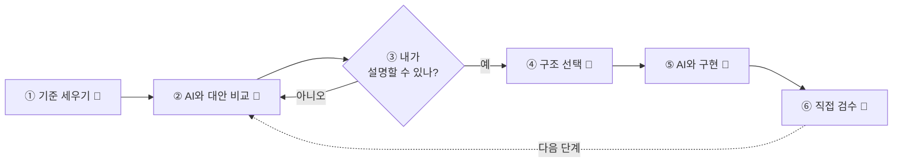

> 고르는 일(③ · ④)과 검수(⑥)는 제가, 대안 비교와 구현(② · ⑤)은 AI와 함께 했습니다.

이 프로젝트는 **설계 기준 세우기 → AI와 대안 비교 → 제가 선택 → 구현은 AI와 함께** 순서로 만들었습니다. "몹 1000마리 · 최대 4인", "설명할 수 있는 코드"라는 기준을 먼저 세우고, 구조마다 AI와 대안을 주고받으며 더 나은 구조가 있는지 시스템 단위로 따져 본 뒤 골랐습니다(각 장의 대안 비교 표). 그리고 "AI가 짜 준 코드를 내가 설명할 수 있는가"를 지키려고 규칙을 먼저 정했습니다.

| 규칙 | 이유 |
|---|---|
| 제가 배운 범위의 코드, **과설계 금지**, 내가 제안한 방식을 우선 구현 | 익숙하지 않은 기법이 섞이면 나중에 직접 고칠 수 없음 |
| for · if/else · 일반 switch, `def.X = dto.X` 한 줄씩. **LINQ · 튜플 · 제네릭 헬퍼 금지**, `get{}` 프로퍼티 대신 일반 함수 | 내가 읽고 디버깅할 수 있는 문법만 |
| 수정한 곳에 `// 새로 추가` · `// [변경]` 표시 | "나중에 검수해야 하니까" — 표시가 남아 있으면 아직 안 본 코드 |
| 코드는 채팅으로 받고, 반영은 요청할 때만. **"직접 반영해"는 그 작업 한 번에만** 유효 | 무엇이 바뀌는지 직접 보고 붙여 넣기 위해. 프로토타입 마감(11.04) 직전에만 직접 수정을 허용하고 표시로 나중에 검수 |
| AI가 넘기기 전에 **컴파일 확인** (실제 Unity 어셈블리 참조, `UNITY_EDITOR` 정의 있을 때 · 없을 때 둘 다) | 붙여 넣고 나서 에러를 찾는 시간을 줄이기 위해. 단, 컴파일 통과 ≠ 플레이 확인 |
| 위치 · 방향 계산은 **기존 시스템(MapGrid · EnemyRegistry · CombatSystem) 재사용** 우선 | 같은 계산이 여러 벌 생기지 않게 |
| 기능을 한 번에 다 만들지 않고 단계별로 (투사체 → 스킬 → 증강) | 한 번에 다 하면 대화가 길어져 토큰만 먹고, 바뀌는 범위도 이해하기 어려움 |
| 핑퐁으로 쌓인 코드는 **다시 검수**하고 단계마다 커밋 | 11.01 · 11.04에 미검토 스크립트 목록(새 파일 11 · 동작 변경 40 · 정리만 66)을 만들어 검토했고, 11.14부터는 9단계로 나눠 변수 정리 · 책임 분리 |

실제로 AI가 복잡하게 제안한 것을 제가 더 단순하게 바꾼 경우가 여러 번 있었습니다. 본문(2~6장)에서 AI와 주고받다가 결정이 바뀐 장면을 모았습니다.

| AI의 처음 제안 | 제 판단 |
|---|---|
| 몹 높이를 레이 하나로 통일했다가, 나중에 "몹 1000마리 레이는 비싸다"고 말을 바꿈 | "1000마리 · 4인이 처음부터 목표"라고 다시 짚음. 큰 틀은 두고 몹별 매 프레임 레이만 구운 격자 높이로 바꿈 (2.5) |
| "바닥 반경 + 높이차"로 판정을 통일해 수평 탄도 공중 몹을 맞히게 | 의도된 사항으로 봄. 공중 몹은 범위 증가 · 스킬 · 타겟팅 증강으로 잡게 해서 증강을 고를 이유를 줌 (3.7) |
| 최대 체력이 늘면 현재 체력도 채우기 (빠진 버그라며 두 번) | 체력 증강이 회복 수단이 되지 않게 뺌 (4.4) |
| 검기 전용 판정 클래스를 따로 만듦 | 판정 모양 `HitShape`에 직육면체를 추가해 논타겟 투사체로 처리 (3.6) |
| 공속에 맞춰 애니메이션 배속을 "모션 길이 ÷ (간격 × 0.8)"로 계산 | 전부 롤백하고, 기본 무기 증강일 때 레이어 가중치와 공속 파라미터만 바꿈 (6.2) |

반대로 AI가 짚어 준 문제로 제 설계를 고친 경우도 있었습니다.

| 제 처음 생각 | AI가 짚은 문제 → 바꾼 것 |
|---|---|
| 버프를 받을 때 더하고 끝날 때 빼기 | 빼는 값이 어긋나거나 순서에 따라 결과가 달라짐 → 버프를 목록으로 들고, 바뀔 때마다 처음부터 다시 계산 (4.4) |
| 공격 수치를 상위인 주인(Owner)에서 가져오기 | 주인은 하나인데 무기는 여러 개이고 무기마다 수치가 다름 → 계산식은 공통 부모 `UnitAttack`에, 주인은 최종 스탯만 (4.5) |

AI가 말한 효과라도 직접 재지 않은 것(예: "레이 1000번 제거")은 결과로 쓰지 않았습니다(7.2).

### 7.4 남은 과제와 다음 계획

| 과제 | 근거 | 다음에 할 것 |
|---|---|---|
| **대량 사망 순간** | 범위 공격으로 2초 사이 655마리가 죽을 때 최저 5.6 FPS (7.2) | Profiler로 사망 처리 · 경험치 구 생성 · 데미지 숫자 중 병목을 나눠 보고, 한 프레임에 처리할 사망 수를 나누는 방식 검토 |
| **몹 · 경험치 구 그리기** | 같은 몹 수에서도 경험치 구가 쌓일수록 프레임이 내려감. 몹 머티리얼에 GPU 인스턴싱 · VAT 미적용 (7.2) | Profiler로 CPU · GPU 중 병목 확인 후 GPU 인스턴싱 · VAT 적용 검토 |
| **4인 멀티** | 구조만 준비, 몹 대상은 로컬 플레이어 고정 (7.1) | 네트워크 방식 결정 후 `GetTargetOrNull`을 "가장 가까운 플레이어"로. 모든 클라이언트가 투사체를 돌리면 데미지가 인원수만큼 중복되므로 **판정은 호스트만** (판정이 `HitUnit` 한 곳에 모여 있어 조건 한 줄로 막을 수 있음) |
| **보스와 버티는 목적** | 보스 없이 무한런으로 임시 구현 (1.1) | 보스를 처치한 뒤 **바로 끝낼지, 무한런으로 버틸지를 플레이어가 고르게** 하고, 버틸수록 골드 획득량이 올라 로비 업그레이드 비용을 벌 수 있게 (메가봉크처럼 목적이 있는 선택형 버티기). 대형 보스는 공간 격자 밖에서 별도 처리 |

**그 밖에 남은 작업** — 진화 상자 · 진화 증강 교체(4장 · 4.3) · 마법사 패시브 · 몹 쪽 버프 / 디버프 · 방어력 비율식(4.4) · 공속의 쿨감 효과 밸런스(4.3) · 예고 표시 인터페이스 · 경사에서 피격 원통 기울기(3.6) · 측정 중 발견한 버그 3건(저장 파일을 두 번 읽음 · 맵 가장자리 투명벽 안쪽 소환 · 절벽 앞에서 멈추지 않는 돌진) 수정

### 7.5 배운 점

**몹 1000마리 기준으로 다시 보면** — 결정마다 매 프레임 비용이 어떻게 바뀌었는지와, 그 근거가 직접 잰 값인지 계산상 추정인지를 나눠 모았습니다.

| 결정 | 매 프레임 비용 (1000마리) | 근거 |
|---|---|---|
| 흐름장 하나 공유 (2.1) | 몹마다 경로 계산 → 0.2초마다 1번 | **측정** — 1000마리 이상 평균 27.2 FPS, 같은 FPS에서 DGS의 약 7배 (7.2) |
| 2m 공간 격자로 분리 (2.4) | 몹끼리 비교 약 100만 번 → 주변 9칸 수천 번 | 계산상 |
| 구운 격자 높이 (2.5) | 레이 1000번 → 배열 읽기 4번 × 1000 | 계산상 — 전후 비교는 아직 재지 않음 (7.2) |
| 콜라이더 없는 판정 (3.6) | 몹마다 물리 계산 → 후보 고르기 + 수학 판정 | **측정** — 위 27.2 FPS 빌드에 함께 적용 |
| 물리 없는 경험치 구 (5.3) | 구마다 Rigidbody → 직접 이동 | **측정** — 그래도 구 500개 이상이면 33.3 FPS (50개 미만 97.0) → 남은 병목 (7.4) |
| 저장은 씬을 옮길 때만 (5.4) | 매 킬 파일 쓰기 → 씬 이동 때 한 번 | 계산상 |
| 대량 사망 처리 | 한 프레임에 몰려 처리 | **측정** — 2초 사이 655마리 사망 때 5.6 FPS → 다음 과제 (7.4) |

- **최적화는 측정에서 시작한다.** 이 프로젝트의 구조 대부분은 DGS 빌드 측정(최저 20.7 FPS, 병목은 살아 있는 오브젝트 수)에서 나왔습니다. 다음 단계도 이 프로젝트를 측정해서 정할 것입니다.
- **같은 일을 하는 코드는 한 곳에.** 투사체 · 범위 · 돌진의 판정과 이펙트가 흩어져 있던 것을 `HitUnit` 하나로 모으자, 몹 돌진에 이펙트를 붙이는 일이 프리팹 교체로 끝났습니다.
- **AI의 제안은 "내가 설명할 수 있는가"로 거른다.** AI가 복잡하게 짠 애니메이션 배속 계산 · 지상 몹 앞쪽 검사 · 사각 판정 전용 클래스를 제가 더 단순한 방식으로 되돌렸고, 반대로 버프 재계산 · 계산 위치처럼 AI가 짚어 준 문제로 제 설계를 고친 경우도 있었습니다. 판단 근거를 직접 말할 수 있는 쪽을 골랐습니다.
- **핑퐁으로 빨리 만든 코드는 반드시 다시 검수한다.** 11.14부터 9단계로 나눠 변수 정리 · 책임 분리를 하면서, 쓰이지 않는 변수 · 표시되지 않는 `[Header]` · 같은 이름의 다른 의미 변수 같은 것들이 나왔습니다.

---

## 부록 A. 전체 구조

시스템 전체가 어떻게 이어지는지와 게임을 시작할 때의 준비 순서를 정리했습니다.

### A.1 전체 구조

전체 구조에서 **몹 하나하나는 공유된 값(흐름장 · 공간 격자)만 읽고, 데미지는 모두 `CombatSystem` 한 창구로 모입니다**.

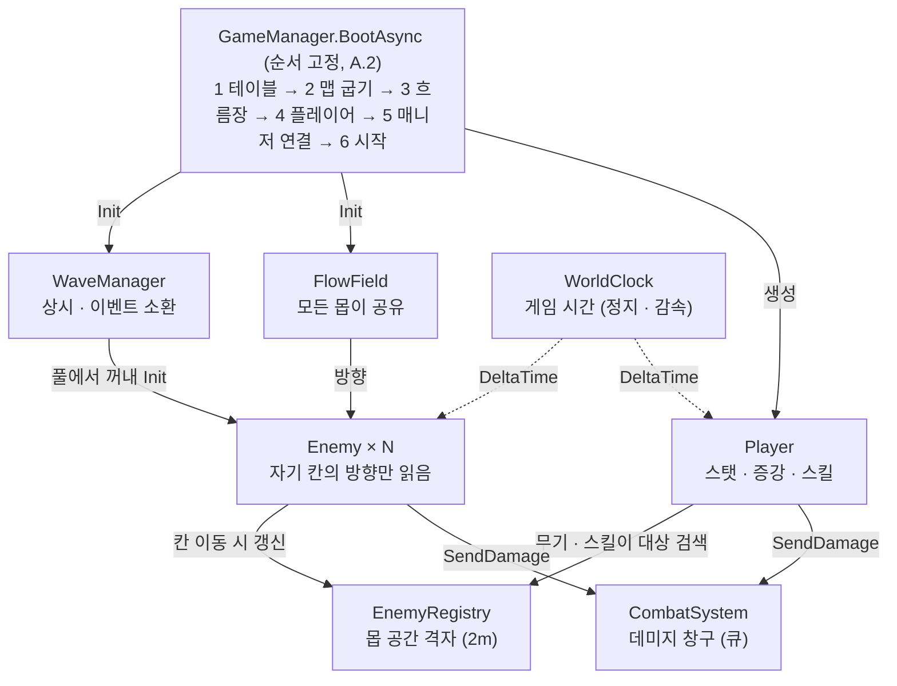

> 실선 = 직접 호출 · 값 전달, 점선 = 모든 게임 로직이 읽는 공용 시계.

| 클래스 | 하는 일 | 하지 않는 일 |
|---|---|---|
| `GameManager` | 초기화 순서 실행, 패배 처리 | 게임 규칙을 판정하지 않음 |
| `TableLoader` | TSV 10종을 한 번만 읽어 Def로 보관 | 씬마다 다시 읽지 않음 |
| `WorldClock` | 게임 시간(정지 · 보통 · 감속 · 배속), 경과 시간 | `Time.timeScale`을 바꾸지 않음 |
| `ObjectPoolManager` | 몹 · 투사체 · 이펙트 · 경험치 구 · 구조물을 **프리팹 이름 키**로 풀링. 프리팹 종류가 너무 많아 미리 등록하지 않고 **처음 요청할 때 풀을 자동으로 만듦** | 종류별 풀 클래스를 따로 두지 않음 |
| `CombatSystem` | 데미지 · 회복 이벤트를 큐에 모아 **그 프레임 시작 때 쌓인 개수만큼** 처리, 크리티컬 판정 | 누가 맞았는지 찾지 않음 (3장) |
| `GameSession` · `SaveService` | 로비 상태(선택 직업 · 상점 · 골드), JSON 저장 | 인게임 수치를 계산하지 않음 |

### A.2 게임을 시작할 때의 준비 순서

각 매니저는 `Awake`에서 자기 참조(Instance)만 잡고, 데이터는 `Init`으로 받으며, `Init` 전에는 `Update`에서 바로 return합니다. 기다리는 관계는 `GameManager.BootAsync` 한 곳에만 두어, 위 그림의 1~6 순서가 코드에서도 위에서 아래로 한 줄씩 읽힙니다.
처음에는 제가 "맵 → 테이블 → 플레이어 순서로, 플레이어 컨트롤러도 비동기로" 하자고 했는데, AI가 **테이블이 맵을 정할 수 있으니 테이블이 먼저**이고 기다림은 한 곳에 모으는 편이 읽기 쉽다고 했습니다. DGS의 "몇 프레임 기다리면 되겠지"를 없애는 것이 목적이었으므로 그렇게 정했습니다 🤝. 맵 굽기는 Physics 검사가 메인 스레드에서만 되므로, 스레드로 넘기지 않고 **한 프레임에 20줄씩** 나눠 굽습니다.

```csharp
// GameManager.cs:13 — 필드
[SerializeField] private MapGrid mapGrid;
[SerializeField] private FlowFieldManager flowFieldManager;
[SerializeField] private PlayerSpawner playerSpawner; // 로비에서 고른 캐릭터 + 상점 스탯으로 플레이어 생성
[SerializeField] private InGameUI inGameUI;           // 인게임 HUD
[SerializeField] private StructureManager structureManager; // 구조물 소환 / 상호작용

// GameManager.cs:43 — 부팅 순서 (로그 · 일부 줄 생략)
private async UniTaskVoid BootAsync(CancellationToken token)
{
    WorldClock.Instance.ResetClock();
    EnemyRegistry.Clear();  // 정적 명부는 씬이 바뀌어도 남아서, 이전 판 기록을 지운다
    PlayerRegistry.Clear();

    TableLoader.Instance.LoadData();       // 1. 테이블
    await UniTask.Yield(token);
    await mapGrid.BakeAllAsync(token);     // 2. 맵 굽기 (여러 프레임에 나눠서)
    flowFieldManager.Init(mapGrid);        // 3. 흐름장
    Player player = playerSpawner.SpawnPlayers(); // 4. 플레이어

    flowFieldManager.AddPlayer(player.transform); // 5. 매니저 연결
    AugmentManager.Instance.Init(player, player.BodyPivot);
    WaveManager.Instance.Init(mapGrid);
    inGameUI.Init(player); // 증강 매니저가 준비된 뒤에 연결 (보유 증강 표시)
    player.OnDead += HandlePlayerDead;

    IsReady = true;                        // 6. 시작
    OnGameReady?.Invoke();
    WaveManager.Instance.StartWaves();
    structureManager.StartSpawn();
}
```

- 전체 코드: [GameManager.cs](https://github.com/KooHoo-Dev/3rd_3D_1-3D-Project-NaJungWon/blob/main/Assets/10.%20Scripts/GameFlow/GameManager.cs)

---

### A.3 호출 API

다른 코드가 무엇을 부르면 무엇이 나오는지 시스템별로 모았습니다.

**몹 이동 (2장)** — 맵 굽기와 추격 대상 등록은 `GameManager`가 시작할 때 부르고, 몹은 매 프레임 조회만 합니다.

| 호출 | 결과 |
|---|---|
| `MapGrid.BakeAllAsync(token)` | 맵 전체를 격자로 한 번 굽기 |
| `MapGrid.BlockArea(area)` / `RebakeArea(area)` | 구조물이 솟아오르는 동안 그 영역을 먼저 막기 / 다 오른 뒤 그 영역의 칸만 다시 검사 |
| `MapGrid.TryGetGroundHeight(pos, out height, out normal)` → `bool` | 바닥 높이 · 경사(주변 4칸 보간, 절벽 칸은 섞지 않음). 맵 밖이면 `false` |
| `MapGrid.TryGetSurfaceHeight(pos, out height)` → `bool` | 주변 4칸 중 가장 높은 표면(바닥 + 장애물 꼭대기) — 공중 몹 고도 |
| `FlowFieldManager.AddPlayer(player)` | 추격 대상 추가. 흐름장은 0.2초마다, 맵이 바뀌면 바로 다시 계산 |
| `FlowField.GetDirection(pos)` → `Vector3` | 그 칸이 가리키는 방향. 못 걷는 칸이면 `Vector3.zero` |
| `FlowField.TryGetNextPoint(pos, out point)` → `bool` | 다음 칸의 가운데. 막혔을 때 그쪽으로 걷기 |
| `EnemyRegistry.FindInRange(center, radius, ref list)` | 반경 안에 있는 몹들 — 몹끼리 밀어내기(2.4) |

**공격 판정 (3장)** — 새 공격은 `UnitAttack`을 상속하고, `OnDelayEnd()`에서 아래를 부르면 됩니다.

| 호출 | 결과 |
|---|---|
| `StartDelay()` | 애니메이션을 틀고, 공격 시점이 되면 `OnDelayEnd()`가 불림 |
| `FireHit(prefab, direction, damage)` → `HitUnit` | 풀에서 꺼냄 → `Launch` → 능력치 보너스 → 켜기. 실패하면 `null` |
| `FindTarget(baseRange)` → `Enemy` | 범위 증가를 적용한 범위 안 가장 가까운 몹. 없으면 `null` |
| `DealDamage(target, damage)` | 생성 오브젝트 없이 바로 데미지(근접 공격 등) |
| `EnemyRegistry.FindHitTargets(center, radius, shape, height, …, ref list)` | 공격 범위가 피격 원통에 닿는 살아 있는 몹들(투사체 · 범위 공통) |
| `EnemyRegistry.FindNearest(center, radius, exclude)` → `Enemy` | 가장 가까운 몹. 이미 맞힌 몹은 건너뜀(타겟팅 재탐색) |
| `CombatEntity.IsHitBy(center, radius, shape, height, …)` → `bool` | 공격 범위가 내 피격 원통에 닿는지(구 · 기둥 · 직육면체) |
| `CombatSystem.SendDamage(sender, receiver, damage, hitPos)` | 데미지를 바로 깎지 않고 큐에 넣기 — 프레임 시작 때 쌓인 개수만큼 처리(3.8) |

**증강 · 스탯 (4장)**

| 호출 | 결과 |
|---|---|
| `AugmentManager.BuildLevelUpOffers(cardCount)` → `List<AugmentOffer>` | 레벨업 카드(새 증강 + 레벨업, 진화는 상자에서만) |
| `AugmentManager.BuildChestOffers(cardCount)` → `List<AugmentOffer>` | 상자 카드 — 진화 조건을 만족한 무기가 있으면 진화 카드 |
| `AugmentManager.Apply(offer)` | 고른 카드 적용 — 새 증강 · 레벨업 · 진화 · 특수를 카드 종류로 나눔(4.3) |
| `PlayerStatHandler.SetAbilityStat(total)` | 능력치 증강 합을 넣고 다시 계산 |
| `PlayerStatHandler.Recalculate()` | 출처별 스탯을 처음부터 다시 합침(4.4) |

**스폰 · 경험치 (5장)**

| 호출 | 결과 |
|---|---|
| `WaveManager.Init(map)` | `waves.tsv` · `spawnRules.tsv`를 읽어 소환 준비 |
| `WaveManager.StartWaves()` | 경과 시간을 0으로 두고 소환 시작(상시 소환은 바로 첫 소환) |
| `Enemy.OnAnyDied` (static 이벤트) | 몹이 풀로 돌아가기 전에 알림 → `ExpOrbSpawner`가 경험치 구를 꺼냄(5.1) |
| `EnemyRegistry.Count` · `RisingCount` | 살아 있는 몹 수 · 땅에서 올라오는 중인 몹 수(소환 수 제한에 함께 셈) |
