# 카타나 제로 (모작) — 커스텀 2D 이동 · 시간 조작 · 녹화/역재생 기술 문서

> **문서 유형**: B. 다기능 (프로젝트 개요 → 공통 기반 → 기능별 [구조 · 핵심 기능 · 고민과 선택] 반복 → 결과)
> **다루는 범위**: 1인 프로젝트지만, 수업에서 받은 기본 코드는 빼고 **제가 새로 만들거나 크게 확장한 시스템 4가지**만 다룹니다.
>
> | # | 시스템 | 한 줄 요약 | 핵심 키워드 |
> |---|---|---|---|
> | A | 플레이어 이동 | Kinematic + BoxCast 직접 이동, 계단 step, 플랫폼 통과, 벽 붙기 · 공중제비 | Kinematic · BoxCast · LayerMask 전환 |
> | B | 크로노스 · 히트스탑 | `Time.timeScale` 하나로 시간 감속과 히트스탑을 처리하고, 둘이 겹쳐도 깨지지 않게 함 | timeScale · unscaled · 복귀값 규칙 |
> | C | 녹화 · 재생 · 역재생 | 틱 단위 상태 스냅샷을 기록하고, 재생은 틱 사이를 보간해 부드럽게 보여줌 | 스냅샷 · 보간 · Animator 시간축 |
> | D | 전투 확장 · 화면 연출 | 수업 전투 코드에 구르기 무적 · 총알 반사를 붙이고, 타격 연출을 한 곳으로 모음 | HitBox 확장 · 풀링 · 데드존 카메라 |

> 📌 **표기 규칙**
> - `📷 [이미지 필요]` / `🎬 [GIF·영상 필요]` : 캡처를 넣어야 하는 자리 (시연 영상 촬영 후 채움)
> - `⟨확인 필요⟩` : 작성자 확인이 필요한 문장
> - `⟨링크 입력⟩` : 링크를 넣어야 하는 자리

---

## 1. 프로젝트 개요

### 1.1 What — 무엇을 만들었나

**카타나 제로 (모작)**은 원작 *Katana ZERO*의 핵심 플레이를 따라 만든 2D 액션 플랫포머입니다.
플레이어와 적 모두 **한 번 맞으면 죽고**, 죽으면 그 판을 **되감아(역재생)** 처음부터 다시 시작합니다.
스테이지의 모든 적을 처치하면 방금 플레이를 **CCTV 리플레이처럼 정방향 재생**한 뒤 다음 스테이지로 넘어갑니다.

```text
타이틀 → 스테이지 준비(클릭 대기) → 플레이(녹화) ─┬─ 모든 적 처치 → 정방향 재생 → 다음 스테이지 (총 8개)
                                                  └─ 사망 / 시간 초과 → 역재생 → 같은 스테이지 재시작
```

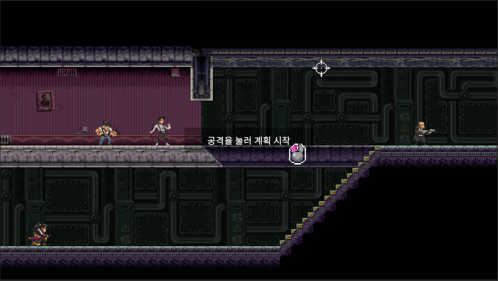

> 🎬 **[GIF·영상 필요]** 한 스테이지 요약: 플레이 → 사망 → 역재생 → 재도전 → 클리어 → 정방향 재생

### 1.2 담당 범위

1인 프로젝트입니다. 학원 수업에서 만든 액션 플랫포머 기본 코드(`Study_Unity_Basic_2D`)를 복사해서 시작했기 때문에, **수업 코드와 제 작업을 아래처럼 나눕니다.**

| 구분 | 내용 |
|---|---|
| ✅ 직접 구현 (본 문서 범위) | `CharacterController2D` 확장(166줄 → 1,014줄: 계단 · 플랫폼 · 구르기 · 벽 붙기 · 공중제비) / `ChronosSystem` / `ScreenEffectManager` / `CameraController` / `GameManager` 게임 흐름 / 녹화 데이터 구조(`TimelineFrame` · `PlayerRecord` 등)와 기록 흐름 / `HitBox` 확장(구르기 무적 · 팀킬 방지 · 연출 호출) / 총알 반사 |
| 🤝 AI 도구와 함께 진행 | 녹화 방식 선택(AI 조언을 바탕으로 상태 스냅샷 채택), 재생 · 역재생 보간과 오류 수정(원인 분석을 AI와 주고받으며 진행) ⟨확인 필요⟩ |
| ➖ 기타 (본 문서에서 생략) | 적 AI 확장(`EnemyController` 추적 · 공격 · 원거리), 인게임 UI, 타이틀, 맵 8개 배치 · 레벨 디자인 |
| ❌ 담당 아님 | 수업 기본 코드(`CombatSystem` · `HitBox` 원형 · `HurtBox` 원형 · `CombatEntity` · `ComponentPool` · `SingletonBase` · `EnemyController` 원형), 보스 코드(템플릿 그대로, 미사용), 그래픽 · 애니메이션 리소스(원작 에셋) |

### 1.3 Why — 왜 이렇게 만들었나

| 문제 상황 (Before) | 결과적으로 생기는 비용 | 해결 방향 |
|---|---|---|
| 원작의 이동(계단 대각선 이동, 플랫폼 통과, 벽 붙기, 구르기)이 기본 물리로는 원하는 느낌이 안 남 | 미끄러짐 · 튕김 등 물리 엔진 결과를 조정하는 데 시간이 듦 | **Kinematic + BoxCast로 이동을 직접 계산** (3장) |
| 시간 감속을 적용할 대상(적 · 총알 · 애니메이션 · 이펙트)이 많음 | 대상마다 속도 값을 따로 바꾸면 수정 범위가 커지고 빠뜨리기 쉬움 | **`Time.timeScale` 하나로 감속**하고, 영향받으면 안 되는 것만 unscaled로 분리 (2장 · 4장) |
| 히트스탑도 timeScale을 쓰므로 크로노스와 겹침 | 히트스탑이 끝난 뒤 감속이 풀리거나 감속 상태로 굳음 | **히트스탑 복귀 값을 크로노스 상태에서 다시 계산** (4장) |
| 죽을 때마다 되감기, 클리어 시 리플레이가 필요함 | 씬 리로드만으로는 "되감는 연출"을 만들 수 없음 | **매 틱 상태를 기록하고 정방향 / 역방향으로 다시 적용** (5장) |
| 녹화를 틱 단위로 끊어 재생하면 애니메이션이 뚝뚝 끊김 | 리플레이 연출 품질이 떨어짐 | **틱 사이를 보간**하고 재생은 실제 시간(unscaled) 기준으로 진행 (5장) |

### 1.4 개발 환경

| 항목 | 내용 |
|---|---|
| Engine | Unity **6000.3.15f1** (Unity 6) · URP 2D |
| Language | C# |
| 입력 | Input System (수업 `SimpleInput` 래퍼 사용) |
| 기간 / 형태 | 2026.06.25 ~ 2026.07.07 (13일) · 1인 프로젝트 |
| 결과물 | 타이틀 + 스테이지 8개, Windows 빌드 |
| 협업 / 관리 | Git(GitHub) |
| 링크 | [GitHub](https://github.com/KooHoo-Dev/3rd-2D-Project-NaJungWon) · [시연 영상](#) ⟨링크 입력⟩ · [빌드](#) ⟨링크 입력⟩ |

### 1.5 전체 구조 한눈에 보기

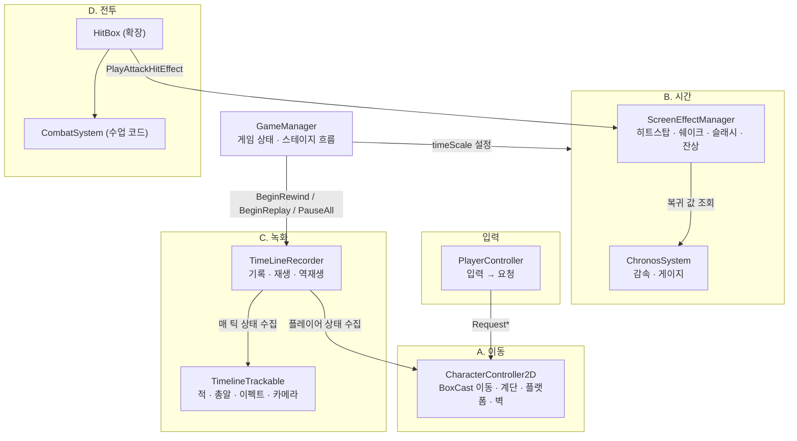

---

## 2. 공통 기반 — 게임 흐름과 시간축 분리

### 2.1 게임 상태 흐름

`GameManager`가 `GameState` 하나로 스테이지 흐름을 관리하고, 상태마다 `Time.timeScale`과 녹화기 모드를 함께 바꿉니다.

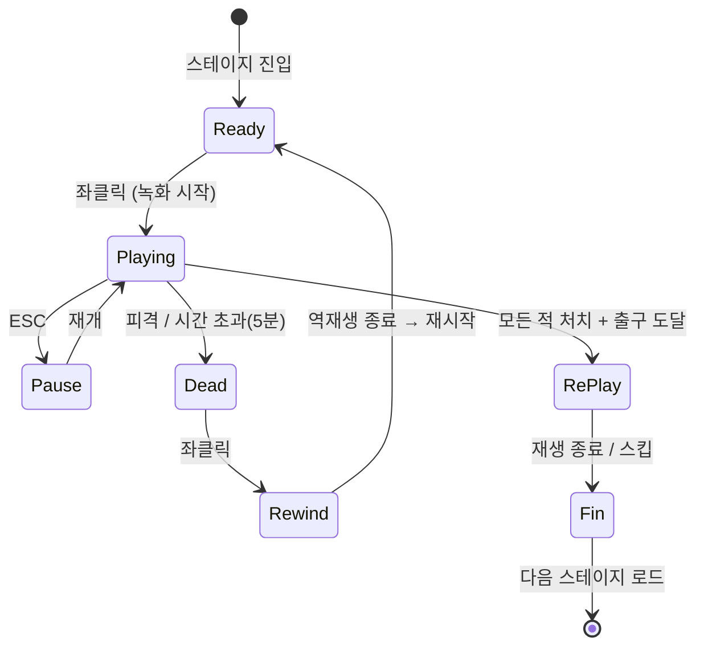

| 상태 | `Time.timeScale` | 녹화기 | 비고 |
|---|---|---|---|
| Ready | 0 | 대기 | 클릭 전까지 세계 정지 |
| Playing | 1 (크로노스 중 0.25) | **Recording** | |
| Pause | 0 | Pause (이전 모드 저장) | 재생 중 일시정지도 처리 (5.4 문제 2) |
| Dead | 1 | Pause | 사망 연출만 진행 |
| Rewind / RePlay | **0** | Rewinding / Replaying | 세계는 멈추고 녹화기만 실제 시간으로 움직임 |

> 출처: `Assets/Scripts/04. System/GameManager.cs:170-216`

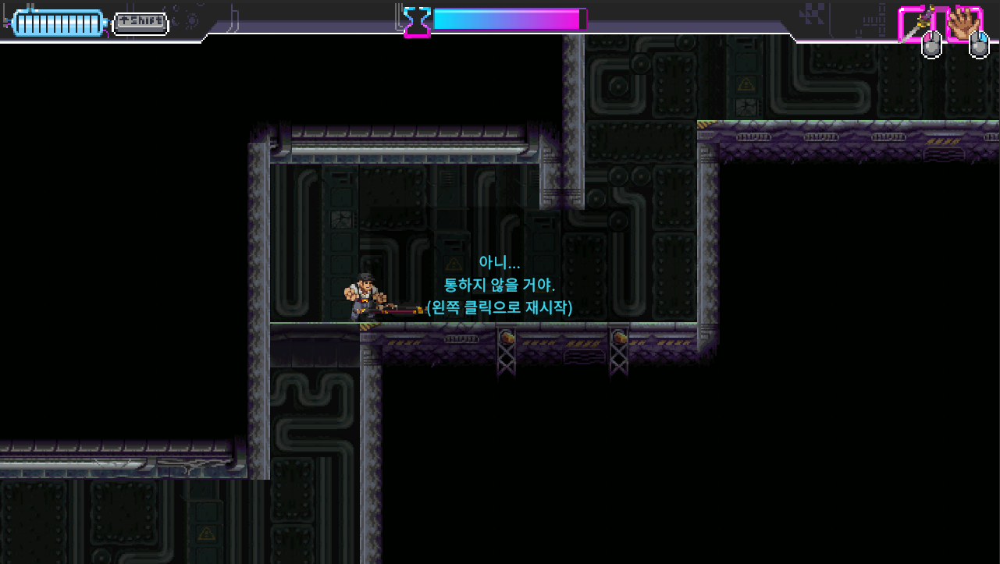

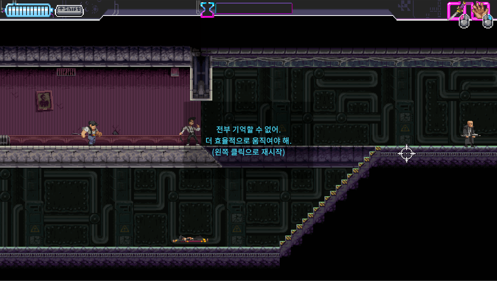

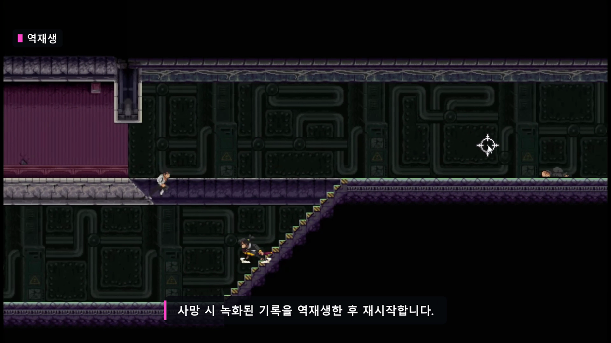

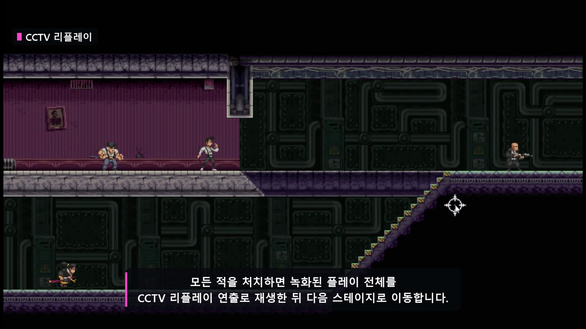

### 2.2 원칙: "게임 세계는 scaled, 시간을 다루는 시스템은 unscaled"

시간 감속 · 히트스탑 · 일시정지 · 재생이 모두 `Time.timeScale`을 건드리기 때문에, **어떤 코드가 어떤 시간을 쓰는지**를 먼저 정했습니다.

| 대상 | 사용하는 시간 | 이유 |
|---|---|---|
| 플레이어 · 적 이동, 애니메이션, 총알 | `fixedDeltaTime` / `deltaTime` (scaled) | 크로노스가 걸리면 같이 느려져야 함 |
| 녹화 **기록** | `FixedUpdate` 1회 = 1틱 (scaled) | 게임 세계가 실제로 진행된 만큼만 기록 |
| 녹화 **재생 · 역재생** | `Time.unscaledDeltaTime` | 재생 중엔 timeScale = 0이므로 실제 시간으로 진행해야 함 |
| 크로노스 게이지, 전환 연출 | `unscaledDeltaTime` | 감속 중에도 실제 1초에 1씩 줄어야 함 |
| 히트스탑 대기, 쉐이크, 슬래시, 카메라 추적 | `unscaledDeltaTime` / `WaitForSecondsRealtime` | timeScale = 0인 동안에도 끝나야 함 |

> 기록은 `FixedUpdate`라서 크로노스 구간은 실제 시간보다 **적은 틱**으로 기록됩니다. 재생은 항상 초당 50틱으로 돌기 때문에, **리플레이에서는 크로노스 구간이 정상 속도로 재생**됩니다(원작 리플레이와 같은 느낌). ⟨확인 필요: 의도한 동작인지⟩

---

## 3. 기능 A — 플레이어 이동

### 3.1 개요

`a`/`d` 좌우 이동, `w` 점프, `s` 한 키로 **공중 급하강 · 플랫폼 내려가기 · 앉기 · 구르기**를 처리합니다.
벽에 붙어 있다가 `w`로 반대 방향 공중제비를 할 수 있고, 계단은 대각선으로 자연스럽게 오르내립니다.

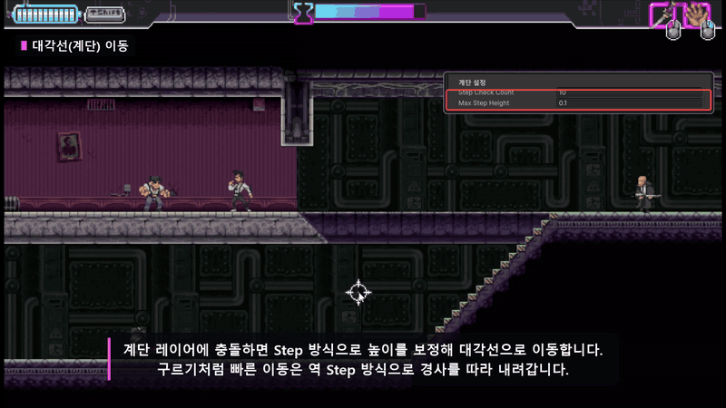

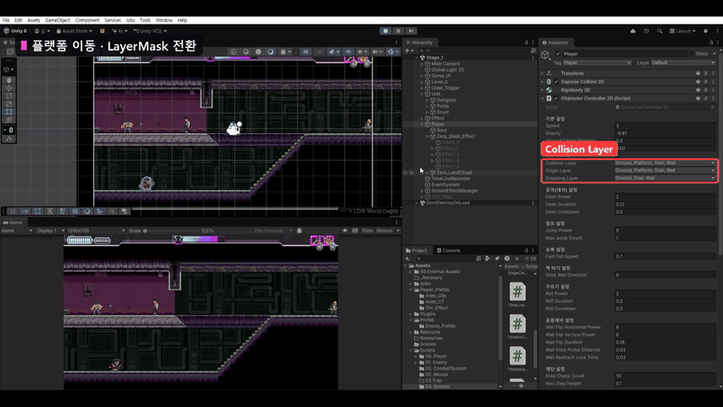

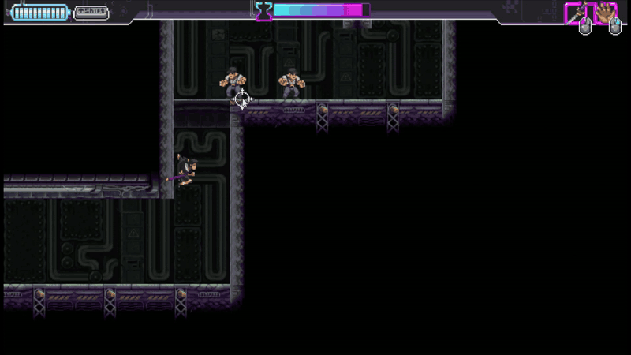

### 3.2 시스템 구조

입력과 이동을 분리했습니다. `PlayerController`는 **요청만 보내고**, 실제 이동 · 충돌은 `CharacterController2D`가 `FixedUpdate`에서 한 번에 처리합니다.

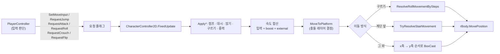

| 속도 구성 | 용도 | 감쇠 방식 |
|---|---|---|
| `moveInput * speed` | 기본 좌우 이동 | 입력 없으면 0 |
| `boostVelocity` | 공격 대시 · 구르기 · 공중제비 | **거리 / 시간**으로 속도 계산, `boostTimer` 끝나면 0 |
| `externalVelocity` | 피격 넉백 | `Lerp`로 점점 감쇠 (`externalDrag = 12`) |

### 3.3 핵심 기능

**① x축 먼저, y축 나중에 이동** — 대각선 이동에서 플랫폼 모서리에 끼는 문제를 막습니다 (7.2 문제 1).

```csharp
// CharacterController2D.cs:185 — 기본 이동: x를 먼저 이동한 위치에서 y를 검사
float boxX = ResolveAxisMovement(box, desireMove.x, Vector3.right);
box.center += new Vector3(boxX, 0, 0);
float boxY = ResolveAxisMovement(box, desireMove.y, Vector3.up);
moveVector = new Vector3(boxX, boxY, 0);
```

**② 계단 step** — 정면이 계단이면 `maxStepHeight(0.3)`를 4번 나눠 올려 보고, 올린 위치에서 앞으로 갈 수 있으면 그 높이로 이동합니다.

```csharp
// CharacterController2D.cs:467 — 위로 조금씩 올려 보며 앞이 비는 높이를 찾음
float stepUnit = maxStepHeight / checks;
for (int i = 1; i <= checks; i++)
{
    float stepY = stepUnit * i;
    // 위로 stepY만큼 올릴 공간이 없으면 다음 높이 시도
    if (Physics2D.BoxCast(box.center, box.size, 0f, Vector2.up, stepY, collisionLayer).collider != null)
        continue;

    Bounds raisedBox = box;
    raisedBox.center += new Vector3(0f, stepY, 0f);
    // 올린 위치에서 앞으로 갈 수 있으면 성공
    if (Physics2D.BoxCast(raisedBox.center, raisedBox.size, 0f, dir, distance, collisionLayer).collider == null)
    {
        stairMove = new Vector2(moveX, stepY);
        return true;
    }
}
```

**③ 구르기는 잘게 나눠서 step** — 구르기는 한 틱 이동량이 커서 step이 실패합니다. 이동량을 `maxStepHeight` 단위로 쪼개 **올라가는 step → 수평 이동 → 내려가는 step(바닥에 붙이기)** 순서로 처리합니다.

```csharp
// CharacterController2D.cs:519 — 한 틱 이동량을 계단 높이 단위로 분할
int sliceCount = Mathf.Max(1, Mathf.CeilToInt(Mathf.Abs(moveX) / maxStepHeight));
float unitMoveX = moveX / sliceCount;

for (int i = 0; i < sliceCount; i++)
{
    if (TryResolveStairMovement(box, unitMoveX, Vector3.right, out Vector2 stepUpMove)) { /* 올라가기 */ continue; }

    float resolvedX = ResolveAxisMovement(box, unitMoveX, Vector3.right);
    if (Mathf.Approximately(resolvedX, 0f)) break;          // 벽에 막힘
    // ...
    if (TrySnapDownStep(box, maxStepHeight, out float downMove)) // 내려가는 계단에 붙기
        partMove.y = downMove;
    // ...
}
```

**④ 플랫폼 통과 — 충돌 레이어 교체** — 플랫폼의 콜라이더를 끄지 않고, **플레이어가 검사하는 LayerMask**를 상황에 따라 바꿉니다.

| 상황 | 사용하는 LayerMask | 출처 |
|---|---|---|
| 점프로 올라가는 중 (`VerticalVelocity > 0`) | `droppingLayer` (플랫폼 제외) | `:318` |
| 계단 위 | `droppingLayer` | `:892` |
| `s`로 내려가는 중 (플랫폼을 완전히 벗어날 때까지) | `droppingLayer` | `:351` 코루틴 |
| 그 외 지상 · 낙하 | `originLayer` (플랫폼 포함) | `:335` |

```csharp
// CharacterController2D.cs:351 — 플랫폼 아래로 완전히 내려가거나 다시 올라갈 때까지 플랫폼 무시
public IEnumerator DropDownPlatform(Collider2D collider)
{
    float platformTop = collider.bounds.max.y;
    float platformBottom = collider.bounds.min.y;

    collisionLayer = droppingLayer;
    isFalling = true;

    yield return new WaitUntil(() =>
        GetCastBox().max.y + skinWidth < platformBottom ||
        GetCastBox().min.y + skinWidth > platformTop);

    isFalling = false;
    collisionLayer = originLayer;
}
```

**⑤ `s`키 하나로 4가지 동작** — 이전 상태에 따라 순서대로 분기합니다 (`CharacterController2D.cs:660`).

1. 공중이면 → 하강 속도 추가 (급하강)
2. 발밑이 `PlatformEffector2D`가 붙은 플랫폼이면 → `DropDownPlatform`
3. 아니면 → 앉기 (`IsCrouching`)
4. 앉은 상태에서 이동 입력 / 이동 중 `s` → 구르기 (`PlayerController`에서 판정)

**⑥ 벽 붙기 · 공중제비** — 공중에서 부착 가능한 벽(레이어 9) 방향으로 입력하면 붙고, `w`를 누르면 벽 반대 방향으로 공중제비합니다. 공중제비 직후 같은 벽에 다시 붙지 않도록 `wallReattachLockTime(0.08초)` 동안 부착 검사를 막습니다.

**수치 근거**

| 값 | 의미 | 근거 |
|---|---|---|
| `speed = 2.0` | 기본 이동 속도 | 원작 체감에 맞춰 조정 ⟨확인 필요⟩ |
| `jumpPower = 8.0`, `gravity = -9.81` | 점프 높이 | 〃 |
| `rollPower = 10`, `rollDuration = 0.10s` | 0.1초에 10만큼 이동 → 초당 100 | 구르기는 "순간 이동처럼 빠르게"가 목표라 거리 / 시간으로 정확히 지정 |
| `dashPower = 6`, `dashDuration = 0.12s` | 공격 시 마우스 방향 돌진 | 〃 |
| `maxStepHeight = 0.3`, `stepCheckCount = 4` | 한 번에 오를 수 있는 높이, 0.075씩 4번 검사 | 타일 계단 한 칸 높이 ⟨확인 필요⟩ |
| `skinWidth = 0.02` | BoxCast 박스를 살짝 줄여 벽에 붙어 있을 때 끼지 않게 함 | 수업 코드 기본값 |
| `externalDrag = 12` | 넉백이 빠르게 줄어듦 | 외부 충격은 자연스럽게 감쇠해야 해서 power + drag 방식 |

### 3.4 고민과 선택

**결정 1. 이동을 무엇으로 구현할 것인가?**

| | 대안 A: Dynamic Rigidbody2D | **대안 B: Kinematic + BoxCast 직접 구현 ✅** |
|---|---|---|
| 장점 | 충돌 · 경사 · 마찰을 엔진이 처리 | 계단 · 플랫폼 · 벽 붙기 · 구르기를 원하는 대로 통제 |
| 단점 | 원작 같은 "딱 떨어지는" 조작감을 만들려면 마찰 · 중력 · 속도 보정이 많이 필요 | 충돌 처리를 전부 직접 작성 → 예외 케이스가 많아짐 |
| 판단 | — | 수업에서 만든 `CharacterController2D`(Kinematic + skinWidth + 축별 BoxCast)를 기반으로 **계단 · 플랫폼 · 벽 · 구르기를 추가**. 이 프로젝트가 물리 커스텀의 첫 시도였음 |

**결정 2. 대각선(계단) 이동을 어떻게 처리할 것인가?**

| | 대안 A: 충돌 normal 방향으로 이동 | **대안 B: step 방식 ✅** |
|---|---|---|
| 장점 | 경사 각도와 상관없이 처리 | 계단 타일에 맞고, "몇 번 올려 보고 안 되면 포기"라 결과가 예측 가능 |
| 단점 | normal 계산 · 미끄러짐 처리가 추가로 필요 | 한 틱 이동량이 크면 실패 → 구르기는 분할 처리 필요 |

채택 후 기본 이동은 정상이었지만, **공격 대시 · 구르기처럼 한 틱에 크게 움직이면 step이 실패**했습니다. 단순 `while`로 반복하면 제자리 이동 · 무한 루프 · 끊기는 순간이동이 생겨서, 이동을 **기본 이동 / 계단 이동 / 구르기 계단 이동** 3가지로 나누고 구르기만 `CeilToInt`로 분할했습니다.

**결정 3. 플랫폼 통과를 어떻게 할 것인가?**

| | 대안 A: 플랫폼 콜라이더를 잠깐 끄기 | **대안 B: 플레이어의 충돌 LayerMask 교체 ✅** |
|---|---|---|
| 장점 | 구현이 단순 | 플랫폼 쪽은 건드리지 않음 → 적 등 다른 캐릭터는 영향 없음 |
| 단점 | 플랫폼 위 다른 캐릭터(적)까지 같이 떨어짐 | 대각선 이동 · 점프 · 하강마다 레이어를 언제 바꿀지 규칙이 필요 |
| 판단 | — | 물리 커스텀의 첫 시도로 새로운 방식을 써 보고 싶어서 선택. 대각선 이동 중 플랫폼을 통과하지 못하는 부작용은 **계단 위 · 점프 상승 중에는 플랫폼 제외 레이어**를 쓰는 규칙으로 해결 |

**결정 4. 대시 · 넉백 이동값을 어떻게 줄 것인가?**

| | 대안 A: power + drag | 대안 B: speed(거리) + duration |
|---|---|---|
| 적용 | **외부 충격(넉백) ✅** | **플레이어 자체 이동(대시 · 구르기 · 공중제비) ✅** |
| 이유 | 맞고 밀릴 땐 서서히 멈춰야 자연스러움 | 내가 누른 동작은 매번 같은 거리를 같은 시간에 가야 조작이 정확함 |

> 초기 버전은 구르기 · 대시를 `rollDrag` / `dashDrag`(감쇠)로 처리했는데, 구르기 거리가 매번 달라져 **거리 / 시간 방식으로 바꿨습니다.**

> 📷 **[이미지 필요]** (선택) 수업용 `CharacterController2D` ↔ 확장한 `CharacterController2D` 필드 비교 캡처

---

## 4. 기능 B — 크로노스 · 히트스탑

### 4.1 개요

`lShift`를 누르고 있는 동안 게임 시간이 0.25배로 느려집니다. 게이지(최대 11초)를 쓰고, 다 쓰거나 키를 떼면 풀립니다.
공격이 맞으면 **히트스탑(0.1초 정지) + 화면 흔들림 + 슬래시**가 같이 나옵니다.

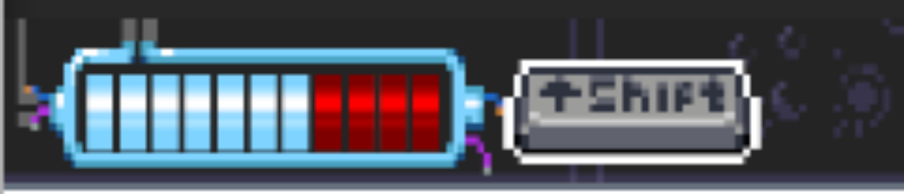

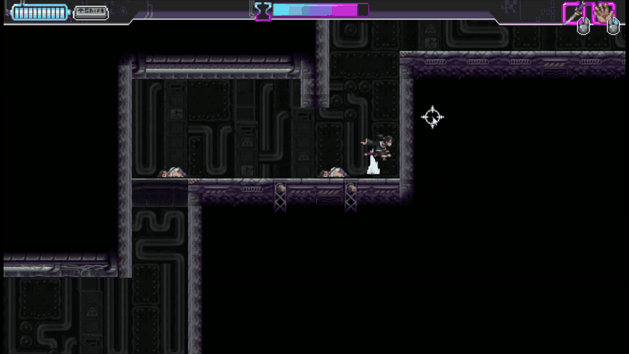

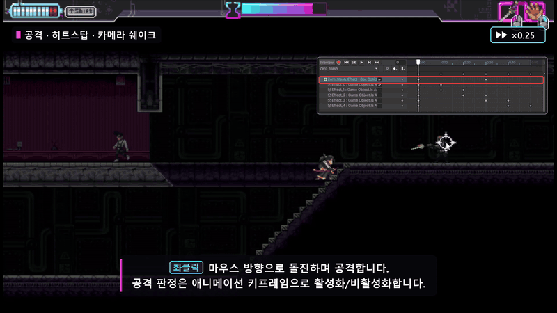

### 4.2 흐름

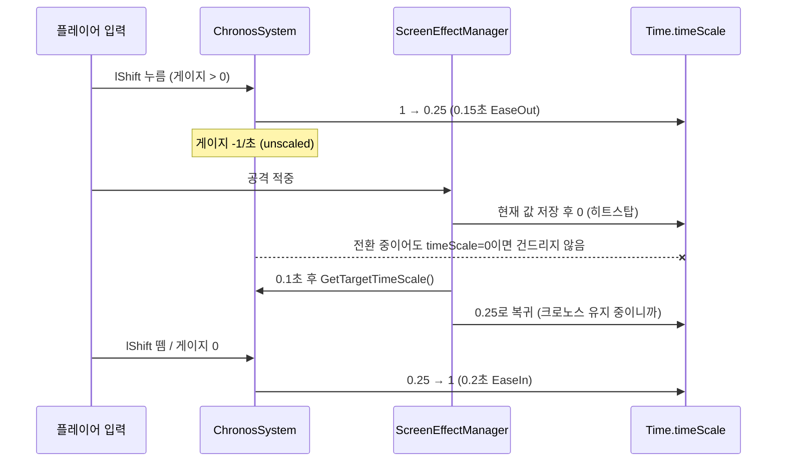

### 4.3 핵심 기능

**① 게이지는 실제 시간 기준** — 감속 중에도 실제 1초에 1씩 줄고, 꺼져 있을 때 초당 0.5씩 찹니다.

```csharp
// ChronosSystem.cs:106
private void UpdateEnergySystem()
{
    if (IsChronosActive)
    {
        CurrentEnergy -= energyDrainRate * Time.unscaledDeltaTime;
        CurrentEnergy = Mathf.Max(CurrentEnergy, 0f);
    }
    else if (CurrentEnergy < maxEnergy)
    {
        CurrentEnergy += energyRegenRate * Time.unscaledDeltaTime;
        CurrentEnergy = Mathf.Min(CurrentEnergy, maxEnergy);
    }
}
```

**② 히트스탑과 겹칠 때의 규칙** — 크로노스는 **히트스탑 중(timeScale = 0)에는 timeScale을 바꾸지 않고**, 히트스탑은 끝날 때 **저장해 둔 값이 아니라 크로노스의 현재 목표 값**으로 돌아갑니다.

```csharp
// ChronosSystem.cs:196
private void ApplyTimeScale(float scale)
{
    if (Time.timeScale <= 0f) return; // 히트스탑 중에는 건드리지 않음
    Time.timeScale = scale;
}
public float GetTargetTimeScale() => IsChronosActive ? chronosTimeScale : 1f;
```

```csharp
// ScreenEffectManager.cs:248
private IEnumerator HitStopCoroutine(float duration)
{
    timeScaleStack.Push(Time.timeScale);
    Time.timeScale = 0f;

    yield return new WaitForSecondsRealtime(duration);   // timeScale=0이어도 끝남

    if (timeScaleStack.Count > 0) timeScaleStack.Pop();  // 저장 값은 버림
    float restoreScale = (ChronosSystem.Instance != null)
        ? ChronosSystem.Instance.GetTargetTimeScale()
        : 1f;
    Time.timeScale = restoreScale;
    hitStopCoroutine = null;
}
```

> 저장해 둔 값으로 돌아가면, 히트스탑 도중 `lShift`를 떼거나 눌렀을 때 **히트스탑 전 상태로 되돌아가는 문제**가 생깁니다. 그래서 복귀 시점의 크로노스 상태를 다시 묻습니다.

**수치 근거**

| 값 | 의미 | 근거 |
|---|---|---|
| `chronosTimeScale = 0.25` | 4배 느려짐 | 원작 체감에 맞춤 ⟨확인 필요⟩ |
| `maxEnergy = 11`, 소모 1/초, 회복 0.5/초 | 최대 11초 사용, 다 쓰면 22초에 완충 | 〃 ⟨확인 필요⟩ |
| 진입 0.15초 / 해제 0.2초 | 진입은 EaseOut(빠르게 걸림), 해제는 EaseIn(천천히 풀림) | 갑자기 바뀌면 어색해서 짧은 전환 추가 |
| 히트스탑 0.1초, 쉐이크 0.15초 · 세기 0.18 | 타격 순간 강조 | 연출 테스트로 조정 |

### 4.4 고민과 선택

**결정 1. 시간 감속을 어떻게 구현할 것인가?**

| | 대안 A: 대상마다 속도 배율 적용 | **대안 B: `Time.timeScale` 변경 ✅** |
|---|---|---|
| 장점 | 플레이어만 빠르게 하는 등 세밀한 조정 가능 | 적 · 총알 · 애니메이션 · 파티클이 한 번에 느려짐 |
| 단점 | 이동 · 애니메이션 · 총알 · 이펙트를 전부 수정해야 함 → 빠뜨리면 버그 | 쿨타임 · 게이지 · 녹화 재생 등 **느려지면 안 되는 것**을 따로 빼야 함 |
| 판단 | — | 바꿔야 할 곳이 너무 많아 B 채택. 대신 2.2의 시간축 분리 표를 기준으로 unscaled 대상을 정리 |

> 원작처럼 플레이어 입력도 같이 느려지므로, "감속은 공짜가 아니라 신중하게 써야 하는 자원"이라는 설계 의도와도 맞습니다.

---

## 5. 기능 C — 녹화 · 재생 · 역재생

### 5.1 개요

플레이하는 동안 매 틱 **플레이어 · 적 · 오브젝트(총알, 카메라) · 이펙트의 상태**를 기록합니다.

- **사망 / 시간 초과** → 기록을 **3배속 역방향**으로 되감은 뒤 재시작
- **클리어** → 기록을 **정방향**으로 재생(CCTV 리플레이)한 뒤 다음 스테이지
- 최대 15,000틱(초당 50틱 기준 **5분**)을 넘기면 시간 초과로 사망 처리

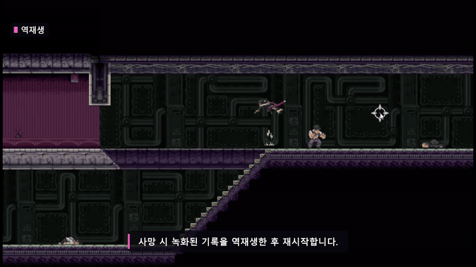


### 5.2 시스템 구조

**데이터 구조 (직접 설계)** — 한 틱 = `TimelineFrame` 1개 = 플레이어 1명 + 적 n + 오브젝트 n + 이펙트 n

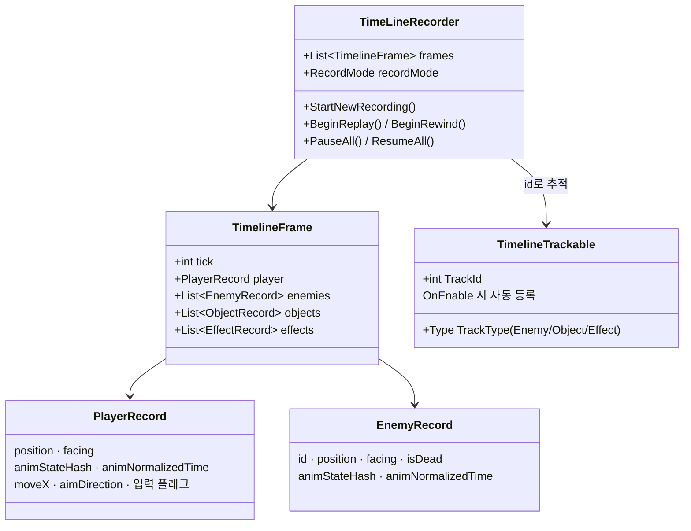

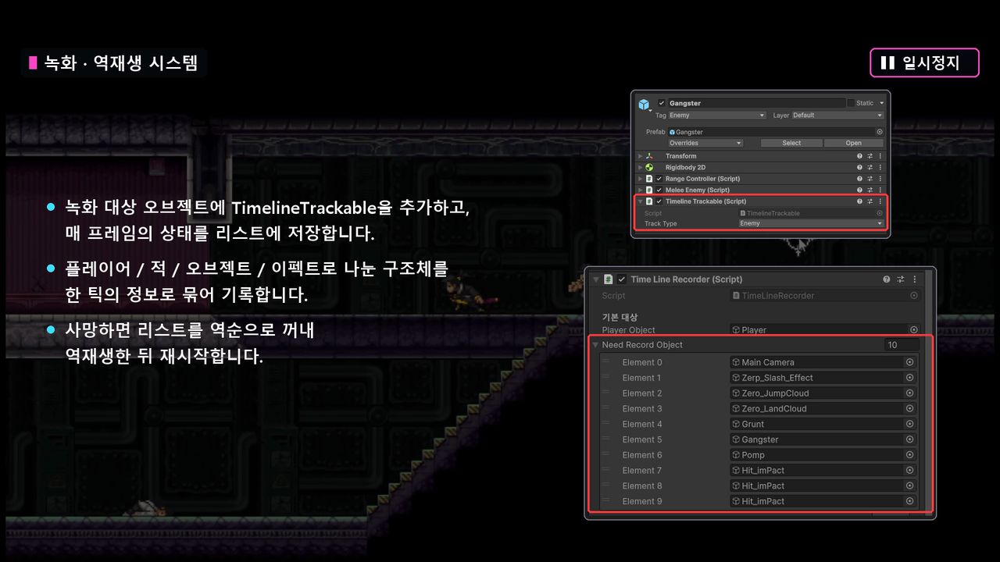

> 📷 **[이미지 필요]** 인스펙터에서 `TimelineTrackable`의 `TrackType`을 지정한 화면 (적 / 총알 / 이펙트 / 카메라)

| 녹화 모드 | 동작 | 루프 |
|---|---|---|
| Recording | 매 틱 `TimelineFrame`을 만들어 추가 | `FixedUpdate` |
| Replaying | `playbackTickFloat`를 초당 50 × 1 증가하며 샘플링 | `Update` + unscaled |
| Rewinding | `playbackTickFloat`를 초당 150 × 3 감소하며 샘플링 | `Update` + unscaled |
| Pause | 이전 모드를 저장하고 멈춤 | — |
| Fin | 재생 끝, `GameManager`가 다음 흐름 진행 | — |

### 5.3 핵심 기능

**① 기록 — 등록된 대상만 상태 스냅샷**

전체 씬을 기록하면 무거우므로, 플레이어 외에는 `TimelineTrackable`이 붙은 오브젝트만 기록합니다. 총알처럼 런타임에 생기는 오브젝트는 `OnEnable`에서 스스로 등록합니다.

```csharp
// TimeLineRecorder.cs:429
private void RecordStage()
{
    if (currentTick >= maxRecordedTicks)     // 5분 초과 → 시간 초과 사망
    {
        WasTimeoutStop = true;
        recordMode = RecordMode.Fin;
        GameManager.Instance?.OnPlayerDead();
        return;
    }

    TimelineFrame frame = new();
    frame.tick = currentTick;
    frame.player = CapturePlayerRecord();

    foreach (var pair in trackedById)
    {
        TimelineTrackable trackable = pair.Value;
        if (trackable == null) continue;
        switch (trackable.TrackType)
        {
            case TimelineTrackable.Type.Enemy:  frame.enemies.Add(CaptureEnemyRecord(trackable)); break;
            case TimelineTrackable.Type.Effect: frame.effects.Add(CaptureEffectRecord(trackable)); break;
            default:                            frame.objects.Add(CaptureObjectRecord(trackable)); break;
        }
    }
    frames.Add(frame);
    currentTick++;
}
```

**② 재생 — 틱 사이 보간**

재생 위치를 정수 틱이 아니라 `float`로 들고, 앞뒤 두 프레임 사이를 `t`로 보간합니다. 위치는 `Lerp`, 방향 · 활성 여부처럼 섞을 수 없는 값은 `t < 0.5` 기준으로 고릅니다.

```csharp
// TimeLineRecorder.cs:660
private void SampleFrame(float tickFloat, bool reverse)
{
    int fromIndex = Mathf.Clamp(Mathf.FloorToInt(tickFloat), 0, frames.Count - 1);
    int toIndex   = Mathf.Clamp(fromIndex + 1, 0, frames.Count - 1);
    float t       = Mathf.Clamp01(tickFloat - fromIndex);

    TimelineFrame fromFrame = frames[fromIndex];
    TimelineFrame toFrame   = frames[toIndex];

    SamplePlayer (fromFrame.player,  toFrame.player,  t, reverse);
    SampleEnemies(fromFrame.enemies, toFrame.enemies, t, reverse);
    SampleObjects(fromFrame.objects, toFrame.objects, t, reverse);
    SampleEffects(fromFrame.effects, toFrame.effects, t, reverse);
}
```

**③ 애니메이션 — 루프 / 단발 판단을 Animator에 맡김**

기록할 때 `normalizedTime`을 0~1로 자르지 않고 그대로 저장하고, 재생할 때 `animator.Play(hash, 0, time)`으로 넣습니다.
루프 애니메이션은 1을 넘어도 Animator가 알아서 순환하고, 단발 애니메이션은 클립 끝에서 멈춥니다 (5.4 문제 3).

```csharp
// TimeLineRecorder.cs:901 — 같은 상태면 시간 보간, 다르면 가까운 쪽 상태 사용
if (hashA != 0 && hashA == hashB)
{
    sampledHash = hashA;
    sampledTime = interpolateLoopAnimation
        ? Mathf.LerpUnclamped(timeA, timeB, t)
        : ((t < 0.5f) ? timeA : timeB);
}
else
{
    bool useTo = t >= 0.5f;
    sampledHash = useTo ? hashB : hashA;
    sampledTime = useTo ? timeB : timeA;
    // ...
}
animator.Play(sampledHash, 0, sampledTime);
animator.Update(0f);
```

**④ 재생 중에는 게임 로직을 끄고, 카메라도 기록값을 따름**

재생 · 역재생 동안 `CharacterController2D` 등 게임 로직 스크립트를 꺼서(`disableWhilePlayback`) 기록값과 싸우지 않게 합니다. 카메라도 `TimelineTrackable`로 기록해서, 리플레이 때 데드존 계산 없이 기록된 위치를 그대로 씁니다(`CameraController.cs:55`).

**수치 근거**

| 값 | 의미 | 근거 |
|---|---|---|
| 기록 = `FixedUpdate` 1회 (0.02초) | 초당 50틱 | 이동이 `FixedUpdate`에서 일어나므로 같은 주기로 기록 |
| `playbackTicksPerSecond = 50`, `replaySpeed = 1` | 정방향 1배속 | 기록 주기와 같게 |
| `rewindPlaybackTicksPerSecond = 150`, `rewindSpeed = 3` | 초당 450틱 = **9배속** 되감기 | 빠르게 재도전하도록 ⟨확인 필요: 의도한 배속인지⟩ |
| `maxRecordedTicks = 15000` | 50틱 × 300초 = 5분 | 스테이지 제한 시간 겸 메모리 상한 |

### 5.4 고민과 선택

**결정 1. 무엇을 기록할 것인가?**

| | 대안 A: 입력만 기록하고 재시뮬레이션 | **대안 B: 매 틱 상태(위치 · 방향 · 애니메이션) 스냅샷 ✅** |
|---|---|---|
| 장점 | 데이터가 작음 | 그대로 다시 적용하면 되므로 **역재생이 쉬움**, 결과가 항상 같음 |
| 단점 | 크로노스 · 히트스탑 · 적 AI 때문에 같은 입력도 결과가 달라질 수 있음, **역방향 시뮬레이션은 불가능** | 틱마다 전체 상태를 저장 → 메모리 사용, 틱 사이가 끊겨 보임 |
| 판단 | — | AI 도구의 조언을 참고해 B 채택. 역재생이 핵심 연출이라 "되돌릴 수 있는가"가 가장 중요했음 ⟨확인 필요⟩ |

> 입력 플래그(`moveX`, `jumpPressed` 등)도 `PlayerRecord`에 남아 있지만, 재생에는 위치 · 애니메이션만 씁니다. 처음에 입력 재시뮬레이션도 고려했던 흔적입니다. ⟨확인 필요⟩

**결정 2. 기록 단위와 재생 단위를 같게 할 것인가?**

| | 대안 A: 기록 · 재생 모두 `FixedUpdate` 틱 단위 | **대안 B: 기록은 틱, 재생은 `Update` + 보간 ✅** |
|---|---|---|
| 장점 | 구현 단순 | 렌더 프레임마다 부드럽게 보임, timeScale = 0에서도 재생 가능 |
| 단점 | 화면 주사율과 틱이 안 맞아 계단처럼 끊김, timeScale = 0이면 `FixedUpdate`가 안 돌아 재생 불가 | 보간 · Animator 시간축을 따로 관리해야 함 (아래 문제 2) |

---

## 6. 기능 D — 전투 확장 · 화면 연출

### 6.1 개요

판정 · 데미지 라우팅(`CombatSystem`, `HitBox` → `HurtBox`)은 수업 코드를 그대로 쓰고, **원작 규칙에 필요한 부분만 붙였습니다.**
타격 연출(히트스탑 · 쉐이크 · 화면 슬래시 · 잔상)은 `ScreenEffectManager` 한 곳에서 호출합니다.

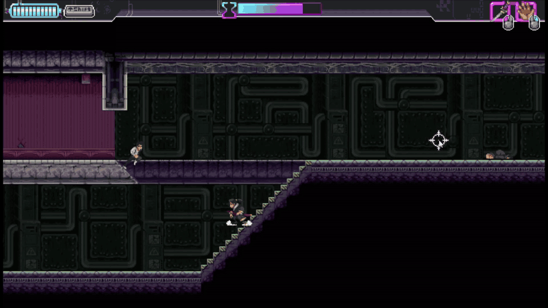

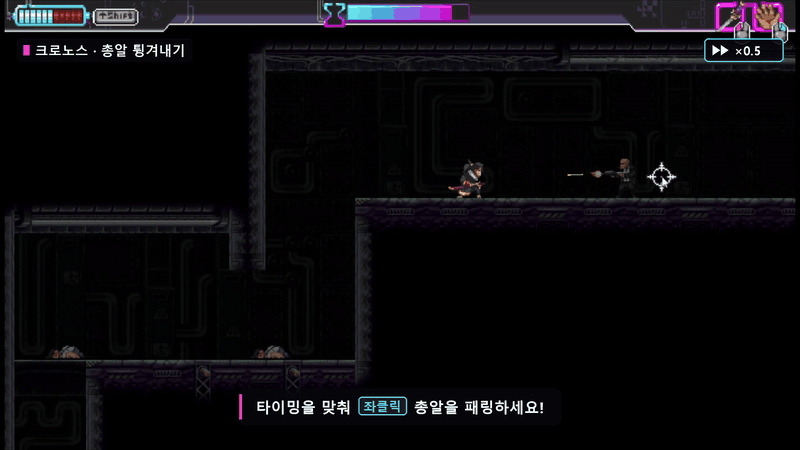

> 🎬 **[GIF·영상 필요]** 구르기로 근접 공격 회피 (무적)

### 6.2 시스템 구조

| 클래스 | 출처 | 역할 |
|---|---|---|
| `CombatSystem` · `CombatEntity` · `HurtBox` | 수업 코드 | 데미지 이벤트 라우팅, 피격 대상 등록 |
| `HitBox` | 수업 코드 + **확장** | 팀킬 방지 · 구르기 / 사망 무적 · 넉백 방향 · 연출 호출 추가 |
| `HurtBox.SetCombatActive` | **추가** | 콜라이더는 두고 판정 등록만 켜고 끔 |
| `ReflectBullet` / `Bullet.ReflectBullet` | **추가** | 공격 판정에 총알이 닿으면 소유자를 바꾸고 방향을 뒤집음 |
| `ScreenEffectManager` | **추가** | 히트스탑 · 쉐이크 · 슬래시(풀 8개) · 잔상(풀 20개), 재생 중 자동 차단 |
| `CameraController` | **추가** | 데드존(3×2) 추적, 맵 경계 클램프 |

### 6.3 핵심 기능

**① HitBox 확장 — 원작 규칙 추가**

```csharp
// HitBox.cs:61 — 수업 코드에 추가한 부분
// 팀킬 방지: 플레이어↔적 사이에서만 판정
if (Owner.gameObject == Player.LocalPlayer.gameObject &&
    collision.gameObject == Player.LocalPlayer.gameObject) return;
else if (Owner.gameObject != Player.LocalPlayer.gameObject &&
    collision.gameObject != Player.LocalPlayer.gameObject) return;

// 플레이어가 구르는 중이거나 이미 죽었으면 적 공격 무효
if (Owner != Player.LocalPlayer && other.gameObject == Player.LocalPlayer.gameObject)
{
    // ...
    bool isInvincible = playerController.isDead || char2D.IsRolling;
    if (isInvincible) return;
}
// ... (수업 코드: CombatEvent 구성 후 CombatSystem.To)
ScreenEffectManager.PlayAttackHitEffect(receiver.transform.position, hitDir);
```

**② 총알 반사** — 플레이어 공격 판정에 총알이 닿으면 소유자를 플레이어로 바꾸고 방향을 반대로 돌립니다.

```csharp
// Bullet.cs:110
public void ReflectBullet(CombatEntity sender)
{
    ScreenEffectManager.HitStop();
    ScreenEffectManager.CameraShake();
    Owner = sender;                                    // 이제 플레이어의 총알 → 적에게 맞음
    fireDirection = fireDirection * new Vector2(-1, -1);
}
```

**③ 연출 통합 호출 + 재생 중 차단** — 리플레이에서는 기록된 이펙트만 보여주고 새 연출은 만들지 않습니다.

```csharp
// ScreenEffectManager.cs — 외부는 이 함수 하나만 호출
public static void PlayAttackHitEffect(Vector3 targetWorldPos, Vector2 hitDirection)
{
    if (Instance == null) return;
    if (Instance.IsPlaybackMode()) return;   // 재생 · 역재생 중에는 차단
    PlaySlashEffect(targetWorldPos, hitDirection);
    HitStop();
    CameraShake();
}
```

| 연출 | 구현 |
|---|---|
| 히트스탑 | timeScale 0 → 0.1초 후 크로노스 목표 값으로 복귀 (4.3) |
| 카메라 쉐이크 | `CameraController`에 흔들림 오프셋만 전달 → 데드존 계산과 분리 |
| 화면 슬래시 | 풀(8개)에서 꺼내 화면 밖 → 공격 방향으로 속도 100으로 가로지른 뒤 반환 |
| 잔상 | 공격 대시 · 구르기 중 0.03초마다 스프라이트를 복사한 잔상을 풀(20개)에서 꺼내 0.2초 동안 페이드 |

**④ 데드존 카메라** — 화면 중앙 3×2 영역 안에서는 카메라가 움직이지 않고, 벗어난 만큼만 따라갑니다. 목표점(`anchor`)을 **매번 맵 경계로 즉시 클램프**해서, 맵 끝에 오래 서 있다가 반대로 움직일 때 카메라가 튀지 않게 했습니다(`CameraController.cs:92`).

> 📷 **[이미지 필요]** 씬 뷰에서 데드존 박스와 맵 경계 콜라이더가 보이는 화면

### 6.4 고민과 선택

**결정 1. 연출 호출을 어디에 둘 것인가?**

| | 대안 A: 연출마다 호출하는 쪽에서 직접 처리 | **대안 B: `ScreenEffectManager` 정적 API로 통합 ✅** |
|---|---|---|
| 장점 | 연출별로 세밀하게 조정 | 호출하는 쪽은 한 줄, "재생 중 차단" 같은 공통 규칙을 한 곳에서 처리 |
| 단점 | 재생 중 차단 조건을 모든 호출부에 넣어야 함 | 매니저가 커짐 (420줄) |

> 수업 코드의 옵서버(`ICombatObserver`)로 연출을 붙이는 방법도 있었지만, 총알 반사처럼 **데미지 이벤트가 아닌 순간**에도 같은 연출이 필요해서 정적 API로 직접 호출했습니다. ⟨확인 필요⟩

---

## 7. 결과 및 배운 점

### 7.1 결과

| 목표 (개요의 Why) | 결과 | 근거 |
|---|---|---|
| 원작 같은 이동 | ✅ 계단 대각선 이동 · 플랫폼 통과 · 벽 붙기 · 공중제비 · 구르기 구현 | `CharacterController2D` 166줄 → 1,014줄 |
| 시간 감속 | ✅ 크로노스 · 히트스탑 · 일시정지가 겹쳐도 timeScale이 꼬이지 않음 | 2.2 시간축 분리, 4.3 복귀 규칙 |
| 사망 시 되감기 / 클리어 리플레이 | ✅ 역재생 9배속, 정방향 1배속 리플레이 | 5장 |
| 부드러운 리플레이 | ✅ 틱 사이 보간 + 루프 / 단발 애니메이션 정상 재생 | 5.3 ② ③ |
| 콘텐츠 | 타이틀 + 스테이지 8개, Windows 빌드 | 13일, 1인 |

> 발표 피드백: "리와인드 기능을 보고 타 게임의 리플레이 방식과 어떻게 다르게 구현되는지 공부할 수 있었다", "FSM과 애니메이션 등 시각적 피드백이 실제 게임을 그대로 옮긴 것처럼 자연스러웠다" (채경희)

### 7.2 문제 해결 경험 (Troubleshooting)

| # | 문제 | 원인 | 해결 / 개선 | 상태 |
|---|---|---|---|---|
| 1 | 대각선 이동 시 플랫폼 모서리에 **캐릭터가 낌** | x, y 이동을 한 번에 BoxCast해서 모서리에 걸림 | x를 먼저 이동한 위치에서 y를 따로 검사 (3.3 ①) | ✅ |
| 2 | 구르기 · 공격 대시로 계단을 지나면 **허공으로 날아가거나 순간이동** | 한 틱 이동량이 계단 높이보다 커서 step 실패, `while` 반복은 무한 루프 · 제자리 이동 | 구르기만 `maxStepHeight` 단위로 분할 + 내려가는 step 추가 (3.3 ③) | ✅ |
| 3 | **역재생 시 캐릭터가 반대 방향을 봄** | 바라보는 방향을 바꾸는 코드가 여러 곳(이동 · 공격 · 공중제비)에 흩어져 있어, 화면의 방향과 기록된 `FacingDirection`이 달랐음 ⟨확인 필요⟩ | 방향 변경을 `SetFacingDirection` 하나로 모으고, 화면 반전도 `FacingDirection`에서만 읽도록 통일 (`PlayerController.SyncFacingVisual`) | ✅ |
| 4 | 크로노스를 쓴 구간이 **역재생에서도 느리게 재생** | 재생이 `Time.deltaTime`(scaled) 기준 | 재생 · 역재생을 `unscaledDeltaTime` 기준으로 변경 | ✅ |
| 5 | **재생 중 일시정지해도 애니메이션이 계속 재생** | 4번 해결로 재생 중 Animator를 `UnscaledTime` 모드로 바꿨더니, 일시정지(timeScale = 0)도 무시함 | 일시정지할 때 Animator 모드를 원래대로 되돌리고, 재개할 때 다시 Unscaled로 설정 (아래 상세) | ✅ |
| 6 | 리플레이에서 **단발 애니메이션(공격 · 사망)이 반복** | `normalizedTime`을 `Mathf.Repeat`로 0~1에 잘라 기록 → 루프인지 단발인지 구분이 사라짐 | 원래 값을 그대로 기록하고 루프 판단은 Animator State의 Loop Time 설정에 맡김 (5.3 ③) | ✅ |
| 7 | 리플레이 애니메이션이 **뚝뚝 끊김** | 틱 단위로만 적용해 프레임 사이 보간이 없음 | 재생 위치를 `float`로 들고 두 틱 사이를 보간 (5.3 ②) | ✅ |
| 8 | 플랫폼 중간에서 하강할 때 **콜라이더에 낌** | 플랫폼과 겹친 상태에서 원래 레이어로 복원되면 플랫폼 안에 갇힘 | 바닥 검사에서 "플랫폼 윗면보다 발이 아래"면 접지가 아닌 것으로 보고 `DropDownPlatform`으로 빠져나가게 처리 | ⚠️ 동작은 하지만 코드가 불안정 (7.3) |

**3번 상세 — 방향을 한 곳에서만 바꾸기**

```csharp
// CharacterController2D.cs:224 — 모든 방향 변경은 여기로
public void SetFacingDirection(float direction)
{
    if (direction == 0f) return;
    FacingDirection = (direction < 0f) ? -1 : 1;
}

// PlayerController.cs:133 — 화면 반전은 FacingDirection만 읽음 → 녹화값과 항상 같음
private void SyncFacingVisual()
{
    Animator.transform.localScale = new Vector3(Controller2D.FacingDirection, 1, 1);
}
```

> 📷 **[이미지 필요]** (선택) 수정 전 역재생에서 캐릭터가 반대 방향을 보는 장면

**5번 상세 — 재생 중 일시정지**

재생 · 역재생 중에는 `Time.timeScale = 0`으로 세계를 멈추고 녹화기만 실제 시간으로 움직입니다(2.1). 그래서 Animator를 `UnscaledTime`으로 바꿔야 재생이 보이는데, 그러면 일시정지도 같은 timeScale = 0이라 **멈출 방법이 없어집니다.**
그래서 "일시정지 중"에는 Animator를 원래 모드로 돌려 timeScale = 0의 영향을 받게 했습니다.

```csharp
// TimeLineRecorder.cs:207
public void PauseAll()
{
    // ...
    prevRecordMode = recordMode;
    if (prevRecordMode == RecordMode.Rewinding || prevRecordMode == RecordMode.Replaying)
        RestoreAnimatorUpdateModes();      // Normal로 되돌림 → timeScale=0에 멈춤
    recordMode = RecordMode.Pause;
}

public void ResumeAll()
{
    if (recordMode != RecordMode.Pause) return;
    recordMode = prevRecordMode;           // 멈춘 지점부터 이어서
    if (recordMode == RecordMode.Rewinding || recordMode == RecordMode.Replaying)
        CacheAndSetAnimatorsToUnscaledTime();
}
```

> 🎬 **[GIF·영상 필요]** 역재생 도중 ESC → 화면 전체가 멈춤 → 재개하면 멈춘 지점부터 이어서 되감기

### 7.3 아쉬운 점 및 향후 계획

**일정 때문에 못 한 것**

| 아쉬운 점 | 영향 | 향후 계획 (v0.2 기획) |
|---|---|---|
| 엔딩(보스전) 미완성 | 마지막 스테이지 클리어 후 마무리가 약함 | 보스전 + 엔딩 연출 |
| 상태별 화면 효과 없음 | 플레이 · 재생 · 역재생 · 일시정지 화면이 구분되지 않음 | 재생 흑백, 역재생 글리치, 일시정지 VHS 노이즈 |
| 다음 맵 길 안내 없음 | 클리어 후 어디로 가야 할지 모름 | 출구 방향 표시 UI |
| 튜토리얼 없음 | 원작을 모르면 총알 반사 등을 알 수 없음 (발표 피드백) | 최초 진입 · 기능 최초 사용 시 안내 |
| 사운드 없음 | 타격감 · 시간 조작이 시각에만 의존 | BGM · SFX 추가 |

**기술 부채**

| 아쉬운 점 | 영향 | 개선 방향 |
|---|---|---|
| 공격 · 점프 · 착지의 시작 / 끝을 **bool 값**으로 처리 | 매 프레임 이전 값과 비교하는 코드(`prevIsWallFlipping` 등)가 늘어남 | 이벤트(`OnLanded`, `OnAttackStart` 등)로 전환 |
| 대각선 이동이 **기본 이동 / 구르기 두 가지 로직** | 계단 관련 수정 시 두 곳을 고쳐야 함 | 분할 이동 하나로 통합 (기본 이동도 slice 1개로 처리) |
| 플랫폼 판정 기준이 섞여 있음 | 한쪽은 레이어 번호(7), 한쪽은 `PlatformEffector2D` 유무로 판정 → 7.2 문제 8의 처리가 불안정 | 플랫폼 판정을 하나의 기준 · 함수로 통일, 레이어 번호 대신 `LayerMask` 필드 사용 |
| `GameManager` · `InGameUI` · `UnitManagement` 역할 분리 부족 | 게임 흐름 수정 시 영향 범위가 넓음 | 흐름(상태) · 표시(UI) · 유닛 관리 책임을 나누고 이벤트로 연결 |

### 7.4 배운 점

- **이미 있는 기능의 가치.** Rigidbody2D를 Kinematic으로 두고 이동을 전부 BoxCast로 만들면서 계단 step, 레이어 교체, 분할 이동 같은 예외를 하나씩 쌓았습니다.
  끝내고 나서야 Physics2D가 기본으로 해 주던 일이 많았다는 걸 체감했고, "다시 만들지 않아도 되는 것을 직접 만들고 있지 않은가"를 먼저 따져 보게 됐습니다.
- **시간을 쓰는 코드는 먼저 시간축을 정해야 한다.** 크로노스 · 히트스탑 · 일시정지 · 재생이 모두 `Time.timeScale`을 건드려서, 하나를 고치면 다른 게 깨졌습니다(7.2 문제 4 → 5).
  "누가 scaled를 쓰고 누가 unscaled를 쓰는가"를 표로 정리한 뒤(2.2)에야 문제가 연쇄되지 않았습니다.
- **값을 추측하지 말고 그 값을 아는 쪽에 맡긴다.** 애니메이션이 루프인지 단발인지 `normalizedTime`으로 추측하다 실패했고, Animator State의 Loop Time 설정에 맡기자 한 줄 변경으로 두 문제가 함께 풀렸습니다.
  방향 버그도 같은 값을 여러 곳에서 바꾸던 게 원인이라, 값을 바꾸는 곳을 하나로 모으는 습관이 생겼습니다.
- **책임 분리가 디버깅 비용을 줄인다.** `PlayerController`(입력 → 요청)와 `CharacterController2D`(실제 이동)를 나누고, 연출을 `ScreenEffectManager`로 모으니 새 연출(화면 슬래시)을 추가할 때 한 파일만 고치면 됐습니다.
- **범위와 일정을 먼저 정해야 한다.** 필요해 보이는 기능부터 만들다 보니 마감에 엔딩 · UI를 급하게 만들거나 빼야 했습니다. 다음 프로젝트부터는 전체 범위와 일정을 먼저 잡고 시작합니다.
