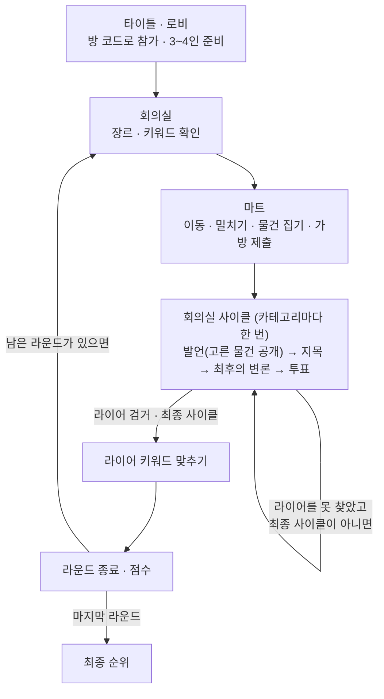
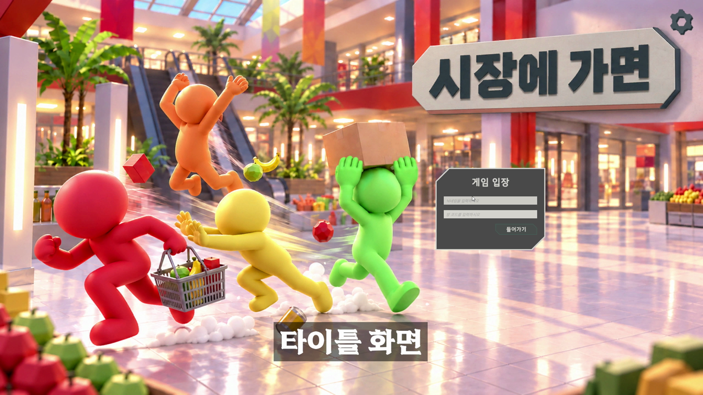
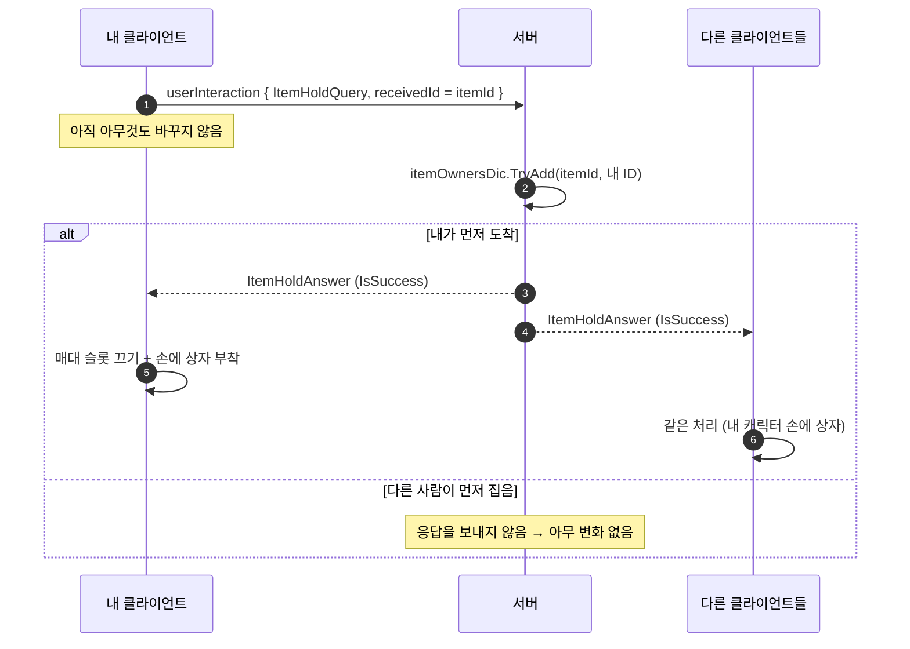
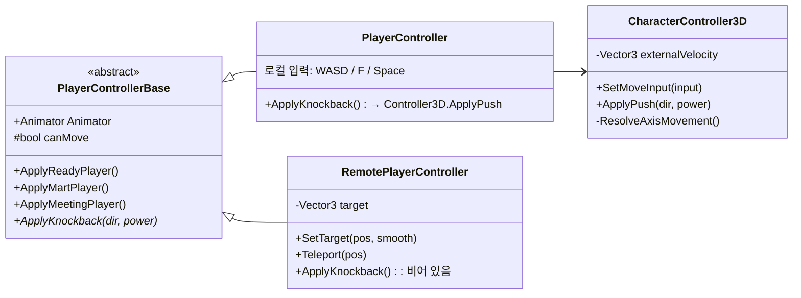
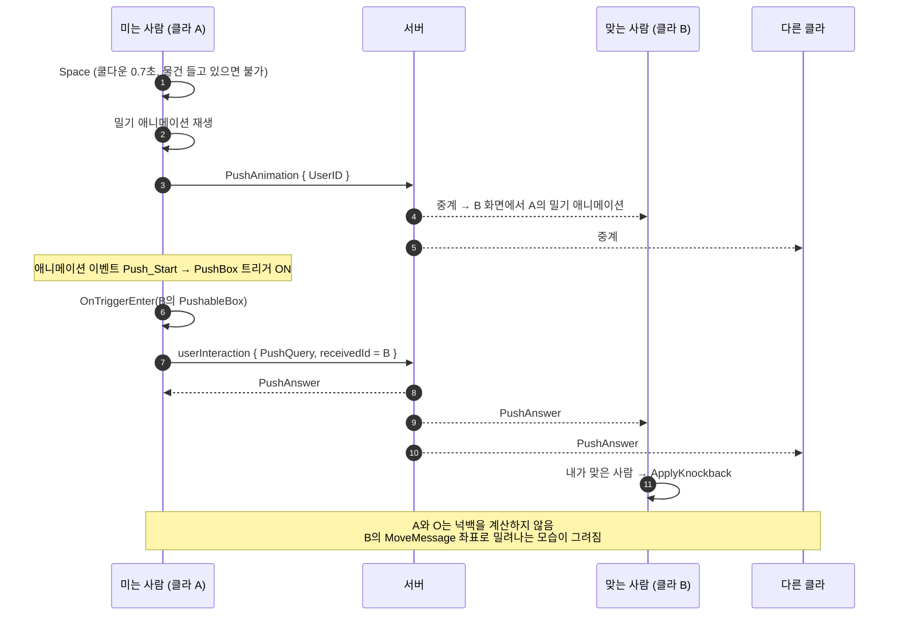
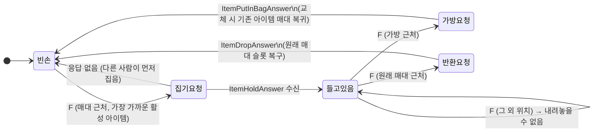
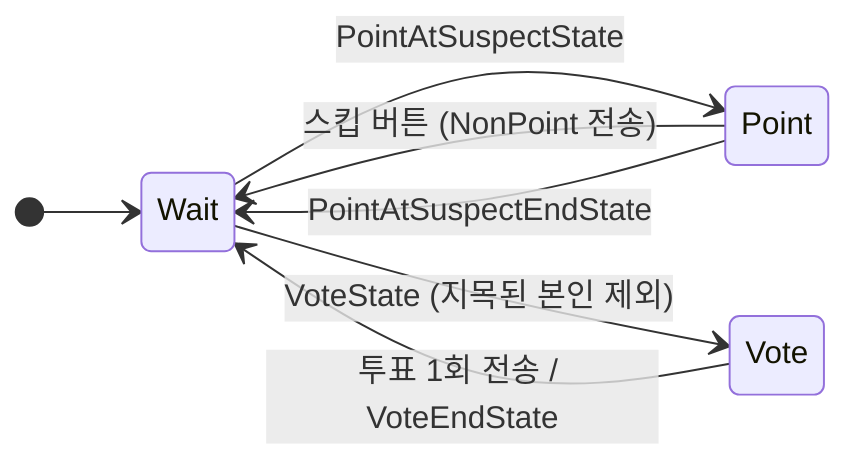
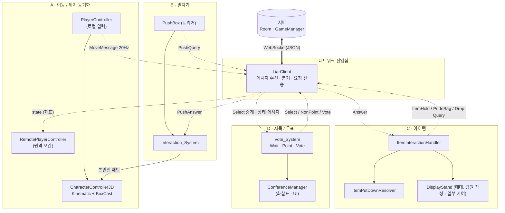

# 시장에 가면 — 마트 상호작용 · 회의실 지목/투표 클라이언트 기술 문서

| 항목 | 내용 |
|---|---|
| 장르 | 3D 쿼터뷰 멀티플레이 추리 게임 (라이어 게임 모티브, 3~4인) |
| 기간 · 형태 | 2026.08.25 ~ 2026.09.08 (공식 개발 기간) · 4인 팀 프로젝트 |
| Engine | Unity **6000.3.15f1** (Unity 6) |
| Language | C# |
| Server | **.NET 10** 콘솔 서버 (팀원 작성) · WebSocket · JSON |
| 주요 라이브러리 | UniTask(비동기 씬 로드 · 전송 루프), DOTween(UI · 화살표 · 아이템 연출) |
| 데이터 | `StreamingAssets/Table/*.tsv` (아이템 · 장르 · 키워드) |
| 협업 | Git(GitHub) · Asana 칸반 |
| 링크 | [Client GitHub](https://github.com/KooHoo-Dev/3rd-TeamProject-SH) · [Server GitHub](https://github.com/KooHoo-Dev/3rd-TeamProject-SH-Server) · [시연 영상](https://youtube.com/shorts/fyhsoPl_Yds) · [전체 영상](https://youtu.be/r_CJydnc-PU) |

**다루는 범위**: 게임 전체가 아니라, 4인 팀에서 **제가 담당한 클라이언트 시스템 4가지**의 설계 의도와 핵심 구현만 다룹니다.

| # | 시스템 | 한 줄 요약 | 핵심 키워드 |
|---|---|---|---|
| A | 캐릭터 이동 · 충돌 · 위치 동기화 | 키네마틱 Rigidbody + 축별 BoxCast 이동, 원격 플레이어 보간 | Kinematic · BoxCast · 지수 보간 |
| B | 플레이어 밀치기 | 애니메이션 타이밍 판정 → 서버 승인 → **맞은 본인만** 넉백 적용 | 요청/응답 · 소유자 처리 |
| C | 아이템 집기 · 운반 · 가방 · 교체 | 선착순 집기, F키 하나로 가방/원래 매대 판정, 같은 카테고리 교체 시 매대 복귀 | 서버 선착순 판정 · Resolver |
| D | 지목 · 투표 입력 | 3D 캐릭터 클릭 지목 · 취소 · 재지목, 3지선다 투표 | 상태 머신 · Raycast |

---

## 1. 개요

### 1.1 게임 소개

**시장에 가면**은 3~4인이 WebSocket 서버로 접속해 플레이하는 3D 쿼터뷰 추리 게임입니다.
라이어 게임을 모티브로, 플레이어는 같은 장르 · 서로 다른(라이어 1명) 키워드를 받은 뒤
**마트에서 직접 물건을 골라 담고**, 회의실로 돌아와 그 물건을 근거로 토론 · 지목 · 투표해 라이어를 찾습니다.

**게임 흐름**



> 유효한 지목이 없으면 변론 · 투표 없이 다음 사이클로 넘어가고, 라이어가 스스로 밝히면(라밍아웃) 바로 키워드 맞추기로 갑니다. 라운드 수는 서버 설정값(`MaxRound`)입니다.



> ▶ 게임 한 라운드(회의실 → 마트 → 회의실)는 [전체 영상](https://youtu.be/r_CJydnc-PU)에서 볼 수 있습니다.

이 중 저는 **클라이언트 전반 중 마트의 캐릭터·아이템 상호작용과 회의실의 지목·투표 입력**을 담당했습니다.

### 1.2 목표

이 게임은 과제(네트워크 통신이 들어간 팀 게임, 2주)의 주제 2 「방 코드 입력형 멀티플레이 게임」으로 만들었습니다.
상용 네트워크 솔루션(Photon · Mirror 등) 없이 팀원이 직접 만든 .NET WebSocket 서버를 써야 했기 때문에,
저는 **WebSocket 서버와 3~4인 클라이언트 사이에서, 팀이 정한 메시지 규약으로 서버 동기화를 직접 경험해 보는 것**을 목표로 했습니다.

만들면서 부딪힌 동기화 문제와 해결 방향은 아래와 같습니다.

| 문제 상황 (Before) | 결과적으로 생기는 비용 | 해결 방향 |
|---|---|---|
| 여러 명이 같은 물건을 동시에 집으려 할 수 있음 | PC마다 "누가 집었는지"가 달라져 게임 결과가 갈림 | **경쟁이 생기는 데이터만 서버가 판정**하고, 클라이언트는 응답을 받은 뒤에만 반영 (2장) |
| 모든 클라이언트가 모든 캐릭터에 충돌 · 넉백을 계산 | 좌표의 미세한 차이로 넉백 방향이 PC마다 달라져 캐릭터가 튕겨 나감 | **자기 캐릭터만 직접 계산**하고, 나머지는 받은 좌표만 그림 (3장) |
| 마트로 씬을 옮기면 다른 플레이어 캐릭터가 이전 씬 좌표에서 새 자리까지 끌려가듯 미끄러짐 (**고무줄 현상**) | 회의실 · 마트를 오갈 때마다 다른 플레이어의 위치가 어긋나 보임 | 씬 전환 직후 1초간 좌표 무시 + 3m 넘게 떨어진 좌표 버리기 (3장) |
| 한 매대에 아이템이 3개로 늘면서, 내려놓을 곳도 가방 · 매대 두 곳이 됨 | 엉뚱한 아이템이 집히고, 내려놓기 규칙이 불명확 | 가장 가까운 아이템 탐색 + **F키 하나로 위치에 따라 가방/매대 판정** (4장) |
| 회의실 지목을 UI 목록으로 하면 누가 누구를 의심하는지 보이지 않음 | 추리 게임의 긴장감과 연출이 약해짐 | **3D 캐릭터를 직접 클릭**해 지목, 지목 관계를 화살표로 시각화 (5장) |

### 1.3 내가 맡은 부분

서버는 팀원이 작성했고, 저는 팀이 함께 정의한 `Protocol`을 기준으로 **메시지를 보내고, 서버가 보낸 결과를 클라이언트에 적용**하는 쪽을 맡았습니다.

| 구분 | 내용 |
|---|---|
| ✅ 담당 (본 문서 범위) | 캐릭터 이동 · 충돌 · 위치 동기화 / 플레이어 밀치기 / 아이템 집기 · 운반 · 가방 넣기 · 교체 · 매대 반환 / 회의실 지목 · 지목 스킵 · 투표 입력과 상태 반영 / 씬 전환 시 플레이어 배치 · 색상 / 지목 · 투표 · 마트 기능이 UI를 호출하는 UIManager 시스템(`Conference_UIManager` · `MartUIManager`, UI 디자인 제외) |
| ➖ 기타 담당 (6.6에 짧게) | 마트 스폰 · 매대 아이템 생성 · 퀘스트 배정, 마트 UI 표시, 채팅 메시지 전송, 최종 순위 캐릭터 애니메이션 |
| ❌ 담당 아님 | 서버 전체(게임 상태 머신 · 판정 · 점수), 매대 · 그리드의 기본 구조(팀원 작성), 맵 · UI 디자인, 데이터 테이블(TSV) |

### 1.4 이 문서에서 다루는 내용

먼저 모든 기능의 바탕인 **서버 판정과 메시지 흐름**(2장)을 설명하고, 이어서 게임의 두 공간 순서대로 설명합니다. 마트에서는 **플레이어 조작**(3장: 이동 · 위치 동기화 · 밀치기)과 **아이템 상호작용**(4장: 집기 · 가방 · 교체), 회의실에서는 **지목 · 투표**(5장)입니다. 나머지는 그 밖의 기능(6장)으로 모았습니다. 마지막으로 결과와 겪은 문제, 남은 과제(7장)를 정리합니다. 전체 구조 그림은 부록 A에 있습니다.

---

## 2. 서버 판정과 메시지 흐름

모든 기능은 같은 방식으로 서버와 메시지를 주고받습니다. 이 장은 그 흐름과, 무엇을 서버가 판정할지 정한 기준을 다룹니다.

### 2.1 요청 · 응답 메시지 흐름

클라이언트는 **자기 화면을 먼저 바꾸지 않습니다.** 요청만 보내고, 서버 응답이 모든 클라이언트에 도착했을 때 각자 같은 결과를 반영합니다.



메시지 종류는 `Protocol.UserInteractionMessage` 하나로 통일되어 있고, `InteractionType`으로 구분합니다.

| 요청 (클라 → 서버) | 응답 (서버 → 전체) | 서버 판정 | 클라이언트 처리 |
|---|---|---|---|
| `PushQuery` | `PushAnswer` | 항상 성공 | 맞은 사람이 **나일 때만** 넉백 (3장) |
| `ItemHoldQuery` | `ItemHoldAnswer` | 선착순 (`TryAdd`) | 매대 슬롯 비활성 + 손에 부착 (4장) |
| `ItemPutInBagQuery` | `ItemPutInBagAnswer { ChangedItemId }` | 같은 카테고리 있으면 교체 | 교체된 아이템을 원래 매대 슬롯에 복구 (4장) |
| `ItemDropQuery` | `ItemDropAnswer` | 소유 해제 | 들고 있던 아이템을 원래 매대 슬롯에 복구 (4장) |

표의 메시지 이름(`~Query` · `~Answer`)은 팀 Protocol에서 정한 이름 그대로이고, 문서에서는 서버로 보내는 것을 **요청(Request)**, 서버가 돌려주는 것을 **응답(Response)**이라고 부릅니다.

#### 2.1.1 무엇을 서버가 판정할 것인가

| | [A] 서버가 모든 것을 계산 | **[B] 다툼이 생기는 것만 서버가 판정** ✓ |
|---|---|---|
| 장점 | 모든 PC의 결과가 항상 같음 | 서버 책임이 작음. 위치 · 넉백은 각 클라이언트가 바로 처리 |
| 단점 | 서버가 캐릭터 좌표와 애니메이션 상태까지 알아야 해서 책임이 지나치게 커짐 | 서버가 검증하지 않는 부분은 조작된 클라이언트를 막지 못함 (7.3) |

**[최종 결정]** [B].
서버가 모든 것을 계산하게 할 수도 있었지만, 그러면 서버의 책임이 지나치게 커진다고 판단했습니다.
그래서 Protocol 협의 단계에서 **여러 명이 동시에 같은 자원을 다툴 수 있는 것만 서버가 판정**하고,
나머지는 서버가 모두에게 같은 데이터를 뿌려주면 각 클라이언트가 그 데이터로 직접 처리하도록 나눴습니다.

| 데이터 | 판정 주체 | 이유 |
|---|---|---|
| 아이템 소유 (누가 먼저 집었나) | **서버** (`itemOwnersDic.TryAdd`) | 두 명이 같은 물건을 동시에 집을 수 있음 → 한 곳에서 선착순 판정 필요 |
| 가방 교체 (같은 카테고리 기존 아이템) | **서버** (`ChangedItemId` 반환) | 플레이어별 가방 내용은 서버가 보관하는 공용 데이터 |
| 지목 · 투표 집계 / 결과 | **서버** | 게임 진행을 결정하는 결과 |
| 내 캐릭터 위치 · 이동 | 클라이언트 | 서버는 받은 좌표를 다른 클라이언트에 중계만 함 |
| 밀치기 넉백 · 연출 | 클라이언트 (맞은 본인) | 3장 참고 |

---

## 3. 마트: 플레이어 조작

WASD로 움직이는 **로컬 캐릭터**와, 서버에서 받은 좌표를 따라가는 **원격 캐릭터**를 서로 다른 컨트롤러로 분리했습니다.
로컬은 직접 충돌을 계산하며 움직이고, 원격은 충돌 계산 없이 좌표만 부드럽게 따라갑니다.
기획 단계의 마트 백로그에서 플레이어끼리의 밀림은 "별도의 밀기 행동이 아닌, 플레이어끼리 충돌했을 때 발생하는 밀림"(추가 과제 EX-E1)이었는데, 최종적으로는 Space로 미는 행동(3.3)으로 만들었습니다.


**클래스 구조**



**루트 / Body 분리**

```text
Player (루트)         ← 위치만 담당 (이동 · 서버 동기화 기준 좌표)
 └─ Body              ← 회전만 담당 (캐릭터 모델 · Animator)
```

이동은 루트, 바라보는 방향은 `Body`에만 적용합니다. 애니메이션의 루트 모션이나 회전이 루트 좌표에 섞이지 않게 해서,
씬을 오갈 때 캐릭터 위치 · 방향이 틀어지는 문제를 막았습니다 (3.5 참고).

**호출 API**

| 하고 싶은 일 | 호출할 API | 비고 |
|---|---|---|
| 로컬 이동 입력 | `CharacterController3D.SetMoveInput(Vector3)` | -1 ~ 1로 Clamp |
| 외부 충격(넉백) | `CharacterController3D.ApplyPush(dir, power)` | 입력을 끊고 `externalVelocity`에 누적 |
| 원격 좌표 갱신 | `RemotePlayerController.SetTarget(pos, smooth)` | 서버 `state` 메시지 수신 시 |
| 씬 전환 시 순간 배치 | `RemotePlayerController.Teleport(pos)` | 1초간 들어오는 좌표 무시 |
| 밀치기 요청 | `LiarClient.Instance.RequestPushQuery(playerId)` | `PushBox` 트리거에서 내 캐릭터일 때만 (3.3) |

### 3.1 내 캐릭터 이동: 축을 나눠 검사하는 BoxCast

```csharp
// CharacterController3D.cs
private void FixedUpdate()
{
    // (Why) 입력 이동과 넉백을 한 벡터로 합쳐, 넉백도 똑같이 벽 충돌 검사를 받게 한다
    HorizontalVelocity = moveX * speed + externalVelocity.x;
    VerticalVelocity   = moveZ * speed + externalVelocity.z;
    Vector3 desireMove = new Vector3(HorizontalVelocity, 0, VerticalVelocity) * Time.fixedDeltaTime;

    Bounds box = GetCastBox();
    // (Why) X와 Z를 따로 검사 → 벽에 비스듬히 부딪혀도 막힌 축만 멈추고 다른 축으로는 미끄러지듯 이동
    float boxX = ResolveAxisMovement(box, desireMove.x, Vector3.right);
    box.center += new Vector3(boxX, 0, 0);
    float boxZ = ResolveAxisMovement(box, desireMove.z, Vector3.forward);

    // 넉백은 잠깐 남았다가 매 프레임 감쇠
    externalVelocity = Vector3.Lerp(externalVelocity, Vector3.zero, externalDrag * Time.fixedDeltaTime);

    rBody.MovePosition(transform.position + new Vector3(boxX, 0, boxZ));
}

private float ResolveAxisMovement(Bounds box, float move, Vector3 axis)
{
    if (move == 0.0f) return 0.0f;
    Vector3 dir = move > 0.0f ? axis : -axis;

    bool isHit = Physics.BoxCast(box.center, box.extents, dir, out RaycastHit hit,
                                 Quaternion.identity, Mathf.Abs(move), collisionLayer);
    if (!isHit) return move;

    // (Why) 벽까지 남은 거리에서 skinWidth만큼 덜 가서, 콜라이더가 벽에 파고들지 않게 한다
    return Mathf.Sign(move) * Mathf.Max(0, hit.distance - skinWidth);
}
```

> 넉백도 `ResolveAxisMovement`를 거치기 때문에, **벽에 부딪히면 더 이상 밀리지 않습니다.** (별도의 벽 처리 코드 없이 해결)

#### 3.1.1 이동을 무엇으로 구현할 것인가

| | [A] Dynamic Rigidbody (물리 엔진) | [B] Unity CharacterController | **[C] Kinematic Rigidbody + BoxCast 직접 구현** ✓ |
|---|---|---|---|
| 장점 | 충돌 · 밀림이 엔진에서 자동 처리 | 경사 · 계단 처리 내장 | 이동 · 충돌 · 넉백을 전부 코드로 통제, 직접 만들어 본 구조 |
| 단점 | PC마다 물리 결과가 미세하게 달라 동기화가 어려움, 중력 · 마찰 설정 필요 | 캡슐 형태 고정, 외부 충격(넉백) 처리를 따로 만들어야 함 | 충돌 처리를 직접 작성해야 함 |

**[최종 결정]** [C].
이 게임은 **점프 등 y축 이동이 전혀 없어** 중력이 필요 없습니다. 그래서 2D 컨트롤러(`CharacterController2D`: Kinematic + skinWidth + 외부 이동값)를 **3D로 옮기면서 중력 · 점프를 빼고 XZ 축별 BoxCast로 바꿨습니다**.

### 3.2 다른 플레이어 위치 동기화: 보간과 좌표 거르기

```csharp
// RemotePlayerController.cs
public void SetTarget(Vector3 position, float smooth)
{
    if (delayTimer > 0f) return;   // (Why) 씬 전환 직후 1초간은 이전 씬에서 보낸 좌표가 섞여 들어오므로 무시

    // (Why) 마지막 목표점에서 3m 이상 떨어진 좌표는 '순간이동'으로 보고 아예 버린다.
    //       스냅해서 옮기는 대신 다음 정상 좌표가 올 때까지 제자리에서 기다린다.
    if ((position - target).sqrMagnitude > maxWalkableSqrDistance) return; // 9 = 3m²

    target = position;
}

private void Update()
{
    // (Why) 프레임 독립적인 지수 감쇠 보간 → FPS가 달라도 같은 속도로 따라간다
    float t = 1f - Mathf.Exp(-smooth * Time.deltaTime);
    Place(Vector3.Lerp(transform.position, target, t));

    Vector3 moveDirection = target - transform.position;
    moveDirection.y = 0f;          // (Why) 위아래로 기울어지지 않게
    if (moveDirection.sqrMagnitude > 0.0001f)
        body.transform.forward = moveDirection.normalized; // 회전은 Body에만
}
```

**수치 근거**

| 항목 | 값 | 근거 |
|---|---|---|
| 위치 전송 주기 | **20Hz** (`sendPerSecond = 20`, 50ms) | 10~20Hz 기준의 상한 |
| 이동 속도 | 5 m/s | `CharacterController3D.speed` (플레이어 프리팹 인스펙터 값) |
| 패킷 1개당 정상 이동량 | 약 **0.25m** | 5 m/s × 0.05 s |
| 비정상 좌표 기준 | **3m** | 정상 이동량의 약 12배 → 정상 이동이 잘못 버려질 일이 없음 |
| 씬 전환 후 무시 시간 | 1초 | 이전 씬 좌표가 도착하는 시간보다 넉넉하게 |

> 넉백으로 한 번에 3m 이상 밀리는 경우도 없습니다. 인스펙터 값(밀치는 힘 30 · `externalDrag` 12 · Fixed Timestep 0.02초)으로 계산하면 넉백 1회에 총 약 2.5m 밀리고, 위치 패킷 1개(50ms) 사이에는 걷기를 더해도 약 1.65m입니다. (여러 명이 동시에 미는 경우는 계산하지 않았습니다.)

#### 3.2.1 원격 캐릭터를 어떻게 따라가게 할 것인가

로컬은 입력으로 직접 움직이고, 원격은 서버 좌표를 따라가기 때문에 둘의 움직임 방식에 차이가 있습니다.
이 차이 때문에 **씬 이동으로 캐릭터를 재배치할 때마다 원격 캐릭터가 예전 좌표로 끌려가는 고무줄 현상**이 계속 생겼습니다.

| | [A] 받은 좌표로 즉시 이동 (스냅) | [B] 모든 좌표를 보간 | **[C] 보간 + 씬 전환 직후 무시 + 비정상 거리 버리기** ✓ |
|---|---|---|---|
| 장점 | 구현 단순, 오차 없음 | 부드러움 | 부드러우면서 순간이동 좌표에 끌려가지 않음 |
| 단점 | 20Hz라 뚝뚝 끊겨 보임 | 씬 전환 시 예전 좌표까지 미끄러져 감 | 정상 좌표를 잘못 버릴 위험 → 3m 기준(정상의 약 12배)으로 회피 |

**[최종 결정]** [C]. 이 방식에 이르기까지의 과정은 3.4 트러블슈팅에 정리했습니다.

### 3.3 플레이어 밀치기

Space로 다른 플레이어를 밀쳐 방해할 수 있습니다. 판정은 **애니메이션 타이밍**에 맞춰 켜지는 트리거로 하고,
서버 승인을 받은 뒤 **맞은 사람이 자기 화면에서만** 넉백을 적용합니다. 나머지 클라이언트는 그 결과 좌표를 받아 그릴 뿐입니다.




```csharp
// PushBox.cs — 판정은 '미는 사람 본인' 클라이언트에서만 서버에 요청한다
private void OnTriggerEnter(Collider collision)
{
    PushableBox pushableBox = Interaction_System.Instance.GetPushableBoxOrNull(collision);
    if (pushableBox == null) return;                    // 등록된 몸통 콜라이더만
    if (pushableBox.Owner == Owner) return;             // 자기 자신 제외
    if (checkList.Contains(pushableBox)) return;        // (Why) 한 번의 밀기에서 같은 대상을 중복 요청하지 않게
    checkList.Add(pushableBox);

    if (Owner != LiarClient.Instance.Local) return;     // (Why) 원격 캐릭터의 트리거는 무시 → 요청이 4번 가지 않음
    LiarClient.Instance.RequestPushQuery(LiarClient.Instance.GetPlayerId(pushableBox.Owner));
}
```

```csharp
// Interaction_System.cs — 서버 승인 후 넉백 적용
private void HandlePushEvent(Interaction_Player sender, Interaction_Player receiver, InteractionEvent @event)
{
    // (Why) 맞은 사람이 '나'일 때만 실제로 밀려난다.
    //       다른 클라이언트는 내 MoveMessage를 받아 원격 캐릭터를 움직이므로 따로 계산할 필요가 없다.
    if (receiver == LiarClient.Instance.Local)
        receiver.ApplyKnockback(@event.HitDirection, @event.PushPower);

    for (int i = 0; i < observerList.Count; ++i)        // 옵저버들에게 알림 (지금 등록되는 옵저버는 없음)
        observerList[i].PushOther(sender, receiver, @event);
}
```

> 밀치기 효과음은 옵저버가 아니라, 이 함수를 부르는 `To()`에서 `SoundManager.Instance.PlaySfx(PlayerPushed)`로 직접 재생합니다(`Interaction_System.cs:60`).

#### 3.3.1 넉백을 누가 계산할 것인가

처음에는 **모든 클라이언트가 모든 캐릭터에 충돌 · 넉백을 적용**했습니다. 그런데 로컬 이동과 원격 보간의 차이로
PC마다 캐릭터 좌표가 미세하게 달랐고, 넉백 방향(`receiver - sender`)도 PC마다 달라져 **캐릭터가 이리저리 튕겨 나가는 버그**가 생겼습니다.

| | [A] 모든 클라이언트가 모든 캐릭터 넉백 계산 | **[B] 맞은 본인만 넉백 계산, 나머지는 좌표만 받음** ✓ |
|---|---|---|
| 장점 | 응답 즉시 모든 화면에서 동시에 밀림 | 넉백 결과가 한 곳(맞은 사람)에서만 결정 → 모든 화면이 같은 결과 |
| 단점 | 좌표 오차만큼 방향이 달라지고, 원격 좌표 갱신과 충돌해 튕김 | 다른 화면에는 다음 위치 패킷(최대 50ms) 뒤에 반영 |

**[최종 결정]** [B].
원격 캐릭터는 어차피 서버 좌표를 따라 그려지므로, **본인만 처리하면 나머지는 자동으로 맞춰진다**고 판단했습니다.

> 이 경험에서 **"각 클라이언트는 자기 캐릭터만 계산하고, 다른 캐릭터는 결과 좌표만 받아 그린다"** 는 원칙을 얻었습니다 (7.4).

**서버 검증을 넣지 않은 이유**: 서버는 `PushQuery`를 항상 성공으로 돌려줍니다. 거리 · 쿨다운 검증을 서버에 두면 서버가 캐릭터 좌표와 애니메이션 상태까지 알아야 해서,
2.1.1의 "다툼이 생기는 것만 서버가 판정" 원칙에 비해 서버 책임이 너무 커진다고 판단해 **의도적으로 클라이언트 판정**으로 두었습니다.

### 3.4 트러블슈팅: 씬을 옮기면 다른 플레이어가 끌려가는 문제 (고무줄 현상)


| 단계 | 내용 |
|---|---|
| 증상 | 마트로 씬을 옮기면 다른 플레이어 캐릭터가 엉뚱한 곳에서 새 자리까지 끌려가듯 미끄러짐(고무줄 현상) |
| 원인 | 씬 전환 직후 이전 씬에서 보낸 좌표가 늦게 도착하고, 원격 보간이 그 좌표를 따라감 |
| 시도 | 순서 문제라고 생각해, **씬 이동 시작부터 캐릭터의 첫 좌표 배치까지를 전부 비동기(await)로 묶은 뒤** 서버 좌표 연결을 시작하도록 바꿔 봄 → 큰 차이가 없었고, 원인이 "배치 순서"가 아니라 **원격 보간이 이미 지나간 좌표를 계속 따라가는 것**임을 알게 됨 |
| 해결 | 좌표를 **받는 쪽에서 거름**: `Teleport` 뒤 1초간 좌표 무시 + 마지막 목표점에서 3m 넘게 떨어진 좌표 버리기(3.2) |
| 결과 | 회의실 ↔ 마트 반복 진입에도 고무줄 현상 없음 (7.1) |
| 배운 점 | 원인을 잘못 짚으면 올바른 기술도 효과가 없습니다. 그 뒤로는 고치기 전에 **"어떤 데이터가 언제 들어오는지"를 먼저 로그로 확인**하게 됐습니다 (7.4) |

### 3.5 트러블슈팅: 회의실로 돌아오면 캐릭터 위치 · 회전이 틀어지는 문제

| 단계 | 내용 |
|---|---|
| 증상 | 마트에서 회의실로 돌아올 때마다 캐릭터 위치와 방향이 틀어져 의자에 정확히 앉지 않음 |
| 원인 | 자리 배치 때 회전을 **루트**에 넣고(`transform.rotation = rot`), 모델(자식)의 회전은 초기화하는 식으로 루트와 모델을 함께 돌렸음. 애니메이션의 루트 모션 · 회전이 루트 좌표에 섞여 위치 · 방향이 틀어짐 |
| 해결 | 플레이어를 **루트(위치) / `Body`(회전 · 모델)로 나누고**, 자리 배치 때 루트에는 위치만, `Body`에는 스폰 포인트의 위치 · 회전을 넣음 (아래 코드, 장 소개의 루트 / Body 분리) |
| 결과 | 회의실에 다시 들어와도 지정된 자리에 지정된 방향으로 앉음 |

```csharp
// LiarClient.cs — 씬에 들어올 때 스폰 포인트로 전원 배치
// 고치기 전: localPlayer.transform.rotation = rot;  (루트를 돌림)
//            localPlayer.transform.GetChild(0).transform.rotation = Quaternion.identity;
if (id == Me.Id)
{
    localPlayer.transform.position = pos;          // 루트는 위치만
    localPlayer.Body.transform.position = pos;     // (Why) 애니메이션으로 밀린 모델 위치도 자리에 다시 맞춤
    localPlayer.Body.transform.rotation = rot;     // 회전은 Body에만
}
else if (remotes.TryGetValue(id, out RemotePlayer remote))
{
    remote.Teleport(pos);                          // 3.2 — 1초간 들어오는 좌표 무시
    remote.Body.transform.position = pos;
    remote.Body.transform.rotation = rot;
}
```

---

## 4. 마트: 아이템 상호작용

매대 근처에서 **F키**를 누르면 가장 가까운 아이템을 집고, 들고 다니다가 다시 **F키**를 누르면
위치에 따라 **가방에 넣거나 원래 매대에 돌려놓습니다.** 가방에 같은 카테고리 아이템이 이미 있으면 서로 교체되고, 기존 아이템은 원래 매대 자리로 돌아갑니다.


**상태 흐름**



**역할 나누기**

| 역할 | 클래스 | 하는 일 | 하지 **않는** 일 |
|---|---|---|---|
| 입력 | `PlayerController` | F키 → 집기/내려놓기 **요청 플래그**만 세움 | 판정 |
| 상호작용 | `ItemInteractionHandler` | 가장 가까운 아이템 탐색, 서버 요청, 서버 응답 반영(부착 · 해제 · 교체) | 가방/매대 구분 |
| 판정 | `ItemPutDownResolver` | 내려놓을 위치가 가방인지 원래 매대인지 판정 | 아이템 상태 변경 |
| 매대 (팀원 작성 · 일부 기여) | `DisplayStand` | 아이템 슬롯 활성/비활성, 손에 들 상자 생성 | 서버 통신 |

**매대 API (팀원 코드와의 경계)**

| 메서드 | 작성 | 하는 일 · 내가 쓰는 곳 |
|---|---|---|
| `DisplayStandManager.CheckWhenStend(Vector3)` | 팀원 | 그 위치가 들어 있는 매대, 없으면 null → 집기(4.1) · 내려놓기(4.2) |
| `DisplayStandManager.TryFindStandByItemId(itemId, out stand, out index)` | **나** | 아이템 ID로 매대와 슬롯 찾기 → 집기 응답 · 교체(4.3) |
| `DisplayStand.Items` · `MartItems` | 팀원 | 슬롯별 아이템 정보 · 오브젝트 (최대 3개, `ItemMaxCount = 3`) |
| `DisplayStand.GetNearestActiveItemIndex(pos)` | **나** | 아직 남은 아이템 중 가장 가까운 슬롯 → 집기(4.1) |
| `DisplayStand.GetItemIndexById(itemId)` | **나** | 이 매대에 그 아이템이 있는지 → 원래 매대 판정(4.2) |
| `DisplayStand.RequestCreateBox(pos, index)` | 팀원 작성 · 내가 수정 | 손에 들 상자 생성 + 슬롯 끄기 → 집기 응답 |
| `DisplayStand.RequestActiveItem(index)` | **나** | 슬롯 켜기 / 끄기 → 반환 · 교체 |

> 매대를 찾는 부분(`CheckWhenStend`)과 아이템 배치는 팀원 코드이고, 아이템 ID로 찾고 되돌리는 부분은 제가 더했습니다.

### 4.1 아이템 집기: 가장 가까운 아이템을 서버 응답 뒤에 집기

```csharp
// ItemInteractionHandler.cs
public void TryGetItem()
{
    if (getItemRequested == false) return;
    getItemRequested = false;

    // 플레이어 앞쪽 탐지점(FindItemPivot)이 들어가 있는 매대를 찾는다
    DisplayStand currentStand = DisplayStandManager.Instance.CheckWhenStend(Owner.FindItemPivot.position);
    if (currentStand == null) return;

    // (Why) 한 매대에 3개가 놓이면서, 탐지점과 가장 가까운 '아직 남아있는' 아이템을 골라야 했다
    int nearestIndex = currentStand.GetNearestActiveItemIndex(Owner.FindItemPivot.position);
    if (nearestIndex < 0) return;

    // (Why) 여기서는 요청만 보낸다. 손에 붙이는 건 서버 응답(SuccessGetItem)에서
    LiarClient.Instance.RequestTryGetItem(currentStand.Items[nearestIndex].ItemId);
}
```

#### 4.1.1 집기를 서버 응답 전에 먼저 보여줄 것인가

| | [A] 누르는 즉시 집고, 서버에는 알리기만 | **[B] 서버 응답을 받은 뒤에만 집기** ✓ |
|---|---|---|
| 장점 | 입력 반응이 즉각적 | 모든 PC가 같은 결과, 선착순이 한 곳에서 결정 |
| 단점 | 한 PC에서는 집었는데 다른 PC에서는 안 집힌 상태가 되는 등 상태가 갈림<br>두 명이 동시에 집으면 "누가 먼저인지" 결정할 곳이 없음 | 응답이 올 때까지 짧은 지연 |

**[최종 결정]** [B].
실제로 [A] 방식에서 PC마다 상태가 달라지는 오류가 계속 났고, 동시 집기의 승자를 정해야 했기 때문에 **서버 선착순 + 응답 후 반영**으로 결정했습니다. 로컬 환경에서 지연은 체감되지 않는 수준이었습니다.

### 4.2 내려놓기: F키 하나로 가방 / 원래 매대 판정

```csharp
// ItemPutDownResolver.cs
public void Resolve(MartItem item, Vector3 checkPivot)
{
    int itemId = item.itemDef.ItemId;

    // 1순위: 가방 근처인가?
    foreach (Collider hit in Physics.OverlapSphere(checkPivot, bagDetectRadius, bagLayerMask))
    {
        if (hit.GetComponent<BagArea>() != null)
        {
            LiarClient.Instance.RequestTryInputItemInBag(itemId);
            return;
        }
    }

    // 2순위: 이 아이템을 집었던 '원래' 매대 근처인가?
    DisplayStand stand = DisplayStandManager.Instance.CheckWhenStend(checkPivot);
    if (stand != null && stand.GetItemIndexById(itemId) >= 0)
    {
        LiarClient.Instance.RequestTryReturnItem(itemId);
        return;
    }

    // (Why) 바닥에는 내려놓을 수 없다 → 아이템이 맵에 흩어지는 상황을 막음
    Debug.Log("주변에 원래 매대도 가방도 없어 아이템을 내려놓을 수 없다.");
}
```

#### 4.2.1 집기와 내려놓기를 같은 키(F)로 할 것인가

기존 매대 코드는 **매대가 플레이어를 찾는 구조**로 작성되어 있어, 가방이 추가되면서 "플레이어 기준으로 가방과 매대를 찾는" 판정이 별도로 필요해졌습니다.
또 바닥에 내려놓을 수 없는데 **반드시 가방에만 넣어야 한다면** 잘못 집은 물건을 버릴 방법이 없어 불편하다고 판단해, **원래 매대에 돌려놓는 기능**을 추가했습니다.

| | [A] 집기 / 가방 넣기 / 돌려놓기 키 분리 | **[B] F키 하나 + 위치로 판정** ✓ |
|---|---|---|
| 장점 | 의도가 명확 | 조작이 단순, 튜토리얼 부담 적음 |
| 단점 | 키가 3개로 늘어 조작이 번거로움 | 같은 키에 두 기능 → 충돌 가능성 |

**[최종 결정]** [B].
물건을 들고 있는 동안은 다른 물건을 **집을 수 없도록** 막았기 때문에(`HandItem != null`이면 집기 요청 무시), 같은 키여도 **"손이 비었으면 집기, 들고 있으면 내려놓기"로 항상 하나만 실행**됩니다.

### 4.3 같은 카테고리 교체: 기존 아이템을 원래 자리로

```csharp
// ItemInteractionHandler.cs — 서버가 ChangedItemId를 주면 교체
public void SuccessPutDownItemInBag(bool isSuccess, string changedItemId)
{
    if (HandItem == null || isSuccess == false) return;

    if (string.IsNullOrEmpty(changedItemId) == false && int.TryParse(changedItemId, out int itemId))
    {
        // (Why) 서버가 "가방에서 빠진 아이템 ID"만 알려주면, 그 ID로 원래 매대 슬롯을 찾아 다시 켠다.
        //       서버가 교체를 승인했을 때만 불리고, 빠진 아이템은 원래 매대에서 집었던 것이라 매대를 항상 찾는다
        DisplayStandManager.Instance.TryFindStandByItemId(itemId, out DisplayStand stand, out int index);
        stand.RequestActiveItem(index);

        // 정리하지 못한 줄 (아래 참고): 아이템 ID를 슬롯 번호(index)와 비교해 실제로는 아무것도 빼지 않는다
        Owner.SelectedItems.RemoveAll(x => x.itemDef.ItemId == index);
        Owner.SelectedItems.Add(HandItem);
    }
    else
    {
        Owner.SelectedItems.Add(HandItem);
    }

    ClearHandItem();
    OnStartPutDownItem?.Invoke(); // 내려놓기 애니메이션 · 효과음 (로컬/원격 컨트롤러가 구독)
}
```

> 서버 쪽에서는 가방(플레이어별 `ItemIds`)을 순회해 같은 `CategoryType`을 찾으면 그 자리를 새 아이템으로 바꾸고,
> 빠진 아이템의 소유권(`itemOwnersDic`)을 풀어 **다른 플레이어가 다시 집을 수 있게** 합니다. (서버 `Room.cs`, 팀원 작성)

**정리하지 못한 줄 — `SelectedItems.RemoveAll`**

교체된 기존 아이템을 내 아이템 목록(`SelectedItems`)에서 빼려던 줄인데, 아이템 ID를 매대 슬롯 번호와 비교하고 있어 실제로는 아무것도 빼지 않습니다.
그래도 화면에 드러나는 문제는 없었습니다.

- 회의실에서 보여 주는 아이템은 서버가 마트를 끝낼 때(`MartReturnState`) 플레이어별 가방(`ItemIds`)으로 보내 주는 목록을 받아 씁니다(`MeItemList`). `SelectedItems`는 이때 비웁니다.
- `SelectedItems`는 마트 안의 Q키 가방 UI에만 쓰이고, 이 UI는 카테고리마다 목록에서 **마지막으로 맞는 아이템**을 보여 주므로 새로 넣은 아이템이 그대로 보입니다.

가방 내용의 기준은 서버 목록이라, 클라이언트 목록을 정리하는 이 줄은 지웠어야 했던 코드입니다 (7.3).

### 4.4 트러블슈팅: 선택하지 않은 아이템이 집히는 문제

| 단계 | 내용 |
|---|---|
| 증상 | 매대 앞에서 F키를 누르면 바라본 아이템이 아닌 다른 아이템이 집힘 |
| 원인 | 처음에는 매대당 아이템 1개로 설계했는데, 3개로 늘어난 뒤에도 **매대 단위로** 집고 있었음 |
| 해결 | 플레이어 앞쪽 탐지점(`FindItemPivot`)과 매대의 3개 아이템 거리를 비교해, **아직 남아 있는 아이템 중 가장 가까운 것**을 집도록 변경 (아래 코드) |
| 결과 | 선택한 아이템만 집히고, 집은 아이템과 가방에 들어간 아이템이 일치함 |

```csharp
// DisplayStand.cs — 아직 남은(활성) 아이템 중 탐지점과 가장 가까운 슬롯
public int GetNearestActiveItemIndex(Vector3 playerPosition)
{
    int nearestIndex = -1;
    float nearestDistance = float.PositiveInfinity;

    for (int i = 0; i < MartItems.Count; i++)
    {
        if (MartItems[i] == null) continue;
        if (!MartItems[i].gameObject.activeSelf) continue; // 이미 집힌 아이템은 후보 제외

        float distance = (playerPosition - MartItems[i].transform.position).sqrMagnitude;
        if (distance < nearestDistance)
        {
            nearestDistance = distance;
            nearestIndex = i;
        }
    }
    return nearestIndex;
}
```

---

## 5. 회의실: 지목 · 투표

발언이 끝나면 지목 단계가 시작되고, 플레이어는 **의심 가는 캐릭터를 직접 클릭**해 지목합니다.
같은 사람을 다시 클릭하면 취소, 다른 사람을 클릭하면 재지목입니다. 최후의 변론 뒤에는 지목된 사람을 제외한 플레이어가
`라이어가 맞다 / 아니다 / 모르겠다` 중 하나로 투표합니다. 집계와 결과 판정은 서버가 하고, 클라이언트는 입력과 표시를 담당합니다.


**상태 흐름**



**서버 메시지와 클라이언트 처리**

| 서버 메시지 | `Vote_System` 상태 | 클라이언트 처리 |
|---|---|---|
| `PointAtSuspectState` | `Point` | 클릭 지목 활성화, 스킵 버튼 표시(최종 사이클 제외), 테이블 조명 |
| `Select` (중계) | — | 지목 → 지목자 색으로 화살표 그리기 / 취소 → 화살표 되감기 |
| `NonPoint` (중계) | 본인이면 `Wait` | 해당 플레이어의 화살표 제거 |
| `PointAtSuspectEndState` | `Wait` | 화살표 전부 제거. ID가 비면 "지목 스킵", 있으면 대상에게 조명 |
| `VoteState` | `Vote` (지목된 본인은 `Wait`) | 투표 UI 표시 |
| `Vote` (중계) | — | **지목된 본인 화면에만** 투표 기록 표시 |
| `VoteEndState` | `Wait` | UI 닫기, 2초 후 기록 숨김 |

> 화살표(베지어 곡선 메시)와 마우스 오버 외곽선 셰이더는 별도 연출 컴포넌트(`PointArrow`, `PointerHighlightController`)로 분리되어 있고,
> 이 장에서는 **입력 · 상태 처리와의 연결 지점**만 다룹니다. 연출은 6.3 · 6.4에 있습니다.

### 5.1 지목: 3D 캐릭터를 클릭해 지목 · 취소 · 재지목

```csharp
// Vote_System.cs — 지목 단계에서만 클릭을 받는다
private void PointOtherPlayer()
{
    if (SimpleInput.GetMouseButtonDown(SimpleInput.MouseButton.Left) == false) return;

    Ray ray = Camera.main.ScreenPointToRay(SimpleInput.GetMousePosition());
    if (Physics.Raycast(ray, out RaycastHit hit) == false) return;

    // (Why) RemotePlayer만 대상 → 자기 자신은 구조적으로 지목할 수 없음
    RemotePlayer remotePlayer = hit.collider.GetComponent<RemotePlayer>();
    if (remotePlayer == null) return;

    if (CurrentSelectUser == null)                              // 첫 지목
    {
        SendSelectRequest(remotePlayer.User.Id, false);
        CurrentSelectUser = remotePlayer.User;
    }
    else if (CurrentSelectUser.Id == remotePlayer.User.Id)      // 같은 사람 다시 클릭 → 취소
    {
        SendSelectRequest(remotePlayer.User.Id, true);
        CurrentSelectUser = null;
    }
    else                                                        // 다른 사람 클릭 → 재지목
    {
        SendSelectRequest(CurrentSelectUser.Id, true);          // ① 기존 지목 취소
        SendSelectRequest(remotePlayer.User.Id, false);         // ② 새 대상 지목
        CurrentSelectUser = remotePlayer.User;
    }
}
```

#### 5.1.1 지목 입력을 무엇으로 할 것인가

| | [A] 플레이어 목록 UI 버튼 | **[B] 3D 캐릭터 직접 클릭** ✓ |
|---|---|---|
| 장점 | 구현 단순, 클릭 실수 적음 | 마피아 게임처럼 "손가락으로 가리키는" 느낌, 누가 누구를 의심하는지 화면 위에서 보임 |
| 단점 | 추리 게임의 긴장감 · 연출이 약함 | 레이캐스트 · 콜라이더 관리 필요 |

**[최종 결정]** [B].
원작이 되는 마피아 게임의 모티브도 있지만, **캐릭터 외곽선과 지목 화살표 연출을 살리기 위한 이유가 더 컸습니다**.

### 5.2 지목 표시: 서버가 중계한 지목을 모두가 같은 순서로 재생

```csharp
// LiarClient.cs — 서버가 중계한 Select를 모든 클라이언트가 같은 순서로 재생
private void OnSelect(SelectMessage message)
{
    if (message.IsSelectCancel == false)
    {
        Color arrowColor = colorSet.GetColor(message.selectID);   // 지목한 사람의 고유 색
        ConferenceManager.Instance?.DrawArrow(message.selectID,   // 고쳐야 할 부분 (아래 참고)
            GetPointPivot(message.selectID), GetPointPivot(message.selectedID), arrowColor);
    }
    else
    {
        ConferenceManager.Instance?.RemoveArrow(message.selectID); // 되감기 애니메이션
    }
}
```

**고쳐야 할 부분 — `ConferenceManager.Instance?.`**

`LiarClient`가 회의실 매니저를 부를 때 `ConferenceManager.Instance?.DrawArrow(...)`처럼 `?.`를 붙였습니다(`LiarClient.cs` 7곳, `Vote_System.cs` 1곳).
테스트할 때 회의실 매니저가 없는 상황에서 에러가 나지 않게 넣은 null 처리인데, 좋은 방법이 아니었습니다.

- `ConferenceManager`는 회의실 씬에만 있고, `Instance`는 `Awake`에서 넣기만 하고 비우지 않습니다.
- 회의실 씬이 내려가 오브젝트가 파괴돼도 `Instance`에는 파괴된 오브젝트가 남습니다. C#의 `?.`는 Unity의 "파괴된 오브젝트 = null" 판정(`==` 재정의)을 거치지 않아 이것을 걸러 내지 못합니다.
- 그래서 안전해 보이지만 실제로는 막아 주지 못하고, 매니저가 꼭 있어야 하는 상황의 문제를 숨기기까지 합니다.

고친다면 `OnDestroy`에서 `Instance = null`로 비우고, 회의실 단계에서만 부르도록 하거나 `!= null`로 검사해야 합니다. 서버가 닫혀 실행해 볼 수 없어 원본은 고치지 못했습니다 (7.3).

#### 5.2.1 재지목을 "취소 + 지목" 두 메시지로 보낼 것인가

서버는 지목 정보를 `PointInfo[지목한 사람] = 취소면 "" : 대상`으로 **덮어쓴 뒤 그대로 전체에 중계**합니다.
그래서 서버 상태만 보면 재지목도 새 지목 하나로 충분합니다.
하지만 클라이언트에서는 지목 화살표를 **지목 메시지가 오면 그리고, 취소 메시지가 오면 지우는** 방식으로 만들 계획이었습니다.
이때 재지목을 새 지목 하나로만 보내면, 다른 클라이언트는 A가 B를 가리키던 예전 화살표를 지워야 한다는 것을 알 수 없습니다.

| | [A] 새 지목 메시지 1개 (처음 방식) | **[B] 취소 → 지목 2개** ✓ |
|---|---|---|
| 서버 상태 | 정상 (덮어쓰기) | 정상 |
| 받는 쪽 처리 (계획) | "A가 C 지목"만 도착 → 예전 A→B 화살표를 지울 신호가 없음 | "A가 B 취소" → 화살표 지우기, "A가 C 지목" → 새 화살표 그리기 |
| 대가 | — | 패킷 2개, 두 메시지 사이에 잠깐 지목 수가 줄어듦 (WebSocket(TCP)이라 순서는 보장) |

**[최종 결정]** [B].
화살표를 지목 메시지로 그리고 취소 메시지로 지우도록 계획했기 때문에, 재지목도 취소 → 지목으로 나눠 보냈습니다.

> 이후 화살표를 실제로 붙이면서 `DrawArrow`가 그 사람의 기존 화살표를 먼저 지우게(`ConferenceManager.KillArrowInstant`) 만들어, 지금은 두 처리가 겹칩니다.
> 그래서 재지목할 때는 취소의 되감기 연출이 보이지 않고 화면 결과는 [A]와 같습니다. 지금 구조라면 메시지를 하나로 줄여도 됩니다.

### 5.3 투표: 한 번만, 지목된 본인 제외

**투표**: 버튼 3개가 각각 `VoteOtherPlayer("Liar" | "NotLiar" | "DontKnow")`를 호출하고, 전송 즉시 UI를 닫아 **한 번만** 투표할 수 있습니다.
지목된 본인에게는 투표 UI를 열지 않습니다(`PointTarget.Id == Me.Id`면 `Wait`).

**최종 사이클 스킵 버튼 비활성화**: 최종 사이클에서는 서버가 스킵을 처리하지 않으므로, 클라이언트도 스킵 버튼을 띄우지 않아 상태가 잘못 전환되지 않게 했습니다.

### 5.4 트러블슈팅: 늦게 들어온 플레이어에게 투표가 안 되는 문제

| 단계 | 내용 |
|---|---|
| 증상 | 늦게 들어온 플레이어에게 투표가 안 됨 |
| 원인 | `Vote_System`이 초기화할 때 한 번 넘겨받은 `Me` · `remotes`(`SetInitializeData`)를 계속 들고 있었음 |
| 해결 | 넘겨받지 않고, `LiarClient`의 값을 그때그때 읽는 프로퍼티로 바꿈 (아래 코드) |
| 결과 | 늦게 들어온 플레이어도 투표 대상에 들어감 |

```csharp
// Vote_System.cs — 고치기 전: SetInitializeData(me, otherUsers)로 한 번 받아 둔 값을 계속 씀
private User Me => LiarClient.Instance.Me;
private Dictionary<string, RemotePlayer> remotes => LiarClient.Instance.remotes;
```

---

## 6. 그 밖의 기능

앞의 장에 넣기에는 관계가 약하지만 제가 맡은 기능들입니다. **6.2 ~ 6.4의 플레이어 색 · 마우스 오버 테두리 · 지목 화살표는 AI를 활용해 만들었습니다.**

### 6.1 씬 전환과 플레이어 상태

회의실 ↔ 마트를 오갈 때마다 플레이어의 "할 수 있는 일"이 바뀝니다. 이를 씬 이름이 아니라 **상태 문자열**로 정의해, 같은 캐릭터 오브젝트를 재사용하면서 상태만 바꿉니다.

| 상태 | 적용 시점 | 이동 | 애니메이션 |
|---|---|---|---|
| `GameReady` | 마트 씬 로드 직후 (아이템 배치 대기) | ✗ | 기본 자세 |
| `applyMart` | 서버의 `MartMoveState` 수신 | ✅ | 걷기 · 들기 · 밀기 |
| `applyMeeting` | 서버의 `MartReturnState` 수신 | ✗ | 의자에 앉기 |

```csharp
// LiarClient.cs — 씬은 Additive로 먼저 올리고, 완전히 로드된 뒤에 전원을 재배치한다
private async UniTask DoLoadScene(string sceneName)
{
    if (activeContentScene == sceneName) return;      // (Why) 같은 상태 메시지를 중복 수신해도 다시 로드하지 않음

    string previous = activeContentScene;
    activeContentScene = sceneName;

    await SceneManager.LoadSceneAsync(sceneName, LoadSceneMode.Additive);
    SceneManager.SetActiveScene(SceneManager.GetSceneByName(sceneName));
    await SceneManager.UnloadSceneAsync(previous);

    DoResponseAll(); // (Why) 새 씬의 매니저가 Awake를 끝낸 뒤라야 스폰 포인트를 읽을 수 있다
}
```

**라운드 전환 시 초기화**: 마트를 떠날 때(`MartReturnState`) 모든 플레이어의 `SelectedItems`와 손에 든 아이템을 지워, 이전 라운드 아이템이 회의실이나 다음 마트에 남지 않게 했습니다.

### 6.2 플레이어마다 색 4가지 입히기 (AI 활용)

게임을 시작하면 플레이어마다 고유 색을 입혀, 회의실 · 마트 어디서든 누가 누구인지 색으로 구분하게 했습니다.

- 팔레트는 빨강 · 주황 · 노랑 · 초록 4색(HSV로 지정, 인스펙터에서 바꿀 수 있음)이고, 플레이어 ID가 `userOrder`(ID 오름차순)에서 몇 번째인지로 색을 고릅니다.
- 몸통 머티리얼의 `_BaseColor`(URP)에 색을 넣고, 없으면 `_Color`로 넣습니다(`PlayerColorSet.ApplyColor`).
- 같은 색을 지목 화살표(6.4) · 마우스 오버 테두리(6.3)에도 쓰고, 팀원이 채팅 글자 색에도 같은 색을 썼습니다.

모든 PC에서 같은 플레이어가 같은 색으로 보이게 하는 과정에서 생긴 문제는 6.7에 정리했습니다.

### 6.3 지목 단계 마우스 오버 테두리: 셰이더 (AI 활용)

지목 단계에서 다른 플레이어에게 마우스를 올리면 그 캐릭터에 테두리가 그려집니다. 누구를 클릭하려는지 미리 보이게 하기 위해서입니다.

- 지목 단계 동안만 마우스 위치로 레이를 쏴서, 맞은 플레이어에게 그 플레이어 색보다 조금 밝은 테두리를 켜고 벗어나면 끕니다.
- 테두리는 앞면을 버리고 법선 방향으로 부풀린 뒷면만 그리는 방식(Inverted Hull)의 셰이더로 그립니다.
- 테두리 머티리얼은 이름이 아니라 **셰이더로 구분**해 찾아 뗍니다. Unity가 인스턴스 머티리얼 이름 뒤에 " (Instance)"를 붙여서 이름 비교가 실패하기 때문입니다.

### 6.4 클릭으로 지목 화살표 그리기 (AI 활용)

지목하면 지목한 사람에게서 대상에게 그 플레이어 색의 화살표가 그려지고, 취소하면 화살표가 말려 들어가며 사라집니다(5.2). 다른 사람으로 다시 지목하면 기존 화살표는 연출 없이 바로 지우고 새로 그립니다(5.2.1).

- 화살표(`PointArrow`)는 **2차 베지어 곡선을 따라 만든 메시**입니다. 지목한 사람이 바라보는 방향에 따라 곡선이 옆으로 또는 앞으로 휘게 했습니다.
- 그리는 정도를 `DrawProgress`(0 ~ 1) 하나로 나타냅니다. 0 ~ 0.85(기본값)에서는 화살대가 곡선을 따라 자라나고(곡선을 그 지점까지 잘라 다시 계산), 나머지 구간에서 화살촉이 펼쳐집니다.
- `ConferenceManager`가 DOTween으로 `DrawProgress`를 0 → 1로 올려 그립니다. 취소할 때는 그 시점의 값에서 0으로 내리고, 걸리는 시간을 남은 양에 비례해 줄여 **어느 시점에 취소해도 같은 속도로 사라지게** 했습니다.

### 6.5 캐릭터 애니메이션

캐릭터 애니메이션(기본 이동 · 밀치기 · 집기 · 내려놓기 · 앉기)은 Animator 파라미터를 코드에서 직접 바꿔 재생합니다.

#### 6.5.1 애니메이션을 상태 패턴으로 관리할 것인가

| | [A] 상태 패턴 (`PickState` · `PushState` · `PutDownState`) | **[B] Animator 파라미터 직접 제어** ✓ |
|---|---|---|
| 장점 | 상태가 많고 전이 조건이 복잡할 때 상태마다 코드를 나눠 관리하기 쉬움 | 구조가 단순하고, 필요한 곳에서 바로 재생 |
| 단점 | 단순한 애니메이션에도 상태 클래스가 늘어남 | 상태와 전이 조건이 많아지면 관리가 어려워짐 |

**[최종 결정]** [B].
처음에는 캐릭터 애니메이션을 상태 패턴(`PickState`, `PushState`, `PutDownState`)으로 관리하려고 클래스를 만들었습니다.
하지만 기본 이동 · 밀치기 · 집기 같은 **애니메이션이 단순하고 서로 겹치는 부분이 없어서** 굳이 상태 클래스가 필요하지 않다고 판단해,
**Animator 파라미터를 직접 제어하는 방식**으로 정리하고 상태 클래스는 쓰지 않게 됐습니다(클래스 파일은 저장소에 남아 있습니다).
상태가 많아지거나(예: 아이템 떨어뜨리기, 기절) 전이 조건이 복잡해지면 그때 상태 패턴을 다시 도입할 계획입니다.

### 6.6 그 밖에 맡은 작업

Asana에서 제 담당으로 완료한 작업 중 이 문서에서 따로 설명하지 않은 것들입니다.

| 분야 | 작업 (Asana 카드) |
|---|---|
| 마트 | 플레이어 최초 입장 시 랜덤 스폰, 서버 아이템 ID 기반 매대 아이템 생성, 매대 그리드 크기 오류 수정, 집은 아이템을 받은 카테고리 순서대로 저장, 플레이어에게 랜덤 카테고리 퀘스트 배정, 마트 아이템 실시간 회전 |
| UI | 마트 장르 · 키워드 상시 표시, 매대별 카테고리 표시 |
| 라이어 게임 | 일반 · 특수 · 키워드 채팅 메시지 전송, 최종 순위 캐릭터 애니메이션 연결 |
| 버그 수정 | 로비 복귀 시 캐릭터 중복 생성, 캐릭터 몸체 의자 관통 |

### 6.7 트러블슈팅: 같은 플레이어가 PC마다 다른 색으로 보인 문제

| 단계 | 내용 |
|---|---|
| 목표 | **각 플레이어마다 하나의 색을, 모든 PC에서 똑같이 그리기** |
| 증상 | 같은 플레이어가 PC마다 다른 색으로 보임 |
| 원인 | `welcome` / `join` 처리 순서와 색상 적용 순서가 PC마다 달라 색 배정이 갈림 |
| 해결 | 입장 순서로 매겨진 ID를 **오름차순 정렬한 `userOrder` 인덱스**로 색을 고정하고, 전원 색을 한 번에 다시 칠하도록(`DoRefreshAllPlayerColors`) 순서를 바꿈 (아래 코드) |
| 결과 | 각 플레이어가 모든 PC에서 같은 색으로 보이게 됨 |

```csharp
// PlayerColorSet.cs — 색은 '정렬된 입장 순서'로만 결정 → 모든 PC에서 같은 결과
public Color GetColor(string id)
{
    int index = LiarClient.Instance.userOrder.IndexOf(id); // userOrder는 ID 오름차순 정렬
    if (index >= 0) return palette[index % palette.Length];
    return Color.white;
}
```

---

## 7. 회고

### 7.1 결과

| 목표 (1.2) | 결과 | 근거 | 절 |
|---|---|---|---|
| 동시 집기에도 모든 PC가 같은 결과 | ✅ 4인 동시 플레이에서 같은 아이템 중복 소유 없음 | 서버 선착순(`TryAdd`) + 응답 후 반영 | 2.1 · 4.1 |
| 밀치기 결과 일치 | ✅ 튕김 현상 제거, 모든 화면에서 같은 위치로 밀림 | 맞은 본인만 넉백 계산 | 3.3.1 |
| 씬 전환 시 원격 캐릭터 안정 (고무줄 현상) | ✅ 회의실 ↔ 마트 반복 진입에도 고무줄 현상 없음 | 1초 무시 + 3m 기준 좌표 버리기 | 3.4 |
| F키 하나로 집기 · 가방 · 매대 반환 | 이동 WASD · 집기/내려놓기 F · 밀기 Space 세 가지로 마트 플레이 완성 | 손이 비었으면 집기, 들고 있으면 위치로 가방/매대 판정 | 4.2 |
| 지목 관계를 화면에서 보이게 | 캐릭터를 직접 클릭해 지목하고, 지목한 사람의 색으로 화살표를 그림 | 레이캐스트 지목 + 지목 메시지 중계 | 5.1 · 6.4 |
| 위치 동기화 | 20Hz 전송, 패킷당 약 0.25m 이동을 지수 보간 | `sendPerSecond = 20`, `speed = 5` (인스펙터) | 3.2 |
| 전체 라운드 완주 | `회의실 → 마트 → 회의실 → 결과`를 여러 라운드 반복 | 시연 영상 | — |

> ▶ 4인 접속 상태에서 한 라운드 전체가 진행되는 장면은 [전체 영상](https://youtu.be/r_CJydnc-PU)에서 볼 수 있습니다.

### 7.2 겪은 문제와 해결

| # | 문제 | 원인 | 해결 / 개선 | 상태 |
|---|---|---|---|---|
| 1 | 원격 캐릭터가 씬 이동 후 **고무줄처럼 끌려감** | 씬 전환 직후 이전 씬에서 보낸 좌표가 늦게 도착하고, 원격 보간이 그 좌표를 따라감 | `Teleport` 시 1초간 좌표 무시 + 마지막 목표점에서 3m 이상 떨어진 좌표는 버림 (3.4) | ✅ |
| 2 | 씬 재진입 시 캐릭터 **위치 · 회전이 틀어짐** | 자리 배치 때 루트와 모델 회전을 함께 건드렸고, 애니메이션 루트 모션 · 회전이 루트 좌표에 섞임 | 플레이어 루트와 모델 `Body`를 분리하고 **회전은 `Body`에만** 적용 (3.5) | ✅ |
| 3 | 원격 캐릭터가 **뒤로 걷는(문워크)** 현상 | 바라볼 방향에 이동 방향이 아니라 **월드 좌표 자체**(`forward = lastPos`)를 넣음 → 원점 기준으로 몸이 돔 | 이동량(목표점 - 현재 위치, y=0)을 방향으로 사용 | ✅ |
| 4 | 밀치기 시 캐릭터가 **이리저리 튕겨 나감** | 모든 클라이언트가 모든 캐릭터에 넉백 적용 → PC마다 좌표 오차만큼 방향이 다름 | 맞은 사람이 본인일 때만 적용 (3.3.1) | ✅ |
| 5 | **선택하지 않은 아이템이 집힘** | 처음엔 매대당 아이템 1개로 설계 → 3개로 늘어난 뒤에도 매대 단위로 집음 | 탐지점(`FindItemPivot`)과 3개 아이템의 거리를 비교해 **가장 가까운 활성 아이템**을 집도록 변경 (4.4) | ✅ |
| 6 | 늦게 들어온 플레이어에게 **투표가 안 됨** | `Vote_System`이 초기화 때 **한 번 받아 둔** 플레이어 정보를 계속 씀 | `LiarClient`의 값을 **그때그때 읽는** 프로퍼티로 변경 (5.4) | ✅ |
| 7 | 같은 플레이어가 **PC마다 다른 색**으로 보임 | `welcome` / `join` 처리 순서와 색상 적용 순서가 PC마다 달라 색 배정이 갈림 | 입장 순서로 매겨진 ID를 **오름차순 정렬한 `userOrder` 인덱스**로 색을 고정하고, 전원 색을 한 번에 다시 칠하도록(`DoRefreshAllPlayerColors`) 순서를 변경 (6.7) | ✅ |

> 각 문제의 자세한 과정은 괄호 안 절에 있습니다.

### 7.3 아쉬운 점과 다음 계획

| 아쉬운 점 | 영향 | 향후 계획 |
|---|---|---|
| **(콘텐츠) 밀치면 들고 있던 아이템이 떨어지는 기능을 넣지 못함** | 원래 아이템을 들고 가는 캐릭터를 밀쳐 **바닥에 떨어뜨리는 방해 플레이**를 기획했지만, 일정상 단순 밀치기만 구현 → 마트 단계의 경쟁 요소가 약해짐 | `PushAnswer` 처리 시 맞은 사람이 `HandItem`을 들고 있으면 `ItemDropQuery`와 같은 흐름으로 **소유권 해제 + 바닥 드롭 상태** 추가. 바닥 아이템 재획득 규칙 정의 필요 |
| **(코드 정리) 교체 때 쓰지 않는 목록 정리 줄이 남음** | 교체된 아이템을 `SelectedItems`에서 빼는 줄이 아이템 ID를 매대 슬롯 번호와 비교해 아무것도 빼지 않음(`ItemInteractionHandler.cs:180`). 회의실은 서버 목록을, 마트 가방 UI는 카테고리별 마지막 아이템을 보여 줘서 화면 문제는 없음 (4.3) | 줄을 지우고, 마트 가방 UI도 서버 목록 기준으로 맞춤. 서버가 닫혀 실행할 수 없어 원본은 고치지 못함 |
| **(코드 정리) 회의실 매니저 호출에 `?.`를 씀** | 테스트 중 에러를 피하려고 넣은 null 처리. 파괴된 Unity 오브젝트는 `?.`로 걸러지지 않아 안전해 보이기만 함 (5.2) | `OnDestroy`에서 `Instance`를 비우고, 회의실 단계에서만 부르거나 `!= null`로 검사. 서버가 닫혀 실행할 수 없어 원본은 고치지 못함 |
| `LiarClient`가 약 1,700줄로 비대함 | 메시지 분기 · 씬 로드 · 플레이어 배치 · 색상 · 요청 전송이 한 클래스에 몰려, 수정 시 충돌과 영향 범위 파악이 어려움 | 회의 · 마트 · 상호작용 · 씬 배치를 **기능별 핸들러로 분리**하고, `LiarClient`는 수신 분기만 담당 |
| 밀치기 · 위치를 서버가 검증하지 않음 | 조작된 클라이언트가 먼 거리 밀치기나 순간이동을 할 수 있음 | 소규모 · 로컬 플레이 프로젝트이고 서버 책임 최소화 원칙(2.1.1)에 따라 **의도적으로 보안을 우선순위에서 제외**. 공개 서비스라면 서버에서 거리 · 쿨다운 · 이동 속도 상한 검증 추가 |

### 7.4 배운 점

> 회고 (발표 자료)
> - **아쉬웠던 점**: "익숙하지 않은 비동기 개념을 이해하는 데 시간이 오래 걸려 계획했던 기능을 충분히 구현하지 못했다"
> - **좋았던 점**: "팀원들과 게임을 만드는 과정이 즐거웠으며 서버와 비동기 처리에 대한 이해와 자신감을 높일 수 있었다"

- **각 클라이언트는 자기 캐릭터만 계산한다.** 모든 클라이언트가 모든 캐릭터를 계산하면 미세한 좌표 차이가 결과 차이로 커진다는 걸, 밀치기 튕김 버그를 통해 직접 겪었습니다.
  다른 캐릭터는 "결과 좌표만 받아 그린다"는 원칙 하나로 밀치기와 이동 동기화 문제가 함께 풀렸습니다.
- **서버에 무엇을 맡길지 기준이 필요하다.** 모든 걸 서버에 맡기면 서버가 무거워지고, 아무것도 안 맡기면 PC마다 상태가 갈립니다.
  "여러 명이 같은 자원을 다투는가?"를 기준으로 아이템 소유는 서버, 위치 · 넉백은 클라이언트로 나누니 역할이 명확해졌습니다.
- **원인을 잘못 짚으면 올바른 기술도 효과가 없다.** 고무줄 현상을 순서 문제로 보고 비동기로 바꿨지만 변화가 없었고,
  실제 원인은 원격 보간이 오래된 좌표를 따라가는 것이었습니다. 그 뒤로는 고치기 전에 **"어떤 데이터가 언제 들어오는지"를 먼저 로그로 확인**하게 됐습니다.
- **협업 코드는 서로의 전제를 맞춰야 한다.** 매대 코드가 "매대가 플레이어를 찾는" 구조였기 때문에 가방이 추가될 때 판정을 따로 만들어야 했고,
  색상 버그는 입장 처리 순서에 대한 서로 다른 가정에서 생겼습니다. 기능을 붙이기 전에 상대 코드의 전제를 먼저 확인하는 습관이 필요하다고 느꼈습니다.

---

## 부록 A. 전체 구조

### A.1 전체 구조



> 실선 = 직접 호출, 점선 = 네트워크 메시지 또는 이벤트.
> 모든 상호작용은 **"요청(Request) → 서버 판정 → 응답(Response) → 클라이언트 반영"** 한 방향으로만 흐릅니다 (2장).
> 그림의 `PushQuery` · `PushAnswer` 같은 이름은 팀 Protocol에서 정한 메시지 이름 그대로입니다.
