# DGS — 3D 액션 뱀서라이크 조작감 · 웨이브 · 증강 · 진화 시스템 기술 문서

> **문서 유형**: B. 다기능 (프로젝트 개요 → 공통 기반 → 기능별 [구조 · 핵심 기능 · 고민과 선택] 반복 → 결과)
> **다루는 범위**: 게임 전체가 아니라, 3인 팀 졸업작품에서 **제가 설계한 시스템 구조와 담당 기능 5가지**의 설계 의도와 고민만 다룹니다.
>
> | # | 시스템 | 한 줄 요약 | 핵심 키워드 |
> |---|---|---|---|
> | A | 캐릭터 조작감 | 마우스 방향으로 몸을 돌려 공격하면서, 이동 방향에 맞는 발걸음(뒷걸음질 등)이 나오게 | 공격 레이어 · 아바타 마스크 · 블렌드 트리 |
> | B | 시간표 기반 웨이브 · 몬스터 풀링 | "메인 + 서브" 몹 조합을 시간표로 바꿔 가며 소환, 생성/파괴 → List → Queue 풀로 개선 | `triggerTime` · Queue 풀 |
> | C | 증강 카드 선택 | 레벨업 시 3장, 무기 5 / 능력치 6 슬롯, 리롤, 후보가 없으면 회복·골드 카드 | ScriptableObject · 스탯 재계산 |
> | D | 무기 증강 · 진화 | 원본의 진화 규칙을 일정에 맞게 줄여 **진화 시스템 전체**를 설계, 낙뢰 · 부메랑 진화 | 진화 조건 · 진화 안내 UI |
> | E | 상점 · 로비 복귀 | 인게임 골드 → 로비 상점 영구 강화, 씬 전환 간 데이터 보관 | `DontDestroyOnLoad` · 실행 순서 |

> 📌 **표기 규칙**
> - `📷 [이미지 필요]` / `🎬 [GIF·영상 필요]` : 캡처를 넣어야 하는 자리
> - `⟨확인 필요⟩` : 작성자 확인이 필요한 문장
> - **🧭 내 판단** : 제가 직접 정한 구조 · 규칙 · 선택 / **🤝 AI와 함께** : 방향은 제가 정하고, 구현은 AI와 주고받으며 진행한 부분

---

## 1. 프로젝트 개요

### 1.1 What — 무엇을 만들었나

**DGS**는 리그 오브 레전드의 '집중포화' 모드를 모티브로 한 PC용 3D 액션 뱀서라이크이며, 3인 팀의 졸업작품입니다.
플레이어는 몰려오는 몬스터를 처치하고, 레벨업마다 증강 카드를 골라 무기와 능력치를 키우며 5분을 버틴 뒤 보스를 잡습니다.
죽거나 클리어하면 로비로 돌아가 모은 골드로 상점에서 영구 능력치를 올리고 다시 도전합니다.

```text
로비(캐릭터 선택 · 상점) → 인게임(웨이브 전투 → 레벨업 → 증강 선택 → 반복) → 보스전 → 승리/패배 → 로비
```


**시연 영상 장면 목록** — 로비에서 시작해 보스를 잡고 로비로 돌아오는 한 판(5분 9초)입니다. 설명이 필요한 곳은 일시정지하고, 나머지 전투는 4배속으로 넘깁니다. [시연 영상](https://youtu.be/uzckM61XfDU) ⟨자막판 업로드 후 링크 교체⟩

| 위치 | 장면 | 관련 장 |
|---|---|---|
| 0:05 | 로비 · 상점 | 7장 |
| 0:19 | 전사 · 마법사 기본 무기 비교, 자동 조준 / 마우스 조준 | 3장 · 6장 |
| 0:41 | 증강 카드 · 증강 정보 UI | 5장 |
| 1:07 | 새 몬스터 (시간표 · 풀링) | 4장 |
| 1:41 | 중간보스 등장 · 처치 드랍 | 4장 |
| 2:14 | 무기 진화 · 부메랑(진화) · 낙뢰(진화) | 6장 |
| 3:17 | 카드 고갈 → 회복 · 골드 카드 | 5장 |
| 3:58 | 보스 등장 (일반 몬스터 풀 반납) · 보스 위치 | 4장 |
| 4:45 | 로비 복귀 · 골드 반영 | 7장 |
| 4:52 | 부록 · 빌드 프레임 측정 | 9.2 |

**플레이어에게 주고 싶었던 경험**

- 공격하면서도 이동이 자연스러운 **조작감** — 적을 겨누며 물러날 때 뒷걸음질로 보이도록 (→ 3장)
- 레벨업마다 **무기와 능력치의 짝을 맞춰 가며 빌드를 짜는** 선택의 고민 (→ 5 · 6장)
- 모든 무기를 강화해 보며 **"진화하면 이펙트와 효과가 어떻게 바뀔까"** 하는 기대감 (→ 6장)
- 튜토리얼 없이도 **진화 조건을 알 수 있도록** 안내 (→ 6.1 툴팁)

팀 프로젝트였지만, 저는 **캐릭터 조작감과 데이터 구조부터 카드 생성 · 선택, 진화, 상점, 게임 루프까지 시스템 구조 전체**를 설계했습니다.

### 1.2 담당 범위

| 구분 | 내용 |
|---|---|
| ✅ 담당 (본 문서 범위) | 캐릭터 이동 · 조준 · 공격 애니메이션 동기화 / 시스템 구조 전체(데이터 구조 · ScriptableObject 설계) / 게임 루프와 상태 전환 / 시간표 기반 몬스터 스폰과 오브젝트 풀링 / 증강 카드 생성 · 선택 · 리롤 · 스탯 반영 / **무기 진화 시스템 전체** / 무기 증강 4종(바다의 축복 · 빙결 지대 · 낙뢰 · 부메랑) / 모든 무기 증강의 피격 이펙트 연결과 중첩 방지 / 진화 안내 툴팁과 무기 설명 문구 / 전사 · 마법사 캐릭터 스킬 / 상점 · 로비 복귀 / UI 스크립트와 배치 |
| ➖ 기타 담당 (8장에서 짧게) | 팀원이 작성한 몬스터 공격 코드의 **발사 타이밍 · 위치 수정** / NavMeshAgent `stoppingDistance` 등 AI 세부값 조정 |
| ❌ 담당 아님 | 랜덤 스폰 위치 계산(`GetRandomSpawnPosition`) / 몬스터별 공격 방식 / 보스 패턴 / 나머지 무기 증강 / UI 이미지 리소스 |

> 무기 증강은 14종(+ 캐릭터 기본 무기 2종)으로 수가 많아 3명이 나눠 만들었습니다. **진화 기능은 처음에 아무 무기에도 없었고**, 진화 구조를 제가 만든 뒤 각 무기 스크립트를 그에 맞게 수정했습니다.

### 1.3 Why — 왜 이렇게 만들었나

| 문제 상황 (Before) | 결과적으로 생기는 비용 | 해결 방향 |
|---|---|---|
| 마우스 방향으로 공격하면서 다른 방향으로 이동 | 몸이 이동 방향을 보면 공격이 엉뚱한 곳으로, 몸만 돌리면 발이 미끄러지듯 움직임 | 공격 방향으로 몸을 돌리고, **발걸음은 공격 방향 기준으로 다시 계산** (3장) |
| 몬스터 · 투사체 · 이펙트를 매번 `Instantiate` / `Destroy` | 몬스터가 많아지는 구간에서 프레임 드랍이 심해짐 | 생성/파괴 → List 풀 → **Queue 풀**로 단계적 개선 (4장) |
| 시간에 따라 나오는 몬스터가 달라져야 함 | 웨이브를 코드로 쓰면 조정마다 코드 수정 | **"메인 + 서브" 몹 조합을 인스펙터 시간표로** 바꿔 가며 소환 (4장) |
| 슬롯 제한 · 만렙 · 진화 조건이 섞인 카드 뽑기 | 개발 도중 **뽑을 카드가 없는 상황**에서 무한 로딩 | 조건별 필터 + 후보가 없을 때 회복·골드 카드로 대체 (5장) |
| 원본의 진화 방식(맵에 생기는 별도 증강 카드) | 일정 안에 카드 제작 · 구현이 어려움 | **"무기 + 짝이 되는 능력치를 둘 다 가지면 진화 카드 등장"**으로 규칙을 줄임 (6장) |
| 인게임과 로비가 다른 씬 | 씬 전환 시 골드 · 상점 강화 값이 사라짐 | `GameManager`(`DontDestroyOnLoad`)가 보관하고 로비 복귀 시 복원 (7장) |

### 1.4 개발 환경

| 항목 | 내용 |
|---|---|
| Engine | Unity **2022.3.62f3** (LTS) · URP |
| Language | C# |
| 데이터 | ScriptableObject (`CardData` · `MonsterInfo` · `CharacterInfo` · `UpgradeAbilityData`) |
| 주요 패키지 | AI Navigation(NavMeshAgent), Cinemachine, UGUI + TextMeshPro |
| 규모 | C# 스크립트 96개 · 약 14,900줄 (팀 전체, 보스 패턴 포함) |
| 형태 | 3인 팀 졸업작품 · 졸업작품 전시 |
| 링크 | [GitHub](https://github.com/NaJungWon/BGS_Project) · [시연 영상](https://youtu.be/uzckM61XfDU) · [실행 파일](https://drive.google.com/file/d/171ISSnbpYfknuxBB_edwc7VileEMU4aD/view?usp=drive_link) |

### 1.5 전체 구조 한눈에 보기

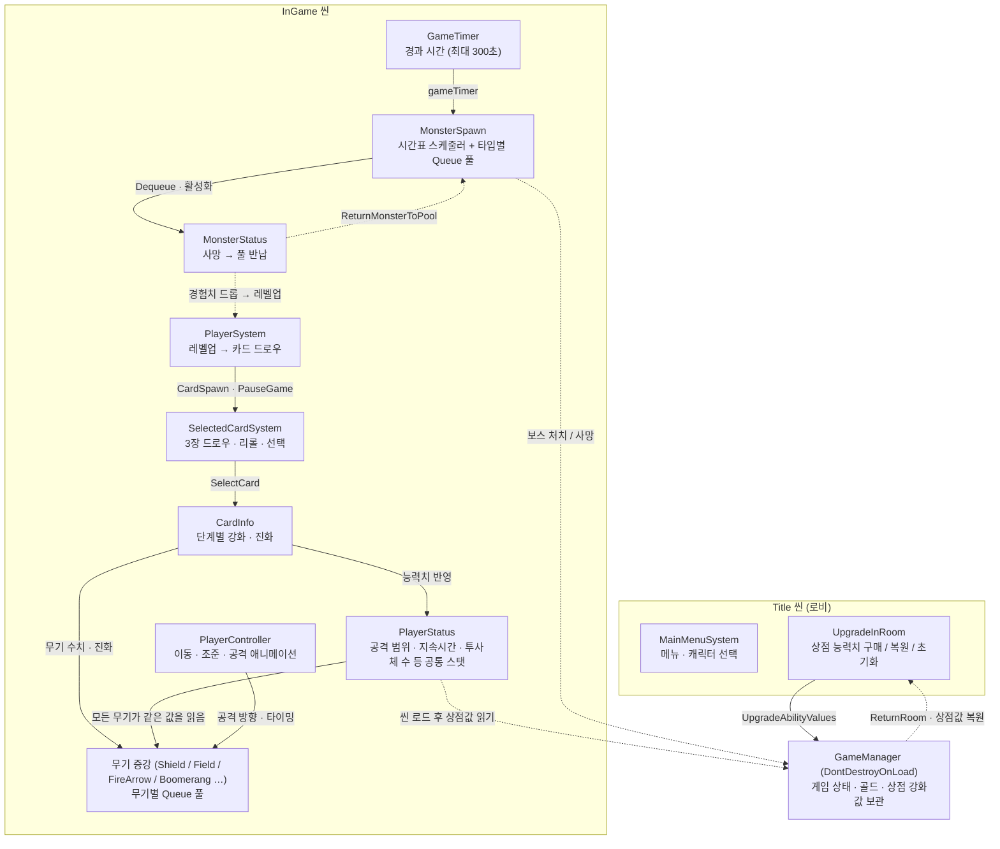

> 실선 = 직접 호출 · 값 전달, 점선 = 사망 · 반납 · 게임 종료처럼 결과를 돌려주는 흐름.

---

## 2. 공통 기반 — 게임 루프와 상태 전환

### 2.1 원칙 두 가지

**① 씬을 넘는 데이터는 `GameManager` 한 곳에만.**
로비와 인게임은 서로 다른 씬입니다. 씬이 바뀌면 상점 UI · 플레이어 오브젝트가 모두 사라지기 때문에,
**씬을 넘어 살아남아야 하는 값(골드, 상점 강화값, 강화 횟수)은 `DontDestroyOnLoad`가 걸린 `GameManager`에만** 두었습니다.

| 데이터 | 소유자 | 생명주기 |
|---|---|---|
| 게임 상태(`gameStatus`), 골드, 상점 강화값, 강화 횟수 | `GameManager` | 프로그램 종료까지 |
| 경과 시간(`gameTimer`), 몬스터 풀, 카드 상태 | 인게임 씬 오브젝트 | 한 판 |
| 상점 슬롯 UI | 로비 씬 오브젝트 | 로비에 있는 동안 |

**② 능력치는 `PlayerStatus` 한 곳에, 무기는 거기서 읽기.** 🧭 내 판단
공격 범위 · 지속시간 · 투사체 수 같은 능력치를 무기마다 따로 계산하지 않고, `PlayerStatus` 한 곳에 모은 뒤 **모든 무기가 같은 값을 참조**하도록 통일했습니다.
그래서 능력치 카드 한 장을 고르면 가지고 있는 모든 무기에 한 번에 반영됩니다.

> 무기끼리의 공통 틀(상속)은 당시 몰라서 "이름 맞추기"로 버텼지만(6.4), **능력치만큼은 한 곳으로 모아 모든 증강이 같은 곳을 참조**하도록 만들었습니다. 이 능력치가 어디서 와서 어떻게 합쳐지는지는 2.3에 정리했습니다.

### 2.2 게임 상태 흐름

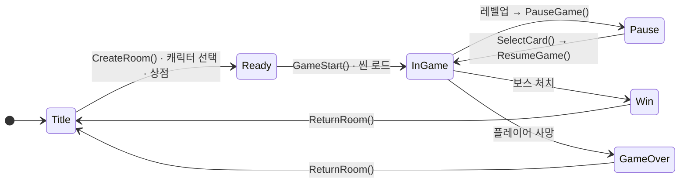

- `Ready`는 로비에서 방을 만들어 캐릭터를 고르고 상점을 쓰는 상태입니다. 로비로 돌아오면(`ReturnRoom()`) `Title`을 거쳐 다시 `Ready`가 됩니다.
- 일시정지는 `Time.timeScale = 0` / `1`로 처리합니다. 증강 선택 중에는 몬스터 · 투사체 · 타이머가 모두 멈춥니다.
- 레벨업은 `PlayerSystem`이 카드 드로우 → 일시정지 순서로 호출합니다.

> `timeScale`은 게임 전체 시간을 한 번에 멈추는 전역 방식이라, "UI 연출만 움직이고 전투는 멈춤" 같은 부분 제어가 어렵습니다. 후속 프로젝트에서는 별도 게임 시계(`WorldClock`)로 바꿨습니다(9.4).

### 2.3 능력치는 어디서 오는가 — 출처별로 나눠 보관하고 한 곳에서 합치기

캐릭터의 최종 능력치는 여러 곳에서 옵니다. 이 값들을 하나로 섞어 더하지 않고, **출처마다 따로 보관한 뒤 바뀔 때마다 한 함수에서 최종 값을 다시 계산**합니다. 🧭 내 판단

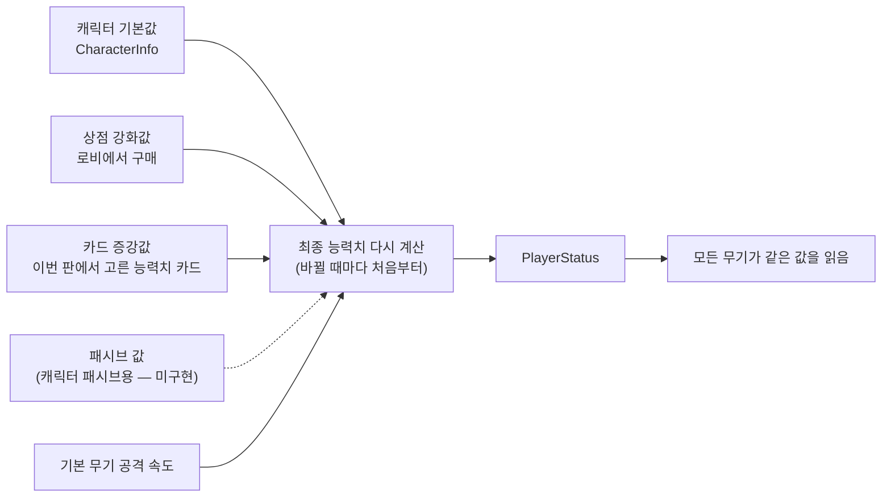

**출처별 데이터 묶음** — 출처마다 같은 모양의 묶음을 하나씩 둡니다 (`Upgrade In Room.cs`, `Upgrade In Game.cs`, 발췌)

```csharp
public struct UpgradeAbilityValues        // 상점에서 구매한 값 (로비 → GameManager → 인게임)
{
    public float maxHealth; public int healthRegeneration; public float attack; public float attackSpeed;
    public int defense; public float speed; public float critical; public int projecTile;
    public float attackRange; public float duration; public float acquisitionRange;
    public float experienceGain; public float goldGain;
}

public struct UpgradeAbilityCardValues    // 이번 판에서 고른 능력치 카드 값
{ /* 위와 같은 능력치 (골드 획득량 제외) */ }

public struct UpgradeAbilityPassiveValues // 캐릭터 패시브 스킬 값 (계획만 하고 구현하지 못함)
{ /* 위와 같은 능력치 */ }
```

**왜 출처별로 나눴나**

- **버프 · 디버프를 나중에 붙이기 쉽게** — 출처가 나뉘어 있으면, 새 효과는 묶음을 하나 더 두고 합치는 계산에 넣기만 하면 됩니다.
- **카드 값만 버리고 상점 값만 따로 쓸 수 있게** — 판이 끝나면 이번 판의 카드 값은 필요 없고, 상점 값은 로비로 들고 가야 합니다.
- **고르는 순서와 상관없이 같은 결과** — 원본 값은 그대로 두고 매번 처음부터 다시 합치기 때문입니다.

**능력치마다 합치는 방식을 나눔** — 원본인 집중포화를 참고해, 공격력 · 방어력 · 체력처럼 **수치로 나오는 능력치**와 공격 속도 · 범위 · 지속시간처럼 **%나 비율로 나오는 능력치**를 구분해 적용했습니다.

| 능력치 | 합치는 방식 |
|---|---|
| 최대 체력 · 공격력 | (기본 + 카드 + 패시브) × 상점 배율 |
| 방어력 · 체력 재생 · 치명타 · 투사체 수 | 기본 + 상점 + 카드 + 패시브 (그대로 더함) |
| 이동 속도 · 공격 범위 · 지속시간 · 획득 범위 · 경험치 획득 | 기본 × (1 + 증가율 합 / 100) |
| 공격 속도 (공격 간격) | 기본 간격 ÷ (1 + 증가율 합 / 100) |

상점의 강화 데이터에도 같은 구분을 넣어, 강화 방식을 **깡 수치 / % / 배수** 세 가지 중에서 고르게 했습니다 (`Upgrade Ability Data.cs`, 발췌).

```csharp
public enum UpgradeValueType
{
    Flat,     // 깡 수치
    Percent,  // % 수치
    Multiply  // 배수 수치
}
```

> **패시브 칸**은 캐릭터마다 패시브 스킬을 하나씩 주려고 미리 만들어 둔 자리입니다. 일정 때문에 패시브 스킬은 만들지 못해, 이 칸은 계산에는 들어가지만 값이 채워지지 않습니다(9.3).

---

## 3. 기능 A — 캐릭터 조작감: 이동 · 조준 · 공격 동기화

### 3.1 개요

DGS에서 **가장 처음 공을 들인 부분**입니다. 플레이어가 게임에서 가장 먼저, 가장 오래 느끼는 것이 조작감이기 때문입니다.

- 캐릭터마다 **기본 공격 무기 증강이 하나씩** 주어지고, 그 무기의 판정이 캐릭터의 공격 애니메이션과 맞게 나갑니다.
- 공격할 때는 **마우스 방향(또는 자동 조준 대상)으로 몸을 돌립니다.** 원본인 집중포화처럼 자동 조준과 마우스 조준을 둘 다 지원합니다.
- 이때 **이동 방향에 따라 발걸음이 달라집니다.** 예를 들어 A(왼쪽)로 이동하면서 D(오른쪽)로 공격하면, 몸은 오른쪽으로 돌아가고 발은 **뒷걸음질**을 칩니다.

**조작법**

| 입력 | 결과 |
|---|---|
| W · A · S · D | 이동 |
| 마우스 | 조준 방향 (기본 공격은 공격 간격마다 자동으로 나감) |
| C | 자동 조준 켜기 / 끄기 (켜면 가장 가까운 몬스터를 조준) |
| Q · E | 캐릭터 스킬 (전사 · 마법사) |

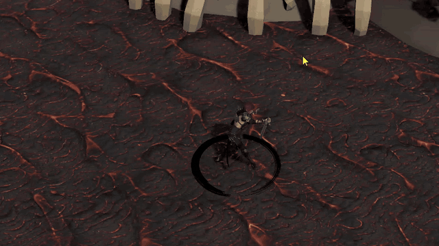

### 3.2 시스템 구조

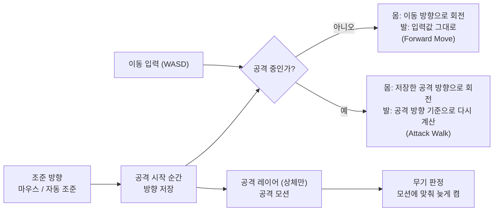

| 구성 | 하는 일 |
|---|---|
| 공격 레이어 + 아바타 마스크 | 공격 모션은 **상체만** 덮어쓰는 별도 레이어. 그래서 하체는 계속 걷기 모션을 재생 |
| 방향 저장 | 공격을 시작하는 순간의 조준 방향을 저장하고, 공격 모션 동안 그 방향으로 몸을 돌림. 저장한 방향을 눈으로 보려고 확인용 오브젝트를 두고 테스트 |
| 발걸음 다시 계산 | 공격 중에는 이동 입력을 **"공격 방향 기준의 앞 / 옆"** 값으로 바꿔 블렌드 트리에 넣음. 공격 방향 반대로 움직이면 '뒤' 값이 되어 뒷걸음질 |
| 무기 판정 타이밍 | 전사 기본 무기는 공격이 시작되고 일정 시간(`waitRotate`) 뒤, 저장한 방향으로 판정을 켬. 휘두르는 순간에 맞아 들어가게 |
| 다음 공격 대기 | 공격 모션이 **끝난 뒤부터** 다음 공격까지의 시간을 셈 |

### 3.3 고민과 선택

**결정. 공격 중에 몸과 발을 어디로 향하게 할 것인가?** 🧭 내 판단

| | 대안 ① 이동 방향 그대로 | 대안 ② 몸만 공격 방향으로 | **대안 ③ 몸은 공격 방향 + 발걸음 다시 계산 ✅** |
|---|---|---|---|
| 모습 | 몸이 이동 방향을 봄 | 몸은 공격 방향, 발은 앞으로 걷는 모션 그대로 | 몸은 공격 방향, 발은 실제 이동 방향에 맞는 모션(옆걸음 · 뒷걸음) |
| 문제 | 조준한 곳과 공격이 어긋남 | 발과 몸의 방향이 달라 미끄러지듯 보임 | 이동 상태를 두 벌로 나눠 만들어야 함 (아래 회고) |

마우스로 조준하는 게임이라 공격 방향이 가장 중요하다고 봤고, 그러면서도 움직임이 어색하지 않게 하려고 ③을 골랐습니다.
같은 "애니메이션과 판정 타이밍 맞추기"는 이후 몬스터 공격을 고칠 때도 똑같이 적용했습니다(8장).

**돌아보면 — 공격 속도가 빨라지면 이동이 버벅임**

| 증상 | 원인 | 당시 | 지금이라면 |
|---|---|---|---|
| 공격 속도가 빨라지면 이동 모션이 크게 버벅임 | 기본 이동과 공격 중 이동을 **두 상태로 나눠 만들어서**, 공격할 때마다 두 상태를 오가며 몸 방향도 "이동 방향 ↔ 공격 방향"으로 계속 바뀜 | 다른 방식이 떠오르지 않아 그대로 둠 | 이동은 **블렌드 트리 하나로 합치고**, "어디를 볼지"만 따로 정했을 것 |

한 줄로 줄이면, **"어디를 볼지"와 "어떻게 걸을지"를 섞어서 두 벌로 만들었는데 둘을 나눴어야 했습니다.** (후속 프로젝트에서 아직 바꿔 보지는 않았습니다.)

---

## 4. 기능 B — 시간표 기반 웨이브 · 몬스터 풀링

### 4.1 개요

뱀서라이크에서는 **계속 나오는 기본 몹**이 가장 중요하고, 시간이 지나면 나오는 몹이 달라져야 합니다.
그래서 웨이브를 코드가 아니라 **시간표 리스트**로 정의하고, 몬스터는 모두 **타입 × 종류별 Queue 풀**에서 꺼내 씁니다.

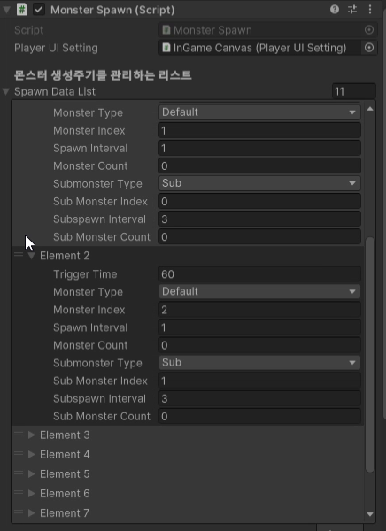

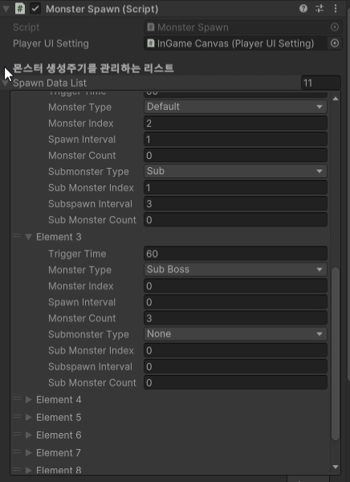

### 4.2 시스템 구조

**시간표 한 줄 = "메인 몹 + 서브 몹" 조합** 🧭 내 판단

예를 들어 메인은 계속 몰려오는 근접 몹, 서브는 드문드문 섞여 나오는 원거리 몹으로 두고 이 **조합을 계속 소환**합니다.
시간이 지나 몹이 바뀌어야 하면, **다음 시간표가 앞 시간표의 몹 종류와 간격을 덮어씁니다.**

**시간표 한 줄의 데이터 묶음** — 메인과 서브를 같은 모양으로 한 줄에 묶었습니다 (`Monster Spawn.cs`)

```csharp
[System.Serializable]
public class MonsterSpawnData
{
    public enum MonsterType { Default, Sub, Elite, SubBoss, Boss, None }

    public float triggerTime;          // 이 줄이 적용될 시간
    public MonsterType monsterType;    // 메인 몬스터 타입
    public int MonsterIndex;           // 메인 몬스터 종류 번호
    public float spawnInterval;        // 지속 생성 간격 (Default / Sub)
    public int MonsterCount;           // 한 번에 낼 마릿수 (Elite / SubBoss)

    public MonsterType submonsterType; // 서브 몬스터도 같은 구성으로 하나 더
    public int subMonsterIndex;
    public float subspawnInterval;
    public int subMonsterCount;
}
```

| 타입 | 소환 방식 | 사전 생성 수 (종류당) |
|---|---|---|
| Default / Sub | 간격마다 1마리씩 **지속 생성**. 다음 시간표가 오면 종류 · 간격만 교체 | 50 / 50 |
| Elite | 도달 시점에 지정한 마릿수만큼 **1회 일괄 생성** | 200 |
| SubBoss | 〃 | 5 |
| Boss | 전용 위치에 1회 생성 + 일반 몬스터 전부 풀로 반납 | 1 |

사전 생성 수는 정확한 근거 없이 **임의로 정한 값**입니다. 엘리트 풀만 200으로 큰 이유는, **분열 몹이 죽으면서 낳는 새끼 몹도 엘리트 풀에서 꺼내 쓰기** 때문입니다.
풀이 비면 새로 만드는 폴백이 있어 부족해도 소환이 멈추지 않습니다.

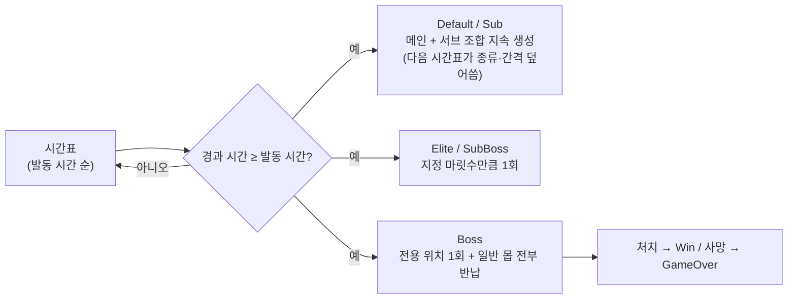

### 4.3 핵심 기능

| 단계 | 하는 일 |
|---|---|
| 시간표 발동 | 매 프레임 시간표를 돌며 발동 시간이 된 항목을 처리. 1회성 항목(엘리트 · 중간보스 · 보스)은 한 번만 발동하도록 기록 |
| 풀에서 꺼내기 | 해당 타입 · 종류의 Queue에서 하나 꺼내 위치를 정하고 켬. 비어 있을 때만 새로 생성 |
| 풀로 돌려보내기 | 몬스터가 죽으면 끄고 Queue에 다시 넣음. **두 번 반납되지 않도록** 반납 여부를 표시 |
| 재사용 초기화 | 다시 켜질 때 체력을 최대 체력으로 되돌려, 이전에 쓰던 체력이 남지 않게 함 |

지속 생성의 좌표는 팀원이 작성한 `GetRandomSpawnPosition()`(NavMesh 위, 플레이어와 10m 이상)을 사용합니다.

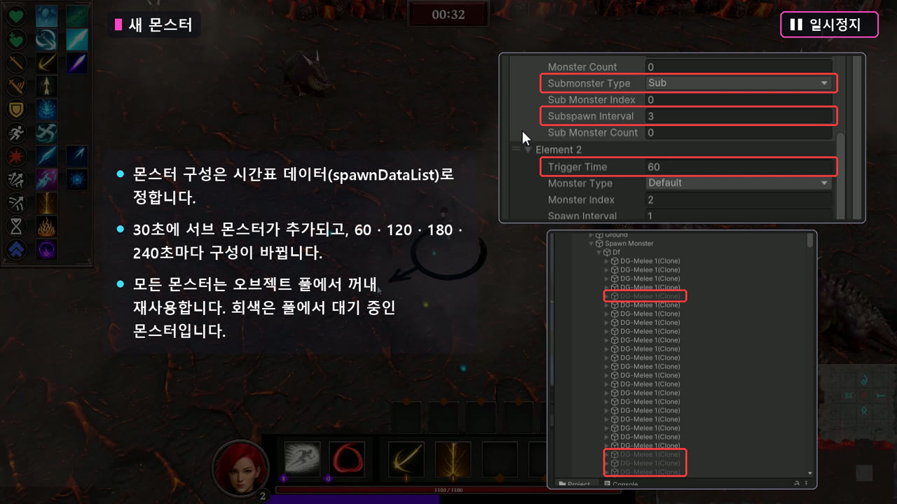

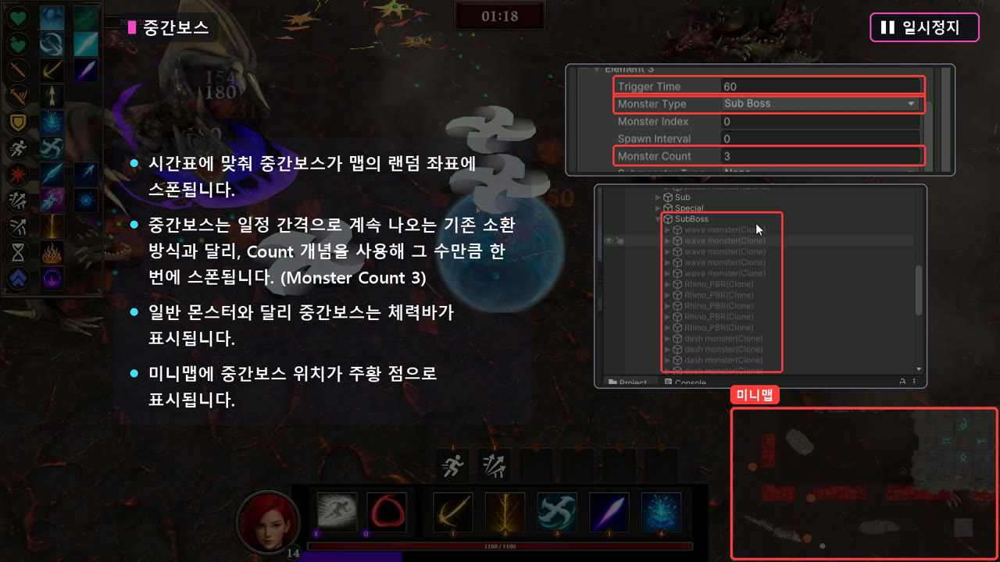

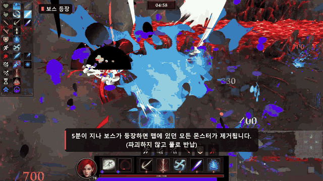

### 4.4 고민과 선택

**결정 1. 몬스터를 어떻게 만들고 없앨 것인가? — 네 번 바꿨습니다** 🧭 내 판단 (전부 직접 판단)

| | 1단계: 생성 / 파괴 | 2단계: List 풀 | 3단계: 활성 / 비활성 List 분리 | **4단계: Queue 풀 ✅** |
|---|---|---|---|---|
| 방식 | 필요할 때 만들고 죽으면 파괴 | 미리 만들어 List에 두고 꺼진 것을 찾아 재사용 | 켜진 것과 꺼진 것을 두 List로 나눠 옮김 | 꺼진 것만 Queue에 넣고 앞에서부터 꺼냄 |
| 문제 | 몬스터가 많아지면 **프레임 드랍이 심함** | 쓸 수 있는 것을 매번 **List 전체에서 찾아야** 함 | 나눠도 **List를 훑는다는 점은 그대로** | 미리 만든 만큼 메모리를 먼저 씀 |

처음에는 생성/파괴로 만들었는데, 몹이 많아지자 프레임이 심하게 떨어졌습니다. 그래서 List 풀로 바꿨더니 이번에는 List를 훑는 시간이 필요했고,
활성/비활성 List를 나눠 봐도 "전체를 훑는다"는 점은 변하지 않았습니다.
그때 **"어차피 꺼진 것만 따로 모아 둘 거라면, 순서대로 앞에서 꺼내기만 하면 된다"**는 생각이 들어 Queue로 바꿨습니다.

다만 개발 당시에는 개선 효과를 **수치로 측정하지 않았습니다.** 완성 후 빌드에서 측정해 보니, 후반 프레임 저하의 남은 원인은 생성 비용이 아니라 **필드에 살아 있는 몬스터 · 경험치 구의 수**였습니다(9.2 #6 측정).
또 지금 돌아보면, 몬스터 추적에 쓴 **NavMesh 자체도 이 정도 몹 수에는 맞지 않았던 것** 같습니다. 당시에는 NavMesh 말고 다른 추적 방식을 몰랐습니다.

**결정 2. 웨이브를 어떻게 정의할 것인가?** 🧭 내 판단

| | 대안 A: 코드 분기 (`if (time > 60) ...`) | **대안 B: "메인 + 서브" 시간표 + 덮어쓰기 ✅** |
|---|---|---|
| 장점 | 구현이 가장 빠름 | 몹 조합 · 간격 · 마릿수를 **인스펙터에서 데이터로** 넣고 바로 테스트 |
| 단점 | 난이도 조정 = 코드 수정 | 시간표 항목이 많아지면 인스펙터가 길어짐 |

기본 몹은 끊기지 않고 계속 나오되 **종류만 시간에 따라 바뀌면 된다**고 생각해서, 앞 데이터를 덮어쓰는 방식을 택했습니다.
엘리트와 중간보스만 "몇 마리"를 정해 한 번에 내보냈습니다.
당시에는 **여러 시간대를 겹쳐서 동시에 소환하는** 방식은 생각하지 못했습니다. 이 구조 때문에 생긴 타이머 문제는 9.3 k에 적었습니다.

**결정 3. 보스가 나오면 일반 몬스터를 어떻게 할 것인가?**

보스가 나오면 살아 있는 일반 몬스터를 **모두 풀로 돌려보내고** 보스방을 엽니다. 이유는 두 가지입니다.

1. **시간 끌기 방지** — 보스에게 다가가지 않고 일반 몹만 잡으며 버티는 플레이를 막기 위해
2. **프레임 확보** — 당시 경험치 구 처리를 잘못 설계해서, 맵에 구가 쌓이면 프레임이 심하게 떨어졌습니다(9.2 #6).
   구를 한 번에 모으는 자석이나 회복 아이템은 **중간보스**를 잡아야만 떨어져서 회수가 어려운 편이었기 때문에, 보스전만큼은 맵을 비워 프레임을 잡으려 했습니다.

> 처음 기획은 엘리트와 중간보스가 모두 카드를 떨어뜨리는 것이었습니다. 몹 종류가 적어 정예 몹을 전부 중간보스로 넣고 엘리트 풀은 특수 기믹 몹(분열 몹의 새끼)만 쓰게 되었고, 맵 드랍 카드를 없애면서 중간보스가 회복 · 자석 아이템을 떨어뜨리도록 바꿨습니다.

---

## 5. 기능 C — 증강 카드 선택

### 5.1 개요

레벨업하면 게임이 멈추고 카드 3장이 나옵니다. 하나를 고르면 그 효과가 바로 스탯에 반영되고 전투가 다시 시작됩니다.
마음에 드는 카드가 없으면 **리롤 버튼**으로 3장을 다시 뽑을 수 있습니다. 졸업작품 전시 때 관람객이 편하게 즐기도록 **리롤 횟수는 제한 없이** 두었습니다.

| 카드 종류 | 개수 | 효과 |
|---|---|---|
| 무기(Weapon) | 14종 + 캐릭터 기본 무기 2종 | 획득 시 무기 생성, 이후 단계별 강화(최대 5) → 조건을 만족하면 진화 |
| 능력치(Ability) | 12종 | 최대 체력 · 공격력 · 공격 속도 · 투사체 수 등 플레이어 스탯 증가 |
| 기타(Else) | 2종 | 체력 25% 회복 / 골드 150 획득 — **더 뽑을 카드가 없을 때** 나오는 카드 |


### 5.2 시스템 구조

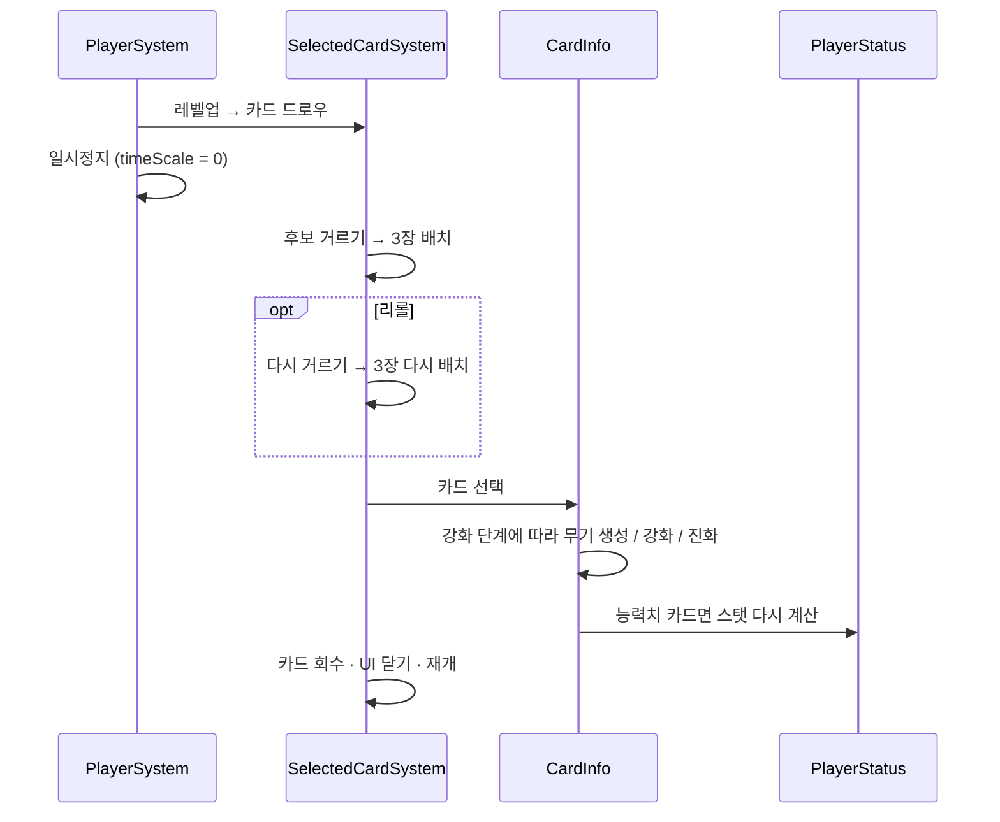

| 클래스 | 역할 |
|---|---|
| `CardData` (ScriptableObject) | 카드 정의 — 이름 · 이미지 · 타입 · 무기 프리팹 · 단계별 증가량 · 진화 짝 능력치 |
| `CardInfo` | 씬에 놓인 카드 한 장 — 현재 강화 단계, 진화 여부, 실제 강화 처리 |
| `SelectedCardSystem` | 후보 거르기 · 3장 드로우 · 리롤 · 선택 처리 · 슬롯 UI 갱신 |
| `UpgradeInGame` | 기본 + 상점 + 카드 + 패시브를 합쳐 최종 스탯 계산 (2.3) |

**카드 한 장의 데이터 묶음** — 무기 · 능력치 · 기타 카드를 **한 형식**으로 묶고, 진화 짝과 "이 무기가 무엇을 얼마나 키우는지"를 데이터로 두었습니다 🧭 내 판단 (`Card Data.cs`, 발췌)

```csharp
[CreateAssetMenu(menuName = "CardData")]
public class CardData : ScriptableObject
{
    public string cardName;
    public Sprite cardImage;
    public CardType cardType;               // Weapon / Ability / Else

    [Header("무기 데이터일 때")]
    public GameObject weaponPrefab;         // 처음 고르면 캐릭터에 붙을 무기
    public float damage, attackSpeed, defense, projecTile, attackRange, duration; // 무기 초기값
    public string weaponDescription;
    public string arousalDescription;       // 진화 설명
    public List<WeaponUpgradeData> weaponUpgradeDataList; // 이 무기가 강화마다 키울 능력치 목록

    [Header("능력치 데이터일 때")]
    public UpgradeAbility upgradeAbility;   // 이 카드가 올릴 능력치 = 무기의 진화 짝
    public float increaseAbility;           // 올릴 수치
    public string needArousalAbility;       // 진화에 필요한 능력치 (툴팁 표시용)

    [System.Serializable]
    public class WeaponUpgradeData
    {
        public UpgradeAbility upgradeAbility; // 키울 능력치 (공격력 · 공격 속도 · 투사체 수 …)
        public float increaseStatus;          // 한 번 강화할 때 늘어나는 양
    }
}
```

무기마다 키우는 능력치가 다르기 때문에(어떤 무기는 투사체 수, 어떤 무기는 지속시간), **"무엇을 얼마나 키우는지"를 무기 코드가 아니라 카드 데이터의 목록**으로 두었습니다. 무기를 새로 만들 때 강화 수치는 이 목록만 채우면 됩니다(무기 스크립트 쪽에 같은 이름의 변수가 있어야 하는 점은 6.4).

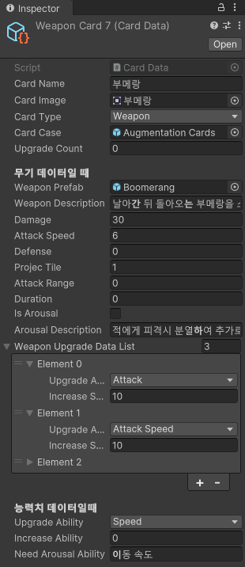

### 5.3 핵심 기능

**① 후보 거르기**

| 규칙 | 결과 |
|---|---|
| 5단계 + 진화까지 끝난 무기 | 후보에서 제외 |
| 5단계 능력치 | 후보에서 제외 |
| 5단계 무기인데 **짝이 되는 능력치 카드가 없음** | 후보에서 제외 |
| 5단계 무기 + 짝 능력치 보유 | **진화 카드**로 후보에 남음 |

이후 **보유한 무기 수(5칸) · 능력치 수(6칸)가 찼는지**에 따라 4가지 경우로 나눠 3장을 고릅니다.
슬롯이 다 찼으면 보유한 카드 중에서만, 남았으면 새 카드까지 포함해 뽑습니다. 후보가 0장이면 **기타 카드 2장**을 내보냅니다.

| 경우 | 무기 슬롯(5) | 능력치 슬롯(6) | 뽑는 범위 |
|---|---|---|---|
| 1 | 가득 참 | 가득 참 | 보유 무기 + 보유 능력치 중 강화 가능한 것 |
| 2 | 가득 참 | 여유 | 보유 무기 + 전체 능력치 |
| 3 | 여유 | 가득 참 | 전체 무기 + 보유 능력치 |
| 4 | 여유 | 여유 | 전체 |

**② 카드 한 장이 캐릭터에 적용되기까지**

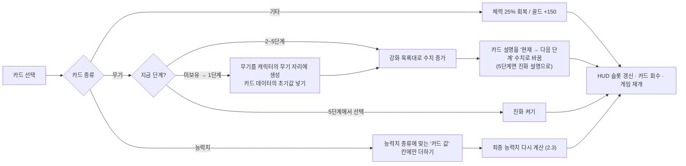

- **무기 카드**: 단계는 **획득(1단계) → 강화(2~5단계) → 진화** 순서입니다. 처음 고르면 무기를 캐릭터에 붙이고 카드 데이터의 초기값을 넣습니다(1단계). 이후 고를 때마다 그 카드의 **강화 목록**(무엇을 얼마나 키우는지)대로 수치를 올리고(2~5단계), 5단계에서 한 번 더 고르면 진화합니다.
- **능력치 카드**: 능력치 종류에 맞는 **카드 값 칸에만** 더한 뒤 최종 능력치를 다시 계산합니다. 상점 값이나 기본값은 건드리지 않습니다(2.3).
- **다음 단계 미리 보기**: 카드를 고를 때마다 카드 설명을 "공격력 10 → 15"처럼 **지금 값과 다음 단계 값**으로 바꿔, 다음에 이 카드가 나오면 무엇이 달라지는지 알 수 있게 했습니다.

> 이 흐름(어디에 무엇을 넣을지)은 제가 정했고, 단계마다 같은 처리를 반복해서 쓴 구현은 아쉬운 점으로 남았습니다(9.3 c).

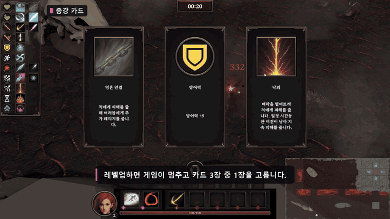

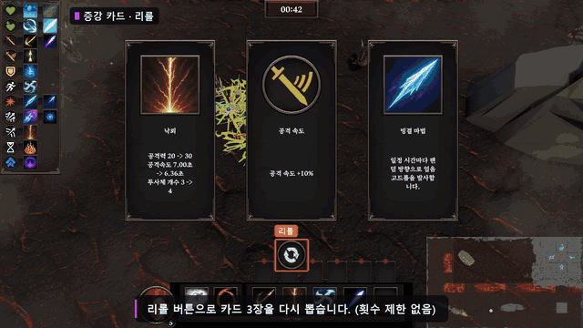

### 5.4 고민과 선택

**결정 1. 카드 데이터를 어디에 둘 것인가?**

| | 대안 A: 코드 상수 | **대안 B: ScriptableObject ✅** | 대안 C: 표(TSV/엑셀) |
|---|---|---|---|
| 장점 | 가장 단순 | 에디터에서 이미지 · 프리팹까지 함께 연결, 수치 조정이 에셋 수정으로 끝남 | 수십 개 수치를 한눈에 비교 · 일괄 수정 |
| 단점 | 수치 조정 = 코드 수정 | 카드마다 에셋을 하나씩 열어 고쳐야 함 | 이미지 · 프리팹 연결에 별도 로더 필요 |

카드는 이미지 · 무기 프리팹 같은 **에셋 참조가 많아서** 에디터에서 바로 연결되는 ScriptableObject를 골랐습니다.
다만 무기 증강이 늘어날수록 에셋을 하나씩 여는 방식이 불편해서, 후속 프로젝트에서는 **엑셀로 관리하기 쉬운 TSV 표**로 바꿨습니다(9.4).

**결정 2. 뽑을 카드가 없을 때 무엇을 보여줄 것인가?** 🧭 내 판단

처음 이 문제를 만난 건 **개발 도중**이었습니다. 회복 · 골드 카드 데이터를 아직 만들지 않은 상태로 테스트하다가, 뽑을 카드가 없는데도 계속 카드를 찾느라 **무한 로딩에 빠져 에디터를 강제 종료**해야 하는 일이 여러 번 생겼습니다.

게임이 완성되면 회복 · 골드 카드가 항상 있으니 후보가 완전히 0장이 될 일은 없습니다. 하지만 **만드는 도중에는 얼마든지 생길 수 있어서**, 후보가 0장일 때 회복 · 골드 카드를 내보내는 처리를 안전장치로 넣었습니다.
결과적으로 후반에 슬롯과 강화가 다 차도 레벨업 보상이 항상 의미 있게 남습니다.

---

## 6. 기능 D — 무기 증강 · 진화

### 6.1 개요

무기 카드를 처음 고르면 무기가 플레이어에 붙고, 같은 카드를 고를 때마다 데미지 · 쿨타임 · 투사체 수 같은 수치가 올라갑니다.
5단계를 채우고 **짝이 되는 능력치 카드**를 갖고 있으면 진화 카드가 나오고, 진화하면 무기의 공격 방식 자체가 바뀝니다.
진화는 이 게임에서 **"강화하면 무엇이 달라질까"라는 기대감**을 만드는 핵심이라고 생각했습니다.

| 무기 (직접 구현) | 기본 공격 | 진화 후 |
|---|---|---|
| 바다의 축복 | 주기적으로 주변에 피해 + 폭발 이펙트 | 진화 이펙트 + **피격 몬스터 이동 속도 감소** |
| 빙결 지대 | 바닥 장판 지속 피해 | 진화 장판 이펙트 + **맞은 몬스터 0.5초 정지** |
| **낙뢰** | 가까운 몬스터에 번개 낙하 → **첫 타격 + 장판 지속 피해** | 피해 · 장판 · 지속시간 강화, **진화 전용 투사체 · 이펙트로 교체** |
| **부메랑** | 던지고 돌아오는 부메랑 | **맞은 자리에서 주변 적을 다시 찾아 분열 → 모두 플레이어에게 귀환** |


### 6.2 시스템 구조

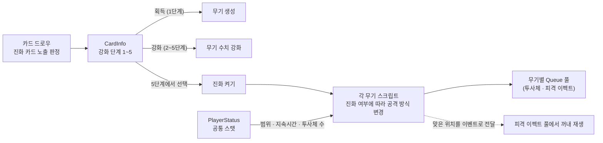

### 6.3 핵심 기능

**① 진화 조건과 안내 UI** 🧭 내 판단 · 🤝 툴팁 문구는 AI와 함께

```text
무기 카드가 5단계(만렙)  AND  그 무기와 짝이 되는 능력치 카드를 보유  →  진화 카드 노출
```

튜토리얼이 없는 게임이라, **뱀서라이크를 처음 하거나 집중포화를 해 보지 않은 사람은 진화 조건을 모를 것**이라고 생각했습니다.
그래서 집중포화의 UI를 참고해, **능력치 아이콘을 기준으로 "이 능력치가 있어야 진화하는 무기"를 따로 표시**하는 툴팁을 만들었습니다. 툴팁과 무기 설명 문구도 직접 작성했습니다(문장은 AI와 주고받으며 다듬었습니다).

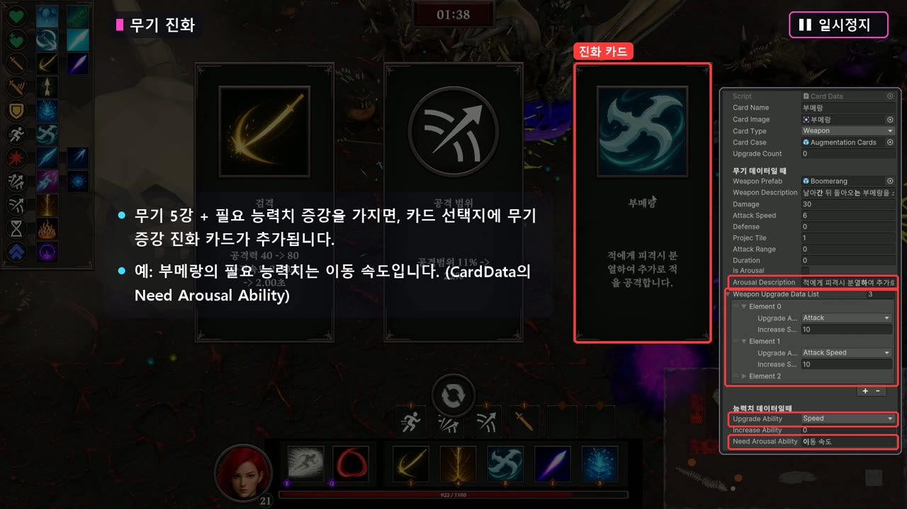

**② 낙뢰 진화 — 두 번 때리는 번개** (가장 공들인 무기 1)

| | 기본 | 진화 |
|---|---|---|
| 피해 | 번개가 떨어질 때 **첫 타격** + 바닥에 남는 **장판 지속 피해**(첫 타격의 1/5) | 첫 타격 · 장판 피해 · 장판 지속시간 모두 1.5배 |
| 이펙트 | 기본 번개 · 피격 이펙트 | **진화 전용 투사체와 피격 이펙트 풀로 통째로 교체**, 기존 투사체는 정리 |

"한 번 + 장판"의 2단 피해 구조와, 진화했을 때 **한눈에 달라 보이는 이펙트**에 특히 신경 썼습니다.
(장판 피해가 강화를 따라가지 못하던 문제는 이 문서를 쓰며 발견해 고쳤습니다 — 9.2 #9)

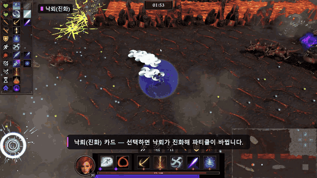

**③ 부메랑 진화 — 맞은 자리에서 다시 찾아가는 분열** (가장 공들인 무기 2)

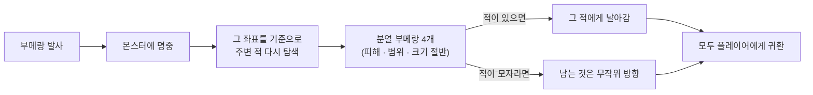

진화한 부메랑은 몬스터에 맞는 순간 사라지고, **맞은 좌표를 기준으로 주변 적을 다시 찾아** 분열 부메랑 4개를 날립니다.
분열 부메랑은 다시 분열하지 않고, 적을 맞힌 뒤 **모두 플레이어에게 되돌아옵니다.** "맞은 자리에서 다시 탐색 → 주변으로 퍼짐 → 귀환"의 흐름을 가장 열심히 만들었습니다.

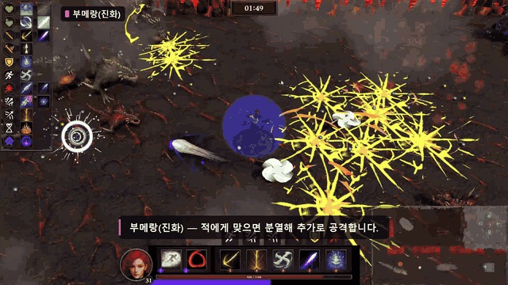

**④ 피격 이펙트 — 위치만 받아 한 곳에서 재생, 같은 자리 중첩은 거르기** 🧭 내 판단

처음 만든 프로토타입 무기 증강들에는 **피격 이펙트를 만드는 부분이 없었습니다.** 그래서 모든 무기 증강에 같은 방식으로 피격 이펙트를 붙였습니다(약 24개 무기 · 투사체 스크립트).

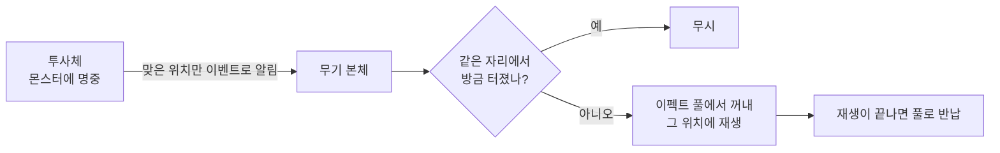

- **투사체는 "어디에 맞았는지"만 알리고**, 이펙트를 풀에서 꺼내 재생하는 일은 무기 본체가 맡습니다. 진화하면 이펙트 풀만 진화용으로 바꾸면 됩니다.
- 투사체와 이펙트를 둘 다 풀로 재사용하기 때문에, 꺼낼 때마다 구독을 끊고 다시 연결해 **구독이 한 번만 유지**되게 했습니다.
- **같은 자리 중첩 거르기** — 한 몬스터에게 피격 이펙트가 여러 번 터지면서 **같은 자리에 이펙트가 수십 개 생기는 문제**가 있었습니다(9.2 #8).
  맞은 좌표를 소수점 한 자리로 반올림해 가까운 좌표를 하나로 묶고, 같은 자리에서 **짧은 시간 안에 또 터지면 무시**하도록 했습니다.
  부메랑 분열도 같은 좌표에서 두 번 일어나지 않도록 좌표를 기록해 걸렀습니다.

### 6.4 고민과 선택

**결정 0. 원본의 진화 방식을 그대로 만들 것인가?** 🧭 내 판단

| | 원본 집중포화 | **DGS ✅** |
|---|---|---|
| 진화 방법 | 레벨업으로 무기 · 능력치를 키우고, **엘리트 · 중간보스를 잡으면 맵에 생기는 별도의 증강 카드**로 진화 | 레벨업 카드 안에서, **무기 5단계 + 짝 능력치 보유 시 진화 카드가 나옴** |
| 필요한 것 | 레벨업과 다른 형식의 카드 · 맵 드랍 · 획득 처리 | 기존 카드 뽑기에 조건 하나 추가 |

원본의 방식이 더 재미있다는 건 알았지만, **별도 카드를 만들 일정이 없었고 기술적으로도 어려웠습니다.**
그래서 진화의 핵심인 "무기와 능력치의 짝을 맞추는 재미"는 남기고, 획득 방법은 기존 카드 뽑기 안으로 줄였습니다.

**결정 1. 무기마다 다른 스크립트에 같은 수치를 어떻게 넣을 것인가?** 🧭 내 판단 · 🤝 진화 기능 추가는 AI와 함께

| | **당시 선택: 변수 이름 통일 + 이름으로 찾아 넣기** | 대안: 공통 부모 클래스 (상속) |
|---|---|---|
| 장점 | 무기 스크립트를 크게 고치지 않고 바로 연결됨 | 컴파일 단계에서 오류를 잡음, 무기가 늘어도 같은 방식 |
| 단점 | 이름 오타 · 변경 시 **오류 없이 조용히 값이 안 들어감**, 무기마다 같은 변수 선언 반복 | 기존 무기 스크립트를 모두 부모 클래스에 맞게 수정해야 함 |

팀원 3명이 무기 증강을 나눠 만들면서 **모두 상속 없이 각자 단순한 스크립트로** 만들었습니다. 저도 당시에는 상속 구조를 잘 몰랐습니다.
다만 "모든 무기에 같은 기능이 들어가고, 같은 방식으로 돌려 쓴다"는 건 분명했기 때문에, **그렇다면 부를 때 쓰는 변수 이름을 통일하자**고 정했습니다.

진화는 처음부터 만들지 않고 "기본 기능을 다 만든 뒤 추가한다"는 계획이었어서, 처음에는 **어느 무기에도 진화가 없었습니다.**
진화가 이 게임에 중요하다고 생각했고 욕심도 났기 때문에, 일정이 촉박한 시점에 **AI와 주고받으며 모든 무기에 진화를 급하게 붙였습니다.** 그래서 구조는 우회책으로 남았습니다.
그래도 그중 **낙뢰와 부메랑 진화만큼은 직접 공들여** 만들었습니다(6.3).

지금 보면 기술 부채입니다. 후속 프로젝트에서는 공통 부모 클래스로 바꿨습니다(9.4).

**결정 2. 피격 이펙트를 누가 만들 것인가?**

| | 대안 A: 투사체가 직접 이펙트 생성 | **대안 B: 투사체는 위치만 이벤트로 알림 ✅** |
|---|---|---|
| 장점 | 구현이 단순 | 이펙트 풀을 무기 본체 한 곳에서 관리, 진화 여부에 따라 이펙트 교체가 쉬움 |
| 단점 | 투사체마다 이펙트 풀을 따로 가져야 함 | 풀에서 재사용할 때 구독 관리가 필요 |

이펙트 생성/소멸도 풀링으로 바꾸면서, **풀을 가진 쪽이 위치만 쉽게 받을 수 있게** 이벤트 방식을 택했습니다.

---

## 7. 기능 E — 상점 · 로비 복귀

### 7.1 개요

인게임에서 모은 골드로 로비 상점에서 능력치를 영구 강화합니다. 죽어서 로비로 돌아와도 골드와 강화 상태는 남아, 다음 판이 조금씩 쉬워지는 로그라이크 구조입니다.
로비의 방 화면에서 **취소하고 나가면 상점 강화가 처음 값으로 돌아갑니다**(7.4).


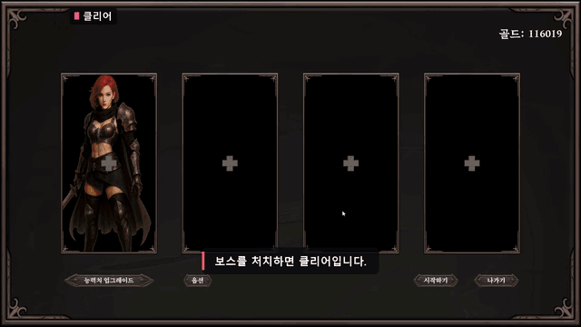

### 7.2 흐름

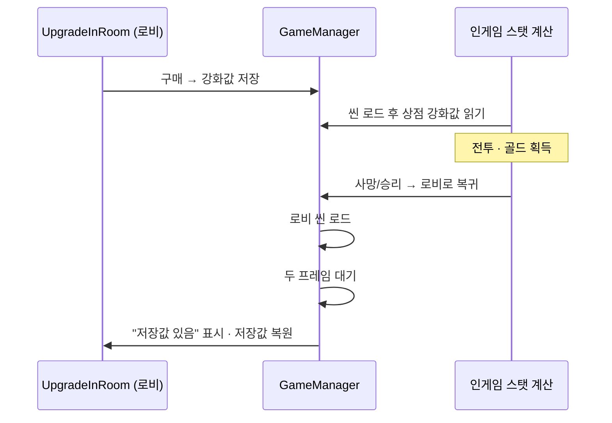

### 7.3 핵심 기능

**로비 복귀 시 저장값 복원**
로비 씬을 다시 불러온 뒤, `GameManager`가 두 프레임을 기다렸다가 상점에 "저장값이 있다"는 표시와 함께 저장해 둔 강화값을 넘깁니다.
상점은 이 표시가 켜져 있으면 기본값 대신 **저장된 강화 횟수를 먼저 사용**합니다. 두 프레임을 기다린 이유는 9.2 #2에 적었습니다.

### 7.4 고민과 선택

**결정 1. 상점 데이터를 어디에 저장할 것인가?**

| | **당시 선택: GameManager 메모리** | 대안: PlayerPrefs / JSON 파일 |
|---|---|---|
| 장점 | 구현이 단순. 한 번 실행하는 동안 "죽어도 골드는 남는" 로그라이크 루프는 충분히 동작 | 게임을 꺼도 유지 |
| 단점 | **게임을 끄면 초기화됨** | 저장 시점 · 파일 구조 설계 필요 |

목표는 **"죽고 로비로 나와도 골드를 쓸 수 있게"** 하는 것이었고, 한 번 실행하는 동안은 이 목표를 만족합니다.
다만 당시 세이브 개념을 제대로 다루지 못해 파일 저장까지는 가지 못했습니다. 후속 프로젝트에서 JSON 저장으로 보완했습니다(9.4).

**결정 2. 강화를 다 끝낸 뒤 새로 시작하려면?** 🧭 내 판단

저장 기능이 없다 보니, 강화를 모두 끝낸 뒤 처음 상태로 다시 해 보려면 **게임을 껐다 켜는 방법밖에 없었습니다.**
상점을 만드는 동안에도 **구매 → 능력치 반영 → 처음 상태로 되돌리기**를 반복해서 확인해야 했습니다.
그래서 별도 버튼을 두지 않고, **방 화면을 나갔다 다시 들어오면 상점이 처음 상태가 되도록** 했습니다. 방 화면의 취소 버튼이 방을 닫으면서 강화 단계와 능력치를 처음 값으로 되돌립니다(`UpgradeInRoom.ResetUpgradeInRoom()`). 이 방식으로 구매와 리셋을 테스트했습니다. 쓴 골드는 돌려주지 않습니다.

> 돌아보면, 테스트용으로 만든 동작이 그대로 남아 **"나가기"와 "초기화"가 한 버튼에 묶였습니다.** 강화를 유지하고 싶은 플레이어도 방을 나가면 구매 내역이 사라집니다. 테스트용 리셋은 개발 빌드에서만 쓰거나, 확인 창이 있는 별도 동작으로 나눴어야 했습니다.

---

## 8. 기타 담당 (요약)

| 항목 | 내용 |
|---|---|
| 몬스터 공격 수정 | 팀원이 작성한 원거리 몬스터는 `stoppingDistance`에서 멈춘 뒤(플레이어가 사거리 안) 일정 시간이 지나면 공격했는데, **공격 애니메이션과 투사체가 나가는 타이밍이 맞지 않았습니다.** 공격 애니메이션 상태에 들어간 것을 확인한 뒤 딜레이만큼 기다려 발사하고, 발사 위치를 몬스터 앞쪽 위로 조정했습니다. 플레이어 공격에서 쓴 "모션과 판정 타이밍 맞추기"(3장)를 몬스터에도 적용한 것입니다. |
| 몬스터 AI 세부값 | AI는 NavMeshAgent 기반. `stoppingDistance`를 공격 사거리로 두어 **근접 몹은 붙어서, 원거리 몹은 사거리에서 멈춰** 공격하도록 값을 조정했습니다. 일반 몹은 로직이 단순해 FSM까지는 필요 없다고 판단했고, FSM은 보스(팀원 담당)에만 쓰는 것으로 정했습니다. |
| 캐릭터 스킬 | 전사 · 마법사 캐릭터의 스킬 |
| UI | HUD · 증강 슬롯 · 카드 UI · 상점 UI · 진화 안내 툴팁의 스크립트와 배치 (이미지 리소스는 팀원 제작) |

---

## 9. 결과 및 배운 점

### 9.1 결과

| 목표 (개요의 Why) | 결과 | 근거 |
|---|---|---|
| 조준과 이동이 어색하지 않게 | 공격 방향으로 몸을 돌리면서 이동 방향에 맞는 발걸음(뒷걸음질 등) 재생 | 공격 레이어 · 블렌드 트리 (3장) |
| 몬스터가 많아도 끊기지 않게 | 생성/파괴 → List → Queue 풀로 생성 비용은 제거. 다만 빌드 측정에서 **활성 몬스터 141마리일 때 23.6 FPS**까지 떨어지고, 일반 몬스터를 풀로 반납한 보스방에서는 **315.6 FPS**로 회복 → 남은 병목은 활성 오브젝트 수 | 타입별 Queue 풀, 무기별 Queue 풀, 9.2 #6 측정 |
| 웨이브를 데이터로 조정 | 시간표만 바꿔 5분 웨이브 · 보스전 구성 완성 | "메인 + 서브" 시간표 |
| 증강 선택 루프 | 레벨업 → 3장 선택(리롤 가능) → 즉시 반영 → 재개. 카드가 바닥나도 회복·골드 카드로 루프 유지 | 카드 드로우 · 기타 카드 |
| 무기 성장 | 무기 16종 모두에 5단계 강화 + 진화 연결, 진화 조건 안내 툴팁 | `CardInfo` 진화 처리 |
| 로그라이크 루프 | 사망 → 로비 → 상점 강화 → 재도전 | `GameManager` 보관 · 복원 |
| 완성 | 실행 파일 빌드 · 시연 영상 · 졸업작품 전시 | [실행 파일](https://drive.google.com/file/d/171ISSnbpYfknuxBB_edwc7VileEMU4aD/view?usp=drive_link) · [시연 영상](https://youtu.be/uzckM61XfDU) |

### 9.2 문제 해결 경험 (Troubleshooting)

| # | 문제 | 원인 | 해결 / 개선 | 상태 |
|---|---|---|---|---|
| 1 | 몬스터가 많아지면 **프레임 드랍** | 매번 생성 / 파괴 → 이후 List 풀에서는 매번 전체 탐색 | 생성/파괴 → List 풀 → 활성/비활성 분리 → **Queue 풀**로 단계적 개선 (4.4) | ✅ 생성 비용 해결 · 남은 저하는 #6 |
| 2 | 로비로 돌아오면 **상점 강화값이 없다고 표시** | 로비의 상점이 GameManager의 저장값이 복원되기 **전에** 먼저 값을 읽음 (스크립트 실행 순서) | 로비 씬 로드 후 2프레임 기다린 뒤 "저장값 있음"을 켜고, 켜져 있으면 저장값을 우선 사용 (7.3) | ✅ (임시 해결 — 9.3 h) |
| 3 | 테스트 중 레벨업 때 **무한 로딩 → 에디터 강제 종료** | 회복 · 골드 카드 데이터를 아직 만들지 않은 상태에서 후보가 0장이 되자, 빈 목록에서 계속 카드를 찾음 | 후보가 0장이면 **회복 · 골드 카드로 대체**하는 안전장치 (5.4) | ✅ |
| 4 | 무기마다 스크립트가 달라 **같은 강화 수치를 넣을 방법이 없음** | 무기 공통 타입이 없음 | 변수 이름을 통일하고 이름으로 값을 주입 (6.4) | ✅ (우회 — 9.3 a) |
| 5 | 원거리 몬스터의 **공격이 모션과 어긋남** | 사거리에서 멈춘 뒤 일정 시간 후 바로 발사 → 애니메이션과 투사체 타이밍 불일치 | 애니메이션 상태 진입 확인 → 딜레이 후 발사, 발사 위치 조정 (8장) | ✅ |
| 6 | 후반(몬스터 100마리 이상) · 경험치 구가 쌓이면 **프레임 드랍** (빌드 최저 20.7 FPS) | 몬스터마다 NavMeshAgent + 비키네마틱 `Rigidbody` + 트리거 Collider + Animator, 경험치 구도 비키네마틱 `Rigidbody` + 트리거 → **살아 있는 동안 매 프레임 드는 경로 · 물리 · 겹침 검사 비용**이 개수만큼 쌓임 | 보스전에서는 맵을 비워 대응(4.4 결정 3). 근본 원인은 **완성 후 빌드 측정으로** 확인 → DGS에서는 미수정, 후속 프로젝트에서 FlowField 공유 · 물리 없는 경험치 구로 변경 (9.4) | ⚠️ |
| 7 | 공격 속도가 빨라지면 **이동 모션이 버벅임** | 기본 이동과 공격 중 이동을 두 상태로 나눠, 공격마다 상태 · 몸 방향이 바뀜 | 당시에는 해결하지 못함. 지금이라면 이동을 하나로 합치고 "어디를 볼지"만 따로 정함 (3.3) | ❌ |
| 8 | 한 몬스터에게 피격 이펙트가 여러 번 터지며 **같은 자리에 이펙트가 수십 개 생김** | 정확한 원인은 확인하지 못함 | 맞은 좌표를 반올림해 묶고, 같은 자리에서 짧은 시간 안에 다시 터지면 무시 (6.3 ④) | ✅ (이펙트) · ❌ (소리 겹침은 남음 — 9.3 n) |
| 9 | 낙뢰를 강화해도 **장판 피해가 오르지 않음** | 장판 피해(첫 타격의 1/5)를 무기가 처음 생길 때(`Start`) **한 번만** 계산 → 이후 강화로 오른 공격력이 반영되지 않음 | 번개를 떨어뜨릴 때마다 그 시점의 공격력으로 다시 계산 | ✅ (문서 작성 중 발견 → 수정) |
| 10 | 절멸 진화 후 **경험치 구 값이 계속 커짐** | 1.5배 보너스를 **풀에서 재사용하는 구 자체에 곱함** → 풀로 돌아가도 값이 남아 1.5배 · 2.25배 …로 누적 | 구를 떨어뜨릴 때마다 원래 값으로 되돌린 뒤 배율 적용. 함께 막타 보너스 누락 · 표시 잔존도 수정 | ✅ (문서 작성 중 발견 → 수정) |

**2번 상세 — 실행 순서 문제**

로비 씬이 다시 로드되면 메뉴와 상점이 새로 만들어지고 각자 시작할 때 상점 슬롯을 초기화합니다.
이때 GameManager가 저장값을 넘겨주기 전이라, 상점은 "구매 기록 없음"으로 초기화됐습니다.
GameManager 쪽에서 **두 프레임을 기다린 뒤** 저장값을 넣고 표시를 켜는 방식으로 해결했습니다.
동작은 하지만 "몇 프레임 뒤면 초기화가 끝났을 것"이라는 가정에 기대는 방식입니다. 후속 프로젝트에서는 **초기화 순서를 한 곳에서 한 줄씩 명시**하는 구조로 바꿨습니다(9.4).

**6번 상세 — 생성 비용과 존재 비용**

풀링으로 **만들고 없애는 비용**은 잡았지만, 필드에 **살아 있는 동안 드는 비용**(Rigidbody 물리 연산)은 그대로였습니다.
경험치 구는 바닥에 떨어졌다가 플레이어에게 끌려오기만 하면 되므로 물리가 필요 없었습니다.
이 경험으로 "최적화 대상은 생성 횟수만이 아니라 **매 프레임 유지 비용**도 포함한다"는 기준이 생겼습니다.

**측정 — 완성 후 빌드에서 잰 FPS**

개발 당시에는 측정하지 않았기 때문에, 완성 후 Windows 빌드에 임시 FPS 표시 스크립트(1초 평균 FPS · 활성 몬스터 수, VSync OFF)를 붙여 한 판을 플레이하며 측정했습니다. 코드는 전시 빌드 그대로입니다.
환경: 1920×1080 · AMD Ryzen 5 7500F · NVIDIA RTX 4060 · RAM 32GB

| 게임 시간 | 활성 몬스터 | FPS (1초 평균) | 프레임 시간 |
|---|---|---|---|
| 0:09 | 8 | 399.9 | 2.5 ms |
| 0:48 | 40 | 176.9 | 5.7 ms |
| 1:12 | 61 | 108.6 | 9.2 ms |
| 2:31 | 96 | 47.4 | 21.1 ms |
| **3:07** | **141** | **23.6** | 42.3 ms |
| 4:40 | 137 | 27.6 | 36.2 ms |
| **보스방** (일반 몬스터 풀 반납 후) | **1** | **315.6** | 3.2 ms |

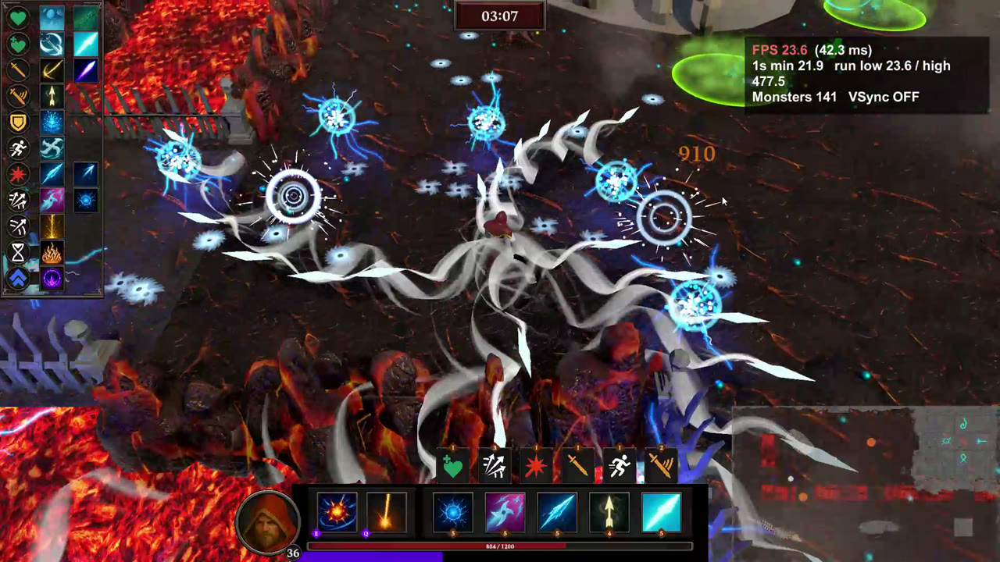

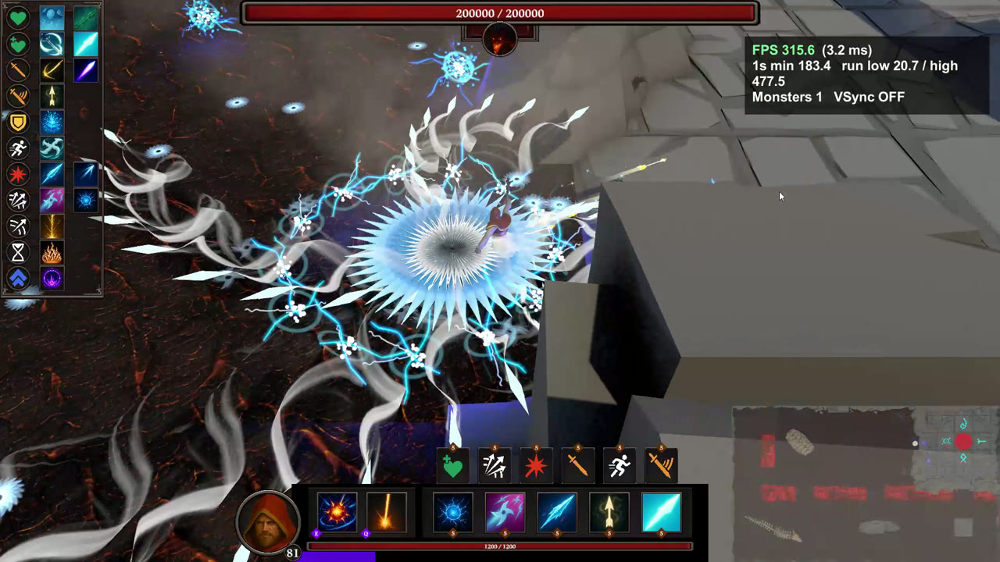

**경험치 구만 사라졌을 때** — 정확한 구 개수는 세지 않았지만, **자석을 먹어 맵의 경험치 구를 한 번에 회수한 순간**을 비교하면 구의 비용이 드러납니다. 몬스터 수는 거의 그대로입니다.

| 게임 시간 | 상황 | 레벨 | 활성 몬스터 | FPS (1초 평균) | 프레임 시간 |
|---|---|---|---|---|---|
| 4:38 | 맵에 경험치 구가 쌓여 있음 | 76 | 143 | **27.8** | 36.0 ms |
| 4:45 | 자석 획득 → 구 일괄 회수 | 76 → 80 | — | — | — |
| 4:47 | 구가 거의 없음 | 80 | 136 | **44.4** | 22.5 ms |

몬스터는 7마리(약 5%)만 줄었는데 프레임은 **27.8 → 44.4 FPS(약 1.6배)**로 올랐습니다. 구 하나는 가볍지만, 수백 개가 살아 있으면 물리 비용이 몬스터 수십 마리만큼 쌓인다는 뜻입니다.

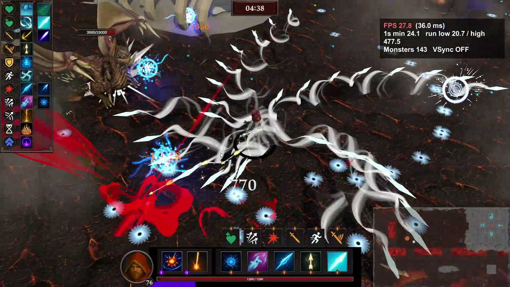

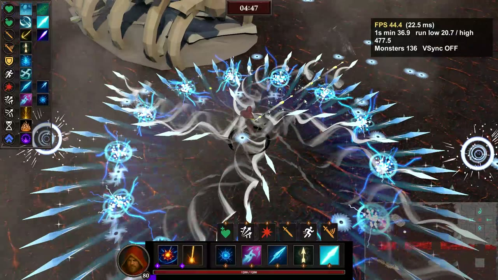

| 오브젝트 | 붙어 있는 것 |
|---|---|
| 일반 몬스터 (`DG-Melee 1` 프리팹) | NavMeshAgent · Rigidbody(비키네마틱) · 트리거 Collider · Animator · Skinned Mesh |
| 경험치 구 (`ExpItem`) | Rigidbody(비키네마틱) · 트리거 Collider |

- 프레임은 **활성 몬스터 수에 거의 반비례**하고, 일반 몬스터를 풀로 반납하는 순간 13배 이상 회복합니다. 풀링으로 생성 비용은 해결됐고, 남은 병목은 **살아 있는 오브젝트마다 붙은 경로 · 물리 · 애니메이션 비용**입니다.
- 몬스터 수가 비슷해도 후반이 더 느린 것은 무기 · 이펙트 수도 함께 늘기 때문으로 보입니다. 원인별 비중은 Profiler로 나눠 보지 않아 ⟨추정⟩입니다.

> 구조는 바꾸지 않았습니다. 전시 빌드 · 시연 영상과 같은 코드로 남기고, 물리 없이 움직이는 경험치 구와 FlowField 추적은 후속 프로젝트에서 적용했습니다(9.4 j · m).

**9 · 10번 상세 — 포트폴리오 문서를 쓰며 코드를 다시 읽다 발견해 고친 것**

완성 당시에는 눈에 띄지 않았지만, 이 문서를 쓰면서 **설명한 내용이 코드와 맞는지 하나씩 대조하다가** 발견했습니다. 두 문제 모두 원인은 같은 종류였습니다. **"한 번 계산한 값이 상황이 바뀐 뒤에도 그대로 남는다."**

| | 9. 낙뢰 장판 피해 | 10. 경험치 구 값 |
|---|---|---|
| 남아 있던 값 | 처음 공격력으로 계산한 장판 피해 | 재사용하는 구에 곱해진 1.5배 |
| 왜 남았나 | 계산을 무기 생성 시점(`Start`)에 한 번만 함 | 풀로 돌려보낼 때 원래 값으로 되돌리는 처리가 없음 |
| 고친 방법 | 쓰는 시점(번개 발사)에 다시 계산 | 쓰는 시점(구 드랍)에 원래 값으로 되돌린 뒤 배율 적용 |
| 수정 파일 | `FireArrow.cs` (낙뢰) | `Exp Item.cs` · `Monster Status.cs` · `Bomber Bullet.cs` (절멸) · `Monster Setting.cs` |

10번을 고치면서 두 가지를 함께 정리했습니다.

- **막타 보너스 누락** — 절멸은 피해를 준 **뒤에** "절멸 표시"를 켜서, 이 공격으로 바로 죽은 몬스터는 보너스를 받지 못했습니다. 표시를 먼저 켜도록 순서를 바꿨습니다.
- **표시 잔존** — 보스 등장으로 일반 몬스터를 한꺼번에 풀로 돌려보낼 때는 구를 떨어뜨리지 않아, 켜진 표시가 다음에 다시 나올 때까지 남았습니다. 몬스터가 다시 켜질 때 표시를 지우도록 했습니다.

> 풀링은 "만들고 없애는 비용"을 줄여 주지만, **재사용하는 객체에 남은 상태를 매번 초기화**해야 한다는 책임이 따라옵니다(9.2 #6의 "존재 비용"과 함께 풀링에서 얻은 두 번째 기준).

### 9.3 아쉬운 점 — 기술 부채와 접은 계획

DGS의 아쉬운 점은 대부분 **당시 설계 경험이 부족해 생긴 기술 부채**입니다. 후속 프로젝트에서 바꾼 것은 9.4에 정리했습니다.

| # | 기술 부채 | 영향 |
|---|---|---|
| a | 무기 수치를 **변수 이름 문자열**로 찾아 주입 | 이름을 바꾸거나 오타가 나면 오류 없이 값이 안 들어감. 무기마다 같은 변수 선언 반복 |
| b | 카드 뽑기 코드 약 800줄, 4가지 경우마다 비슷한 뽑기 코드 반복 | 규칙 하나를 바꾸면 4곳을 고쳐야 함 |
| c | 강화 단계 0~5마다 거의 같은 코드 | 단계별 수치를 데이터로 빼지 못함 |
| d | 몬스터 풀(타입별 5개)과 **무기마다 따로 만든 Queue 풀** | 풀링 코드 중복. 당시 자료구조 · 시스템 구조 설계가 미숙했던 결과 |
| e | 상점 데이터가 메모리에만 있음 | 게임을 끄면 초기화 |
| f | 자식 순서 번호로 UI를 찾는 **하이어라키 순서 의존** | UI 구조가 조금만 바뀌어도 참조가 깨짐 |
| g | 개발 중 성능을 **측정하지 않음** | 풀링 효과를 수치로 증명할 수 없었고, 남은 병목(활성 오브젝트 비용)도 완성 후 빌드 측정에서야 확인 (9.2 #6) |
| h | 실행 순서 문제를 **프레임 대기**로 해결 | 기기 · 씬 구성이 바뀌면 다시 깨질 수 있음 |
| i | 일시정지를 `Time.timeScale`로 처리 | 전투만 멈추고 UI 연출은 움직이는 식의 부분 제어가 어려움 |
| j | 경험치 구의 Rigidbody 물리 처리 | 구가 많아질수록 매 프레임 물리 비용 누적 (9.2 #6) |
| k | 지속 생성 타이머 하나를 **지나간 시간표 항목 전체가 공유** | 지나간 Default/Sub 항목마다 같은 타이머에 시간을 더해서, 항목이 쌓일수록 **실제 생성 간격이 설정값보다 짧아짐**. 문서를 쓰며 코드를 다시 읽다가 발견 |
| l | 기본 이동과 공격 중 이동을 두 상태로 나눔 | 공격 속도가 빨라지면 이동 모션이 버벅임 (3.3) |
| m | 몬스터 추적을 NavMesh로만 처리 (몹마다 NavMeshAgent + 비키네마틱 Rigidbody) | 몹 수가 많아질수록 부담 — 빌드에서 141마리일 때 23.6 FPS (9.2 #6). 당시에는 다른 추적 방식을 몰랐음 |
| n | 피격 **소리**가 겹쳐 커지는 문제 | 이펙트 중첩은 걸렀지만 소리 겹침은 아직 고치지 못함. 이펙트가 여러 번 터지던 근본 원인도 확인하지 못함 |

**접은 계획 — 캐릭터 패시브 스킬**

캐릭터마다 패시브 스킬을 하나씩 주려고 능력치 계산에 **패시브 칸**까지 미리 만들어 두었지만(2.3), 개발 일정 때문에 패시브 스킬은 만들지 못했습니다.

**접은 계획 — 멀티플레이**

처음에는 **멀티플레이를 계획**했습니다. 승리 조건을 "모든 플레이어가 살아 있을 때 보스 처치"로 만들어 둔 것도 그 흔적입니다.
당시 수업에서 배운 서버 방식은 유니티 클라이언트 안에서 서버와 클라이언트를 함께 작성하는 TCP 방식이었는데,
개발 일정이 빠듯했고 서버 프로그래밍 실력도 부족해서 결국 만들지 못했습니다.

### 9.4 배운 점 → 후속 프로젝트에서 적용

DGS를 마친 뒤, DGS 코드를 기반으로 **3인칭 3D 뱀서라이크를 1인으로 다시 만드는 후속 프로젝트**(Unity 6000.3.15f1, 2026.10~, 제작 중)를 진행하고 있습니다.
9.3의 기술 부채를 하나씩 고치는 것이 이 프로젝트의 목표 중 하나입니다.

| DGS 기술 부채 | 후속 프로젝트에서 바꾼 방식 | 근거 |
|---|---|---|
| a. 이름으로 값 주입 | 무기 증강 **추상 부모 클래스 `WeaponAugment`**. 수치는 `SetLevelData()`로 전달하고 자식은 공격만 구현 | `WeaponAugment.cs`, 커밋 메시지 "BS Project의 리플렉션 값 주입 방식 대신 SetLevelData로 수치 전달" |
| b · c. 카드 분기 · 단계 반복 | `AugmentManager`가 후보를 만들고, 레벨별 누적 수치는 `augmentLevels.tsv` 표로 분리. 진화 판정은 `CanArousal()` 하나로 정리. 무기 5 / 능력치 6 슬롯과 회복·골드 대체 규칙은 그대로 유지 | `AugmentManager.cs`, `AugmentLevelTable.cs` |
| d. 풀 중복 | 공용 **`ObjectPoolManager` + `IObjectPoolItem` 인터페이스** 하나로 몬스터 · 투사체 · 이펙트 · 경험치 구 · 데미지 텍스트 · 구조물을 모두 관리 | `ObjectPoolManager.cs` |
| e. 메모리 저장 | `SaveService`로 **JSON 파일 저장** | `SaveService.cs` |
| f. 하이어라키 의존 | UI 빌더 · 링커 클래스로 참조 연결 ⟨확인 필요: `GetChild` 사용이 아직 15곳 남아 있음 — 남은 용도 확인⟩ | `InGameUILinker.cs` 등 |
| g. 측정 없음 | 완성 후 DGS 빌드를 측정해 병목(활성 오브젝트의 경로 · 물리 비용)을 확인하고, 그 결과를 후속 프로젝트 설계(아래 j · m)에 반영 | 9.2 #6 측정 |
| h. 프레임 대기 | 매니저는 시작할 때 자기 참조만 잡고, **`GameManager.BootAsync`에서 초기화 순서를 명시** (테이블 → 맵 → 흐름장 → 플레이어 → 매니저 연결) | `GameManager.cs` |
| i. `timeScale` 일시정지 | **`WorldClock`** — 게임 로직은 게임 시계, UI는 실제 시간. 정지 · 감속 · 배속 단계 지원 | `WorldClock.cs` |
| j. 경험치 구 물리 | Rigidbody 없이 직접 이동시켜 낙하 · 흡수 | `ExpOrb.cs` |
| m. 몹마다 NavMeshAgent | 그리드 위에 **FlowField 하나를 만들어 모든 몹이 공유** — 몹은 자기 칸의 방향만 읽음 | `FlowFieldManager.cs`, `EnemyControllerBase.cs` |
| k. 스폰 타이머 공유 | 상시 소환 규칙마다 **타이머를 따로 둠**. 규칙에 시작 · 종료 시간이 있어 "지나간 항목을 덮어쓰는" 로직 자체가 필요 없음 | `WaveManager.cs`, `SpawnRuleDef.cs` |
| 데이터 형식 | ScriptableObject → **TSV 표**. 무기 증강 수치가 많아 엑셀로 한 번에 관리하는 쪽이 편했음 | `StreamingAssets/Table`, `TableLoader.cs` |

> 9.3의 l(이동 상태 분리)은 후속 프로젝트에서 **아직 바꿔 보지 않았습니다.**

**무기 수치 전달 — 전과 후**

```csharp
// DGS — 이름으로 필드를 찾아 값 주입
var field = component.GetType().GetField("weaponDamage");
if (field != null) field.SetValue(component, 계산값);

// 후속 — 부모 클래스가 값을 받는 통로를 정의
public abstract class WeaponAugment : UnitAttack
{
    public void SetLevelData(AugmentLevelDef data) { /* 부모가 데미지 · 공속 · 범위 계산 */ }
}
```

**정리하면**

- **"어디를 볼지"와 "어떻게 움직일지"처럼, 섞여 있는 책임은 나눠야 한다.** 이동 버벅임도, 이름 맞추기 주입도 결국 한 곳에 너무 많은 일을 섞은 결과였습니다.
- **동작하는 우회책과 좋은 구조는 다르다.** 변수 이름 통일, 프레임 대기는 당장은 동작했지만 규모가 커질수록 깨지기 쉬웠습니다. 이후로는 "누가 이 값을 넘겨주는가, 누가 먼저 초기화되는가"를 **타입과 코드 순서로 드러내는** 쪽을 먼저 고민합니다.
- **최적화는 측정부터.** 풀링으로 체감은 좋아졌지만 수치가 없어 설명할 근거가 약했습니다. 완성 후 빌드를 측정해 보니 병목은 생성이 아니라 **살아 있는 오브젝트 수**였고, 자석으로 경험치 구만 회수해도 프레임이 약 1.6배 올랐습니다. 이 숫자가 후속 프로젝트에서 FlowField와 물리 없는 경험치 구를 고른 근거가 됐습니다.
- **원본을 그대로 따라 하기보다 핵심을 남기고 줄이는 판단.** 진화 방식을 줄인 덕분에 일정 안에 모든 무기에 진화를 넣을 수 있었습니다.

---

## 부록. 초안 확정 전 확인 목록

| 항목 | 위치 |
|---|---|
| 후속 프로젝트의 `GetChild` 잔존 | 9.4 |
| 자막판 시연 영상 YouTube 링크 (업로드 후 교체) | 1.1 · 1.4 · 9.1 |
| 뒷걸음질 GIF 촬영 (자막판 영상에 없는 장면) | 3.1 |
