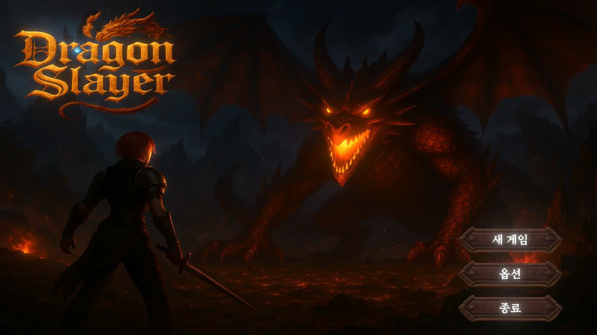
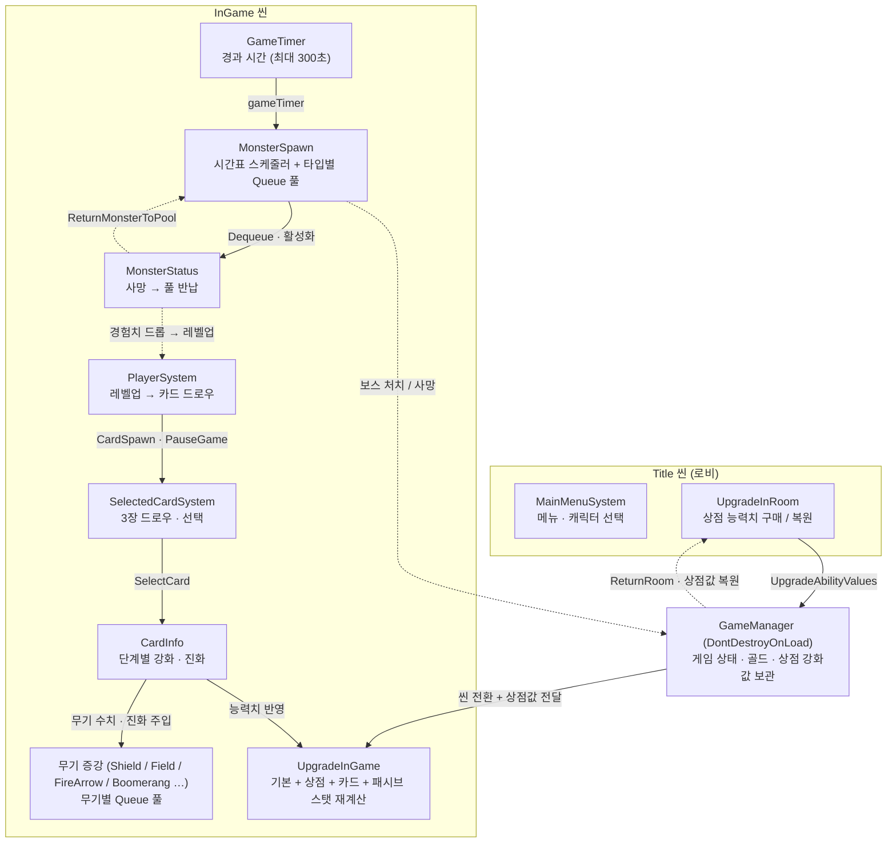
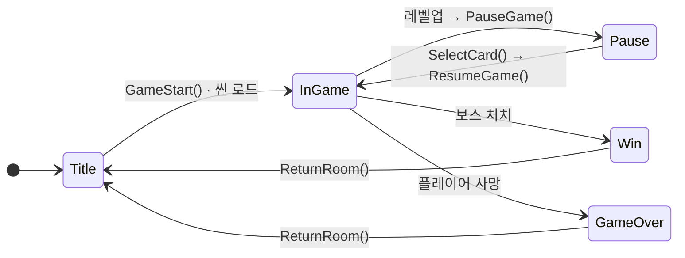
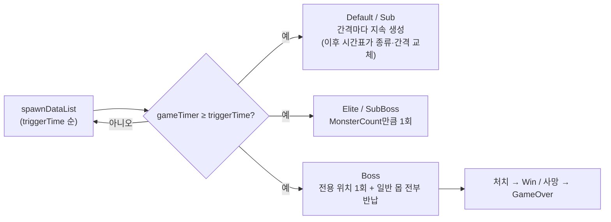
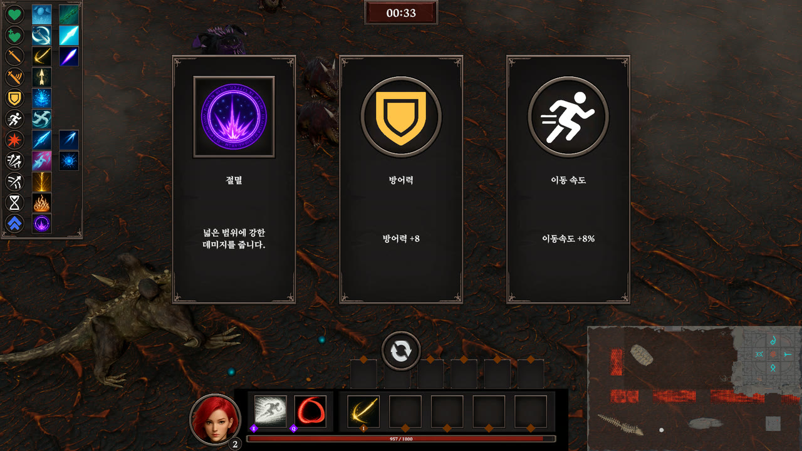
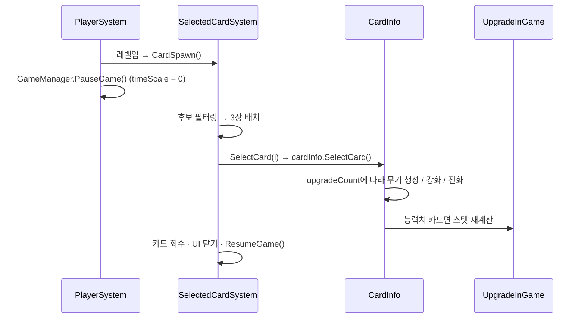
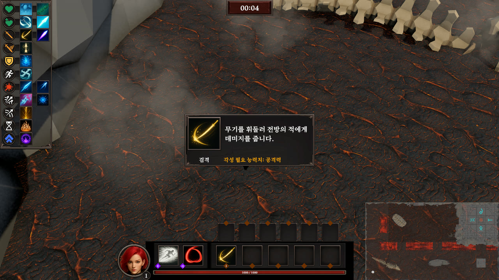
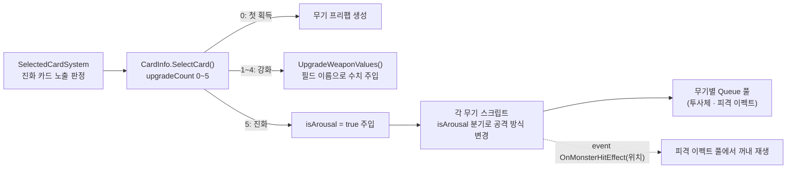
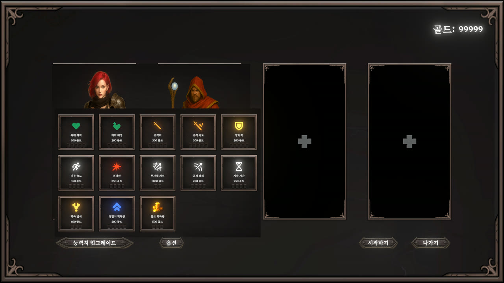
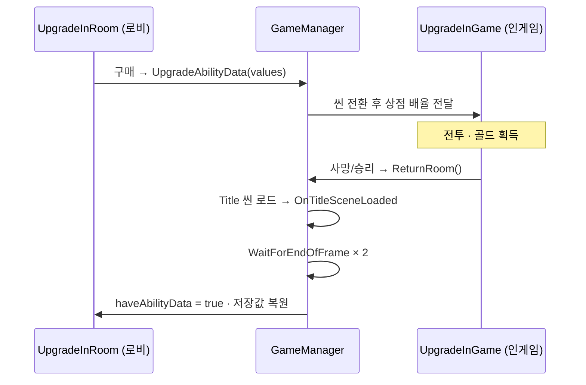

# DGS — 3D 액션 뱀서라이크 게임 루프 · 증강 · 웨이브 시스템 기술 문서

> **문서 유형**: B. 다기능 (프로젝트 개요 → 공통 기반 → 기능별 [구조 · 핵심 기능 · 고민과 선택] 반복 → 결과)
> **다루는 범위**: 게임 전체가 아니라, 3인 팀에서 **제가 설계한 시스템 구조와 담당 기능 4가지**의 설계 의도와 핵심 구현만 다룹니다.
>
> | # | 시스템 | 한 줄 요약 | 핵심 키워드 |
> |---|---|---|---|
> | A | 시간표 기반 웨이브 · 몬스터 풀링 | 인스펙터 시간표로 "몇 초에 무엇을 어떻게" 소환, 생성/파괴 → List → Queue 풀로 개선 | `triggerTime` · `Dictionary<int, Queue>` |
> | B | 증강 카드 선택 | 레벨업 시 3장 드로우, 무기 5 / 능력치 6 슬롯 제한, 후보가 없으면 회복·골드 카드 | ScriptableObject · 스탯 재계산 |
> | C | 무기 증강 · 진화 | 무기 4종 구현 + **진화 시스템 전체**, 피격 이펙트는 이벤트로 위치 전달 | 진화 조건 · 이벤트 구독 |
> | D | 상점 · 로비 복귀 | 인게임 골드 → 로비 상점 영구 강화, 씬 전환 간 데이터 보관 | `DontDestroyOnLoad` · 실행 순서 |

> 📌 **표기 규칙**
> - `📷 [이미지 필요]` / `🎬 [GIF·영상 필요]` : 캡처를 넣어야 하는 자리
> - `⟨확인 필요⟩` : 작성자 확인이 필요한 문장
> - `⟨링크 입력⟩` : 링크를 채워야 하는 자리

---

## 1. 프로젝트 개요

### 1.1 What — 무엇을 만들었나

**DGS**는 리그 오브 레전드의 '집중포화' 모드를 모티브로 한 PC용 3D 액션 뱀서라이크입니다.
플레이어는 몰려오는 몬스터를 자동 공격으로 처치하고, 레벨업마다 증강 카드를 골라 무기와 능력치를 키우며 5분을 버틴 뒤 보스를 잡습니다.
죽거나 클리어하면 로비로 돌아가 모은 골드로 상점에서 영구 능력치를 올리고 다시 도전합니다.

```text
로비(캐릭터 선택 · 상점) → 인게임(웨이브 전투 → 레벨업 → 증강 선택 → 반복) → 보스전 → 승리/패배 → 로비
```



> 🎬 **[GIF·영상 필요]** 로비 → 인게임 → 증강 선택 → 보스전까지 한 판 요약. 출처: [시연 영상](https://youtu.be/uzckM61XfDU) ⟨장면 타임스탬프 입력⟩

팀 프로젝트였지만, 저는 **데이터 구조부터 카드 생성 · 선택, 상점, 게임 루프까지 시스템 구조 전체**를 설계했습니다.

### 1.2 담당 범위

| 구분 | 내용 |
|---|---|
| ✅ 담당 (본 문서 범위) | 시스템 구조 전체(데이터 구조 · ScriptableObject 설계) / 게임 루프와 상태 전환 / 시간표 기반 몬스터 스폰과 오브젝트 풀링 / 증강 카드 생성 · 선택 · 스탯 반영 / **무기 진화 시스템 전체** / 무기 증강 4종(바다의 축복 · 빙결 지대 ⟨확인 필요⟩ · 낙뢰 · 부메랑) / 상점 · 로비 복귀 / UI 스크립트와 배치 |
| ➖ 기타 담당 (8장에서 짧게) | 팀원이 작성한 몬스터 공격 코드의 **공격 시작점 · 타이밍 수정** / NavMeshAgent `stoppingDistance` 등 AI 세부값 조정 / 자동 조준 · 마우스 조준 |
| ❌ 담당 아님 | 랜덤 스폰 위치 계산(`GetRandomSpawnPosition`) / 몬스터별 공격 방식 / 보스 패턴 / 나머지 무기 증강 / UI 이미지 리소스 |

> 무기 증강은 14종(+ 캐릭터 기본 무기 2종)으로 수가 많아 3명이 나눠 만들었습니다. **진화 기능은 처음에 아무도 만들지 않은 상태였고**, 진화 구조를 제가 만든 뒤 각 무기 스크립트를 그에 맞게 수정했습니다.

### 1.3 Why — 왜 이렇게 만들었나

| 문제 상황 (Before) | 결과적으로 생기는 비용 | 해결 방향 |
|---|---|---|
| 몬스터 · 투사체 · 이펙트를 매번 `Instantiate` / `Destroy` | 몬스터가 많아지는 구간에서 프레임 드랍이 심해짐 | 생성/파괴 → List 풀 → **Queue 풀**로 단계적 개선 (3장) |
| 웨이브 구성을 코드 분기로 작성 | 난이도 조정마다 코드 수정 | **"몇 초에 · 무엇을 · 어떤 방식으로 · 몇 마리"를 인스펙터 시간표 데이터로** (3장) |
| 증강 선택지가 무작위 | 슬롯 제한 · 만렙 · 진화 조건이 섞이면 **뽑을 카드가 없는 상황**이 생김 | 조건별 필터 + 후보가 없을 때 회복·골드 카드로 대체 (4장) |
| 무기마다 스크립트가 다름 | 같은 업그레이드 수치를 무기별로 따로 넣어야 함 | 필드 이름을 통일해 한 곳에서 주입 (5장, 당시의 우회책 → 8.4에서 개선) |
| 인게임과 로비가 다른 씬 | 씬 전환 시 골드 · 상점 강화 값이 사라짐 | `GameManager`(`DontDestroyOnLoad`)가 보관하고 로비 복귀 시 복원 (6장) |

### 1.4 개발 환경

| 항목 | 내용 |
|---|---|
| Engine | Unity **2022.3.62f3** (LTS) · URP |
| Language | C# |
| 데이터 | ScriptableObject (`CardData` · `MonsterInfo` · `CharacterInfo` · `UpgradeAbilityData`) |
| 주요 패키지 | AI Navigation(NavMeshAgent), Cinemachine, UGUI + TextMeshPro |
| 규모 | C# 스크립트 87개 · 약 14,000줄 (팀 전체) |
| 기간 / 형태 | 2025.03 ~ 2025.06 (약 14주) ⟨확인 필요⟩ · 3인 팀 프로젝트 |
| 링크 | GitHub ⟨링크 입력 — 저장소 정리 후⟩ · [시연 영상](https://youtu.be/uzckM61XfDU) · [실행 파일](https://drive.google.com/file/d/171ISSnbpYfknuxBB_edwc7VileEMU4aD/view?usp=drive_link) |

### 1.5 전체 구조 한눈에 보기



> 실선 = 직접 호출, 점선 = 사망 · 반납 · 게임 종료처럼 결과를 돌려주는 흐름.

---

## 2. 공통 기반 — 게임 루프와 상태 전환

### 2.1 원칙: "씬을 넘는 데이터는 GameManager 한 곳에만"

로비와 인게임은 서로 다른 씬입니다. 씬이 바뀌면 상점 UI · 플레이어 오브젝트가 모두 사라지기 때문에,
**씬을 넘어 살아남아야 하는 값(골드, 상점 강화값, 강화 횟수)은 `DontDestroyOnLoad`가 걸린 `GameManager`에만** 두었습니다.

| 데이터 | 소유자 | 생명주기 |
|---|---|---|
| 게임 상태(`gameStatus`), 골드, 상점 강화값(`UpgradeAbilityValues`), 강화 횟수(`upgradeCountData`) | `GameManager` | 프로그램 종료까지 |
| 경과 시간(`gameTimer`), 몬스터 풀, 카드 상태 | 인게임 씬 오브젝트 | 한 판 |
| 상점 슬롯 UI | 로비 씬 오브젝트 | 로비에 있는 동안 |

### 2.2 게임 상태 흐름



- 일시정지는 `Time.timeScale = 0` / `1`로 처리합니다(`GameManager.cs:241`). 증강 선택 중에는 몬스터 · 투사체 · 타이머가 모두 멈춥니다.
- 레벨업은 `PlayerSystem`이 `CardSpawn()` → `PauseGame()` 순서로 호출합니다(`Player System.cs:111`).

> `timeScale`은 게임 전체 시간을 한 번에 멈추는 전역 방식이라, "UI 연출만 움직이고 전투는 멈춤" 같은 부분 제어가 어렵습니다. 후속 프로젝트에서는 별도 게임 시계(`WorldClock`)로 바꿨습니다(8.4).

---

## 3. 기능 A — 시간표 기반 웨이브 · 몬스터 풀링

### 3.1 개요

웨이브는 코드가 아니라 **시간표 리스트(`spawnDataList`)**로 정의합니다.
`GameTimer`가 각 항목의 `triggerTime`에 도달하면 그 항목이 발동하고, 몬스터는 모두 **타입 × 인덱스별 Queue 풀**에서 꺼내 씁니다.

> 📷 **[이미지 필요]** `MonsterSpawn` 인스펙터의 `spawnDataList` 펼친 화면 (triggerTime · 타입 · 간격 · 수량이 보이게)

### 3.2 시스템 구조

**시간표 한 줄의 구조** (`Monster Spawn.cs:12`)

```csharp
[System.Serializable]
public class MonsterSpawnData
{
    public enum MonsterType { Default, Sub, Elite, SubBoss, Boss, None }
    public float triggerTime;      // 해당 정보가 적용될 시간
    public MonsterType monsterType; // 메인 몬스터 타입
    public int MonsterIndex;        // 메인 몬스터 인덱스 번호
    public float spawnInterval;     // 지속 생성 간격 (Default/Sub)
    public int MonsterCount;        // 일괄 생성 개수 (Elite/SubBoss)
    public MonsterType submonsterType; // 서브 몬스터도 같은 구성으로 하나 더
    // ...
}
```

| 타입 | 소환 방식 | 사전 생성 수 (인덱스당) |
|---|---|---|
| Default / Sub | `spawnInterval`마다 1마리씩 **지속 생성**. 다음 시간표가 오면 종류 · 간격만 교체 | 50 / 50 |
| Elite | 도달 시점에 `MonsterCount`만큼 **1회 일괄 생성** | 200 |
| SubBoss | 〃 | 5 |
| Boss | 전용 위치에 1회 생성 + 일반 몬스터 전부 풀로 반납 | 1 |

사전 생성 수는 `DefaultMonsterSetting()`에서 정합니다(`Monster Spawn.cs:187`). 정확한 근거가 있는 값이라기보다, 플레이 테스트에서 풀이 비지 않는 정도로 잡은 값입니다 ⟨확인 필요⟩. 풀이 비면 새로 만드는 폴백이 있어 부족해도 소환이 멈추지 않습니다.



### 3.3 핵심 기능

**① 시간표 발동** — `Monster Spawn.cs:197` (발췌)

```csharp
public void MonsterSpawnSetting() // 스케줄에 따른 스폰 설정
{
    if (!monsterSpawn || GameManager.gameStatus != GameManager.GameStatus.InGame) return;

    for (int i = 0; i < spawnDataList.Count; i++)
    {
        var data = spawnDataList[i];
        if (GameTimer.gameTimer >= data.triggerTime)
        {
            // 이미 지나간 시간표의 Default/Sub 구성을 새 값으로 교체
            // ...
            HandleMainSpawn(data, i);
            if (data.submonsterType != MonsterSpawnData.MonsterType.None)
                HandleSubSpawn(data, i);
        }
    }
}
```

`HandleMainSpawn`은 타입에 따라 지속 생성 / 1회 일괄 생성 / 보스 소환으로 나눕니다. 1회성 항목은 `spawnedDataIndices`(HashSet)에 인덱스를 기록해 한 번만 발동합니다(`Monster Spawn.cs:267`).
지속 생성의 좌표는 팀원이 작성한 `GetRandomSpawnPosition()`(NavMesh 위, 플레이어와 10m 이상)을 사용합니다.

**② 풀에서 꺼내기** — `Monster Spawn.cs:377` (발췌)

```csharp
private GameObject ActivateMonsterFromPool(MonsterType poolType, int index, Vector3 position, Quaternion rotation)
{
    Queue<GameObject> pool = GetOrCreatePool(poolType, index);
    GameObject monster = null;

    while (pool.Count > 0 && monster == null) // 파괴된(null) 오브젝트는 건너뜀
        monster = pool.Dequeue();

    if (monster == null)                        // 풀이 비었을 때만 새로 생성
    {
        MonsterInfo info = GetMonsterInfo(poolType, index);
        if (info == null) return null;
        monster = CreateMonster(poolType, info, index, addToPool: false);
        // ... 타입별 등록 리스트에 추가
    }

    MonsterStatus status = monster.GetComponent<MonsterStatus>();
    if (status != null) { status.isInPool = false; status.monsterAlive = true; }

    monster.transform.position = position;
    monster.transform.rotation = rotation;
    monster.SetActive(true);
    return monster;
}
```

**③ 풀로 돌려보내기** — `Monster Spawn.cs:583`, `Monster Status.cs:157` (발췌)

```csharp
public void ReturnMonsterToPool(GameObject monster)
{
    if (monster == null) return;
    MonsterStatus status = monster.GetComponent<MonsterStatus>();
    if (status == null || status.spawnPoolType == MonsterType.None) return;
    if (status.isInPool) return;               // 두 번 반납 방지

    var pool = GetOrCreatePool(status.spawnPoolType, status.spawnPoolIndex);
    if (pool == null) return;
    status.isInPool = true;
    pool.Enqueue(monster);
}

void Dead() // MonsterStatus.cs
{
    monsterAlive = false;
    gameObject.SetActive(false);
    if (MonsterSpawn.Instance != null)
        MonsterSpawn.Instance.ReturnMonsterToPool(this.gameObject);
}
```

- 체력은 `MonsterSetting.OnEnable()`에서 최대 체력으로 되돌립니다(`Monster Setting.cs:163`). 재사용한 몬스터에 이전 판의 체력이 남지 않습니다.
- 보스가 나오면 `DisableAllNonBossMonsters()`가 살아 있는 일반 몬스터를 **파괴하지 않고 풀로 반납**합니다.

> 🎬 **[GIF·영상 필요]** 시간이 지나며 몬스터 구성이 바뀌고(기본 → 서브 → 엘리트 일괄 등장), 보스 등장 시 일반 몬스터가 한 번에 사라지는 장면. 출처: 시연 영상 ⟨타임스탬프⟩

### 3.4 고민과 선택

**결정 1. 몬스터를 어떻게 만들고 없앨 것인가? — 세 번 바꿨습니다**

| | 1단계: `Instantiate` / `Destroy` | 2단계: List 풀 | **3단계: Queue 풀 ✅** |
|---|---|---|---|
| 방식 | 필요할 때 만들고 죽으면 파괴 | 미리 만들어 List에 두고 비활성 오브젝트를 찾아 재사용 | 비활성 오브젝트만 Queue에 넣고, 꺼낼 때 `Dequeue` |
| 문제 | 몬스터가 많아지는 구간에서 **프레임 드랍이 심해짐** | 쓸 수 있는 오브젝트를 매번 **List 전체에서 찾아야** 하고, 활성/비활성 관리 로직이 복잡해짐 | 사전 생성분만큼 메모리를 미리 씀 |
| 결과 | — | 생성 비용은 줄었지만 탐색 비용이 남음 | Queue에는 **쓸 수 있는 것만** 들어 있어 탐색 없이 바로 꺼냄 |

뱀서라이크는 몬스터가 끊임없이 늘어나는 장르라 한 번의 끊김도 체감이 큽니다. 초기 메모리를 더 쓰는 대신 전투 중 생성 비용과 탐색 비용을 모두 없애는 쪽을 골랐습니다.
다만 개선 효과를 **Profiler 수치로 측정하지 않았습니다.** 그래서 이 문서에는 "프레임 드랍이 줄었다"는 체감만 적었습니다(8.3).

**결정 2. 웨이브를 어떻게 정의할 것인가?**

| | 대안 A: 코드 분기 (`if (time > 60) ...`) | **대안 B: 인스펙터 시간표 리스트 ✅** |
|---|---|---|
| 장점 | 구현이 가장 빠름 | "몇 초에 · 무엇을 · 어떤 방식으로 · 몇 마리"를 **인스펙터에서 데이터로** 넣고 바로 테스트 |
| 단점 | 난이도 조정 = 코드 수정 + 재컴파일 | 시간표 항목이 많아지면 인스펙터가 길어짐 |

웨이브 난이도는 플레이하면서 계속 바꿔야 하는 값이라, 수정이 **데이터 수정으로 끝나도록** 시간표 방식을 택했습니다.

---

## 4. 기능 B — 증강 카드 선택

### 4.1 개요

레벨업하면 게임이 멈추고 카드 3장이 나옵니다. 하나를 고르면 그 효과가 바로 스탯에 반영되고 전투가 다시 시작됩니다.

| 카드 종류 | 개수 | 효과 |
|---|---|---|
| 무기(Weapon) | 14종 + 캐릭터 기본 무기 2종 | 획득 시 무기 생성, 이후 단계별 강화(최대 5) → 조건을 만족하면 진화 |
| 능력치(Ability) | 12종 | 최대 체력 · 공격력 · 공격 속도 · 투사체 수 등 플레이어 스탯 증가 |
| 기타(Else) | 2종 | 체력 25% 회복 / 골드 150 획득 — **더 뽑을 카드가 없을 때** 나오는 카드 |



### 4.2 시스템 구조



| 클래스 | 역할 |
|---|---|
| `CardData` (ScriptableObject) | 카드 정의 — 이름 · 이미지 · 타입 · 무기 프리팹 · 단계별 증가량 |
| `CardInfo` | 씬에 놓인 카드 한 장 — 현재 강화 단계(`upgradeCount`), 진화 여부, 실제 강화 처리 |
| `SelectedCardSystem` | 후보 필터링 · 3장 드로우 · 선택 처리 · 슬롯 UI 갱신 |
| `UpgradeInGame` | 기본 + 상점 + 카드 + 패시브를 합쳐 최종 스탯 계산 |

### 4.3 핵심 기능

**① 후보 필터링** — `Selected Card System.cs:411` (발췌)

```csharp
// 만렙 + 진화 완료 무기, 만렙 능력치는 후보에서 제외
selectableWeaponCards.RemoveAll(card => card.cardInfo.upgradeCount == 5 && card.cardInfo.isArousal);
selectableAbilityCards.RemoveAll(card => card.cardInfo.upgradeCount == 5);

// 만렙 무기 중, 진화에 필요한 능력치 카드를 갖고 있지 않으면 제외
selectableWeaponCards.RemoveAll(weaponCard =>
{
    if (weaponCard.cardInfo.upgradeCount == 5)
    {
        foreach (var abilityCard in selectedAbilityCards)
            if (weaponCard.cardInfo.upgradeAbility == abilityCard.cardInfo.upgradeAbility)
                return false;   // 짝이 맞는 능력치가 있으면 '진화 카드'로 남김
        return true;
    }
    return false;
});
```

이후 **보유한 무기 수(5칸) · 능력치 수(6칸)가 찼는지**에 따라 4가지 경우로 나눠 3장을 고릅니다.
슬롯이 다 찼으면 보유한 카드 중에서만, 남았으면 새 카드까지 포함해 뽑습니다. **어느 경우든 후보가 0장이면 Else 카드 2장**을 내보냅니다.

| 경우 | 무기 슬롯(5) | 능력치 슬롯(6) | 뽑는 범위 |
|---|---|---|---|
| 1 | 가득 참 | 가득 참 | 보유 무기 + 보유 능력치 중 강화 가능한 것 |
| 2 | 가득 참 | 여유 | 보유 무기 + 전체 능력치 |
| 3 | 여유 | 가득 참 | 전체 무기 + 보유 능력치 |
| 4 | 여유 | 여유 | 전체 |

**② 선택 → 즉시 반영 → 재개** — `Selected Card System.cs:239` (발췌)

```csharp
public void SelectCard(int cardIndex)
{
    GameObject selectedCard = cardSpawnPosition[cardIndex].GetChild(0).gameObject;
    CardInfo cardInfo = selectedCard.GetComponent<CardInfo>();

    if (cardInfo.cardType == CardInfo.CardType.Else)
    {
        // 체력 25% 회복 또는 골드 +150
        // ...
    }
    else
    {
        cardInfo.SelectCard();                         // 강화 단계 진행 (무기 생성/강화/진화)
        SelectCardplayerUISetting(cardInfo, selectedCard); // 슬롯 UI 갱신
    }

    // 배치된 카드를 모두 카드 보관 오브젝트로 회수
    // ...
    GameManager.gameStatus = GameManager.GameStatus.InGame;
    GameManager.ResumeGame();
}
```

**③ 스탯 재계산** — `Upgrade In Game.cs:75` (발췌)

```csharp
// 최대 체력 = (기본 + 카드 + 패시브) × 상점 배율
playerStatus.maxHealth = (playerInfo.health * upgradeValues.maxHealth)
                       + (abilityCardValues.maxHealth * upgradeValues.maxHealth)
                       + (upgradePassiveValues.maxHealth * upgradeValues.maxHealth);

// 공격 속도(공격 간격)는 증가율을 모두 더한 뒤 나눔
playerStatus.attackSpeed = playerInfo.attackSpeed /
    (1 + (upgradeValues.attackSpeed + upgradeWeaponValues.weaponAttackSpeed
        + abilityCardValues.attackSpeed + upgradePassiveValues.attackSpeed) / 100);
// ... 방어 · 이동 속도 · 치명타 · 투사체 수 · 범위 등도 같은 함수에서 계산
```

원본 값(`CharacterInfo`, 상점값, 카드값, 패시브값)은 그대로 두고, **바뀔 때마다 이 함수에서 최종 값을 다시 계산**합니다. 카드를 여러 장 고르거나 순서가 바뀌어도 결과가 같습니다.

> 🎬 **[GIF·영상 필요]** 카드 선택 직후 HUD의 스탯 · 증강 슬롯이 바로 바뀌는 장면

### 4.4 고민과 선택

**결정 1. 카드 데이터를 어디에 둘 것인가?**

| | 대안 A: 코드 상수 | **대안 B: ScriptableObject ✅** | 대안 C: 표(TSV/엑셀) |
|---|---|---|---|
| 장점 | 가장 단순 | 에디터에서 이미지 · 프리팹까지 함께 연결, 수치 조정이 에셋 수정으로 끝남 | 수십 개 수치를 한눈에 비교 · 일괄 수정 |
| 단점 | 수치 조정 = 코드 수정 | 카드마다 에셋을 하나씩 열어 고쳐야 함 | 이미지 · 프리팹 연결에 별도 로더 필요 |

카드는 이미지 · 무기 프리팹 같은 **에셋 참조가 많아서** 에디터에서 바로 연결되는 ScriptableObject를 골랐습니다.
다만 무기 증강이 늘어날수록 에셋을 하나씩 여는 방식이 불편해서, 후속 프로젝트에서는 **엑셀로 관리하기 쉬운 TSV 표**로 바꿨습니다(8.4).

**결정 2. 선택지가 없을 때 무엇을 보여줄 것인가?**

슬롯 제한(무기 5 · 능력치 6)과 만렙 · 진화 조건은 기획에서 정한 규칙입니다. 이 규칙대로 거르다 보면 후반에는 **뽑을 카드가 0장**이 됩니다.
빈 화면을 띄우거나 레벨업을 건너뛰는 대신, **회복 · 골드 카드**를 내보내 레벨업 보상이 항상 의미 있게 했습니다.

---

## 5. 기능 C — 무기 증강 · 진화

### 5.1 개요

무기 카드를 처음 고르면 무기 오브젝트가 플레이어에 붙고, 이후 같은 카드를 고를 때마다 데미지 · 쿨타임 · 투사체 수 같은 수치가 올라갑니다.
5단계를 채우고 **짝이 맞는 능력치 카드**를 갖고 있으면 진화 카드가 나오고, 진화하면 무기의 공격 방식 자체가 바뀝니다.

| 무기 (직접 구현) | 스크립트 | 기본 공격 | 진화 후 |
|---|---|---|---|
| 바다의 축복 | `Shield Test.cs` | 주기적으로 주변에 피해 + 폭발 이펙트 | 진화 이펙트 + **피격 몬스터 이동 속도 감소** |
| 빙결 지대 ⟨확인 필요: "영역" 무기가 이것이 맞는지⟩ | `Field Test.cs` | 바닥 장판 지속 피해 | 진화 장판 활성화 + 추가 효과 ⟨확인 필요⟩ |
| 낙뢰 | `FireArrow.cs` | 가까운 몬스터에 번개 낙하 | 진화 투사체 · 이펙트로 교체 ⟨확인 필요⟩ |
| 부메랑 | `BoomerangAttack.cs` · `Boomerang.cs` | 던지고 돌아오는 부메랑 | **맞은 위치에서 분열 부메랑 4개 생성** |



> 🎬 **[GIF·영상 필요]** 부메랑 진화 전/후 비교 — 진화 후 맞은 자리에서 4방향으로 분열하는 장면
> 📷 **[이미지 필요]** 바다의 축복 · 빙결 지대 · 낙뢰 진화 전/후 이펙트 비교 캡처

### 5.2 시스템 구조



### 5.3 핵심 기능

**① 진화 조건** — 기획에서 정한 규칙을 그대로 구현했습니다.

```text
무기 카드가 5단계(만렙)  AND  그 무기의 upgradeAbility와 같은 능력치 카드를 보유  →  진화 카드 노출
```

조건 판정은 카드 드로우 단계(4.3 ①)에서 하고, 실제 진화는 `CardInfo`가 처리합니다.

**② 강화 · 진화 값 주입** — `Card Info.cs:192`, `Card Info.cs:216` (발췌)

```csharp
case 5: // 5단계 이후 선택 = 진화
    UpgradeWeaponValues();
    isArousal = true;
    foreach (var component in weaponInstance.GetComponents<Component>())
    {
        var field = component.GetType().GetField("isArousal"); // 이름이 isArousal인 필드를 찾아
        if (field != null) { field.SetValue(component, true); break; } // 값을 켬
    }
    break;

private void SetWeaponComponentValue(Component[] components, string fieldName, float value)
{
    foreach (var component in components)
    {
        var field = component.GetType().GetField(fieldName); // "weaponDamage", "weaponCooldown" 등
        if (field != null)
        {
            // ... 단계에 맞게 계산해 field.SetValue(component, 계산값)
            break;
        }
    }
}
```

무기 스크립트가 무기마다 전부 달라서, **모든 무기에 `weaponDamage` · `weaponCooldown` · `isArousal` 같은 이름의 변수를 똑같이 두고** 이름으로 찾아 값을 넣었습니다.
당시에는 공통 인터페이스나 부모 클래스를 다루는 데 익숙하지 않아 선택한 우회책입니다. 지금 보이는 문제와 후속 프로젝트에서 바꾼 방식은 5.4와 8.4에 정리했습니다.

**③ 피격 이펙트를 이벤트로 연결** — `BoomerangAttack.cs:110`, `Boomerang.cs:90` (발췌)

```csharp
// BoomerangAttack.cs — 풀에서 꺼낸 부메랑에 이벤트를 다시 연결
boomerangScript.OnBoomerangReturn -= HandleBoomerangReturn;   // 중복 구독 방지
boomerangScript.OnBoomerangReturn += HandleBoomerangReturn;

if (isArousal)                                                // 진화 상태일 때만 분열 처리 연결
{
    boomerangScript.OnMonsterHit -= HandleMonsterHit;
    boomerangScript.OnMonsterHit += HandleMonsterHit;
}

boomerangScript.OnMonsterHitEffect -= HandleMonsterHitEffect;
boomerangScript.OnMonsterHitEffect += HandleMonsterHitEffect;
boomerangScript.Initialize(transform, direction, player, weaponDamage, attackRange, isArousal, false);

// Boomerang.cs — 몬스터에 닿으면 위치만 알림
OnMonsterHitEffect?.Invoke(other.transform.position);
```

투사체(부메랑)는 "어디에 맞았는지"만 알리고, 이펙트를 풀에서 꺼내 재생하는 일은 무기 본체가 맡습니다.
투사체와 이펙트를 둘 다 풀로 재사용하기 때문에, 꺼낼 때마다 `-=` 후 `+=`로 **구독을 한 번만 유지**합니다.

### 5.4 고민과 선택

**결정 1. 무기마다 다른 스크립트에 같은 수치를 어떻게 넣을 것인가?**

| | **당시 선택: 필드 이름 통일 + 리플렉션** | 대안: 공통 부모 클래스 / 인터페이스 |
|---|---|---|
| 장점 | 무기 스크립트를 크게 고치지 않고 바로 연결됨 | 컴파일 단계에서 오류를 잡음, 무기가 늘어도 같은 방식 |
| 단점 | 이름 오타 · 변경 시 **오류 없이 조용히 값이 안 들어감**, 리플렉션 비용, 무기 쪽에 같은 변수 선언이 반복됨 | 기존 무기 스크립트를 모두 부모 클래스에 맞게 수정해야 함 |

당시에는 상속 · 인터페이스 설계가 익숙하지 않았고, 팀원 3명이 이미 각자 무기를 만든 상태라 **이름만 맞추면 연결되는** 방식을 골랐습니다.
지금 보면 기술 부채입니다. 후속 프로젝트에서는 `WeaponAugment` 부모 클래스와 `SetLevelData()`로 바꿨습니다(8.4).

**결정 2. 피격 이펙트를 누가 만들 것인가?**

| | 대안 A: 투사체가 직접 이펙트 생성 | **대안 B: 투사체는 위치만 이벤트로 알림 ✅** |
|---|---|---|
| 장점 | 구현이 단순 | 이펙트 풀을 무기 본체 한 곳에서 관리, 진화 여부에 따라 이펙트 교체가 쉬움 |
| 단점 | 투사체마다 이펙트 풀을 따로 가져야 함 | 풀에서 재사용할 때 구독 관리(`-=` / `+=`)가 필요 |

이펙트 생성/소멸도 풀링으로 바꾸면서, **풀을 가진 쪽이 위치만 쉽게 받을 수 있게** 이벤트 방식을 택했습니다.

---

## 6. 기능 D — 상점 · 로비 복귀

### 6.1 개요

인게임에서 모은 골드로 로비 상점에서 능력치를 영구 강화합니다. 죽어서 로비로 돌아와도 골드와 강화 상태는 남아, 다음 판이 조금씩 쉬워지는 로그라이크 구조입니다.



### 6.2 흐름



### 6.3 핵심 기능

**로비 복귀 시 저장값 복원** — `GameManager.cs:183`, `GameManager.cs:215` (발췌)

```csharp
public void ReturnRoom()
{
    gameStatus = GameStatus.Title;
    SceneManager.LoadScene("Title");
    SceneManager.sceneLoaded += OnTitleSceneLoaded;
}

private IEnumerator WaitForMainMenuSystem()
{
    yield return new WaitForEndOfFrame();   // MainMenuSystem.Start() 이후까지 대기
    if (mainMenuSystem != null)
    {
        yield return new WaitForEndOfFrame(); // UpgradeInRoom 초기화 이후까지 대기
        if (upgradeInRoom != null)
        {
            upgradeInRoom.haveAbilityData = true;               // "저장값이 있다" 표시
            upgradeInRoom.currentAbilityValues = upgradeAbilityValues;
            // ... 골드 UI 갱신
        }
        mainMenuSystem.CreateRoom();
    }
}
```

`UpgradeInRoom`은 `haveAbilityData`가 켜져 있으면 기본값 대신 **GameManager에 저장된 강화 횟수를 먼저 사용**합니다(`Upgrade In Room.cs:155`).

### 6.4 고민과 선택

**결정. 상점 데이터를 어디에 저장할 것인가?**

| | **당시 선택: GameManager 메모리** | 대안: PlayerPrefs / JSON 파일 |
|---|---|---|
| 장점 | 구현이 단순. 한 번 실행하는 동안 "죽어도 골드는 남는" 로그라이크 루프는 충분히 동작 | 게임을 꺼도 유지 |
| 단점 | **게임을 끄면 초기화됨** | 저장 시점 · 파일 구조 설계 필요 |

목표는 **"죽고 로비로 나와도 골드를 쓸 수 있게"** 하는 것이었고, 한 번 실행하는 동안은 이 목표를 만족합니다.
다만 당시 세이브 개념을 제대로 다루지 못해 파일 저장까지는 가지 못했습니다. 후속 프로젝트에서 JSON 저장(`SaveService`)으로 보완했습니다(8.4).

---

## 7. 기타 담당 (요약)

| 항목 | 내용 |
|---|---|
| 몬스터 공격 수정 | 팀원이 작성한 공격 코드는 거리 판정만 있고 **공격이 나가는 위치와 시점이 애니메이션과 맞지 않았습니다** ⟨확인 필요: 실제 증상⟩. 공격 애니메이션 상태에 들어간 것을 확인한 뒤(`WaitUntil`) `attackDelay`만큼 기다려 발사하고, 발사 위치를 몬스터 앞쪽 위(`forward * 1 + up * 1`)로 조정했습니다(`Monster Range Attack.cs:66`). |
| 몬스터 AI 세부값 | AI는 NavMeshAgent 기반. `stoppingDistance = attackRange`로 두어 **근접 몹은 붙어서, 원거리 몹은 사거리에서 멈춰** 공격하도록 값을 조정했습니다(`Monster Setting.cs:112`). 일반 몹은 로직이 단순해 FSM까지는 필요 없다고 판단했고, FSM은 보스(팀원 담당)에만 쓰는 것으로 정했습니다. |
| 조준 | 모티브인 '집중포화'와 같은 방식으로, **자동 조준**(조준 범위 박스 `OverlapBox` 안에서 가장 가까운 몬스터, `Aiming Setting.cs:84`)과 **마우스 조준**을 둘 다 지원했습니다. |
| UI | HUD · 증강 슬롯 · 카드 UI · 상점 UI의 스크립트와 배치 (이미지 리소스는 팀원 제작) |

> 🎬 **[GIF·영상 필요]** 원거리 몹이 사거리에서 멈춰 공격 모션에 맞춰 투사체를 쏘는 장면

---

## 8. 결과 및 배운 점

### 8.1 결과

| 목표 (개요의 Why) | 결과 | 근거 |
|---|---|---|
| 몬스터가 많아도 끊기지 않게 | 생성/파괴 → List → Queue 풀로 바꿔 대량 스폰 구간의 프레임 드랍이 줄어듦 (체감, **수치 미측정**) | `Dictionary<int, Queue<GameObject>>`, 무기별 Queue 풀 |
| 웨이브를 데이터로 조정 | 시간표만 바꿔 5분 웨이브 · 보스전 구성 완성 | `spawnDataList`, `triggerTime` |
| 증강 선택 루프 | 레벨업 → 3장 선택 → 즉시 반영 → 재개. 카드가 바닥나도 회복·골드 카드로 루프 유지 | `CardSpawn` · `SelectCard` · Else 카드 |
| 무기 성장 | 무기 16종 모두에 5단계 강화 + 진화 연결 | `CardInfo` 진화 처리 |
| 로그라이크 루프 | 사망 → 로비 → 상점 강화 → 재도전 | `GameManager` 보관 · 복원 |
| 완성 | 실행 파일 빌드 · 시연 영상 | [실행 파일](https://drive.google.com/file/d/171ISSnbpYfknuxBB_edwc7VileEMU4aD/view?usp=drive_link) · [시연 영상](https://youtu.be/uzckM61XfDU) |

### 8.2 문제 해결 경험 (Troubleshooting)

| # | 문제 | 원인 | 해결 / 개선 | 상태 |
|---|---|---|---|---|
| 1 | 몬스터가 많아지면 **프레임 드랍** | 매번 `Instantiate` / `Destroy` → 이후 List 풀에서는 매번 비활성 오브젝트 탐색 | 생성/파괴 → List 풀 → **Queue 풀**로 단계적 개선 (3.4) | ✅ (수치 미측정) |
| 2 | 로비로 돌아오면 **상점 강화값이 없다고 표시** | 로비의 `UpgradeInRoom`이 GameManager의 저장값이 복원되기 **전에** 먼저 값을 읽음 (스크립트 실행 순서) | 로비 씬 로드 후 2프레임 기다린 뒤 `haveAbilityData`를 켜고, 켜져 있으면 저장값을 우선 사용 (6.3) | ✅ (임시 해결 — 8.3 h) |
| 3 | 후반에 **카드가 생성되지 않음** | 슬롯 · 만렙 · 진화 조건으로 거르면 후보가 0장이 되는데, 기본으로 들어가야 할 **회복 · 골드 카드 2장이 후보에 없었음** → 빈 목록에서 카드를 찾음 | 4가지 경우마다 하위 조건을 나누고, 후보가 0장이면 **Else 카드로 대체** (4.3) | ✅ |
| 4 | 무기마다 스크립트가 달라 **같은 강화 수치를 넣을 방법이 없음** | 무기 공통 타입이 없음 | 필드 이름을 통일하고 이름으로 값을 주입 (5.3 ②) | ✅ (우회 — 8.3 a) |
| 5 | 원거리 몬스터의 **공격이 모션과 어긋남** ⟨확인 필요⟩ | 거리 판정만으로 즉시 발사 | 애니메이션 상태 진입 확인 → `attackDelay` 후 발사, 발사 위치 조정 (7장) | ✅ |
| 6 | 경험치 구가 많이 쌓이면 **프레임 드랍** | 경험치 구가 일반 `Rigidbody`(non-kinematic) + 트리거라, **살아 있는 동안 매 프레임 물리 연산 비용**이 구 수만큼 쌓임 | 풀링 · 회수로 줄였지만 근본 원인은 **완성 후에** 파악 → DGS에서는 미수정, 후속 프로젝트에서 물리 없이 이동하도록 변경 (8.4) | ⚠️ |

**2번 상세 — 실행 순서 문제**

로비 씬이 다시 로드되면 `MainMenuSystem` · `UpgradeInRoom`이 새로 만들어지고 각자 `Start()`에서 상점 슬롯을 초기화합니다.
이때 GameManager가 저장값을 넘겨주기 전이라, 상점은 "구매 기록 없음"으로 초기화됐습니다.
GameManager 쪽에서 **두 프레임을 기다린 뒤** 저장값을 넣고 플래그를 켜는 방식으로 해결했습니다.
동작은 하지만 "몇 프레임 뒤면 초기화가 끝났을 것"이라는 가정에 기대는 방식입니다. 후속 프로젝트에서는 **각 매니저의 `Awake`에서는 자기 참조만 잡고, 초기화 순서는 `GameManager.BootAsync`에서 한 줄씩 명시**하는 구조로 바꿨습니다(8.4).

**6번 상세 — 생성 비용과 존재 비용**

풀링으로 **만들고 없애는 비용**은 잡았지만, 필드에 **살아 있는 동안 드는 비용**(Rigidbody 물리 연산)은 그대로였습니다.
경험치 구는 바닥에 떨어졌다가 플레이어에게 끌려오기만 하면 되므로 물리가 필요 없었습니다.
이 경험으로 "최적화 대상은 생성 횟수만이 아니라 **매 프레임 유지 비용**도 포함한다"는 기준이 생겼습니다.

> 📷 **[이미지 필요]** (선택) 경험치 구가 대량으로 쌓인 장면

### 8.3 아쉬운 점 — 기술 부채

DGS의 아쉬운 점은 대부분 **당시 설계 경험이 부족해 생긴 기술 부채**입니다. 각 항목은 후속 프로젝트에서 어떻게 바꿨는지와 함께 8.4에 정리했습니다.

| # | 기술 부채 | 영향 |
|---|---|---|
| a | 무기 수치를 **필드 이름 문자열 + 리플렉션**으로 주입 | 이름을 바꾸거나 오타가 나면 오류 없이 값이 안 들어감. 무기마다 같은 변수 선언 반복 |
| b | `SelectedCardSystem` 약 800줄, 4가지 경우마다 비슷한 뽑기 코드 반복 | 규칙 하나를 바꾸면 4곳을 고쳐야 함 |
| c | `CardInfo.SelectCard()`의 `upgradeCount` case 0~5가 거의 같은 코드 | 단계별 수치를 데이터로 빼지 못함 |
| d | 몬스터 풀(타입별 Dictionary 5개)과 **무기마다 따로 만든 Queue 풀** | 풀링 코드 중복. 당시 자료구조 · 시스템 구조 설계가 미숙했던 결과 |
| e | 상점 데이터가 메모리에만 있음 | 게임을 끄면 초기화 |
| f | `GetChild(2).GetChild(8)` 같은 **하이어라키 순서 의존** | UI 구조가 조금만 바뀌어도 참조가 깨짐 |
| g | Profiler로 측정하지 않음 | 풀링 효과를 수치로 증명할 수 없음 |
| h | 실행 순서 문제를 **프레임 대기**로 해결 | 기기 · 씬 구성이 바뀌면 다시 깨질 수 있음 |
| i | 일시정지를 `Time.timeScale`로 처리 | 전투만 멈추고 UI 연출은 움직이는 식의 부분 제어가 어려움 |
| j | 경험치 구의 Rigidbody 물리 처리 | 구가 많아질수록 매 프레임 물리 비용 누적 (8.2 #6) |
| k | 지속 생성 타이머(`mainSpawnTimer`) 하나를 **지나간 시간표 항목 전체가 공유** | 시간표가 발동된 Default/Sub 항목마다 매 프레임 같은 타이머에 `deltaTime`을 더함(`Monster Spawn.cs:197`, `:267`) → 지나간 항목이 쌓일수록 **실제 생성 간격이 설정값보다 짧아짐**. 문서를 쓰며 코드를 다시 읽다가 발견 |

### 8.4 배운 점 → 후속 프로젝트에서 적용

DGS를 마친 뒤, DGS 코드를 기반으로 **3인칭 3D 뱀서라이크를 1인으로 다시 만드는 후속 프로젝트**(Unity 6000.3.15f1, 2026.10~)를 진행하고 있습니다.
8.3의 기술 부채를 하나씩 고치는 것이 이 프로젝트의 목표 중 하나입니다.

| DGS 기술 부채 | 후속 프로젝트에서 바꾼 방식 | 근거 |
|---|---|---|
| a. 리플렉션 값 주입 | 무기 증강 **추상 부모 클래스 `WeaponAugment`**(`UnitAttack` 상속). 수치는 `SetLevelData(AugmentLevelDef)`로 전달하고 자식은 `Attack()`만 구현 | `WeaponAugment.cs`, 커밋 메시지 "BS Project의 리플렉션 값 주입 방식 대신 SetLevelData로 수치 전달" |
| b · c. 카드 분기 · case 반복 | `AugmentManager`가 후보를 만들고, 레벨별 누적 수치는 `augmentLevels.tsv` 표로 분리. 진화 판정은 `CanArousal()` 하나로 정리. 무기 5 / 능력치 6 슬롯과 회복·골드 대체 규칙은 그대로 유지 | `AugmentManager.cs`, `AugmentLevelTable.cs` |
| d. 풀 중복 | 공용 **`ObjectPoolManager` + `IObjectPoolItem` 인터페이스** 하나로 몬스터 · 투사체 · 이펙트 · 경험치 구 · 데미지 텍스트 · 구조물을 모두 관리 | `ObjectPoolManager.cs` |
| e. 메모리 저장 | `SaveService`로 **JSON 파일 저장** | `SaveService.cs` |
| f. 하이어라키 의존 | UI 빌더 · 링커 클래스로 참조 연결 ⟨확인 필요: `GetChild` 사용이 아직 15곳 남아 있음 — 남은 용도 확인⟩ | `InGameUILinker.cs` 등 |
| g. 측정 없음 | ⟨확인 필요: 후속 프로젝트에서 Profiler 측정을 했는지⟩ | — |
| h. 프레임 대기 | 매니저는 `Awake`에서 Instance만 잡고, **`GameManager.BootAsync`(UniTask)에서 초기화 순서를 명시** | `GameManager.cs` |
| i. `timeScale` 일시정지 | **`WorldClock`** — 게임 로직은 `WorldClock.DeltaTime`, UI는 실제 시간. 정지 · 감속 · 배속 단계 지원 | `WorldClock.cs` |
| j. 경험치 구 물리 | Rigidbody 없이 `MoveTowards`로 낙하 · 흡수 | `ExpOrb.cs` |
| k. 스폰 타이머 공유 | 상시 소환 규칙마다 **타이머를 따로 둠**(`ruleTimers[i]`). 규칙에 시작 · 종료 시간(`StartTime` / `EndTime`)이 있어 "지나간 항목을 교체"하는 로직 자체가 필요 없음 | `WaveManager.cs:24`, `:124`, `SpawnRuleDef.cs` |
| 데이터 형식 | ScriptableObject → **TSV 표**. 무기 증강 수치가 많아 엑셀로 한 번에 관리하는 쪽이 편했음 | `StreamingAssets/Table`, `TableLoader.cs` |

**코드 비교 1 — 무기 수치 전달**

```csharp
// DGS — 이름으로 필드를 찾아 값 주입 (Card Info.cs)
var field = component.GetType().GetField("weaponDamage");
if (field != null) field.SetValue(component, 계산값);

// 후속 — 부모 클래스가 받는 통로를 정의 (WeaponAugment.cs)
public abstract class WeaponAugment : UnitAttack
{
    public void SetLevelData(AugmentLevelDef data)
    {
        levelData = data;
        SetAttackStat(data.AugmentLevelStat); // 부모가 데미지 · 공속 · 범위 계산
    }
}
```

**코드 비교 2 — 초기화 순서**

```csharp
// DGS — "두 프레임이면 끝났겠지" (GameManager.cs)
yield return new WaitForEndOfFrame();
yield return new WaitForEndOfFrame();
upgradeInRoom.haveAbilityData = true;

// 후속 — 순서를 코드로 명시 (GameManager.cs, 발췌)
TableLoader.Instance.LoadData();                 // 1. 테이블
await mapGrid.BakeAllAsync(token);               // 2. 맵
flowFieldManager.Init(mapGrid);                  // 3. 흐름장
Player player = playerSpawner.SpawnPlayers();    // 4. 플레이어
AugmentManager.Instance.Init(player, player.BodyPivot); // 5. 매니저 연결
```

> 후속 프로젝트의 공용 풀은 Queue 대신 **Stack**을 씁니다. 풀에서 꺼내는 순서는 상관이 없고, Stack은 가장 최근에 반납한 오브젝트를 다시 꺼내기 때문입니다.

**정리하면**

- **동작하는 우회책과 좋은 구조는 다르다.** 필드 이름 통일, 프레임 대기는 당장은 동작했지만 규모가 커질수록 깨지기 쉬웠습니다. 이후로는 "누가 이 값을 넘겨주는가, 누가 먼저 초기화되는가"를 **타입과 코드 순서로 드러내는** 쪽을 먼저 고민합니다.
- **최적화는 측정부터.** 풀링으로 체감은 좋아졌지만 수치가 없어 설명할 근거가 약했고, 경험치 구 물리 비용은 완성 후에야 찾았습니다.
- **데이터는 다루는 사람에 맞는 형식으로.** 에셋 연결이 많을 때는 ScriptableObject가, 수치가 많을 때는 표가 편했습니다.

---

## 부록. 초안 확정 전 확인 목록

| 항목 | 위치 |
|---|---|
| 정확한 개발 기간 | 1.4 |
| "영역" 무기가 빙결 지대(`Field Test.cs`)가 맞는지, 빙결 지대 · 낙뢰의 진화 효과 | 1.2 · 5.1 |
| 몬스터 공격 수정의 실제 증상 | 7장 · 8.2 #5 |
| 사전 생성 수(50/50/200/5/1)의 근거 | 3.2 |
| 후속 프로젝트의 `GetChild` 잔존 · Profiler 측정 여부 | 8.4 |
| 시연 영상 장면 타임스탬프 (자막 추가 후) | 🎬 표시 전체 |
| GitHub 링크 (저장소 정리 후) | 1.4 |
