# 카타나 제로 (모작) — 커스텀 2D 이동 · 시간 조작 · 녹화/역재생 기술 문서

| 항목 | 내용 |
|---|---|
| 장르 | 2D 액션 플랫포머 (*Katana ZERO* 모작) |
| 기간 · 형태 | 2026.06.25 ~ 2026.07.07 (13일) · 1인 프로젝트 |
| Engine | Unity **6000.3.15f1** (Unity 6) · URP 2D |
| Language | C# |
| 입력 | Input System (`SimpleInput` 래퍼 사용) |
| 결과물 | 타이틀 + 스테이지 8개, Windows 빌드 |
| 협업 · 관리 | Git(GitHub) |
| 규모 | 스크립트 62개 · 약 7,500줄 — 첫 커밋(06-24) 이후 새 스크립트 9개 · 고친 스크립트 28개, 약 3,900줄 추가 |
| AI 활용 | 이펙트(화면 연출)와 녹화 · 재생 · 역재생 코드, 그리고 기능마다 고민과 선택의 대안 비교 — 고르는 것은 직접 (7.2) |
| 링크 | [GitHub](https://github.com/KooHoo-Dev/3rd-2D-Project-NaJungWon) · [시연 영상](https://youtube.com/shorts/NHOCmuigQ10) · [전체 영상](https://youtu.be/RWAb_H2oY2c) · [실행 파일](https://github.com/KooHoo-Dev/3rd-2D-Project-NaJungWon/releases/tag/v1.0.1) |

제가 새로 만들거나 크게 확장한 네 가지 — **플레이어 이동 · 크로노스와 히트스탑 · 녹화와 역재생 · 타격 연출과 카메라** — 만 다룹니다. 전체 구조 그림과 다른 코드가 부르는 함수(호출 API)는 부록 A에 모았습니다.

---

## 1. 개요

### 1.1 게임 소개

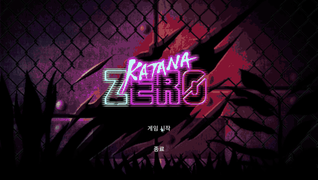

**카타나 제로 (모작)** — 원작 *Katana ZERO*의 핵심 플레이를 따라 만든 2D 액션 플랫포머입니다.
플레이어와 적 모두 **한 번 맞으면 죽고**, 죽으면 그 판을 **되감아(역재생)** 처음부터 다시 시작합니다.
스테이지의 모든 적을 처치하면 방금 플레이를 **CCTV 리플레이처럼 정방향 재생**한 뒤 다음 스테이지로 넘어갑니다.

**시점과 맵**

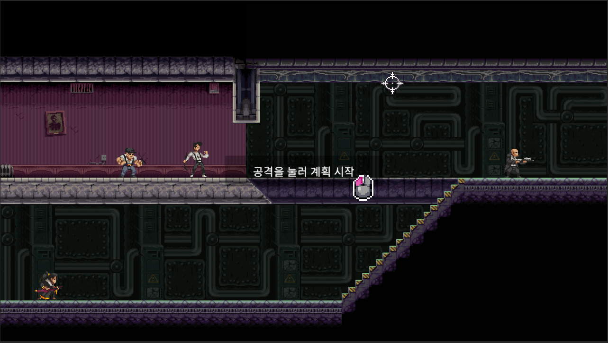

옆에서 보는 2D 시점이고, 스테이지마다 여러 층을 대각선 계단과 아래로 내려갈 수 있는 플랫폼이 잇습니다. 타이틀 뒤에 스테이지 8개가 이어집니다.

**조작**

| 입력 | 결과 |
|---|---|
| `a` / `d` · `←` / `→` | 좌우 이동 |
| `w` | 점프 · 벽에 붙어 있을 때 반대 방향 공중제비 (3.3 · 3.7) |
| `s` | 공중 급하강 · 플랫폼 내려가기 · 앉기 · (이동 중) 구르기 (3.4 · 3.5) |
| 마우스 좌클릭 | 마우스 방향으로 공격 대시(3.6). 스테이지 시작(첫 클릭으로 녹화 시작) · 사망 뒤 역재생 시작 · 리플레이 건너뛰기에도 씀 |
| `Left Shift` (누르고 있기) | 크로노스 — 게임 시간 0.25배 감속 (4장) |
| `ESC` | 일시정지 / 해제 (사망 · 재생 · 역재생 중에도 가능) |
| `R` | 플레이 중 수동 재시작 (역재생을 거쳐 다시 시작) |

**목표한 경험** — 원작의 핵심 루프인 **한 방 사망 → 되감기 → 재도전 → 클리어 리플레이**의 손맛을 그대로 옮기는 것입니다.

**게임 흐름**

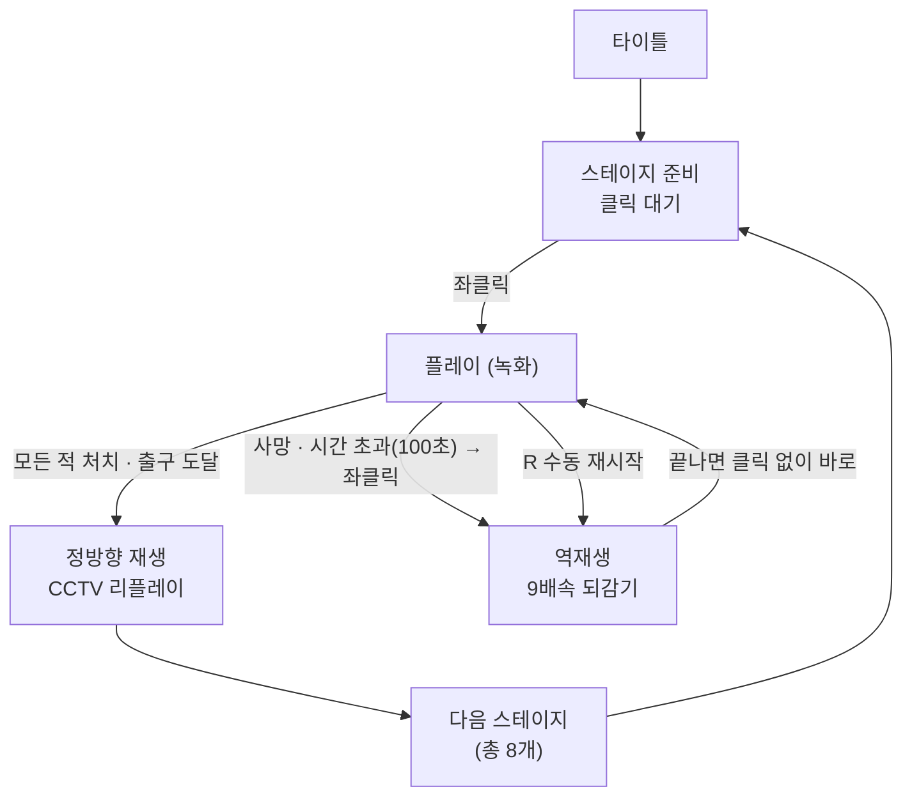

> ▶ 한 스테이지 흐름(플레이 → 사망 → 역재생 → 재도전 → 클리어 → 정방향 재생)은 [전체 영상](https://youtu.be/RWAb_H2oY2c)에서 볼 수 있습니다.

**원작과 다른 점** — 원작의 핵심 루프를 그대로 따라 만든 레플리카에 가까운 모작이라, 일부러 바꾼 규칙은 거의 없습니다. 보스전 · 엔딩, 물건 집어 던지기, 맵 장애물(레이저 · 연막), 재생 화면 연출, 사운드는 2주 일정에 맞춰 범위를 좁히며 뺐습니다(7.4). 공격에 닿은 적이 여럿일 때 원작처럼 가까운 적부터 차례로 처리하지 않고 한 번에 처리하는 점은 남은 과제입니다(7.3).

### 1.2 목표

| 목표 | 기준 | 지금 상태 |
|---|---|---|
| 이동 · 충돌을 직접 작성 | Rigidbody2D를 **Kinematic**으로 두고, 계단 · 플랫폼 · 벽 · 구르기까지 BoxCast로 직접 계산 (3장) | 계단 대각선 이동 · 플랫폼 통과 · 벽 붙기 · 공중제비 · 구르기 동작 (7.1) |
| 원작의 핵심 루프 | 한 방 사망 → 9배속 되감기 → 바로 재도전, 클리어하면 정방향 리플레이 (5장) | 역재생 · 리플레이 동작, 녹화 · 재생 중에도 180 fps 유지 (7.1) |
| 시간 기능끼리 깨지지 않기 | 크로노스 · 히트스탑 · 일시정지 · 재생이 모두 `Time.timeScale`을 바꿔도 서로 덮어쓰지 않음 (2장 · 4장) | 겹쳐도 감속 · 정지 상태로 굳지 않음 (7.1) |

원작 *Katana ZERO*의 핵심 플레이를 따라 만든 모작이지만, 저는 2D에서 Rigidbody2D를 Dynamic이 아닌 **Kinematic** 상태로 두고, **물리(이동 · 충돌)를 처음부터 끝까지 직접 작성해 보는 것**을 목표로 했습니다.
대학에서 15주 단위로 만들어 오다 처음 해 본 2주 프로젝트라, 만들 것의 전체 틀을 먼저 세우고 자잘한 기능은 빼 가며 범위를 좁혔습니다.

직접 만들다 보니 기능마다 **이것을 직접 만들지, 엔진이나 이미 있는 코드에 맡길지**를 정해야 했습니다. 이 문서는 기능을 설명하면서 그 선택(🧭)과 이유를 함께 적고, 7.4에서 한데 모읍니다.

| 기능 | 만들며 부딪힌 것 | 이렇게 풀었다 |
|---|---|---|
| 시간축 (2장) | 크로노스 · 히트스탑 · 일시정지 · 재생이 모두 `Time.timeScale`을 바꿔, 하나를 고치면 다른 것이 깨짐 | 게임 상태마다 timeScale과 녹화기를 함께 정하고, 실제 시간으로 움직일 것을 표로 나눔 |
| 플레이어 이동 (3장) | 기본 물리로는 원작의 계단 대각선 이동 · 플랫폼 통과 · 벽 붙기 · 구르기 느낌이 안 남 | **직접 계산** — Kinematic + BoxCast. 계단은 조금씩 올려 보는 step, 구르기는 이동량을 나눠 처리 |
| 크로노스 · 히트스탑 (4장) | 감속할 대상이 많고, 히트스탑도 timeScale을 써서 크로노스와 겹침 | **엔진에 맡김** — `Time.timeScale` 하나로 감속. 히트스탑은 끝날 때 크로노스의 지금 목표 값으로 복귀 |
| 녹화 · 재생 · 역재생 (5장) | 씬 리로드로는 되감는 연출을 만들 수 없고, 틱 단위로 재생하면 끊김 | 매 틱 상태를 기록해 정방향 / 역방향으로 다시 적용하고 틱 사이를 보간. 루프 판단은 **Animator에 맡김** |
| 타격 연출 · 카메라 (6장) | 한 번 맞으면 죽는 게임이라 맞히는 순간이 약하면 손맛이 없고, 기존 카메라는 맵 끝에서 맵 밖을 보여 줌 | 판정은 **기존 전투 구조**에 원작 규칙만 붙이고, 연출 호출과 데드존 카메라는 **직접** |

---

## 2. 시간축부터 정하기

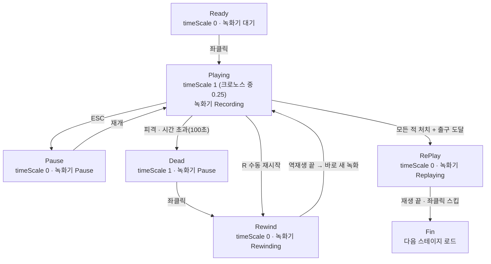

크로노스(감속) · 히트스탑(정지) · 일시정지 · 녹화 재생과 역재생이 **모두 `Time.timeScale`을 바꿔서**, 처음에는 하나를 고치면 다른 것이 깨졌습니다(5.2).
그래서 **게임 상태마다 timeScale과 녹화기 모드를 함께 정하고**(위 그림), **어떤 코드가 게임 시간과 실제 시간을 쓰는지 표로 나눴습니다**(2.2).

### 2.1 상태마다 timeScale과 녹화기 함께 바꾸기

`GameManager`가 `GameState` 하나로 스테이지 흐름을 관리하고, 상태가 바뀔 때 위 그림처럼 `Time.timeScale`과 녹화기 모드를 함께 바꿉니다. 재생 · 역재생 중에는 **세계를 멈추고(timeScale 0) 녹화기만 실제 시간으로** 움직입니다.

> 클릭을 기다리는 Ready는 스테이지에 처음 들어올 때만 거칩니다. 역재생이 끝나면 클릭 없이 바로 새 녹화(Playing)를 시작합니다.
> ESC 일시정지는 **Ready · Fin을 뺀 모든 상태(Dead · Rewind · RePlay 포함)** 에서 가능하고, 해제하면 일시정지 직전 상태로 돌아갑니다.

### 2.2 느려질 것과 그대로 갈 것

| 대상 | 사용하는 시간 | 이유 |
|---|---|---|
| 플레이어 · 적 이동, 애니메이션, 총알 | `fixedDeltaTime` / `deltaTime` (scaled) | 크로노스가 걸리면 같이 느려져야 함 |
| 녹화 **기록** | `FixedUpdate` 1회 = 1틱 (scaled) | 게임 세계가 실제로 진행된 만큼만 기록 |
| 녹화 **재생 · 역재생** | `Time.unscaledDeltaTime` | 재생 중엔 timeScale = 0이므로 실제 시간으로 진행해야 함 |
| 크로노스 게이지, 전환 연출 | `unscaledDeltaTime` | 감속 중에도 실제 1초에 1씩 줄어야 함 |
| 히트스탑 대기, 쉐이크, 슬래시, 카메라 추적 | `unscaledDeltaTime` / `WaitForSecondsRealtime` | timeScale = 0인 동안에도 끝나야 함 |

크로노스는 Playing 상태에서만 켤 수 있고, 재생 · 역재생 중이거나 Playing이 아니게 되면 강제로 꺼집니다(`ChronosSystem.CanAcceptChronosInput`).

> 기록은 `FixedUpdate`라서 크로노스 구간은 실제 시간보다 **적은 틱**으로 기록됩니다. 재생은 항상 초당 50틱으로 돌기 때문에, **리플레이에서는 크로노스 구간이 정상 속도로 재생**됩니다. 원작 리플레이와 같은 느낌을 내려고 의도한 동작입니다.

---

## 3. 플레이어 조작

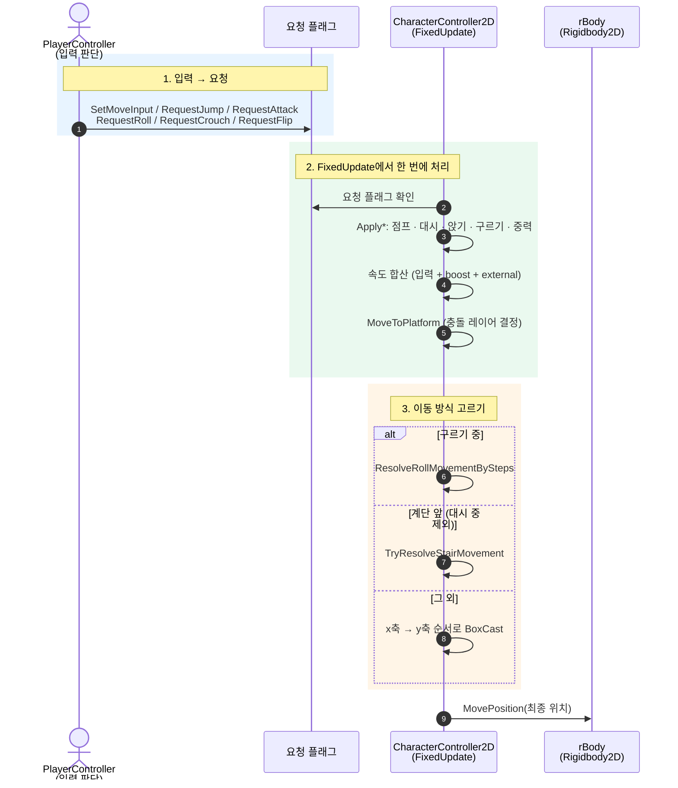

이 문서에서 가장 자세히 다루는 부분입니다. 입력과 이동을 나눠, `PlayerController`는 키 입력을 보고 **요청만 넣고**, 실제 이동 · 충돌은 `CharacterController2D`가 `FixedUpdate`에서 요청을 꺼내 한 번에 처리합니다.

| 입력 | 동작 | 절 |
|---|---|---|
| `a` / `d` · `←` / `→` | 좌우 이동. 계단을 만나면 그대로 오르내림 | 3.1 · 3.2 |
| `w` | 점프 | 3.3 |
| 공중에서 `s` | 급하강 | 3.4 |
| 플랫폼 위에서 `s` | 플랫폼 아래로 내려가기 | 3.4 |
| 땅에서 `s` / `s` + `a`·`d` | 앉기 / 구르기 | 3.5 |
| 마우스 좌클릭 | 커서 방향으로 공격 대시 | 3.6 |
| 공중에서 벽 쪽 입력 → `w` | 벽 붙기 → 공중제비 | 3.7 |

**물리 엔진 대신 Kinematic + BoxCast** 🧭 — 원작 같은 "딱 떨어지는" 조작감을 내려고 계단 · 플랫폼 · 벽 · 구르기를 물리 엔진에 맡기지 않고 직접 계산했습니다. 기존 `CharacterController2D`(Kinematic + skinWidth + 축별 BoxCast)를 기반으로 **아래 일곱 가지 조작을 더했습니다**.

| | [A] Dynamic Rigidbody2D | **[B] Kinematic + BoxCast 직접 구현** ✓ |
|---|---|---|
| 장점 | 충돌 · 경사 · 마찰을 엔진이 처리 | 계단 · 플랫폼 · 벽 붙기 · 구르기를 원하는 대로 통제 |
| 단점 | 원작 같은 "딱 떨어지는" 조작감을 만들려면 마찰 · 중력 · 속도 보정이 많이 필요 | 충돌 처리를 전부 직접 작성 → 예외 케이스가 많아짐 |

> 이렇게 직접 만든 컨트롤러는 다음 팀 프로젝트 「시장에 가면」에서 중력 · 점프를 빼고 XZ 축 BoxCast로 바꿔 3D 캐릭터 이동에 다시 썼습니다.

### 3.1 좌우 이동: x축 먼저, y축 나중

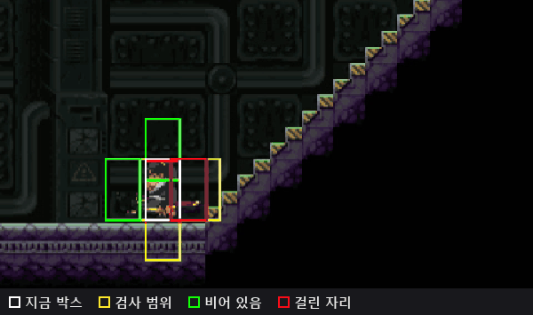

> 박스는 `CharacterController2D`의 `OnGUI`로 그린 BoxCast 시각화입니다. 흰색 = 지금 박스, 노랑 = 검사 범위, 초록 = 끝까지 비어 있음, 빨강 = 걸린 자리입니다. 이 장의 다른 GIF에 보이는 초록 · 노랑 박스도 같은 표시입니다.

좌우 입력(-1 ~ 1)에 속도 3을 곱한 값이 기본 이동입니다. 이동할 양을 x · y 두 축으로 나눠 BoxCast로 검사하고, **y는 x만큼 옮긴 박스에서** 검사합니다. 막힌 축은 벽까지 남은 거리에서 `skinWidth`만큼 덜 가서 멈춥니다.

<table style="table-layout:fixed;width:100%">
<colgroup><col style="width:55%"><col style="width:45%"></colgroup>
<thead><tr><th>코드 — x를 먼저 옮긴 박스에서 y를 검사</th><th>인스펙터 — <code>Player</code> 프리팹</th></tr></thead>
<tbody><tr><td style="vertical-align:top">

<pre><code class="language-csharp" style="font-size:12px;padding:14px">// CharacterController2D.cs:20, 22 — 필드
public float     skinWidth           = 0.02f;
public LayerMask collisionLayer;

// :185 FixedUpdate() 안 — 구르기 · 계단이 아닐 때
float boxX = ResolveAxisMovement(
    box, desireMove.x, Vector3.right);
box.center += new Vector3(boxX, 0, 0);
float boxY = ResolveAxisMovement(
    box, desireMove.y, Vector3.up);

// CharacterController2D.cs:421
private float ResolveAxisMovement(
    Bounds box, float move, Vector3 axis)
{
    if (move == 0.0f) return 0.0f;

    Vector3 dir = move &gt; 0.0f ? axis : -axis;
    float distance = Mathf.Abs(move);

    RaycastHit2D hit = Physics2D.BoxCast(
        box.center, box.size, 0.0f,
        dir, distance, collisionLayer);

    if (hit.collider == null) return move;

    float allowed =
        Mathf.Max(0, hit.distance - skinWidth);

    return Mathf.Sign(move) * allowed;
}
</code></pre>

</td><td style="vertical-align:top">


</td></tr></tbody>
</table>

- 전체 코드: [CharacterController2D.cs](https://github.com/KooHoo-Dev/3rd-2D-Project-NaJungWon/blob/main/Assets/Scripts/9.%20Utils/CharacterController2D.cs) · [PlayerController.cs](https://github.com/KooHoo-Dev/3rd-2D-Project-NaJungWon/blob/main/Assets/Scripts/00.%20Player/PlayerController.cs)

이 장의 수치는 모두 위 인스펙터 값입니다. 원작 체감에 가깝도록 플레이하며 직접 조정했고, 코드의 기본값과 달라도 게임은 인스펙터 값으로 동작합니다.

**만들며 생긴 문제 — 대각선 이동 시 플랫폼 모서리에 캐릭터가 낌.**

| 단계 | 내용 |
|---|---|
| 증상 | 대각선 이동 시 플랫폼 모서리에 캐릭터가 낌 |
| 원인 | 축마다 따로 BoxCast했지만 **x · y 모두 출발 위치에서** 검사해서, 축마다는 비어 있어도 두 이동을 합친 자리가 모서리 안쪽이 됨 |
| 해결 | x를 먼저 옮긴 박스에서 y를 검사 (위 코드 `box.center += …`) |
| 결과 | 대각선 이동 중 모서리에서 멈추지 않음 |

### 3.2 계단: step으로 오르내리기

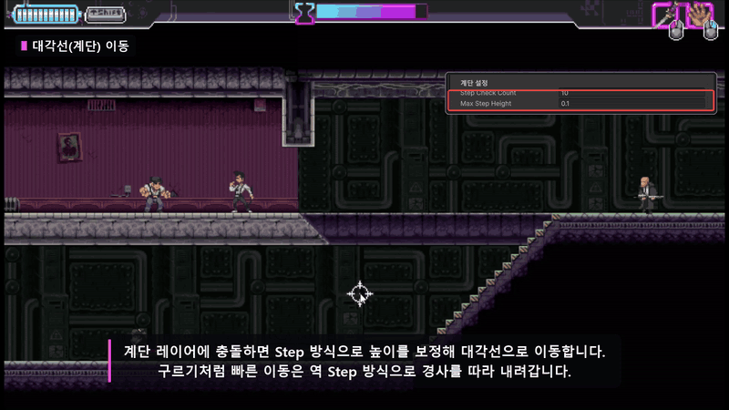

정면이 계단이면 `maxStepHeight(0.1)`를 10번 나눠 올려 보고, 올린 위치에서 앞으로 갈 수 있으면 그 높이로 이동합니다. 두 값은 맵의 계단을 오르내려 보며 정했습니다. 공격 대시 중에는 계단 검사를 하지 않습니다(3.6).

```csharp
// CharacterController2D.cs:80-81 — 필드 (인스펙터: 10번 · 0.1)
public int   stepCheckCount = 4;       // 위로 몇 번 나눠서 검사할지 카운트
public float maxStepHeight  = 0.3f;   // 한 번에 올라갈 수 있는 최대 계단 높이

// CharacterController2D.cs:467 TryResolveStairMovement() 안
int checks = Mathf.Max(1, stepCheckCount);
float stepUnit = maxStepHeight / checks;

for (int i = 1; i <= checks; i++)
{
    float stepY = stepUnit * i;

    RaycastHit2D upHit = Physics2D.BoxCast(box.center, box.size, 0.0f, Vector2.up, stepY, collisionLayer);
    if (upHit.collider != null)
        continue;

    Bounds raisedBox = box;
    raisedBox.center += new Vector3(0.0f, stepY, 0.0f);

    RaycastHit2D moveHit = Physics2D.BoxCast(raisedBox.center, raisedBox.size, 0.0f, dir, distance, collisionLayer);
    if (moveHit.collider == null)
    {
        stairMove = new Vector2(moveX, stepY);
        return true;
    }
}
```

- 전체 코드: [CharacterController2D.cs](https://github.com/KooHoo-Dev/3rd-2D-Project-NaJungWon/blob/main/Assets/Scripts/9.%20Utils/CharacterController2D.cs)

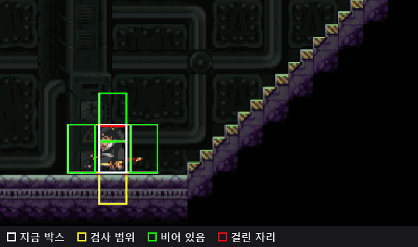

**경사 normal 대신 step 방식** 🧭 — [A]를 먼저 시도했지만, 당시 경사면 normal 기준 이동을 충분히 이해하지 못해 원하는 대로 다루지 못했습니다. 맵의 계단은 **대각선 경사** 형태였지만, 일정 안에 **내가 이해하고 고칠 수 있는 방식**으로 만드는 것을 우선해 step으로 선택했습니다.

| | [A] 충돌 normal 방향으로 이동 | **[B] step 방식** ✓ |
|---|---|---|
| 장점 | 경사 각도와 상관없이 처리 | "조금씩 올려 보고 안 되면 포기"라 동작을 이해하기 쉽고 결과가 예측 가능 |
| 단점 | normal 계산 · 미끄러짐 처리가 추가로 필요 | 한 틱 이동량이 크면 실패 → 구르기는 분할 처리 필요 (3.5) |

> 경사 계단을 step으로 처리한 것은 이해도에 맞춘 선택이라, normal 기준 경사 이동은 다시 공부해 볼 과제로 남았습니다.

### 3.3 점프

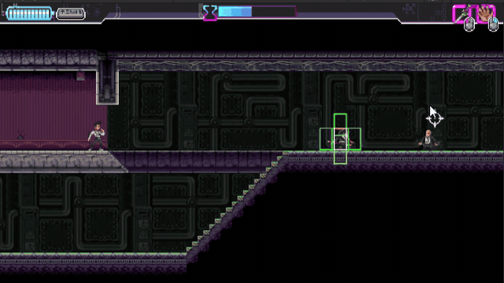

`w`를 누르면 점프를 요청하고, 다음 `FixedUpdate`에서 **땅에 있을 때만** 위쪽 속도 6을 줍니다. 점프 횟수는 최대 1번이고 착지하면 다시 채워져, 공중 점프는 없습니다.

- 점프하는 순간 남아 있던 공격 대시 속도를 지웁니다. 반대로 공격 대시는 남은 점프 속도를 지웁니다(3.6).
- 올라가는 동안에는 플랫폼을 빼고 검사해서, 아래층에서 뛰어 위 플랫폼을 뚫고 올라설 수 있습니다(3.4 표).
- 벽에 붙어 있을 때 `w`는 점프 대신 공중제비입니다(3.7).

- 전체 코드: [CharacterController2D.cs](https://github.com/KooHoo-Dev/3rd-2D-Project-NaJungWon/blob/main/Assets/Scripts/9.%20Utils/CharacterController2D.cs) (`RequestJump` :245 · `ApplyJump` :616) · [PlayerController.cs](https://github.com/KooHoo-Dev/3rd-2D-Project-NaJungWon/blob/main/Assets/Scripts/00.%20Player/PlayerController.cs) (`UpdateJumpInput` :235)

### 3.4 `s` ① 급하강 · ② 플랫폼 내려가기


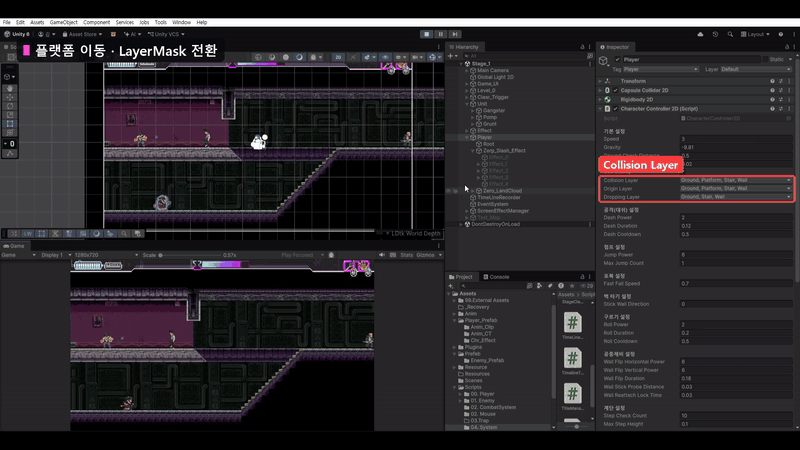

`s` 하나에 동작이 네 가지라, 누르고 있는 동안 아래 순서로 하나만 고릅니다(③ · ④는 3.5).

1. 공중이면 → 하강 속도를 0.7씩 더함 (급하강)
2. 발밑에 `PlatformEffector2D`가 붙은 플랫폼이 있으면 → 플랫폼 아래로 내려가기 (`DropDownPlatform`)
3. 아니면 → 앉기
4. 앉은 상태에서 좌우 입력 / 좌우로 가는 중 `s` → 구르기

플랫폼을 내려갈 때는 플랫폼의 콜라이더를 끄지 않고, **플레이어가 검사하는 LayerMask**를 상황에 따라 바꿉니다.

| 상황 | 사용하는 LayerMask |
|---|---|
| 점프로 올라가는 중 (`VerticalVelocity > 0`) | `droppingLayer` (플랫폼 제외) |
| 계단 위 | `droppingLayer` |
| `s`로 내려가는 중 (플랫폼을 완전히 벗어날 때까지) | `droppingLayer` |
| 그 외 지상 · 낙하 | `originLayer` (플랫폼 포함) |

- 전체 코드: [CharacterController2D.cs](https://github.com/KooHoo-Dev/3rd-2D-Project-NaJungWon/blob/main/Assets/Scripts/9.%20Utils/CharacterController2D.cs) (`ApplyCrouch` :660 — 위 1~3 순서, `DropDownPlatform` :351 — 플랫폼 위아래로 완전히 벗어날 때까지 기다렸다가 `originLayer`로 되돌림) · 두 레이어 값은 3.1 인스펙터

**플랫폼 콜라이더 대신 내 LayerMask를 바꾸기** 🧭 — **플레이어와 적이 같은 방식으로 플랫폼을 오르내리게** 하려고 [B]를 골랐습니다. 적도 같은 방식(레이어 교체 + `DropDownPlatform`)을 `EnemyController`에 따로 넣어, 추적 중인 플레이어가 아래층에 있으면 플랫폼을 통과해 따라 내려옵니다.

| | [A] 플랫폼 콜라이더를 잠깐 끄기 | **[B] 플레이어의 충돌 LayerMask 교체** ✓ |
|---|---|---|
| 장점 | 구현이 단순 | 플랫폼 쪽은 건드리지 않음 → 각 캐릭터가 **자기 기준으로** 통과 여부를 정함 |
| 단점 | 플랫폼 위 다른 캐릭터(적)까지 같이 떨어짐 | 대각선 이동 · 점프 · 하강마다 레이어를 언제 바꿀지 규칙이 필요 |

> 대각선 이동 중 플랫폼을 통과하지 못하는 부작용은 **계단 위 · 점프 상승 중에는 플랫폼 제외 레이어**를 쓰는 규칙(위 표)으로 해결했습니다.

**만들며 생긴 문제 — 플랫폼 중간에서 하강할 때 콜라이더에 낌.**

| 단계 | 내용 |
|---|---|
| 증상 | 플랫폼 중간에서 하강할 때 콜라이더에 낌 |
| 원인 | 플랫폼과 겹친 상태에서 원래 레이어로 복원되면 플랫폼 안에 갇힘 |
| 해결 | 바닥 검사에서 "플랫폼 윗면보다 발이 아래"면 접지가 아닌 것으로 보고 `DropDownPlatform`으로 빠져나가게 처리 |
| 결과 | ⚠️ 동작은 하지만 코드가 불안정 (7.3) |

### 3.5 `s` ③ 앉기 · ④ 구르기

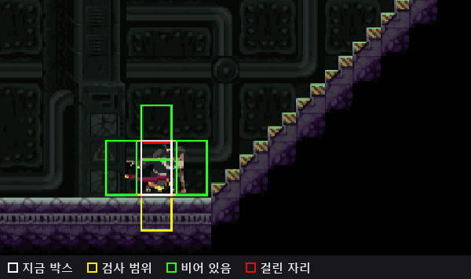

땅에서 `s`를 누르고 있으면 앉고, 앉은 채 좌우를 새로 누르거나 좌우로 가는 중에 `s`를 새로 누르면 **입력한 쪽으로** 구릅니다. 구르기는 땅에서만 되고, 0.2초에 2만큼 움직인 뒤 0.5초 동안은 다시 구를 수 없습니다.

```csharp
// PlayerController.cs:211 UpdateRollInput() 안
// S 재입력
bool crouchDown = crouchHeld && !prevCrouchHeld;
// 좌/우 입력이 0 -> 비0 으로 바뀌는 순간만 재입력으로 취급
bool moveReInput = Mathf.Approximately(prevHorizontalRaw, 0.0f) &&
                   !Mathf.Approximately(horizontalRaw, 0.0f);

// 구르기 판정
if (crouchHeld && moveHeld && (crouchDown || moveReInput) && Controller2D.CanStartRoll)
{
    Controller2D.RequestRoll(Mathf.Sign(horizontalRaw));
}
```

- 전체 코드: [PlayerController.cs](https://github.com/KooHoo-Dev/3rd-2D-Project-NaJungWon/blob/main/Assets/Scripts/00.%20Player/PlayerController.cs) · [CharacterController2D.cs](https://github.com/KooHoo-Dev/3rd-2D-Project-NaJungWon/blob/main/Assets/Scripts/9.%20Utils/CharacterController2D.cs) (`ApplyRoll` :703, 분할 이동 `ResolveRollMovementBySteps` :518)

구르기 판정은 위 `UpdateRollInput()` **한 곳에서만** 합니다. 앉기 쪽(`ApplyCrouch`)은 앉은 상태만 관리해서, `s` → `a`/`d`로 누르든 `a`/`d` → `s`로 누르든 입력 순서와 상관없이 같은 조건으로 구릅니다.

구르기는 한 틱 이동량이 커서 계단 step(3.2)이 실패합니다. 그래서 이동량을 `maxStepHeight` 단위로 쪼개, 조각마다 **① 올라가는 step → ② 수평 이동 → ③ 내려가는 step(바닥에 붙이기)** 순서로 처리합니다. 더 앞으로 갈 수 없으면 거기서 멈춥니다.

**만들며 생긴 문제 — 구르기 · 공격 대시로 계단을 지나면 허공으로 날아감.**

| 단계 | 내용 |
|---|---|
| 증상 | 구르기 · 공격 대시로 계단을 지나면 허공으로 날아가거나 순간이동 |
| 원인 | 한 틱 이동량이 계단 높이보다 커서 step 실패 |
| 시도 | 단순 `while`로 반복 → 제자리 이동 · 무한 루프 · 끊기는 순간이동이 생김 |
| 해결 | 이동을 기본 이동 / 계단 이동 / 구르기 계단 이동 3가지로 나누고, 구르기만 `maxStepHeight` 단위로 분할 + 내려가는 step 추가 (위 ①~③). 공격 대시는 계단 step을 쓰지 않고 기본 이동(3.1)으로 처리 |
| 결과 | 구르기로 계단을 지나도 바닥에 붙어 이동 |

### 3.6 공격 대시

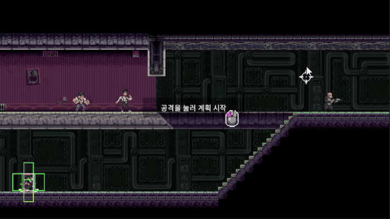

마우스 좌클릭 순간 **캐릭터에서 커서로 향하는 방향**을 요청하고, 다음 `FixedUpdate`에서 그 방향으로 0.12초 동안 2만큼 돌진합니다. 바라보는 방향도 그쪽으로 바뀌고, 남아 있던 점프 속도는 지웁니다(3.3). 한 번 쓰면 0.5초 동안 다시 쓸 수 없습니다.

대시가 시작되는 순간 공격 애니메이션과 공격 이펙트를 켜고, 대시 중에 닿은 적 · 총알은 공격 판정이 처리합니다(6장). 대시 중에는 계단 step을 쓰지 않고 기본 이동으로 움직입니다(3.5 문제).

- 전체 코드: [CharacterController2D.cs](https://github.com/KooHoo-Dev/3rd-2D-Project-NaJungWon/blob/main/Assets/Scripts/9.%20Utils/CharacterController2D.cs) (`ApplyAttack` :638) · [PlayerController.cs](https://github.com/KooHoo-Dev/3rd-2D-Project-NaJungWon/blob/main/Assets/Scripts/00.%20Player/PlayerController.cs) (`UpdateAttackInput` :164)

**넉백은 감쇠, 내가 누른 동작은 거리 / 시간** 🧭 — 외부 충격(넉백)은 [A], 공격 대시 · 구르기는 [B]로 나눠 씁니다. 초기 버전은 구르기 · 대시를 `rollDrag` / `dashDrag`(감쇠)로 처리했는데, 구르기 거리가 매번 달라져 **거리 / 시간 방식으로 바꿨습니다.**

| | **[A] power + drag** ✓ | **[B] speed(거리) + duration** ✓ |
|---|---|---|
| 적용 | 외부 충격(넉백) — `externalVelocity`를 `Lerp`로 감쇠(12) | 플레이어 자체 이동(대시 · 구르기) — 속도 = 거리 ÷ 시간 |
| 이유 | 맞고 밀릴 땐 서서히 멈춰야 자연스러움 | 내가 누른 동작은 매번 같은 거리를 같은 시간에 가야 조작이 정확함 |

### 3.7 벽 붙기 · 공중제비

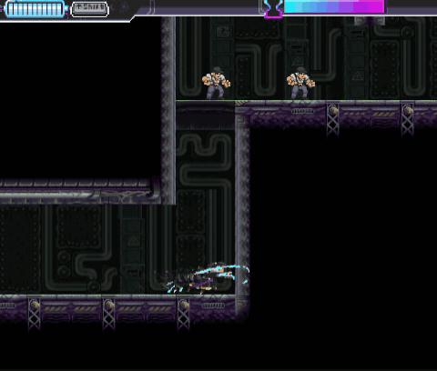

- **붙기** — 공중에서 **입력한 방향**으로 벽(레이어 9)을 검사해 닿으면 붙습니다. 붙는 순간 떨어지던 속도와 가로 추진을 0으로 만듭니다. 땅에 닿거나, 반대 방향을 누르거나, 벽이 끝나 더 닿지 않으면 떨어집니다.
- **공중제비** — 붙어 있을 때 `w`를 누르면 점프 대신 공중제비를 요청하고, 벽 반대쪽으로 가로 6 · 세로 6의 속도로 0.18초 동안 튕겨 나갑니다. 바라보는 방향도 벽 반대쪽으로 바뀌고, 점프 횟수는 다 쓴 것으로 처리합니다.
- **반대쪽 벽에 이어 붙기** — 공중제비 직후 0.03초는 같은 벽에 다시 붙지 않게 막고, 공중제비 중에는 입력이 없어도 좌우 벽을 검사해 반대쪽 벽에 바로 붙습니다. 그래서 위 GIF처럼 양쪽 벽을 번갈아 차며 올라갈 수 있습니다.

- 전체 코드: [CharacterController2D.cs](https://github.com/KooHoo-Dev/3rd-2D-Project-NaJungWon/blob/main/Assets/Scripts/9.%20Utils/CharacterController2D.cs) (`StickWall` :720 · `ApplyFlip` :787 · `TryAttachWall` :848)

---

## 4. 크로노스와 히트스탑

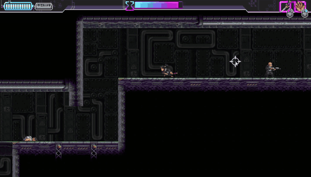

`lShift`를 누르고 있는 동안 게임 시간이 0.25배로 느려지고, 공격이 맞으면 **히트스탑(0.08초 정지) + 화면 흔들림 + 슬래시**가 같이 나옵니다.
둘 다 `Time.timeScale`을 바꾸기 때문에, 아래 흐름처럼 겹쳐도 깨지지 않게 하는 것이 이 장의 핵심입니다.

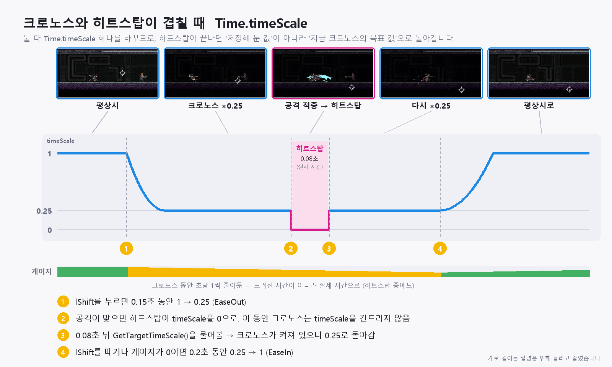

### 4.1 시간 감속: `Time.timeScale` 하나로

**대상마다 배율 대신 `Time.timeScale` 하나로** 🧭 — 크로노스를 만들 때 감속에서 빠져야 할 것은 UI밖에 없어서, 엔진의 `Time.timeScale` 하나로 세계 전체를 늦추는 [B]가 맞다고 판단했습니다. [A]는 적 · 총알 · 애니메이션 · 이펙트를 전부 고쳐야 했습니다.

| | [A] 대상마다 속도 배율 적용 | **[B] `Time.timeScale` 변경** ✓ |
|---|---|---|
| 장점 | 플레이어만 빠르게 하는 등 세밀한 조정 가능 | 적 · 총알 · 애니메이션 · 파티클이 한 번에 느려짐 |
| 단점 | 이동 · 애니메이션 · 총알 · 이펙트를 전부 수정해야 함 → 빠뜨리면 버그 | 쿨타임 · 게이지 · 녹화 재생 등 **느려지면 안 되는 것**을 따로 빼야 함 |

대가로 히트스탑 대기 · 녹화 재생 · 게이지 · 카메라처럼 실제 시간으로 움직여야 하는 것은 따로 빼야 했고, 그 기준이 2.2의 표입니다.

> 원작처럼 플레이어 입력도 같이 느려지므로, "감속은 공짜가 아니라 신중하게 써야 하는 자원"이라는 설계 의도와도 맞습니다.

### 4.2 크로노스 게이지는 실제 시간으로

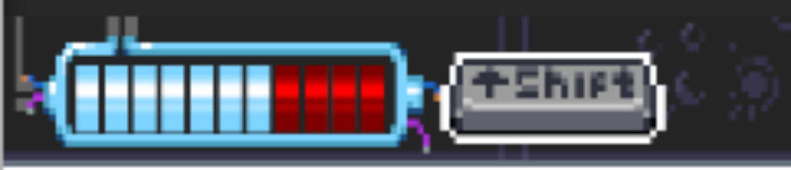


게이지는 감속 중에도 실제 시간대로 줄어야 해서 `Time.unscaledDeltaTime`으로 계산하고, 라운드를 새로 시작할 때마다 가득 채웁니다. 다 쓰면 22초 뒤에 가득 찹니다(최대 11 ÷ 초당 0.5).

켜고 끌 때는 갑자기 바뀌면 어색해서 진입 0.15초(EaseOut) · 해제 0.2초(EaseIn) 동안 바꿉니다(코드 값). 수치는 원작 체감에 가깝도록 플레이하며 정했습니다.

- 전체 코드: [ChronosSystem.cs](https://github.com/KooHoo-Dev/3rd-2D-Project-NaJungWon/blob/main/Assets/Scripts/04.%20System/ChronosSystem.cs) (게이지 `UpdateEnergySystem` :106, 라운드 시작 때 `ResetEnergy` :232)

### 4.3 히트스탑이 끝나면 돌아갈 값

크로노스는 **히트스탑 중(timeScale = 0)에는 timeScale을 바꾸지 않고**, 히트스탑은 끝날 때 **저장해 둔 값이 아니라 크로노스의 현재 목표 값**으로 돌아갑니다.

```csharp
// ChronosSystem.cs:20-21 — 필드
[SerializeField, Range(0.1f, 0.8f)]
private float chronosTimeScale = 0.25f;

// ChronosSystem.cs:198
private void ApplyTimeScale(float scale)
{
    // ScreenEffectManager 히트스탑(timeScale=0) 중에는 건드리지 않음
    if (Time.timeScale <= 0f) return;

    Time.timeScale = scale;
}

// ChronosSystem.cs:206
public float GetTargetTimeScale() => IsChronosActive ? chronosTimeScale : 1f;

// ScreenEffectManager.cs:250 HitStopCoroutine() 안
timeScaleStack.Push(Time.timeScale);
Time.timeScale = 0f;

yield return new WaitForSecondsRealtime(duration);

if (timeScaleStack.Count > 0) timeScaleStack.Pop(); // 예전 값은 버립니다.

float restoreScale = (ChronosSystem.Instance != null)
    ? ChronosSystem.Instance.GetTargetTimeScale()
    : 1f;

Time.timeScale = restoreScale;
```

- 전체 코드: [ChronosSystem.cs](https://github.com/KooHoo-Dev/3rd-2D-Project-NaJungWon/blob/main/Assets/Scripts/04.%20System/ChronosSystem.cs) · [ScreenEffectManager.cs](https://github.com/KooHoo-Dev/3rd-2D-Project-NaJungWon/blob/main/Assets/Scripts/04.%20System/ScreenEffectManager.cs)

**저장해 둔 값 대신 그 순간 크로노스의 목표 값으로 복귀** 🧭 — 저장해 둔 값으로 돌아가면, 히트스탑 도중 `lShift`를 떼거나 눌렀을 때 **히트스탑 전 상태로 되돌아가는 문제**가 생깁니다. 그래서 복귀 시점의 크로노스 상태를 다시 묻습니다.

| | [A] 히트스탑 전에 저장해 둔 값 | **[B] 그 순간 크로노스의 목표 값** ✓ |
|---|---|---|
| 장점 | 히트스탑이 크로노스를 몰라도 됨 | 히트스탑 도중 `lShift`를 떼거나 눌러도 지금 상태로 돌아감 |
| 단점 | 히트스탑 도중 `lShift`를 떼거나 누르면 **히트스탑 전 상태로 되돌아감** | 히트스탑이 크로노스의 목표 값(`GetTargetTimeScale`)을 물어봐야 함 |

**[결과]** 크로노스 · 히트스탑 · 일시정지가 겹쳐도 timeScale이 감속이나 정지 상태로 굳지 않습니다(7.1). 다만 크로노스를 끄는 0.2초 전환 도중에 히트스탑이 끝나면, 1로 돌아간 뒤 남은 전환이 이어져 잠깐 1보다 느려집니다.

---

## 5. 녹화 · 역재생 · 리플레이

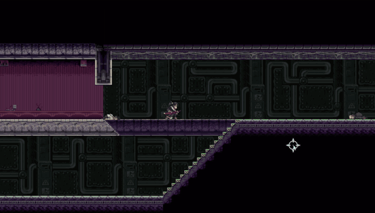


플레이하는 동안 매 틱 **플레이어 · 적 · 오브젝트(총알, 카메라) · 이펙트의 상태**를 기록해 두고, 죽으면 **9배속으로 되감은 뒤** 바로 다시 시작하고, 클리어하면 **정방향으로 다시 보여 준 뒤** 다음 스테이지로 넘어갑니다.

> 녹화 · 재생 · 역재생은 AI의 도움을 받아 작성했고, 특히 아래 문제 → 해결(5.2 · 5.4)은 AI와 주고받으며 고쳤습니다(7.2).

**구조**

**데이터 구조 (직접 설계)** — 한 틱 = `TimelineFrame` 1개 = 플레이어 1명 + 적 n + 오브젝트 n + 이펙트 n

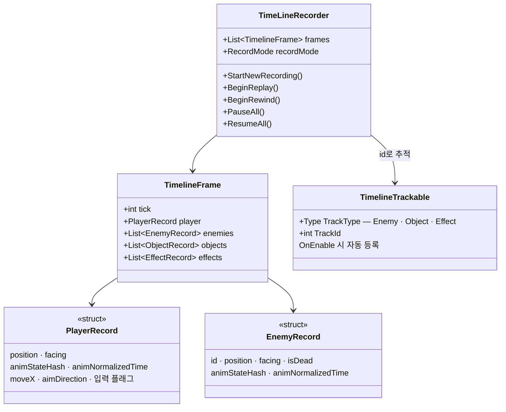

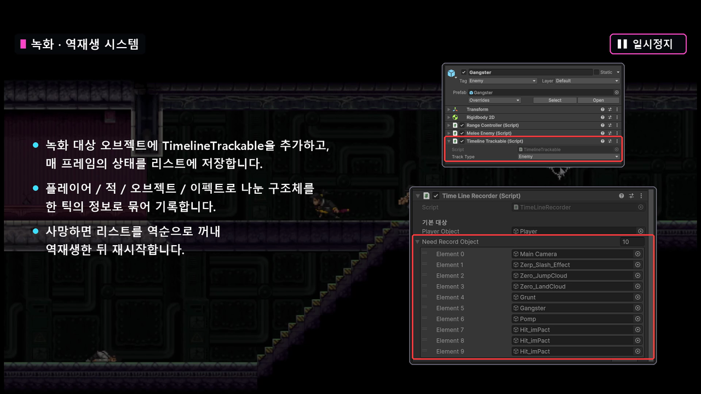

| 녹화 모드 | 동작 | 주기 · 속도 |
|---|---|---|
| Recording | 매 틱 `TimelineFrame`을 만들어 추가 | `FixedUpdate` 1회 = 1틱(초당 50틱), 최대 5,000틱 = 100초 |
| Replaying | 재생 위치를 앞으로 옮기며 샘플링 | `Update` + unscaled, 초당 50틱 × 1 = **1배속** |
| Rewinding | 재생 위치를 뒤로 옮기며 샘플링 | 초당 150틱 × 3 = **9배속** |
| Pause | 이전 모드를 저장하고 멈춤 | — |
| Fin | 재생 끝, `GameManager`가 다음 흐름 진행 | — |

수치는 각 스테이지 씬의 `TimeLineRecorder` 인스펙터 값(8개 스테이지 동일)으로, 코드의 기본값(`maxRecordedTicks = 15000` 등)과 다를 수 있습니다. 9배속은 빠르게 재도전하도록 플레이하며 정했고, 5,000틱(100초)은 스테이지 제한 시간 겸 메모리 상한입니다. 이를 넘기면 시간 초과로 사망 처리합니다.

### 5.1 매 틱 상태 기록

전체 씬을 기록하면 무거우므로, 플레이어 외에는 `TimelineTrackable`이 붙은 오브젝트만 기록합니다. 총알처럼 런타임에 생기는 오브젝트는 `OnEnable`에서 스스로 등록합니다. 기록 함수는 등록된 대상을 종류(적 · 이펙트 · 오브젝트)별로 나눠 위 데이터 구조의 한 틱에 담습니다.

- 전체 코드: [TimeLineRecorder.cs](https://github.com/KooHoo-Dev/3rd-2D-Project-NaJungWon/blob/main/Assets/Scripts/04.%20System/TimeLineRecorder.cs) (`RecordStage` :438) · [TimelineTrackable.cs](https://github.com/KooHoo-Dev/3rd-2D-Project-NaJungWon/blob/main/Assets/Scripts/04.%20System/TimelineTrackable.cs)

**입력 대신 매 틱 상태 스냅샷** 🧭 — 재생 · 역재생 초기 데이터 작업을 AI와 함께 하며 [B]로 정했습니다. 역재생이 핵심 연출이라 "되돌릴 수 있는가"가 가장 중요했습니다.

| | [A] 입력만 기록하고 재시뮬레이션 | **[B] 매 틱 상태(위치 · 방향 · 애니메이션) 스냅샷** ✓ |
|---|---|---|
| 장점 | 데이터가 작음 | 그대로 다시 적용하면 되므로 **역재생이 쉬움**, 결과가 항상 같음 |
| 단점 | 크로노스 · 히트스탑 · 적 AI 때문에 같은 입력도 결과가 달라질 수 있음, **역방향 시뮬레이션은 불가능** | 틱마다 전체 상태를 저장 → 메모리 사용, 틱 사이가 끊겨 보임 |

**[결과]** 대가로 쓴 메모리는 100초(5,000틱) 녹화에 Mono 약 +8.5 MB였습니다(7.1).

> 입력 플래그(`moveX`, `jumpPressed` 등)도 `PlayerRecord`에 남아 있지만, 재생에는 위치 · 애니메이션만 씁니다. 처음에는 입력도 재생에 쓰려 했으나, 상태 스냅샷만으로 재생하도록 바꾸면서 기록 코드만 남았습니다. 예전 적용 함수(`ApplyFrame`) · `LerpLoop01`처럼 지금은 부르지 않는 코드와 함께 정리할 대상입니다.

### 5.2 틱 사이 보간

재생 위치를 정수 틱이 아니라 `float`로 들고, 앞뒤 두 프레임 사이를 `t`로 보간합니다. 위치는 `Lerp`, 방향 · 활성 여부처럼 섞을 수 없는 값은 `t < 0.5` 기준으로 고릅니다.

```csharp
// TimeLineRecorder.cs:113-116 — 필드
[SerializeField] private float playbackTicksPerSecond = 50f;
[SerializeField] private float replaySpeed = 1f;
[SerializeField] private float rewindPlaybackTicksPerSecond = 150f;
[SerializeField] private float rewindSpeed = 3f;

// TimeLineRecorder.cs:620 — 정방향 재생
playbackTickFloat += playbackTicksPerSecond * replaySpeed * Time.unscaledDeltaTime;
// TimeLineRecorder.cs:643 — 역재생
playbackTickFloat -= rewindPlaybackTicksPerSecond * rewindSpeed * Time.unscaledDeltaTime;

// TimeLineRecorder.cs:669 SampleFrame() 안
int fromIndex = Mathf.Clamp(Mathf.FloorToInt(tickFloat), 0, frames.Count - 1);
int toIndex = Mathf.Clamp(fromIndex + 1, 0, frames.Count - 1);
float t = Mathf.Clamp01(tickFloat - fromIndex);

TimelineFrame fromFrame = frames[fromIndex];
TimelineFrame toFrame = frames[toIndex];

SamplePlayer(fromFrame.player, toFrame.player, t, reverse);
SampleEnemies(fromFrame.enemies, toFrame.enemies, t, reverse);
SampleObjects(fromFrame.objects, toFrame.objects, t, reverse);
SampleEffects(fromFrame.effects, toFrame.effects, t, reverse);
```

- 전체 코드: [TimeLineRecorder.cs](https://github.com/KooHoo-Dev/3rd-2D-Project-NaJungWon/blob/main/Assets/Scripts/04.%20System/TimeLineRecorder.cs)

**기록은 틱, 재생은 `Update` + 보간** 🧭 — 처음부터 [B]를 고른 것이 아니라, **[A]로 만든 뒤 문제를 하나씩 만나며 [B]로 옮겨 온** 결과입니다. 무엇보다 **정방향 재생과 역재생을 둘 다** 해야 해서, 같은 기록을 양방향으로 부드럽게 샘플링할 수 있는 [B]가 결국 필요했습니다.

| | [A] 기록 · 재생 모두 `FixedUpdate` 틱 단위 | **[B] 기록은 틱, 재생은 `Update` + 보간** ✓ |
|---|---|---|
| 장점 | 구현 단순 | 렌더 프레임마다 부드럽게 보임, timeScale = 0에서도 재생 가능 |
| 단점 | 화면 주사율과 틱이 안 맞아 계단처럼 끊김, timeScale = 0이면 `FixedUpdate`가 안 돌아 재생 불가 | 보간 · Animator 시간축을 따로 관리해야 함 (아래 · 5.3) |

**만들며 생긴 문제 — 세 번 바꾸기까지.** 단계마다 원인을 AI와 주고받으며 찾았습니다.

| # | 만난 문제 | 원인 | 바꾼 것 |
|---|---|---|---|
| ① | 리플레이 애니메이션이 뚝뚝 끊김 | 틱 단위로만 적용해 프레임 사이 보간이 없음 | 재생 위치를 `float`로 들고 두 틱 사이를 보간 (위 코드) |
| ② | 공격 · 사망처럼 한 번만 나와야 할 애니메이션이 반복 | 애니메이션 시간을 0 ~ 1로 잘라 기록해 루프인지 단발인지 구분이 사라짐 | 원래 값을 그대로 기록하고 루프 판단은 Animator에 맡김 (5.3) |
| ③ | 크로노스 구간이 역재생에서도 느리게 재생 → 재생을 `unscaledDeltaTime` 기준으로, Animator를 `UnscaledTime` 모드로 바꾸자 **재생 중 일시정지해도 애니메이션이 계속 돎** | `UnscaledTime` 모드는 일시정지(timeScale = 0)도 무시함 | 일시정지할 때만 Animator 모드를 원래대로 되돌리고, 재개할 때 다시 Unscaled로 (`PauseAll` :210 · `ResumeAll` :229) |

**[결과]** 리플레이가 화면 프레임마다 끊김 없이 이어지고, 리플레이 중에도 180 fps에서 떨어지지 않았습니다(7.1). 재생 중 ESC로 화면 전체가 멈추고, 재개하면 멈춘 지점부터 이어집니다.

### 5.3 루프 판단은 Animator에게

기록할 때 `normalizedTime`을 0 ~ 1로 자르지 않고 그대로 저장하고, 재생할 때 `animator.Play(hash, 0, time)`으로 넣습니다.
루프 애니메이션은 1을 넘어도 Animator가 알아서 순환하고, 단발 애니메이션은 클립 끝에서 멈춥니다. 처음에는 `Mathf.Repeat`로 0 ~ 1에 잘라 기록해 5.2 표 ②의 반복 문제가 생겼습니다.

```csharp
// TimeLineRecorder.cs:117 — 필드
[SerializeField] private bool interpolateLoopAnimation = true;

// TimeLineRecorder.cs:910 SampleAnimator() 안 — 같은 상태면 시간 보간, 다르면 가까운 쪽 상태 사용
if (hashA != 0 && hashA == hashB)
{
    sampledHash = hashA;

    //    normalizedTime이 1.0을 넘었는지로 "단발성 여부"를 추측하지 않습니다.
    //    루프 애니메이션도 한 사이클만 지나면 똑같이 1.0을 넘어 계속 증가하므로
    //    그 값만으로는 둘을 구분할 방법이 없습니다.
    //    대신 각 State의 "Loop Time" 설정에 판단을 맡기면,
    //    루프 상태는 큰 값이 들어와도 내부적으로 올바르게 순환 재생되고,
    //    단발성 상태는 클립 길이를 넘는 순간 자동으로 마지막 프레임에 고정됩니다.
    sampledTime = interpolateLoopAnimation
        ? Mathf.LerpUnclamped(timeA, timeB, t)
        : ((t < 0.5f) ? timeA : timeB);
}
// ... 다른 상태면 t >= 0.5 기준으로 가까운 쪽 상태 · 시간 사용

animator.Play(sampledHash, 0, sampledTime);
animator.Update(0f);
```

- 전체 코드: [TimeLineRecorder.cs](https://github.com/KooHoo-Dev/3rd-2D-Project-NaJungWon/blob/main/Assets/Scripts/04.%20System/TimeLineRecorder.cs)

### 5.4 재생 중 게임 로직 끄기

재생 · 역재생 동안 플레이어의 게임 로직 스크립트(`PlayerController` · `CharacterController2D`)를 꺼서(`disableWhilePlayback`) 기록값과 싸우지 않게 합니다. 카메라도 `TimelineTrackable`로 기록해서, 리플레이 때 데드존 계산 없이 기록된 위치를 그대로 씁니다.

다만 스크립트를 꺼도 **Animator 파라미터는 그대로 남습니다.** 그래서 사망으로 켜진 `IsDead`는 역재생을 시작할 때 따로 꺼 둡니다.

```csharp
// TimeLineRecorder.cs:102 — 필드
[SerializeField] private List<Behaviour> disableWhilePlayback = new();

// TimeLineRecorder.cs:365 BeginRewind() 안
SetPlaybackMode(true);

// 사망 시 켜진 IsDead가 남아 있으면, 녹화된 상태를 Play해도
// 모든 상태의 IsDead → HurtFly 전이가 바로 발동해 사망 애니메이션으로 덮인다.
// (적은 기록의 isDead를 프레임마다 적용하지만 플레이어 기록에는 없음)
playerAnimator.SetBool(PlayerController.IS_DEAD, false);
```

- 전체 코드: [TimeLineRecorder.cs](https://github.com/KooHoo-Dev/3rd-2D-Project-NaJungWon/blob/main/Assets/Scripts/04.%20System/TimeLineRecorder.cs) (`SetPlaybackMode` :385 — 목록의 스크립트를 재생 중에 끄고 끝나면 켬)

**만들며 생긴 문제 — 재생 중에도 실제 플레이의 값이 남아 있음.** 사망 모션 문제(시연 영상을 찍은 뒤 발견)와 방향 문제의 ②는 11-12에 고쳤습니다(커밋 `c1289fc`).

| 문제 | 원인 | 해결 |
|---|---|---|
| 역재생에서 서 있던 구간까지 사망 모션이 나옴 | 사망 때 켠 `IsDead`가 역재생 내내 남아, 녹화기가 `Play(Idle)` 뒤 `Update(0f)`를 부르면 거의 모든 상태에 있는 `IsDead → HurtFly` 전이가 바로 발동. `IsDead`를 끄는 `ResetPlayer()`는 역재생이 **끝난 뒤** 호출됨 | 역재생 시작(`BeginRewind`)에서 `IsDead`를 끔 (위 코드) → 녹화된 Idle · 이동 모션이 그대로 보임 |
| 역재생 시 캐릭터가 반대 방향을 봄 | ① 방향을 바꾸는 코드가 이동 · 공격 · 공중제비에 흩어져 있고, `PlayerController`가 `FacingDirection`의 **사본**으로 화면을 뒤집어 기록과 화면이 어긋남 ② 녹화기의 `playerController` 변수가 이름과 달리 `CharacterController2D` 타입이라, 꺼야 할 목록에 **진짜 `PlayerController`가 빠져** 재생 중에도 화면 반전을 덮어씀 | ① 방향 변경을 `SetFacingDirection` 하나로 모으고 화면 반전은 `FacingDirection`만 읽게 함 ② 변수를 `characterController` / `playerController`로 나눠 **둘 다** `disableWhilePlayback`에 추가 → 녹화 당시와 같은 방향 |

---

## 6. 타격 연출과 카메라

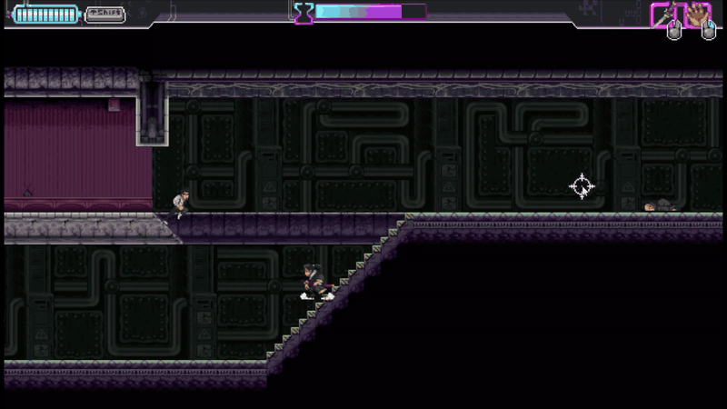

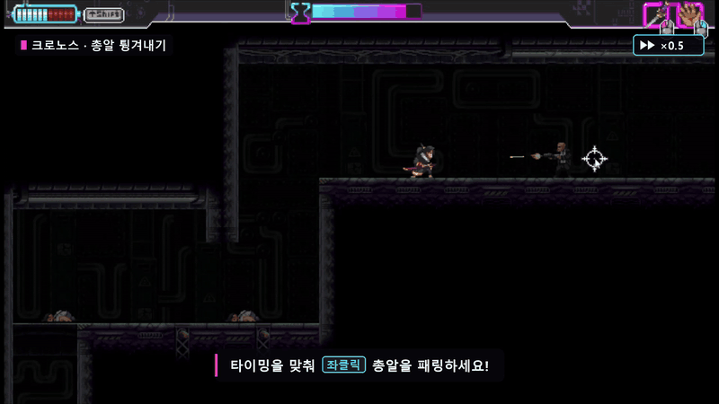

플레이어와 적 모두 한 번 맞으면 죽기 때문에, 맞히는 순간의 히트스탑 · 쉐이크 · 슬래시와 총알 반사로 그 한 방을 강조했습니다.
판정 · 데미지 라우팅(`CombatSystem`, `HitBox` → `HurtBox`)은 **기존 구조를 그대로 쓰고**, 원작 규칙에 필요한 부분 — 팀킬 방지, 구르기 · 사망 무적, 넉백 방향, 총알 반사 — 만 붙였습니다.

총알 반사는 플레이어 공격 판정(`ReflectBullet`)에 총알이 닿으면 총알의 소유자를 플레이어로 바꾸고 방향을 반대로 돌립니다. 소유자가 바뀌었으니 반사된 총알은 적에게 맞고, 반사하는 순간에도 히트스탑 · 쉐이크가 나옵니다.

- 전체 코드: [HitBox.cs](https://github.com/KooHoo-Dev/3rd-2D-Project-NaJungWon/blob/main/Assets/Scripts/02.%20CombatSystem/HitBox.cs) · [ReflectBullet.cs](https://github.com/KooHoo-Dev/3rd-2D-Project-NaJungWon/blob/main/Assets/Scripts/00.%20Player/ReflectBullet.cs) · [Bullet.cs](https://github.com/KooHoo-Dev/3rd-2D-Project-NaJungWon/blob/main/Assets/Scripts/01.%20Enemy/Bullet.cs) (`ReflectBullet` :110)

### 6.1 타격 연출을 한 곳에서


공격 판정(`HitBox`)과 총알 명중(`Bullet`)이 모두 `ScreenEffectManager.PlayAttackHitEffect` 하나를 부르고, 이 함수가 슬래시 · 히트스탑 · 쉐이크를 한 번에 냅니다. 리플레이에서는 기록된 이펙트만 보여 주고 새 연출은 만들지 않도록, 이 함수가 재생 중이면 바로 돌아갑니다. 이펙트 코드는 AI의 도움을 받아 작성했습니다(7.2).

| 연출 | 구현 |
|---|---|
| 히트스탑 | timeScale 0 → 정해진 시간 뒤 크로노스 목표 값으로 복귀 (4.3) |
| 카메라 쉐이크 | `CameraController`에 흔들림 오프셋만 전달 → 데드존 계산과 분리 (6.2) |
| 화면 슬래시 | 풀에서 꺼내 화면 밖 → 공격 방향으로 가로지른 뒤 반환 |
| 잔상 | 공격 대시 · 구르기 중 일정 간격으로 스프라이트를 복사한 잔상을 풀에서 꺼내 페이드 |

- 전체 코드: [ScreenEffectManager.cs](https://github.com/KooHoo-Dev/3rd-2D-Project-NaJungWon/blob/main/Assets/Scripts/04.%20System/ScreenEffectManager.cs) (`PlayAttackHitEffect` :150)

**연출은 `ScreenEffectManager` 정적 API 하나로** 🧭 — 기존 옵서버(`ICombatObserver`)로 붙이는 방법도 있었지만, 이 옵서버는 `OnDamageTaken` · `OnHealTaken` 두 가지 **데미지 · 회복 이벤트만** 받습니다(데미지 팝업이 이 방식). 총알 반사처럼 **데미지 이벤트가 아닌 순간**에도 같은 연출이 필요해서 정적 API로 직접 호출했습니다.

| | [A] 연출마다 호출하는 쪽에서 직접 처리 | **[B] `ScreenEffectManager` 정적 API로 통합** ✓ |
|---|---|---|
| 장점 | 연출별로 세밀하게 조정 | 호출하는 쪽은 한 줄, "재생 중 차단" 같은 공통 규칙을 한 곳에서 처리 |
| 단점 | 재생 중 차단 조건을 모든 호출부에 넣어야 함 | 매니저가 커짐 (420줄) |

> 총알 반사(`Bullet.ReflectBullet`)는 `HitStop` · `CameraShake`를 직접 불러 재생 중 검사를 거치지 않지만, 재생 중에는 `timeScale = 0`이라 충돌 판정 자체가 돌지 않습니다.

### 6.2 데드존 카메라

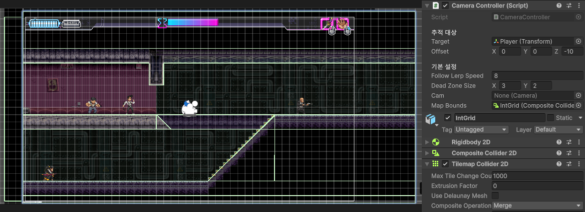

화면 중앙 3×2 영역 안에서는 카메라가 움직이지 않고, 벗어난 만큼만 따라갑니다. 목표점(`anchor`)을 **매번 맵 경계로 바로 클램프**해서, 맵 끝에 오래 서 있다가 반대로 움직일 때 카메라가 튀지 않게 했습니다.

맵 경계(`mapBounds`)는 맵 타일 `IntGrid`의 콜라이더(위 그림)를 그대로 쓰고, 그 범위에서 화면 절반만큼 안쪽으로 좁힌 범위로 `anchor`를 클램프합니다. 맵이 화면보다 작으면 맵 중심에 고정합니다. 추적은 `unscaledDeltaTime`이라 크로노스 · 히트스탑 · 일시정지 중에도 멈추지 않습니다(2.2).

- 전체 코드: [CameraController.cs](https://github.com/KooHoo-Dev/3rd-2D-Project-NaJungWon/blob/main/Assets/Scripts/04.%20System/CameraController.cs) (`LateUpdate` :78)

**`SimpleFollowCamera` 대신 데드존 + 맵 경계 카메라를 직접** 🧭 — 이 게임에 맞는 추적 방식(데드존)을 쓰면서, 맵 끝에서 맵 밖이 화면에 나오지 않게 하려고 직접 만들었습니다.

| | [A] `SimpleFollowCamera` (단순 추적) | **[B] 데드존 + 맵 경계 제한 `CameraController` 직접 작성** ✓ |
|---|---|---|
| 장점 | 이미 있는 코드라 바로 사용 가능 | 작은 움직임에는 카메라가 가만히 있고, 맵 끝에서도 맵 안만 비춤 |
| 단점 | 카메라 위치에 제한이 없어 **맵 끝에서 맵 밖이 렌더링됨** | 데드존 · 경계 클램프 · 쉐이크 오프셋을 직접 작성해야 함 |

> 쉐이크 오프셋(`shakeOffset`)은 경계를 맞춘 **뒤에** 더해서, 맵 끝에서 흔들리면 최대 0.18만큼 맵 밖이 보일 수 있습니다. 문서를 쓰며 코드를 다시 보다 알게 되어 남은 과제로 적었습니다(7.3).

---

## 7. 회고

### 7.1 결과

| 목표 (1.2) | 결과 | 근거 | 절 |
|---|---|---|---|
| 목표한 경험 (1.1) | ✅ 한 방 사망 → 역재생 → 재도전 → 클리어 리플레이 루프 동작 | 발표 피드백 (아래) | 5장 |
| Kinematic으로 이동 · 충돌 직접 작성 | ✅ 계단 대각선 이동 · 플랫폼 통과 · 벽 붙기 · 공중제비 · 구르기 구현 | `CharacterController2D` 첫 커밋 362줄 → 1,014줄 | 3장 |
| 대각선(계단) 이동 | ✅ 계단 대각선 이동, 구르기로 계단을 지나도 바닥에 붙어 이동 | y는 x만큼 옮긴 박스에서 검사 · step · 구르기 분할 | 3.1 · 3.2 · 3.5 |
| 시간 감속 | ✅ 크로노스 · 히트스탑 · 일시정지가 겹쳐도 timeScale이 감속 · 정지 상태로 굳지 않음 | 2.2 시간축 분리, 4.3 복귀 규칙 | 2.2 · 4.1 · 4.3 |
| 사망 시 되감기 / 클리어 리플레이 | ✅ 역재생 9배속, 정방향 1배속 리플레이 | 아래 측정 | 5장 |
| 부드러운 리플레이 | ✅ 틱 사이 보간 + 루프 / 단발 애니메이션 정상 재생 | 5.2 · 5.3 | 5.2 · 5.3 |
| 콘텐츠 | 타이틀 + 스테이지 8개, Windows 빌드 | 13일, 1인 | — |

> 발표 피드백(동료): "리와인드 기능을 보고 타 게임의 리플레이 방식과 어떻게 다르게 구현되는지 공부할 수 있었다", "FSM과 애니메이션 등 시각적 피드백이 실제 게임을 그대로 옮긴 것처럼 자연스러웠다"

**측정 — 녹화 데이터의 메모리 비용과 fps** (2026-11-12, 빌드 · Ryzen 5 7500F · RTX 4060 · 창 1270×720 · 1스테이지)

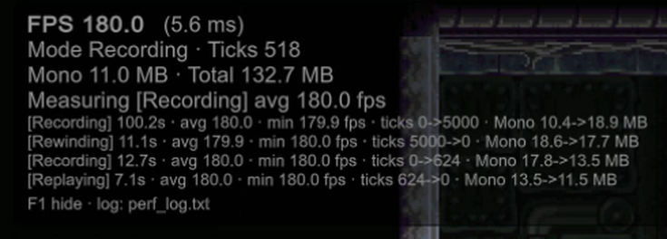

| 상황 | 시간 | 기록된 틱 | Mono 메모리 | 평균 / 최저 fps |
|---|---|---|---|---|
| 녹화 (시간 제한까지) | 100.2초 | 0 → 5,000 | 10.4 → 18.9 MB (**약 +8.5 MB**) | 180.0 / 179.9 |
| 역재생 (9배속) | 11.1초 | 5,000 → 0 | 18.6 → 17.7 MB | 179.9 / 180.0 |
| 녹화 (클리어까지) | 12.7초 | 0 → 624 | — | 180.0 / 180.0 |
| 리플레이 (1배속, 도중에 건너뜀) | 7.1초 | 624 | — | 180.0 / 180.0 |

- **fps**: 녹화 · 역재생 · 리플레이 모두 **180 fps에서 떨어지지 않았습니다.** 180은 수직 동기화로 모니터 주사율에 묶인 상한이라, 여유가 얼마인지가 아니라 **상한 아래로 내려가지 않았다**는 뜻입니다.
- **메모리**: 100초(5,000틱) 녹화로 Mono 힙이 약 8.5 MB 늘었습니다(틱 하나에 약 1.7 KB). 제한 시간 100초가 곧 녹화 상한이라 한 스테이지에서 이보다 커지지 않습니다(GC 시점에 따른 오차가 있는 근사값).

> **어떻게 쟀나** — 측정용 코드를 잠시 넣어 위 화면처럼 값을 띄우고 구간마다 로그로 남겼습니다. 화면 녹화 프로그램을 켠 상태에서 잰 값이고, 측정 코드는 측정 뒤 원본 프로젝트에서 뺐습니다.

### 7.2 AI와 일한 방식

AI의 도움을 가장 많이 받은 곳은 **이펙트**(화면 연출, 6.1)와 **녹화 · 재생 · 역재생**(5장)으로, 코드 작성부터 문제 → 해결까지 AI와 주고받았습니다. 그 밖의 기능도 각 절의 고민과 선택(🧭)은 AI와 대안을 주고받으며 비교했고, 고르는 것은 제가 했습니다.

| 기능 | AI와 함께 한 것 | 제가 한 것 |
|---|---|---|
| 이펙트 · 녹화 · 재생 · 역재생 (5장 · 6.1) | 코드 작성, 문제가 생길 때마다 원인과 해결을 주고받으며 고치기 (5.2 · 5.4) | 한 틱에 담을 데이터 구조 (5장), 9배속 · 100초 같은 재생 수치 |
| 플레이어 조작 · 시간축 · 카메라 (2 · 3 · 4장 · 6.2) | 고민과 선택의 대안 비교 (예: 계단 경사 처리 3.2, 벽 붙기 3.7) | 방식 고르기, 구현, 플레이하며 수치 맞추기 |

녹화기는 끊김 → 단발 모션 반복 → 일시정지 문제를 차례로 만나며 재생 방식을 세 번 바꿨고(5.2), 재생 중에도 실제 플레이의 값이 남아 생긴 사망 모션 · 방향 문제도 같은 방식으로 고쳤습니다(5.4). 여러 번 바꾸는 동안 지금은 쓰지 않는 코드가 남아, 정리할 대상으로 적어 두었습니다(5.1).

### 7.3 남은 과제와 다음 계획

| 과제 | 근거 | 다음에 할 것 |
|---|---|---|
| **여러 적 동시 타격 순차 처리** | 원작은 가까운 적부터 차례로 히트스탑 · 처치 연출이 나오지만, 지금은 닿은 적 전부가 한 번에 처리돼 타격감이 약함 (1.1 원작과 다른 점) | 거리순으로 정렬해 한 명씩 히트스탑 · 연출 |
| **튜토리얼** | 원작을 모르면 총알 반사 등을 알 수 없음 (발표 피드백) | 최초 진입 · 기능 최초 사용 시 안내 |
| **상태별 화면 효과** | 플레이 · 재생 · 역재생 · 일시정지 화면이 구분되지 않음 | 재생 흑백, 역재생 글리치, 일시정지 VHS 노이즈 |
| **플랫폼 판정 기준 통일** | 한쪽은 레이어 번호(7), 한쪽은 `PlatformEffector2D` 유무로 판정 → 3.4의 하강 끼임 처리가 불안정 | 플랫폼 판정을 하나의 기준 · 함수로 통일, 레이어 번호 대신 `LayerMask` 필드 사용 |
| **쉐이크 중 맵 밖 노출** | 쉐이크 오프셋을 경계 클램프 뒤에 더해, 맵 끝에서 최대 0.18만큼 맵 밖이 보일 수 있음 (6.2) | 쉐이크를 더한 최종 카메라 위치를 다시 경계 안으로 클램프 |

**그 밖에 남은 작업** — 2주에 맞춰 범위를 좁히며 뺀 보스전 · 엔딩, 물건 집어 던지기, 맵 장애물(레이저 · 연막), 다음 맵 길 안내, 사운드.

**기술 부채** — 공격 · 점프 · 착지의 시작 / 끝을 bool 대신 이벤트로 바꾸기, 대각선 이동(기본 이동 · 구르기) 두 로직을 분할 이동 하나로 통합, 녹화기에서 쓰지 않는 코드 정리(5.1), `GameManager` · `InGameUI` · `UnitManagement` 역할 분리.

### 7.4 배운 점

**이미 있는 기능의 가치 — 직접 만들 것과 맡길 것.**
Rigidbody2D를 Kinematic으로 두고 이동을 전부 BoxCast로 만들면서 계단 step, 레이어 교체, 분할 이동 같은 예외를 하나씩 쌓았습니다.
끝내고 나서야 Physics2D가 기본으로 해 주던 일이 많았다는 걸 체감했고, "다시 만들지 않아도 되는 것을 직접 만들고 있지 않은가"를 먼저 따져 보게 됐습니다. 이 프로젝트에서 내린 선택을 모아 보면 아래와 같습니다.

| 기능 | 고른 쪽 | 이유 |
|---|---|---|
| 시간 감속 (4.1) | 엔진에 맡김 — `Time.timeScale` | 감속에서 빠질 것이 UI뿐이었음. 대가(실제 시간으로 움직일 것)는 2.2 표로 관리 |
| 루프 / 단발 판단 (5.3) | 엔진에 맡김 — Animator의 Loop Time | 기록한 값만으로는 둘을 구분할 수 없고, 그 구분은 State 설정에 이미 있음 |
| 판정 · 데미지 (6장) | 기존 코드에 맡김 — `CombatSystem` | 원작 규칙(팀킬 방지 · 무적 · 반사)만 붙이면 됐음 |
| 이동 · 충돌 (3장) | 직접 — Kinematic + BoxCast | 원작 같은 조작감을 물리 엔진으로 내려면 보정이 많고, 직접 작성해 보는 것 자체가 목표였음 |
| 계단 (3.2) | 직접, 단 이해할 수 있는 방식 — step | 경사 normal 이동은 당시 다루지 못했음 |
| 연출 호출 (6.1) | 직접 — 정적 API | 기존 옵서버는 데미지 · 회복 이벤트만 받아 총알 반사 순간을 잡지 못함 |
| 카메라 (6.2) | 직접 — 데드존 + 맵 경계 | `SimpleFollowCamera`는 맵 끝에서 맵 밖을 보여 줌 |

따지는 순서는 두 가지로 정리됩니다. **① 엔진이나 기존 코드가 이 게임의 규칙을 맞추면 맡기고, 그 대가만 관리합니다**(4.1 → 2.2). **② 맞추지 못하면 직접 만들되, 일정 안에 제가 이해하고 고칠 수 있는 방식으로 만듭니다**(3.2).

**시간을 쓰는 코드는 먼저 시간축을 정해야 한다.**
크로노스 · 히트스탑 · 일시정지 · 재생이 모두 `Time.timeScale`을 건드려서, 하나를 고치면 다른 게 깨졌습니다(5.2). "누가 scaled를 쓰고 누가 unscaled를 쓰는가"를 표로 정리한 뒤(2.2)에야 문제가 연쇄되지 않았습니다.

**틀은 먼저, 범위는 기간에 맞게.**
만들 것의 전체 틀을 먼저 세우고 시작했지만, 대학에서 15주 단위로 만들어 오다 처음 해 본 2주 프로젝트라 보스전 · 물건 던지기 · 맵 장애물 · 재생 연출처럼 만들며 빼야 한 기능이 생겼습니다. 다음 프로젝트부터는 틀과 함께 기간에 맞는 범위와 일정도 먼저 잡고 시작합니다.

---

## 부록 A. 전체 구조

### A.1 전체 구조

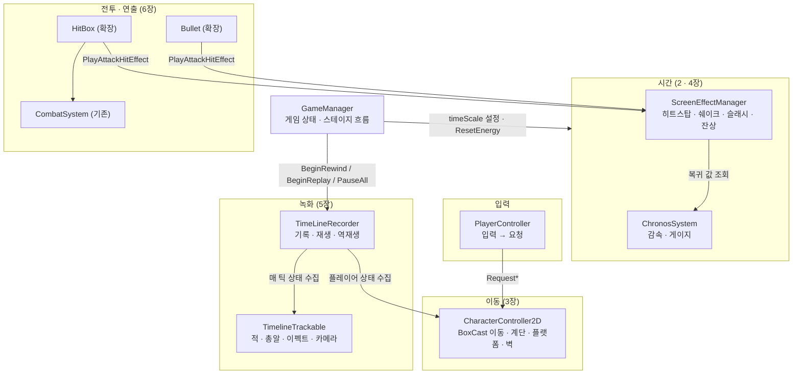

### A.2 호출 API

다른 코드가 무엇을 부르면 무엇이 나오는지 시스템별로 모았습니다.

**플레이어 이동 (3장)** — 입력 쪽(`PlayerController`)은 `CharacterController2D`에 아래 요청만 보내고, 실제 이동은 다음 `FixedUpdate`에서 한 번에 처리됩니다.

| 호출 | 결과 |
|---|---|
| `SetMoveInput(float h)` | 좌우 이동 입력(-1 ~ 1) 설정 |
| `RequestJump()` → `bool` | 점프 요청. 남은 점프 횟수가 없으면 `false` |
| `RequestFlip()` → `bool` | 벽 공중제비 요청. 벽에 붙어 있지 않으면 `false` |
| `RequestCrouch(bool)` / `RequestRoll(float forward)` | 앉기 · 구르기 요청 |
| `RequestAttack(Vector2 mouseVec)` | 마우스 방향으로 공격 대시 요청 |
| `ApplyImpact(Vector2 dir, float power)` | 넉백 같은 외부 충격 (`externalVelocity`에 더해 감쇠) |

**크로노스 · 히트스탑 (4장)**

| 호출 | 결과 |
|---|---|
| `ChronosSystem.EnergyPercent` | 게이지 비율 0 ~ 1 (UI 표시용) |
| `ChronosSystem.Instance.GetTargetTimeScale()` | 지금 돌아가야 할 timeScale (감속 중 0.25, 아니면 1) |
| `ChronosSystem.Instance.ResetEnergy()` | 게이지를 가득 채우고 감속을 강제로 끔 (라운드를 새로 시작할 때) |
| `ScreenEffectManager.HitStop(duration = -1)` | 히트스탑. -1이면 인스펙터 기본값(0.08초) |

**녹화 · 재생 · 역재생 (5장)** — 녹화기는 `GameManager`가 게임 상태에 맞춰 부르고, 녹화 대상은 컴포넌트만 붙이면 됩니다.

| 호출 · 설정 | 결과 |
|---|---|
| 오브젝트에 `TimelineTrackable` 추가 + `TrackType` 지정 | 켜질 때(`OnEnable`) 녹화 대상으로 자동 등록 (런타임에 생기는 총알도 동일) |
| `TimeLineRecorder.recorder.StartNewRecording()` | 기록을 비우고 새로 녹화 시작 (라운드를 새로 시작할 때 — 스테이지 시작 클릭 · 역재생 종료 뒤) |
| `BeginRewind()` / `BeginReplay()` | 역재생(사망 · 시간 초과 · 수동 재시작) / 정방향 재생(클리어) 시작 |
| `PauseAll()` / `ResumeAll()` | 지금 모드를 기억하고 멈춤 / 멈춘 지점부터 이어서 진행 |
| `TimeLineRecorder.WasTimeoutStop` | 이번 사망이 시간 초과였는지 (재시작 안내 문구 구분용) |

**타격 연출 · 카메라 (6장)**

| 호출 | 결과 |
|---|---|
| `ScreenEffectManager.PlayAttackHitEffect(Vector3 pos, Vector2 dir)` | 슬래시 · 히트스탑 · 쉐이크를 한 번에 (재생 · 역재생 중에는 무시) |
| `ScreenEffectManager.CameraShake(duration = -1, magnitude = -1)` | 쉐이크만. -1이면 인스펙터 기본값(0.15초 · 0.18) |
| `ScreenEffectManager.StartAfterimage()` / `StopAfterimage()` | 대시 · 구르기 잔상 시작 / 중단 |
| `HurtBox.SetCombatActive(bool)` | 콜라이더는 두고 피격 판정만 켜고 끔 |
| `Bullet.ReflectBullet(CombatEntity sender)` | 총알 소유자를 `sender`로 바꾸고 방향 반전 |
