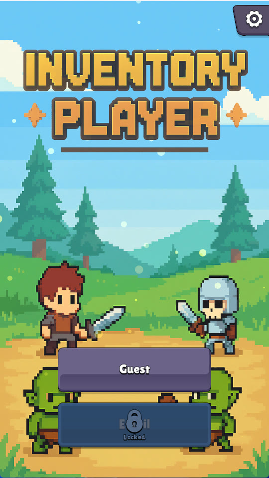
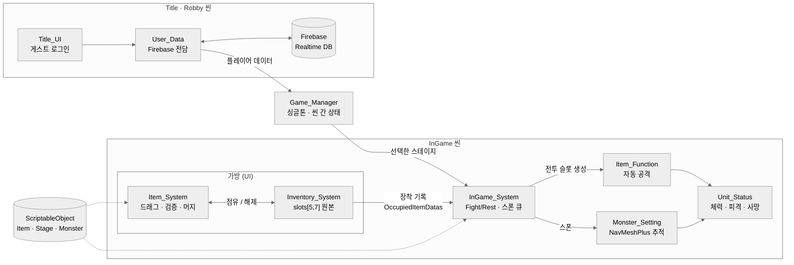
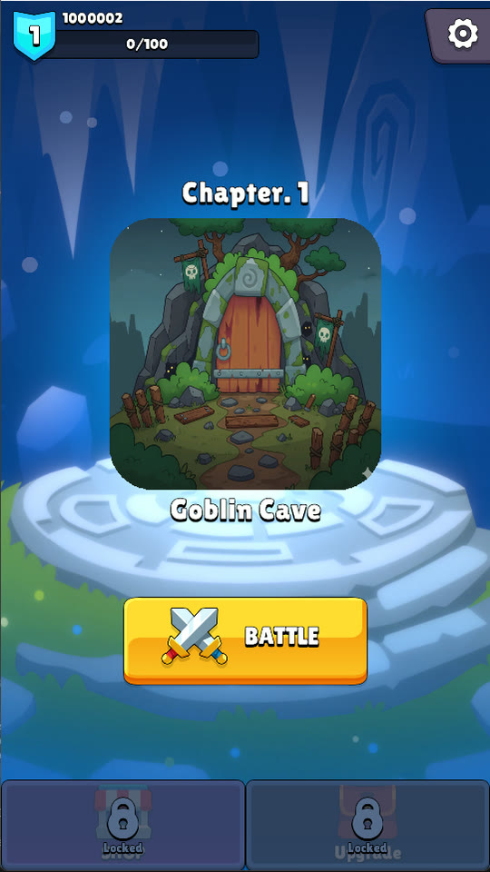
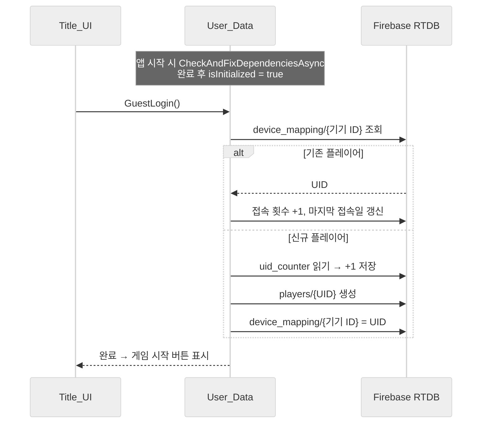
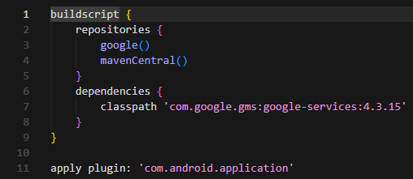
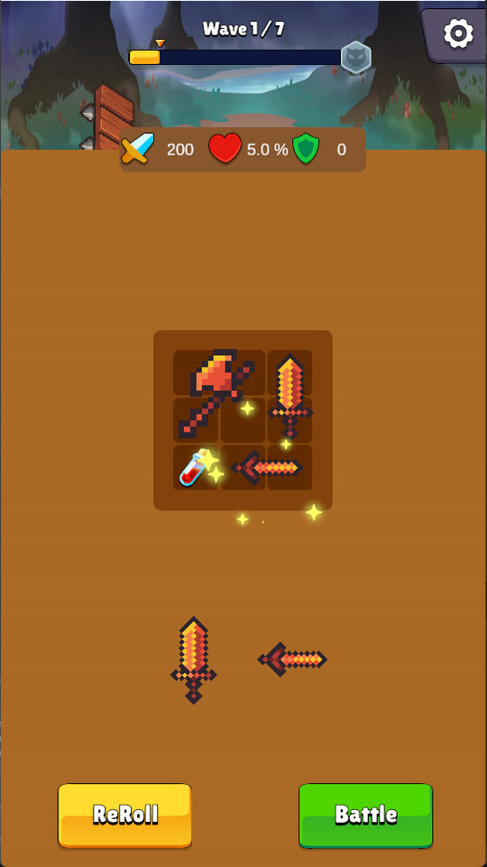
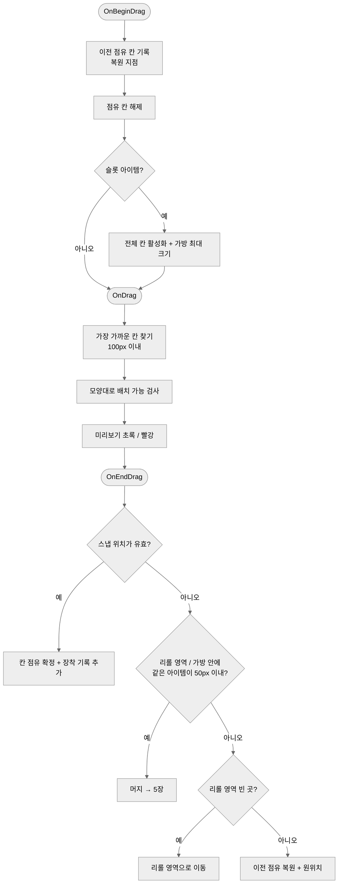
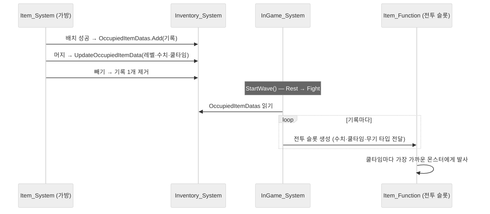
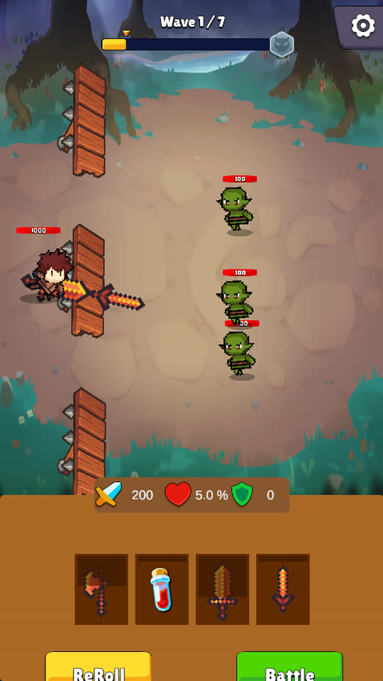
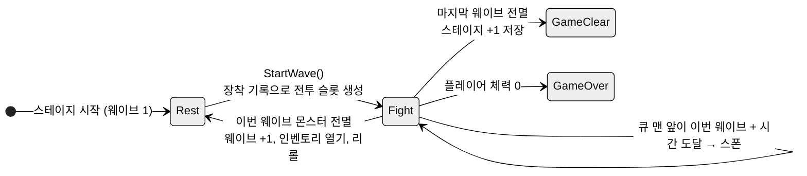

# 인벤토리 플레이어 (Inventory Player) 기술 문서

---

## 1. 프로젝트 개요

🎬 [GIF·영상 필요] 가방에 아이템을 끌어다 배치 → 같은 아이템 머지 → 웨이브 전투까지 한 번에 보이는 10초 클립 (시연 영상의 인벤토리 정비 ~ 전투 시작 구간 ⟨확인 필요⟩)

### 1.1 무엇을 만들었나 (What)

**「인벤토리 플레이어」**는 웨이브 사이 정비 시간에 **테트리스처럼 모양이 다른 아이템을 가방 칸에 배치하고, 같은 아이템끼리 합쳐 강화하면, 다음 웨이브에서 장착한 아이템이 자동으로 싸우는** 모바일 2D 캐주얼 웨이브 방어 게임입니다. 백팩 히어로의 "가방 정리가 곧 전투력" 구조를 모티프로 한 개인 프로젝트입니다.



### 1.2 왜, 무엇에 집중했나 (Why)

이 프로젝트는 **"Firebase로 데이터를 유지하고, 모바일 기기에서 실행된다"**를 개발 조건으로 잡고 시작했습니다. 그 위에서 다음 세 가지에 집중했습니다.

| 집중한 것 | 내용 |
|---|---|
| **Firebase 계정 데이터** | 서버를 직접 만들지 않고, 기기별로 플레이어를 식별해 진행 데이터를 클라우드에 유지 |
| **모바일 대응** | Android 빌드에서 Firebase 연동이 실패하던 문제를 빌드 파이프라인 수정으로 해결 |
| **테트리스형 배치 ★** | 모양이 다른 아이템을 `GridLayoutGroup` 기반 UI 가방에 끌어다 놓고, 놓기 전에 가능 여부를 보여 줌 |

가장 시간을 많이 쓴 곳은 세 번째입니다. 가방 칸을 `GridLayoutGroup`으로 자동 정렬하는 UI로 만들었는데, **잠긴 칸을 숨기거나 가방이 커지는 순간 GridLayout이 칸을 다시 채워 정렬하면서 가방 모양 자체가 일그러지는 문제**가 계속 생겼습니다. 이를 해결하기 위해 **"칸의 상태는 2차원 배열 하나가 원본이고, 화면의 칸은 그 배열을 비추는 거울"**이라는 원칙을 세우고, 가방 크기와 칸의 활성 상태를 그 배열에서 다시 계산하는 구조로 정리했습니다. 이 인벤토리 시스템이 이 프로젝트의 핵심입니다.

### 1.3 게임 규칙 요약

| 구분 | 규칙 |
|---|---|
| 흐름 | 타이틀(게스트 로그인) → 로비(스테이지 선택) → 인게임 |
| 인게임 루프 | **Rest(정비)** 에서 가방 정리 → 웨이브 시작 → **Fight(전투)** → 몬스터 전멸 시 다시 Rest |
| 가방 | 5×7 칸. 처음에는 가운데 3×3만 열려 있음 |
| 리롤 | Rest마다 아이템 4개가 무작위로 나옴(중복 가능). 리롤 버튼으로 다시 뽑기 가능 |
| 배치 | 아이템을 끌어 가방의 빈칸에 놓음. 아이템마다 차지하는 칸 모양이 다름(1×1, 1×2, 2×1, L자 3칸) |
| 가방 확장 | **슬롯 아이템**을 잠긴 칸에 놓으면 그 칸이 열림 |
| 머지 | 같은 아이템·같은 레벨끼리 겹치면 레벨 +1 (공격력 = 기본값 × 레벨, 쿨타임 레벨당 −10%) |
| 전투 | 가방에 장착한 아이템마다 전투 슬롯이 생겨, 쿨타임마다 가까운 몬스터를 자동 공격(던지기) 또는 회복 |
| 웨이브 | 스테이지당 7웨이브. 웨이브가 오를수록 몬스터 체력·공격력 +10%씩 |
| 종료 | 마지막 웨이브 전멸 → 클리어(스테이지 진행 저장) / 플레이어 체력 0 → 게임 오버 |

### 1.4 개발 환경

| 항목 | 내용 |
|---|---|
| Engine | Unity 2022.3.62f3 (2D) |
| 플랫폼 | Android (세로 540×960), PC 빌드 병행 |
| 백엔드 | Firebase Unity SDK 11.1.0 (Realtime Database) |
| 주요 패키지 | NavMeshPlus(2D NavMesh), SPUM(캐릭터 스프라이트), uGUI + TextMeshPro |
| 기간 | 2025.09 ~ 2025.12 (약 15주) |
| 형태 | 개인 프로젝트 |
| 개발 조건 | **Firebase 기반 데이터 유지, 모바일 기기에서 실행** |

### 1.5 링크

- 시연 영상: [YouTube](https://youtu.be/irNj6mxdZbU)
- 실행 파일: [Windows](https://drive.google.com/file/d/1EXKoKSK5ZjoUS6K-guy7PDsMTsIcnTyK/view) · [Android](https://drive.google.com/file/d/1oe80GqxYBO_P2ZSlpxeFSt-d2LHG5U4L/view?usp=drive_link)
- GitHub: ⟨링크 입력⟩

### 1.6 이 문서에서 다루는 내용

전체 구조(2장)를 먼저 보여 드린 뒤, 다섯 가지 시스템을 차례로 설명합니다. **계정 데이터·모바일 빌드**(3장), 이 프로젝트의 핵심인 **그리드 인벤토리·드래그 배치**(4장), **머지·장착에서 전투까지**(5장), **웨이브·몬스터**(6장), **UI 연출**(7장)입니다. 마지막으로 결과와 기술 부채, 배운 점(8장)을 정리합니다.

---

## 2. 전체 구조

### 2.1 아키텍처



데이터는 두 계층으로 나뉩니다. **정적 데이터**(아이템·스테이지·몬스터 스탯)는 ScriptableObject로, **유저 데이터**(계정·진행)는 Firebase로 관리합니다. `Game_Manager`는 씬이 바뀌어도 남는 싱글톤으로, 로비에서 고른 스테이지와 플레이어 데이터를 인게임으로 넘깁니다.

인게임은 다시 **가방(UI)** 과 **전투(월드)** 로 나뉩니다. 가방 쪽은 "어디에 무엇을 놓았는가"만 알고, 전투 쪽은 가방이 남긴 **장착 기록(`OccupiedItemDatas`)** 만 보고 무기를 만듭니다.

### 2.2 클래스 역할

| 클래스 | 하는 일 | 하지 않는 일 |
|---|---|---|
| `User_Data` | Firebase 초기화, 기기 ID로 플레이어 조회, UID 발급, 플레이어 데이터 읽기·쓰기 | UI를 바꾸지 않음 |
| `Game_Manager` | 씬 상태(Title/Robby/InGame), 스테이지·플레이어 데이터 전달, 60초마다 플레이 시간 저장 | 게임 규칙을 판정하지 않음 |
| `Inventory_System` | **칸 상태 2차원 배열의 원본**, 칸 활성화·가방 크기 계산, 리롤, 장착 기록 관리 | 드래그 입력을 받지 않음 |
| `Item_System` | 아이템 하나의 드래그·스냅·미리보기·배치 검증·점유/해제·머지 | 칸 배열을 새로 만들거나 가방 크기를 직접 정하지 않음 |
| `Slot_State` | 칸 하나의 화면 표시(색상) | 배치 가능 여부를 판단하지 않음 (배열이 원본) |
| `InGame_System` | Fight/Rest 상태, 스폰 큐, 웨이브 스케일링, 전멸 판정, 전투 슬롯 생성 | 가방 안의 배치를 알지 못함 (장착 기록만 읽음) |
| `Item_Function` | 전투 슬롯 하나의 쿨타임, 대상 탐색, 투사체·회복 발사 | 레벨·수치를 계산하지 않음 (기록을 그대로 씀) |
| `Monster_Setting` / `Unit_Status` | 몬스터 추적·공격 / 플레이어·몬스터 공통 체력·피격·사망 | — |
| `InGame_UI` · `Robby_UI` · `Title_UI` | 화면 전환, 이징 연출, 버튼 입력 | 데이터를 직접 저장하지 않음 (`User_Data` 호출) |

### 2.3 고민과 선택: 가방과 전투를 어떻게 나눌 것인가

> **결정 대상**: 가방에 넣은 아이템이 전투에서도 그대로 움직이게 할 것인가, 가방과 전투를 따로 둘 것인가?

| | **[A] 가방 아이템이 직접 공격** | **[B] 가방(UI) · 전투(인게임) 분리** ✓ |
|---|---|---|
| 방식 | 가방 칸에 놓인 UI 오브젝트가 쿨타임마다 공격 | 가방은 배치만 하고, 웨이브 시작 시 장착 기록으로 전투 슬롯을 새로 생성 |
| 장점 | 오브젝트가 하나라 구현이 단순 | 정비 턴과 전투 턴이 명확히 갈림. 가방 코드가 전투를 몰라도 됨 |
| 단점 | 배치 로직과 전투 로직이 한 오브젝트에 섞임. 전투 중 가방 조작과 충돌 | 같은 아이템이 **UI 프리팹 / 전투 프리팹 / 장착 기록** 세 가지로 존재해 동기화가 필요 |

**[최종 결정]** [B]를 선택했습니다. 백팩 히어로처럼 **"정비 턴에 가방을 정리하고, 전투 턴에는 그 결과로 싸운다"** 는 흐름을 만들고 싶었기 때문입니다. 그래서 가방은 UI(Canvas)로, 전투는 월드(인게임)로 나눴습니다.

```csharp
// Item_Data.cs — 한 아이템이 두 개의 프리팹을 가짐
[Header("배치 아이템 프리팹")]
public GameObject item;        // 가방에 놓이는 UI 오브젝트
[Header("전투 아이템 프리팹")]
public GameObject battleItem;  // 전투에서 날아가는 투사체
```

**[얻은 것]** 가방 쪽은 `OccupiedItemDatas`(이름·레벨·수치·쿨타임 묶음)만 남기면 되고, 전투 쪽은 그 목록만 보고 무기를 만듭니다(5장). 전투 중에는 가방을 닫아 두므로 배치 상태가 전투 도중 바뀌지 않습니다.

**[감수한 대가]** 머지로 레벨이 오르거나 아이템을 빼면 **UI 아이템과 장착 기록을 둘 다 고쳐야** 합니다. 이 동기화가 이 프로젝트에서 가장 번거로웠던 부분 중 하나이며, 5장과 8장에서 다시 다룹니다.

---

## 3. 시스템 ① 계정 데이터 · 모바일 빌드

📷 [이미지 필요] Firebase 콘솔의 데이터 트리 (`players/{uid}`, `device_mapping`, `uid_counter`가 한 화면에 보이게)

### 3.1 개요

로그인 폼 없이 **"게스트 로그인" 버튼 한 번**으로 플레이를 시작합니다. 기기 ID로 이전 플레이 기록을 찾고, 있으면 그 계정을 이어서 쓰고, 없으면 새 UID를 발급합니다.



### 3.2 구조: 데이터 트리

| 경로 | 내용 |
|---|---|
| `players/{uid}` | 이름, 캐릭터 번호, 레벨, 경험치, 골드, 스테이지, 플레이 시간, 접속 횟수, 마지막 접속일(yyyyMMdd) |
| `device_mapping/{기기 ID}` | 이 기기가 쓰는 UID |
| `uid_counter` | 마지막으로 발급한 UID (1000001부터 1씩 증가) |

실제로 플레이 중에 갱신되는 값은 **스테이지**(클리어 시 +1), **플레이 시간**(60초마다), **접속 횟수·마지막 접속일**(로그인 시)입니다. 골드·레벨·경험치는 필드만 만들어 두었습니다(8장).



### 3.3 핵심 기능

**사용법 (API)** — 외부에서는 `User_Data`의 세 메서드만 씁니다.

```csharp
await userData.GuestLogin();                          // 타이틀: 플레이어 확인 또는 생성
PlayerData data = await userData.GetCurrentPlayerData(); // 로비: 진행 데이터 읽기
await userData.UpdatePlayerData(data);                // 클리어·플레이 시간: 저장
```

**신규·기존 플레이어 분기**

```csharp
// User_Data.cs:76
private async Task InitializePlayerUID()
{
    // 1. 기기 ID로 기존 플레이어 검색
    string existingUID = await CheckExistingPlayer();

    if (!string.IsNullOrEmpty(existingUID))
    {
        playerUID = existingUID;          // 기존 계정을 이어서 사용
        await UpdateExistingPlayerData(); // 접속 횟수·마지막 접속일 갱신
    }
    else
    {
        playerUID = await GenerateNewUID(); // uid_counter + 1
        await CreateNewPlayerData();        // players/{uid} + device_mapping 저장
    }
}
```

**초기화 전 접근 차단** — Firebase는 `CheckAndFixDependenciesAsync`가 끝나기 전에 DB에 접근하면 실패합니다. 초기화가 끝난 뒤에만 `isInitialized`를 켜고, 로그인과 데이터 생성은 이 값을 먼저 확인합니다.

```csharp
// User_Data.cs:49
var dependencyStatus = await FirebaseApp.CheckAndFixDependenciesAsync();
if (dependencyStatus == DependencyStatus.Available)
{
    dbref = FirebaseDatabase.DefaultInstance.RootReference;
    isInitialized = true; // 이 시점 이후에만 로그인·저장 허용
}

// User_Data.cs:329 — GuestLogin
if (!isInitialized || dbref == null)
{
    Debug.LogError("Firebase가 초기화되지 않았습니다. 잠시 후 다시 시도해주세요.");
    return;
}
```

**비동기 → 코루틴 연결** — `GuestLogin()`은 `Task`라서 Unity UI를 바로 바꿀 수 없습니다. `ContinueWith`에서는 완료 플래그만 세우고, 코루틴이 그 플래그를 기다렸다가 메인 스레드에서 버튼을 바꿉니다.

```csharp
// Title_UI.cs:65
userData.GuestLogin().ContinueWith(task =>
{
    isSuccess = !task.IsFaulted; // 다른 스레드: 값만 기록
    isCompleted = true;
});

while (!isCompleted) yield return null; // 메인 스레드에서 대기

if (isSuccess)
{
    loginButtons.SetActive(false);
    _gameStartButtonCoroutine = StartCoroutine(ShowGameStartButtonWithEase());
}
```

> 이 성공 판정에는 빈틈이 있습니다. `GuestLogin` 안에서 예외를 모두 잡기 때문에 `task.IsFaulted`가 항상 false입니다. 8장 기술 부채에서 다룹니다.

### 3.4 고민과 선택: 진행 데이터를 어디에 저장할 것인가

> **결정 대상**: 모바일 게임의 진행 데이터를 기기 안에 둘 것인가, 클라우드에 둘 것인가?

| | **[A] PlayerPrefs / 로컬 JSON** | **[B] Firebase Realtime Database** ✓ |
|---|---|---|
| 방식 | 기기 저장소에 저장 | 클라우드 DB에 플레이어별 트리로 저장 |
| 장점 | 구현이 가장 단순. 오프라인 동작, 지연 없음 | 앱을 지워도 서버에 데이터가 남음. 콘솔에서 데이터를 바로 확인·수정 가능 |
| 단점 | 앱을 지우면 데이터가 사라짐. 기기 밖에서 확인 불가 | 네트워크와 초기화 순서에 의존. 비동기 처리가 필요 |

**[최종 결정]** [B]를 선택했습니다. 당시 Firebase 데이터 연동 특강을 들었고, **서버를 직접 만들지 않고도 데이터를 유지하는 방법**을 실제 모바일 프로젝트에 적용해 보는 것이 이 프로젝트의 개발 조건이었습니다. 로그인 화면을 두지 않고 **기기 ID로 플레이어를 구분**해 버튼 한 번으로 시작하게 했습니다.

**[얻은 것]** 콘솔에서 `players/{uid}`를 열면 각 플레이어의 진행 상태와 접속 횟수를 바로 볼 수 있어, 테스트 중 데이터 확인이 쉬웠습니다.

**[감수한 대가]** 모든 데이터 접근이 비동기가 되어 초기화 가드와 코루틴 연결 코드가 필요해졌습니다. 또 Firebase Auth 없이 기기 ID만으로 식별하기 때문에 DB 보안 규칙을 열어 둬야 동작합니다. 이 부분은 8장에서 개선 계획으로 다룹니다.

### 3.5 트러블슈팅: Android 빌드에서 Firebase 연동 실패

**증상** — 에디터에서는 로그인이 되는데, **Android로 빌드해 기기에서 실행하면 Firebase 연동이 계속 실패**했습니다. ⟨확인 필요: 기기에서 본 에러 메시지나 화면 상태가 있으면 한 줄 추가⟩

**원인** — 두 가지가 겹쳐 있었습니다.

1. 프로젝트 설정이 PC 기준으로 되어 있어 Android 빌드 설정이 맞지 않았습니다. ⟨확인 필요: 바꾼 Player Settings 항목. 현재 값은 minSdk 22, ARMv7, Mono⟩
2. Firebase 설정 파일 `google-services.json`이 **Gradle 빌드 폴더에 복사되기 전에** Gradle이 실행되어, Google Services 플러그인이 파일을 찾지 못했습니다. Unity 2022의 빌드 경로(`Library/Bee/.../Gradle/launcher`)에서 이 순서 문제가 생겼습니다.

**해결**

- 프로젝트 설정을 Android 기준으로 하나씩 다시 맞췄습니다.
- **빌드 직전에 가장 먼저 실행되는 에디터 스크립트**를 만들어, `google-services.json`을 플러그인이 찾는 경로에 미리 복사했습니다.
- `launcherTemplate.gradle`에 Google Services 플러그인(`com.google.gms:google-services:4.3.15`)을 추가하고 `apply plugin: 'com.google.gms.google-services'`로 적용했습니다.

```csharp
// Editor/CopyGoogleServicesJson.cs
public class CopyGoogleServicesJsonPrebuild : IPreprocessBuildWithReport
{
    public int callbackOrder => -9999; // 다른 빌드 전처리보다 먼저 실행

    public void OnPreprocessBuild(BuildReport report)
    {
        string src = Path.Combine(Directory.GetCurrentDirectory(), "Assets", "google-services.json");
        // ...
        string launcherDir = Path.Combine(gradleRoot, "launcher"); // Library/Bee/Android/Prj/Mono2x/Gradle

        // 플러그인이 찾는 후보 경로 4곳에 모두 복사
        string[] targets =
        {
            Path.Combine(launcherDir, "google-services.json"),
            Path.Combine(launcherDir, "src", "google-services.json"),
            Path.Combine(launcherDir, "src", "release", "google-services.json"),
            Path.Combine(launcherDir, "src", "debug", "google-services.json"),
        };
        foreach (var dst in targets)
        {
            Directory.CreateDirectory(Path.GetDirectoryName(dst));
            File.Copy(src, dst, true);
        }
    }
}
```



**결과** — Android 기기에서 게스트 로그인과 데이터 저장이 동작했습니다.

**배운 점** — 에디터에서 되는 것과 기기에서 되는 것은 다릅니다. 모바일 빌드 문제는 코드보다 **빌드 파이프라인(설정 파일이 언제, 어디에 놓이는가)** 에서 생길 수 있다는 것을 배웠습니다.

---

## 4. 시스템 ② 그리드 인벤토리 · 드래그 배치 ★

🎬 [GIF·영상 필요] 아이템을 끌 때 초록/빨강 미리보기가 바뀌고, 놓으면 칸에 딱 붙는 장면 (시연 영상의 정비 구간)

### 4.1 개요: GridLayout이 가방 모양을 바꿔 버리는 문제

가방은 칸 35개(5×7)를 `GridLayoutGroup`으로 자동 정렬한 UI입니다. 처음에는 가운데 3×3만 열려 있고, 슬롯 아이템으로 잠긴 칸을 열어 가방을 넓힙니다.



문제는 **GridLayout이 "켜져 있는 자식만" 차례대로 채워 넣는다**는 점이었습니다. 잠긴 칸을 `SetActive(false)`로 숨기면 뒤의 칸들이 앞으로 당겨지고, 가방이 넓어지면 한 줄에 들어가는 칸 수가 바뀝니다. 그 결과 **화면의 칸 위치와 실제 데이터의 칸 위치가 어긋나, 가방 모양이 일그러지거나 아이템이 엉뚱한 칸에 들어가는** 일이 반복됐습니다.

그래서 다음 두 가지 원칙을 세웠습니다.

1. **칸 상태의 원본은 2차원 배열 `slots[x, y]` 하나**이고, 화면의 칸(`Slot_State`)은 그 배열을 비추는 거울이다.
2. **화면 좌표가 아니라 칸의 순번(sibling index)으로** 배열 좌표를 계산하고, 가방 크기와 칸 활성화도 배열에서 다시 계산한다.

### 4.2 구조: 칸 상태와 좌표 규칙

| 상태 | 의미 | 화면 표시 |
|---|---|---|
| `Empty` | 열린 빈칸 | 기본 색 |
| `Occupied` | 아이템이 차지함 | 기본 색 (아이템이 위에 놓임) |
| `Locked` | 잠긴 칸 | 열린 영역 밖: 비활성 / 열린 영역 안: **투명(알파 0)** |
| `None` | 범위 밖 | — |

| 규칙 | 내용 | 위치 |
|---|---|---|
| 좌표 → 순번 | `index = y × 5 + x` | `Item_System.cs:738` |
| 순번 → 좌표 | `x = index % 5`, `y = index / 5` | `Item_System.cs:640` |
| 초기 상태 | 모두 Locked, (1~3, 2~4)만 Empty | `Inventory_System.cs:64` |

**아이템 모양 데이터** — 아이템마다 가로·세로 칸 수를 정하고(기본은 모든 칸 사용), 쓰지 않을 칸만 끄는 방식입니다. 칸을 쓰지 않으면 오프셋을 `(-1, -1)`로 표시해 검사에서 건너뜁니다.

| 아이템 | 크기 | 모양 |
|---|---|---|
| 포션 | 1×1 | ■ |
| 검 1 | 1×2 | 세로 2칸 |
| 검 2 / 슬롯 아이템 | 2×1 | 가로 2칸 |
| 도끼 | 2×2 중 3칸 | L자 (`isUsed` 1,1,1,0) |

📷 [이미지 필요] 인스펙터에서 도끼 아이템의 `slotWidth/Height`와 `slotList`(isUsed 체크) 설정 화면

```csharp
// Item_System.cs:119 — 커스텀 모양: 사용하지 않는 칸은 (-1,-1)
for (int x = 0; x < slotWidth; x++)
    for (int y = 0; y < slotHeight; y++)
    {
        int slotIndex = y * slotWidth + x; // 가로 우선
        slotShape[x, y] = slotList[slotIndex].isUsed
            ? new Vector2Int(x, y)
            : new Vector2Int(-1, -1);     // 비어 있는 칸
    }
```

### 4.3 핵심 기능 ①: 드래그 3단계



**① 드래그 시작 — 복원 지점 남기기**

```csharp
// Item_System.cs:157
public void OnBeginDrag(PointerEventData eventData)
{
    originalPosition = transform.position;
    originalParent = transform.parent;

    // 드래그 실패 시 되돌리기 위해 이전 점유 상태를 먼저 기록
    wasPlacedBeforeDrag = isPlacedInInventory;
    previousOccupiedSlots = new List<Vector2Int>(occupiedSlots);

    ClearOccupiedSlots(); // 자기 자리를 비워야 같은 자리 근처로 옮길 수 있음

    // 슬롯 아이템은 잠긴 칸을 미리 보여 줘야 하므로 전체 칸을 켬 (순서 중요)
    if (itemType == Item_Data.ItemType.Slot && inventorySystem != null)
    {
        inventorySystem.ActivateAllSlotsForSlotItem();
        inventorySystem.RepositionExistingItems();
    }
    // ...
}
```

**② 드래그 중 — 자석 스냅과 미리보기.** 손가락 위치에서 100px 안에 있는 가장 가까운 칸을 기준점으로 잡고, 그 위치가 바뀔 때만 미리보기를 다시 그립니다. **실제 배치는 하지 않고 색만 바꿉니다.**

```csharp
// Item_System.cs:187
transform.position = eventData.position;                     // 손가락을 따라 이동
Vector2Int snapPosition = FindNearestValidSlot(eventData.position);

if (snapPosition != currentSnapPosition)                     // 기준 칸이 바뀔 때만 갱신
{
    ClearPreview();
    currentSnapPosition = snapPosition;
    if (currentSnapPosition.x >= 0 && currentSnapPosition.y >= 0)
    {
        isValidPlacement = CanPlaceAtPosition(currentSnapPosition);
        ShowPreview(currentSnapPosition, isValidPlacement);  // 초록 / 빨강
    }
}
```

### 4.4 핵심 기능 ②: 배치 검증

배치 가능 여부는 **배열만 읽어서** 판단합니다. 화면의 칸 오브젝트는 건드리지 않습니다.

```csharp
// Item_System.cs:410
bool CanPlaceItemAtPosition(Vector2Int position)
{
    for (int x = 0; x < slotWidth; x++)
        for (int y = 0; y < slotHeight; y++)
        {
            Vector2Int shapeOffset = slotShape[x, y];
            if (shapeOffset.x == -1 && shapeOffset.y == -1) continue; // 모양의 빈칸은 건너뜀

            Vector2Int checkPos = position + shapeOffset;

            // 1. 가방 범위 밖이면 불가
            if (checkPos.x < 0 || checkPos.x >= inventorySystem.inventoryMaxWidth ||
                checkPos.y < 0 || checkPos.y >= inventorySystem.inventoryMaxHeight)
                return false;

            // 2. 빈칸(Empty)이 아니면 불가 — Locked·Occupied 모두 여기서 걸림
            if (inventorySystem.slots[checkPos.x, checkPos.y] != Inventory_System.SlotState.Empty)
                return false;
        }
    return true;
}
```

슬롯 아이템은 반대로 **잠긴 칸(Locked)에만** 놓을 수 있습니다(`CanPlaceSlotAtPosition`, `Item_System.cs:444`). 놓으면 그 칸들이 Empty로 바뀌고, 슬롯 아이템은 사라집니다.

| 아이템 종류 | 놓을 수 있는 칸 | 놓으면 |
|---|---|---|
| 일반 아이템 | Empty | Empty → Occupied, 장착 기록 추가 |
| 슬롯 아이템 | Locked | Locked → Empty, 가방 크기 다시 계산, 아이템 소멸 |

### 4.5 핵심 기능 ③: 가방 크기와 칸 활성화

GridLayout이 칸을 다시 채우더라도 모양이 유지되도록, **가방 크기와 켜 둘 칸을 배열에서 계산**합니다.

1. 배열에서 열린 칸(Empty·Occupied)을 모두 감싸는 최소 사각형을 구합니다.
2. 가방 크기를 `(사각형 가로 + 1) × 100`, `(세로 + 1) × 100`으로 맞춥니다. 칸 크기가 100, 간격이 5이므로 **한 줄에 정확히 사각형 가로 칸 수만큼만 들어갑니다.**
3. 사각형 안의 칸은 잠겨 있어도 **끄지 않고 투명하게** 둡니다. 꺼 버리면 GridLayout이 뒤의 칸을 당겨 모양이 깨지기 때문입니다.

```csharp
// Inventory_System.cs:331 — 슬롯 아이템 장착 후
// 1. 열린 칸을 감싸는 사각형 계산
for (int x = 0; x < inventoryMaxWidth; x++)
    for (int y = 0; y < inventoryMaxHeight; y++)
        if (slots[x, y] == SlotState.Empty || slots[x, y] == SlotState.Occupied)
        { /* minX, maxX, minY, maxY 갱신 */ }

// 2. 사각형 안의 칸은 모두 활성화 — 잠긴 칸은 투명하게
for (int x = minX; x <= maxX; x++)
    for (int y = minY; y <= maxY; y++)
    {
        int slotIndex = y * inventoryMaxWidth + x;
        Slot_State slot = inventoryBag.transform.GetChild(slotIndex).GetComponent<Slot_State>();
        slot.gameObject.SetActive(true);

        Color slotColor = GetSlotColor(slots[x, y], slot);
        if (slots[x, y] == SlotState.Locked) slotColor.a = 0f; // 자리는 차지하되 보이지 않게
        slot.image.color = slotColor;
    }

// 3. 사각형 크기에 맞춰 가방 크기 조절 → GridLayout의 한 줄 칸 수가 결정됨
AdjustInventoryBagSizeForRange(minX, maxX, minY, maxY); // (범위 + 1) × 100
```

슬롯 아이템을 드래그하는 동안에는 잠긴 칸에 미리보기를 보여야 하므로, **35칸을 모두 켜고 가방을 최대 크기(600×800)로** 키웠다가(`ActivateAllSlotsForSlotItem`), 놓으면 다시 계산합니다.

🎬 [GIF·영상 필요] 슬롯 아이템을 끌 때 가방이 전체 크기로 펼쳐지고, 잠긴 칸에 놓으면 가방이 새 모양으로 줄어드는 장면

### 4.6 고민과 선택: 칸 상태를 어디에 둘 것인가

> **결정 대상**: 칸이 열렸는지, 아이템이 있는지를 각 칸 오브젝트가 들고 있게 할 것인가, 한 곳에 모을 것인가?

| | **[A] 칸 오브젝트마다 상태 보관** | **[B] 2차원 배열 원본 + 화면은 거울** ✓ |
|---|---|---|
| 방식 | 칸 UI(`Slot_State`)가 자기 상태를 가짐 | `slots[x, y]`가 원본, 칸 UI는 색만 표시 |
| 장점 | 칸이 자기 상태를 알아 직관적 | 배치 검사·가방 크기 계산이 배열 읽기로 끝남. GridLayout이 칸을 재배치해도 데이터는 그대로 |
| 단점 | 여러 칸짜리 아이템을 검사할 때 칸 오브젝트를 하나하나 찾아야 함. **GridLayout 재배치로 화면 위치가 바뀌면 좌표도 흔들림** | 배열과 화면을 맞추는 코드가 필요 (순번 규칙 관리) |

**[최종 결정]** [B]를 선택했습니다. GridLayout을 쓰는 이상 **화면의 칸 위치는 언제든 바뀔 수 있는 값**이었습니다. 위치가 흔들리는 화면을 기준으로 삼으면 문제가 끝나지 않아서, 흔들리지 않는 배열을 기준으로 삼고 화면은 그 결과만 보여 주게 했습니다.

**[얻은 것]** 배치 검사, 슬롯 해금, 가방 크기 계산이 모두 같은 배열을 봅니다. 화면 연출(색, 투명도)을 바꿔도 배치 규칙은 바뀌지 않습니다.

**[감수한 대가]** "순번 = y × 5 + x"라는 규칙이 여러 메서드에 흩어져 있습니다. 가방 크기 공식(`(n+1)×100`)도 칸 크기 100·간격 5라는 **씬의 GridLayout 설정에 묶여 있어**, 칸 크기를 바꾸면 공식도 같이 바꿔야 합니다(8장).

### 4.7 고민과 선택: 놓을 때 판정할 것인가, 놓기 전에 보여 줄 것인가

> **결정 대상**: 터치로 여러 칸짜리 아이템을 정확히 놓게 하려면?

| | **[A] 놓은 위치에서 바로 판정** | **[B] 자석 스냅 + 미리보기** ✓ |
|---|---|---|
| 방식 | 손가락을 뗀 곳의 칸에 배치 시도 | 드래그 중 가장 가까운 칸(100px 이내)을 기준점으로 잡고, 모양대로 초록/빨강 표시 |
| 장점 | 구현이 단순 | 놓기 전에 결과를 알 수 있음. 놓으면 칸 중심에 정확히 붙음 |
| 단점 | 손가락이 아이템을 가려 **어느 칸에 들어갈지 보이지 않음**. 기준 칸이 생각과 다르게 잡힘 | 드래그 중 매 프레임 35칸과 거리 계산 |

**[최종 결정]** [B]를 선택했습니다. 처음에는 **들어갈 칸이 제대로 보이지 않아 불편했고, 아이템이 내가 생각한 기준과 조금 다른 칸에 들어가는** 일이 잦았습니다. 그래서 놓기 전에 들어갈 칸을 색으로 보여 주고, 놓으면 차지한 칸들의 중심에 붙도록(`CalculateItemCenterPosition`) 바꿨습니다.

**[얻은 것]** 미리보기는 **색만 바꾸고 배열은 건드리지 않기** 때문에, 배치 규칙에 버그를 만들지 않고 조작감만 개선할 수 있었습니다.

**[감수한 대가]** 매 프레임 35칸과 거리를 비교하지만, 칸 수가 적어 문제가 되지 않았습니다(측정하지는 않음).

### 4.8 트러블슈팅

| 문제 | 증상 | 원인 | 해결 |
|---|---|---|---|
| **가방 모양 깨짐** | 잠긴 칸을 숨기거나 가방이 커지면 칸 배치가 일그러짐 | GridLayout은 켜진 칸만 순서대로 채움. 칸을 끄면 뒤 칸이 당겨지고, 가방 너비가 바뀌면 한 줄 칸 수가 바뀜 | 열린 영역 사각형 안의 잠긴 칸은 **투명하게 켜 두고**, 가방 크기를 사각형에 맞춰 한 줄 칸 수를 고정 (4.5) |
| **장착 아이템 위치 어긋남** | 슬롯 아이템으로 가방이 넓어진 뒤, 이미 놓인 아이템이 칸과 어긋난 위치에 남음 | 가방 크기가 바뀌면 GridLayout이 **다음 프레임에** 칸을 다시 배치함. 아이템은 이전 좌표에 그대로 있음 | 한 프레임 기다린 뒤(`yield return null`) 각 아이템이 **점유한 칸들의 중심**으로 다시 이동 (`RepositionExistingItems`) |
| **유령 점유** | 아이템을 뺐는데 칸이 계속 막혀 있거나, 놓았는데 칸이 비어 있음 | 점유·해제가 여러 곳에서 따로 일어나고, 드래그 실패 시 해제만 되고 복원이 안 됨 | 점유·해제를 `OccupySlots` / `ClearOccupiedSlots`로 통일. 드래그 시작 시 복원 지점을 남기고 실패하면 `RestorePreviousOccupationIfNeeded`로 복원 |

**장착 아이템 위치 어긋남 — 한 프레임 기다리기**

```csharp
// Inventory_System.cs:442
IEnumerator RepositionItemsAfterLayoutUpdate()
{
    // GridLayout이 칸을 재배치할 시간을 한 프레임 줌
    yield return null;

    for (int i = 0; i < occupiedWeaponSlot.transform.childCount; i++)
    {
        Item_System item = occupiedWeaponSlot.transform.GetChild(i).GetComponent<Item_System>();
        if (item != null && item.isPlacedInInventory)
            item.RepositionToSlots(); // 점유 칸들의 새 중심 좌표로 이동
    }
}
```

**배운 점** — 아이템의 위치를 **좌표로 기억하지 말고 "어느 칸을 차지하는가"로 기억**해야, 칸이 움직여도 아이템이 따라갈 수 있습니다. 또 GridLayout처럼 자동으로 배치하는 UI는 **값을 바꾼 프레임에 바로 위치가 반영되지 않는다**는 것을 알게 됐습니다.

---

## 5. 시스템 ③ 머지 · 장착 → 전투

🎬 [GIF·영상 필요] 같은 검 두 개를 겹쳐 레벨이 오르며 아이콘·파티클이 바뀌는 장면 → 웨이브 시작 후 전투 슬롯에서 쿨타임이 돌며 무기가 날아가는 장면

### 5.1 개요

같은 아이템·같은 레벨 두 개를 겹치면 하나로 합쳐져 레벨이 오릅니다. 가방에 장착한 아이템은 **장착 기록**으로 남고, 웨이브가 시작되면 그 기록마다 전투 슬롯이 생겨 자동으로 공격합니다.

| 아이템 | 기본 수치 | 기본 쿨타임 | 타입 |
|---|---|---|---|
| 도끼 | 80 | 1.0초 | 던지기 |
| 검 1 | 70 | 0.7초 | 던지기 |
| 검 2 | 50 | 0.5초 | 던지기 |
| 포션 | 50 | 2.0초 | 회복 |

### 5.2 핵심 기능 ①: 머지

```csharp
// Item_System.cs:649
bool CanUpgrade(Item_System targetItem)
{
    // 슬롯 아이템은 합치지 않음
    if (this.itemType == Item_Data.ItemType.Slot || targetItem.itemType == Item_Data.ItemType.Slot)
        return false;

    return targetItem.itemData == this.itemData &&   // 같은 아이템
           targetItem.itemLevel == this.itemLevel;   // 같은 레벨
}

// Item_System.cs:662
void UpgradeItem(Item_System targetItem)
{
    targetItem.itemLevel++;
    targetItem.itemValue = (int)(targetItem.itemData.itemValue * targetItem.itemLevel); // 기본값 × 레벨

    // 쿨타임: 레벨 1 = 100%, 레벨 2 = 90%, 레벨 3 = 80% ...
    float cooldownReduction = 1.0f - (0.1f * (targetItem.itemLevel - 1));
    targetItem.itemCooldown = targetItem.itemData.itemCooldown * cooldownReduction;
    // ... 레벨에 맞는 아이콘으로 교체, 파티클·EaseOutBack 연출

    // 가방에 장착된 아이템이면 장착 기록도 같은 레벨로 갱신
    if (targetItem.isPlacedInInventory && inventorySystem != null)
        inventorySystem.UpdateOccupiedItemData(targetItem);

    Destroy(gameObject); // 재료로 쓴 아이템 제거
}
```

| 레벨 | 1 | 2 | 3 | 4 | 5 |
|---|---|---|---|---|---|
| 수치 배율 | ×1 | ×2 | ×3 | ×4 | ×5 |
| 쿨타임 | 100% | 90% | 80% | 70% | 60% |

수치는 플레이로 정한 레벨 디자인 값이고, 최대 레벨은 **아이템마다 준비한 아이콘 5장**에 맞춰 5로 잡았습니다. 다만 6레벨 머지를 막는 코드가 없습니다(8장).

### 5.3 핵심 기능 ②: 장착 기록에서 전투 슬롯으로



```csharp
// InGame_System.cs:331
public void OccupiedWeaponSetting(Inventory_System inventorySystem)
{
    ClearCombatWeaponSlots(); // 이전 웨이브의 전투 슬롯 정리

    for (int i = 0; i < inventorySystem.OccupiedItemDatas.Count; i++)
    {
        var itemData = inventorySystem.OccupiedItemDatas[i];
        GameObject weaponSlot = Instantiate(occupiedWeaponSlot, inGameUI.useWeaponSlot.transform);
        activeWeaponSlots.Add(weaponSlot);

        Item_Function itemFunction = weaponSlot.GetComponent<Item_Function>();
        itemFunction.equippedItemRecord = itemData;           // 레벨·수치·쿨타임 그대로 사용
        itemFunction.itemValue = itemData.itemValue;
        itemFunction.weaponType = itemData.itemData.weaponType; // 던지기 / 회복
        // ...
    }
}
```

전투 슬롯(`Item_Function`)은 쿨타임 동안 슬롯 이미지의 `fillAmount`를 줄여 남은 시간을 보여 주고, 쿨타임이 끝나면 공격 범위 안에서 **살아 있는 가장 가까운 몬스터**를 찾아 투사체를 던집니다. 포션은 플레이어에게 회복 투사체를 보냅니다.



### 5.4 고민과 선택: 머지를 먼저 볼 것인가, 배치를 먼저 볼 것인가

> **결정 대상**: 같은 아이템 위에 놓았을 때, 그 자리에 "배치"할 것인가 "머지"할 것인가?

드롭 한 번에 **"이 칸에 놓을 수 있다"와 "근처에 같은 아이템이 있다"가 동시에 참**인 경우가 많습니다. 처음에는 칸 배치를 먼저 판정해서, 같은 아이템 위에 놓아도 **머지되지 않고 옆 칸에 장착되거나, 칸에 내려놓아지면서 위치가 빗나가는** 문제가 있었습니다.

| | **[A] 배치 우선** | **[B] 머지 우선** ✓ |
|---|---|---|
| 순서 | 칸 배치 → 실패하면 머지 | 머지 가능 여부 → 아니면 배치 |
| 장점 | 가방에 넣는 동작이 우선이라 예측이 쉬움 | 같은 아이템끼리 겹치면 항상 합쳐짐 |
| 단점 | 빈칸 근처의 같은 아이템과 합치기 어려움 | 머지할 생각이 없어도 가까우면 합쳐질 수 있음 |

**[최종 결정]** [B]를 기본으로 하되, 실제 코드는 **"스냅 위치가 유효하면 배치 → 아니면 머지 → 아니면 칸 배치 → 리롤 영역 → 복원"** 순서입니다(4.3 흐름도). 그리고 머지 대상을 **리롤 영역의 아이템**과 **가방에 장착된 아이템** 두 곳에서 각각 찾도록 나눴습니다. 같은 아이템이 어느 쪽에 있느냐에 따라 머지가 되거나 안 되던 문제가 이 구분으로 해결됐습니다. ⟨확인 필요: 노션에는 "무조건 머지를 먼저 판정"이라고 적혀 있지만, 현재 코드는 유효한 스냅 위치를 가장 먼저 확인합니다. 문서는 코드 기준으로 썼습니다.⟩

```csharp
// Item_System.cs:218 — OnEndDrag 판정 순서 (요약)
if (스냅 위치가 유효) { 배치; return; }

// 1. 리롤 영역의 아이템 중 50px 이내 + 같은 아이템·레벨 → 머지
// 2. 가방에 장착된 아이템 중 50px 이내 + 같은 아이템·레벨 → 머지
// 3. 손가락 아래 오브젝트가 아이템이면 머지, 칸이면 배치 시도
// 4. 리롤 영역의 빈 곳이면 리롤 영역으로 이동
// 5. 모두 아니면 이전 점유 복원 후 원위치
RestorePreviousOccupationIfNeeded();
ReturnToOriginalPosition();
```

**[감수한 대가]** 판정 단계가 다섯 개로 늘어 `OnEndDrag` 하나가 150줄이 됐습니다. 판정 순서가 코드에 하드코딩되어 있어, 새로운 드롭 대상(예: 판매 칸)을 추가하려면 이 함수를 직접 고쳐야 합니다(8장).

### 5.5 트러블슈팅: 머지 후 전투 데이터 불일치

**증상** — 가방에 장착한 아이템을 머지했는데, 전투에서는 이전 레벨의 수치로 공격했습니다. ⟨확인 필요: 실제로 겪은 증상인지. 코드의 `UpdateOccupiedItemData`에서 추정함⟩

**원인** — 가방의 UI 아이템과 장착 기록(`OccupiedItemDatas`)이 따로 존재해서, UI 아이템의 레벨만 올라가고 기록은 그대로였습니다(2.3의 감수한 대가).

**해결** — 머지할 때 **"같은 아이템이면서 레벨이 머지 전 레벨인 기록"** 을 찾아 레벨·수치·쿨타임을 함께 갱신했습니다.

```csharp
// Inventory_System.cs:480
for (int i = 0; i < OccupiedItemDatas.Count; i++)
{
    var record = OccupiedItemDatas[i];
    if (record.itemData == itemSystem.itemData &&
        record.itemName == itemSystem.itemName &&
        record.itemLevel == itemSystem.itemLevel - 1) // 머지 전 레벨과 일치하는 기록
    {
        record.itemLevel = itemSystem.itemLevel;
        record.itemValue = itemSystem.itemValue;
        record.itemCooldown = itemSystem.itemCooldown;
        break;
    }
}
```

**배운 점** — 같은 데이터를 두 곳에 두면, **바뀌는 모든 순간(배치·제거·머지)에 양쪽을 맞추는 코드**가 필요합니다. 처음부터 하나의 원본을 두고 다른 쪽이 참조하게 하는 편이 낫습니다.

---

## 6. 시스템 ④ 웨이브 · 몬스터

🎬 [GIF·영상 필요] 웨이브 시작 → 몬스터가 장애물을 돌아 플레이어에게 다가옴 → 전멸 후 인벤토리가 올라오는 장면

### 6.1 개요: 데이터로 정의한 웨이브

스테이지는 ScriptableObject 하나입니다. **"몇 번째 웨이브의, 몇 초에, 어떤 몬스터가, 몇 마리"** 를 목록으로 적어 두면, 코드를 고치지 않고 스테이지를 만들 수 있습니다. 현재 스테이지 2개(각 7웨이브), 몬스터 5종(고블린 4종 + 보스)이 있습니다.

```csharp
// Stage_Wave_Info.cs
[CreateAssetMenu(menuName = "Stage_Wave_Info")]
public class Stage_Wave_Info : ScriptableObject
{
    public int stageNumber;
    public int maxWaveNumber;
    public string stageName;
    public List<MonsterSpawnData> spawnDataList;

    [System.Serializable]
    public class MonsterSpawnData
    {
        public int currentWaveNumber;    // 몇 번째 웨이브
        public float triggerTime;        // 웨이브 시작 후 몇 초
        public Monster_Info monsterInfo; // 어떤 몬스터
        public MonsterType monsterType;  // None, Default, Boss
        public int MonsterCount;         // 몇 마리
    }
}
```

📷 [이미지 필요] 인스펙터에서 `1_Stage` 에셋의 spawnDataList를 펼친 화면

### 6.2 구조: 상태 흐름



`InGameState`에는 이 밖에 `Pause`가 있습니다. Rest에는 시간 제한이 없고, 플레이어가 웨이브 시작 버튼을 누를 때까지 가방을 정리할 수 있습니다.

### 6.3 핵심 기능: 정렬 큐로 스폰하기

스테이지가 시작되면 스폰 목록을 **웨이브 번호 → 시간 순**으로 한 번 정렬해 큐에 넣습니다. 이후 매 프레임에는 **큐의 맨 앞 하나만** 확인합니다.

```csharp
// InGame_System.cs:110
sortedSpawnData.Sort((a, b) =>
{
    int waveComparison = a.currentWaveNumber.CompareTo(b.currentWaveNumber);
    if (waveComparison != 0) return waveComparison;   // 1. 웨이브 순
    return a.triggerTime.CompareTo(b.triggerTime);    // 2. 같은 웨이브 안에서는 시간 순
});
foreach (var spawnData in sortedSpawnData) spawnDataQueue.Enqueue(spawnData);
```

```csharp
// InGame_System.cs:143 — Fight 상태에서 매 프레임
Stage_Wave_Info.MonsterSpawnData next = spawnDataQueue.Peek();

// 맨 앞이 다음 웨이브 데이터 = 이번 웨이브 스폰이 끝남 → 전멸할 때까지 대기
if (next.currentWaveNumber != currentWaveNumber)
{
    if (isProcessingCurrentWave)
    {
        isWaitingForMonstersToDie = true;
        isProcessingCurrentWave = false;
    }
    return;
}

if (Mathf.Abs(inGameTimer - next.triggerTime) < 0.1f) // 스폰 시각 도달
{
    SpawnMonsters(spawnDataQueue.Dequeue());
    isProcessingCurrentWave = true;
}
```

**웨이브 스케일링** — 같은 몬스터라도 웨이브가 오를수록 강해집니다. `기본값 + 기본값 × 10% × (웨이브 − 1)`로, 7웨이브에서는 기본값의 1.6배가 됩니다. 값은 플레이로 정한 레벨 디자인입니다.

```csharp
// InGame_System.cs:217
float baseHp = spawnData.monsterInfo.monsterHp;
float waveBonus = baseHp * 0.1f * (currentWaveNumber - 1);  // 웨이브당 +10% (선형)
// 공격력도 같은 식, 이동 속도·공격 사거리는 Monster_Info 값 그대로
```

**몬스터 이동** — 몬스터는 NavMeshPlus(2D용 NavMesh)로 플레이어를 추적하고, `stoppingDistance`(공격 사거리) 안에 들어오면 공격 애니메이션 후 데미지를 줍니다.

### 6.4 고민과 선택: 스폰 시점을 어떻게 확인할 것인가

> **결정 대상**: "지금 스폰할 몬스터가 있는가"를 매 프레임 어떻게 확인할 것인가?

| | **[A] 매 프레임 목록 전체 검사** | **[B] 정렬 후 Queue** ✓ |
|---|---|---|
| 방식 | 스폰 목록 전체를 돌며 이번 웨이브·이번 시간에 맞는 항목 찾기 | 시작할 때 한 번 정렬, 이후 맨 앞 하나만 `Peek` → 맞으면 `Dequeue` |
| 장점 | 목록 순서와 상관없이 동작 | 매 프레임 확인이 한 번. 한 번 쓴 데이터는 다시 볼 일이 없음 |
| 단점 | 목록이 길수록 매 프레임 비용 증가. 이미 스폰한 항목을 따로 표시해야 함 | 정렬이 맞지 않으면 순서가 꼬임 |

**[최종 결정]** [B]를 선택했습니다. 스폰 데이터는 **앞에서부터 한 번씩 꺼내 쓰고 다시 보지 않는** 데이터라, 먼저 들어간 것이 먼저 나오는 Queue가 가장 자연스럽다고 판단했습니다. 웨이브 데이터는 플레이 중에 바뀌지 않으므로 시작할 때 한 번만 정렬하면 됩니다.

**[얻은 것]** **"맨 앞 데이터가 다음 웨이브 것이면, 이번 웨이브 스폰은 끝났다"** 는 판단이 자연스럽게 나옵니다. 그래서 "이번 웨이브 몬스터가 모두 죽어야 다음 웨이브로 넘어간다"는 규칙을 `isWaitingForMonstersToDie` 하나로 표현할 수 있었습니다.

**[감수한 대가]** 당시에는 자료구조 선택지를 넓게 비교하지 못했습니다. 정렬된 `List`와 인덱스 하나로도 같은 결과를 낼 수 있어, Queue가 "최적화"라기보다는 **"한 번 쓰고 버린다"는 의도를 코드에 드러내는 선택**이었다고 봅니다. 또 스폰 시각을 `±0.1초`로 비교하는 방식에는 빈틈이 있습니다(8장).

### 6.5 고민과 선택: 몬스터를 어떻게 움직일 것인가

| | **[A] 플레이어 방향으로 직선 이동** | **[B] NavMeshPlus 경로 탐색** ✓ |
|---|---|---|
| 장점 | 구현이 가장 단순 | 장애물을 돌아서 접근. 속도·정지 거리를 데이터로 설정 |
| 단점 | 장애물이 있으면 끼거나 통과함 | 2D 맵용 NavMesh를 따로 구워야 함 |

**[최종 결정]** [B]를 선택했습니다. 플레이어 앞에 장애물을 배치하는 것을 고려했기 때문에 직선 이동은 맞지 않았습니다. 당시 수업에서 NavMesh를 배웠고, Unity 기본 NavMesh는 3D(XZ 평면) 기준이라 **2D(XY 평면)에서 동작하는 GitHub 패키지 NavMeshPlus**를 찾아 적용했습니다.

```csharp
// Monster_Setting.cs:22 — 2D에서 NavMeshAgent가 스프라이트를 회전시키지 않도록
agent.updateRotation = false;
agent.updateUpAxis = false;
```

### 6.6 오브젝트 풀링을 쓰지 않은 이유

몬스터·투사체·전투 슬롯은 모두 `Instantiate` / `Destroy`로 만들고 지웁니다. 한 웨이브에 나오는 몬스터 수가 많지 않아 **일부러 풀링을 넣지 않았습니다.** 다만 이 판단을 프로파일러로 확인하지는 않았습니다(8장).

---

## 7. 시스템 ⑤ UI 연출

🎬 [GIF·영상 필요] 웨이브 전멸 후 인벤토리가 아래에서 통통 튀며 올라오고, 전투 버튼이 내려가는 장면 + 설정 팝업이 튀어나오는 장면

### 7.1 개요

캐주얼 게임의 손맛을 위해 UI가 등장할 때 이징을 넣었습니다. DOTween을 쓰지 않고 **코루틴과 이징 함수를 직접 구현**했습니다. 당시 DOTween을 배우기 전이었기 때문입니다.

| 연출 | 대상 | 이징 | 시간 |
|---|---|---|---|
| 인벤토리 열기·닫기 | 가방 패널 Y 위치 (−1185 ↔ −120) | EaseOutBounce | 1초 |
| 웨이브 진행도 | 슬라이더 값 | Lerp (선형) | 1초 |
| 설정 팝업 | 크기 0 → 1 | EaseOutBack | 0.35초 |
| 버튼 클릭 | 크기 튕김 | EaseOutBack | 0.3초 |
| 아이템 장착·머지 | 크기 0.8 → 최대 1.15/1.3 → 1 | EaseOutBack | 0.4 / 0.5초 |

### 7.2 핵심 기능: 연출 중 입력 막기

인벤토리가 움직이는 동안 아이템을 잡으면, 아이템 위치와 칸 위치가 어긋납니다. 그래서 **움직이기 전에 가방·리롤·장착 영역을 끄고, 이동이 끝난 콜백에서 다시 켭니다.** 연출이 진행 중일 때 다시 호출되면 이전 코루틴을 멈추고 새로 시작합니다.

```csharp
// InGame_UI.cs:72
public void openInventory()
{
    // 움직이는 동안은 조작할 수 없도록 먼저 끔
    if (inventorySlot != null && inventorySlot.activeSelf) inventorySlot.SetActive(false);
    if (reRollSlot != null && reRollSlot.activeSelf) reRollSlot.SetActive(false);
    // ...

    if (inventoryMoveCoroutine != null) StopCoroutine(inventoryMoveCoroutine); // 연출 겹침 방지
    inventoryMoveCoroutine = StartCoroutine(MoveInventoryY(shownY, () =>
    {
        // 도착한 뒤에만 다시 켬
        if (inventorySlot != null) inventorySlot.SetActive(true);
        if (reRollSlot != null) reRollSlot.SetActive(true);
        if (occupiedWeaponSlot != null) occupiedWeaponSlot.SetActive(true);
    }));
    MoveButtonsToDefault();
}

// InGame_UI.cs:143
private IEnumerator MoveInventoryY(float targetY, Action onComplete = null)
{
    // ...
    while (elapsed < moveDurationSeconds)
    {
        elapsed += Time.deltaTime;
        float t = Mathf.Clamp01(elapsed / moveDurationSeconds);
        float newY = Mathf.Lerp(startY, targetY, EaseOutBounce(t));
        inventoryRect.anchoredPosition = new Vector2(startPos.x, newY);
        yield return null;
    }
    inventoryRect.anchoredPosition = new Vector2(startPos.x, targetY); // 끝 위치 보정
    onComplete?.Invoke();
}
```

전투 버튼도 같은 방식으로, 이동이 끝난 시점에 `Button.enabled`를 켜고 꺼서 연출 중 잘못 눌리지 않게 했습니다.

---

## 8. 결과 · 회고

### 8.1 결과

측정 도구로 수치를 남기지는 못해, 결과는 기능 단위로 정리합니다.

| 집중한 것 | 결과 |
|---|---|
| **Firebase 계정 데이터** | 버튼 한 번으로 기기별 계정이 만들어지고, 다시 접속하면 같은 UID로 이어서 플레이합니다. 스테이지 진행·플레이 시간·접속 기록이 클라우드에 남습니다. |
| **모바일 대응** | Android 빌드에서 실패하던 Firebase 연동을 빌드 전처리 스크립트와 Gradle 템플릿 수정으로 해결해, 기기에서 로그인과 저장이 동작합니다. |
| **테트리스형 배치** | 4종의 모양(1×1, 1×2, 2×1, L자)을 가진 아이템을 미리보기와 스냅으로 배치하고, 슬롯 아이템으로 가방을 넓혀도 가방 모양과 장착 아이템 위치가 유지됩니다. |
| 데이터 기반 확장 | 아이템 모양은 프리팹 설정, 스테이지·몬스터는 ScriptableObject라 코드 수정 없이 추가할 수 있습니다. |

### 8.2 아쉬운 점과 개선 계획

**일정 때문에 넣지 못한 것**

| 항목 | 현재 | 계획 |
|---|---|---|
| 무기 종류 | 던지기 3종 + 회복 1종. `Shoot` 타입은 enum만 있고 동작 없음 | 원거리 발사형 무기 추가 |
| 클리어 보상 | 골드·레벨·경험치 필드는 있지만 획득·저장하는 곳이 없음 | 클리어 시 골드 지급 → 리롤 비용 등에 사용 |

**기술 부채 (문서를 쓰며 코드를 다시 보고 발견한 것 포함)**

| 문제 | 원인·당시 판단 | 개선 계획 |
|---|---|---|
| **6레벨 머지 시 오류** | `CanUpgrade`가 아이템과 레벨이 같은지만 보고 최대 레벨을 확인하지 않음(`Item_System.cs:649`). 5레벨끼리 합치면 아이콘 목록(5장)의 범위를 넘어 예외가 나고, 레벨·수치는 이미 바뀐 상태로 남음 | `CanUpgrade`에 `itemLevel < itemData.itemImages.Count` 조건 추가 |
| **스폰 시각을 건너뛸 수 있음** | 스폰 판정이 `Abs(타이머 − 시각) < 0.1초`라, 한 프레임이 0.2초 이상 걸리면 그 시각을 지나쳐 영영 스폰되지 않고 웨이브가 멈춤 (`InGame_System.cs:187`) | `inGameTimer >= triggerTime`으로 변경 |
| **몬스터 스탯을 프리팹 원본에 기록** | 스폰할 때 프리팹 에셋의 체력·공격력을 바꾼 뒤 `Instantiate`함 (`InGame_System.cs:214`). 에디터에서는 원본 에셋 값이 바뀜 | 생성한 인스턴스에 값을 넣도록 순서 변경 |
| **칸 배치 실패 시 점유 복원 누락** | 칸 위에 놓았지만 배치가 안 되는 경우(`TryPlaceInInventory`)에는 원위치만 하고 이전 점유를 복원하지 않음 (`Item_System.cs:389`). 가방 안의 아이템이 제자리로 돌아가도 칸은 비어 있는 상태가 됨 | 다른 실패 경로처럼 `RestorePreviousOccupationIfNeeded()` 호출 |
| **로그인 실패도 성공으로 표시** | `GuestLogin`이 예외를 안에서 모두 잡아, 바깥의 `task.IsFaulted`가 항상 false (`Title_UI.cs:67`) | `GuestLogin`이 `bool`을 반환하게 하고 그 값으로 UI 분기 |
| **기기 ID만으로 식별, DB 보안 규칙 개방** | 당시 Firebase Auth를 몰라 기기 ID로 플레이어를 구분함. 인증이 없어 DB 규칙을 열어 둬야 하고, 타이틀의 "전체 데이터 삭제" 테스트 버튼이 모든 플레이어 데이터를 지울 수 있음 | Firebase 익명 인증(Anonymous Auth)으로 UID 발급, 보안 규칙을 `auth.uid` 기준으로 제한, 테스트 버튼 제거 |
| **UID 발급이 원자적이지 않음** | `uid_counter`를 읽고 +1 해서 쓰는 두 단계라, 두 기기가 동시에 가입하면 같은 UID를 받을 수 있음 | `RunTransaction` 사용, 또는 Auth UID로 대체 |
| **`Item_System` 1,150줄** | 드래그·스냅·검증·점유·머지·연출·사운드가 한 클래스에 있음. `OnEndDrag` 판정 순서도 하드코딩 | 배치 검증, 머지, 연출을 별도 클래스로 분리 |
| **UI 구조·씬 설정에 묶인 코드** | 레벨 아이콘을 `GetChild(1)`로 찾는 등 프리팹 자식 순서에 의존. 가방 크기 공식 `(n+1)×100`이 GridLayout의 칸 크기 100·간격 5에 묶임 | `[SerializeField]` 직접 참조로 교체, 칸 크기·간격을 GridLayout에서 읽어 계산 |
| **같은 데이터의 이중 관리** | UI 아이템과 장착 기록이 따로 있어 배치·제거·머지마다 동기화 필요 (2.3, 5.5) | 장착 기록을 원본으로 두고 UI 아이템은 기록을 참조 |

```csharp
// 6레벨 머지 — 현재
return targetItem.itemData == this.itemData &&
       targetItem.itemLevel == this.itemLevel;

// 개선: 준비된 아이콘 수(= 최대 레벨)에 도달하면 합치지 않음
return targetItem.itemData == this.itemData &&
       targetItem.itemLevel == this.itemLevel &&
       targetItem.itemLevel < targetItem.itemData.itemImages.Count;
```

**일부러 하지 않은 것**

| 항목 | 이유 |
|---|---|
| 오브젝트 풀링 | 웨이브당 몬스터 수가 많지 않아 넣지 않음. 프로파일러로 확인하지는 않았으므로, 몬스터 수를 늘릴 때 측정 후 결정 |

### 8.3 배운 점

- **자동 배치 UI는 "화면 위치"를 믿으면 안 됩니다.** GridLayout은 칸을 켜고 끄거나 크기가 바뀔 때마다 위치를 다시 계산합니다. 상태의 원본을 배열 하나에 두고, 화면은 그 결과만 그리게 하자 가방 모양과 아이템 위치 문제가 정리됐습니다.
- **드래그 앤 드롭은 실패 경로가 더 중요합니다.** 성공하는 경우보다 "놓을 곳이 없을 때", "머지와 배치가 겹칠 때"를 정의하는 데 더 많은 시간이 들었고, 드래그 시작 시 복원 지점을 남겨야 상태가 꼬이지 않는다는 것을 배웠습니다.
- **모바일 빌드는 코드 밖에서 실패할 수 있습니다.** Firebase 연동 문제의 원인은 코드가 아니라 설정 파일이 빌드의 어느 단계에 어디에 놓이는가였습니다. 에디터에서 되는 것과 기기에서 되는 것은 따로 확인해야 합니다.
- **문서를 쓰며 코드를 다시 보면 버그가 보입니다.** 최대 레벨 미처리, 스폰 시각 비교, 배치 실패 시 복원 누락은 모두 이 문서를 쓰면서 발견했습니다.
