# 인벤토리 플레이어 (Inventory Player) 기술 문서

| 항목 | 내용 |
|---|---|
| 장르 | 모바일 2D 전략 퍼즐 (백팩 히어로 모티프) |
| Engine | Unity 2022.3.62f3 (2D) |
| 플랫폼 | Android(화면 자동 회전, UI 기준 해상도 1080×1920), PC 빌드 병행(창 540×960) |
| 주요 패키지 | NavMeshPlus(2D NavMesh), SPUM(캐릭터 스프라이트), uGUI + TextMeshPro |
| 기간 | 2025.09 ~ 2025.12 (4학년 2학기, 약 15주) |
| 형태 | 개인 프로젝트 |
| AI 활용 | 2D용 NavMesh 패키지 찾기와 UI 드래그 방식 고르기에서 대안을 주고받음 (7.2) |
| 링크 | [시연 영상](https://youtube.com/shorts/Rnicbd1Siko) · [전체 영상](https://youtu.be/BjvQOf5DfPY) · 실행 파일 [Windows](https://drive.google.com/file/d/1EXKoKSK5ZjoUS6K-guy7PDsMTsIcnTyK/view) · [Android](https://drive.google.com/file/d/1oe80GqxYBO_P2ZSlpxeFSt-d2LHG5U4L/view?usp=drive_link) · [GitHub](https://github.com/NaJungWon/Inventory_Player) |

---

## 1. 개요

### 1.1 게임 소개

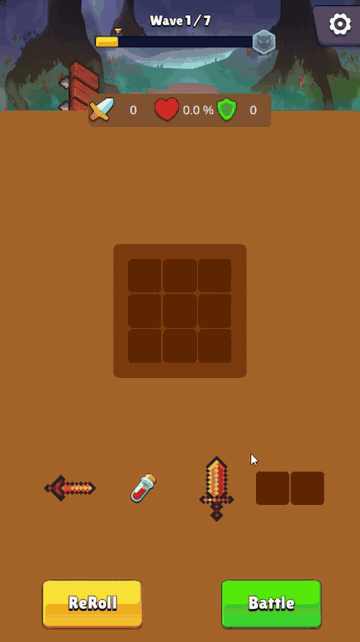

「**인벤토리 플레이어**」는 웨이브 사이 정비 시간에 **테트리스처럼 모양이 다른 아이템을 가방 칸에 배치하고, 같은 아이템끼리 합쳐 강화하면, 다음 웨이브에서 장착한 아이템이 자동으로 싸우는** 모바일 2D 전략 퍼즐 게임입니다. 백팩 히어로의 "가방 정리가 곧 전투력" 구조를 모티프로 한 개인 프로젝트입니다.

**목표한 경험** — 백팩 히어로처럼 **가방 정리가 곧 전투력**이 되는 것, 정비 턴에 손가락으로 모양이 다른 아이템을 끼워 넣고 합친 결과로 전투 턴에 싸우는 것입니다.

**게임 흐름**

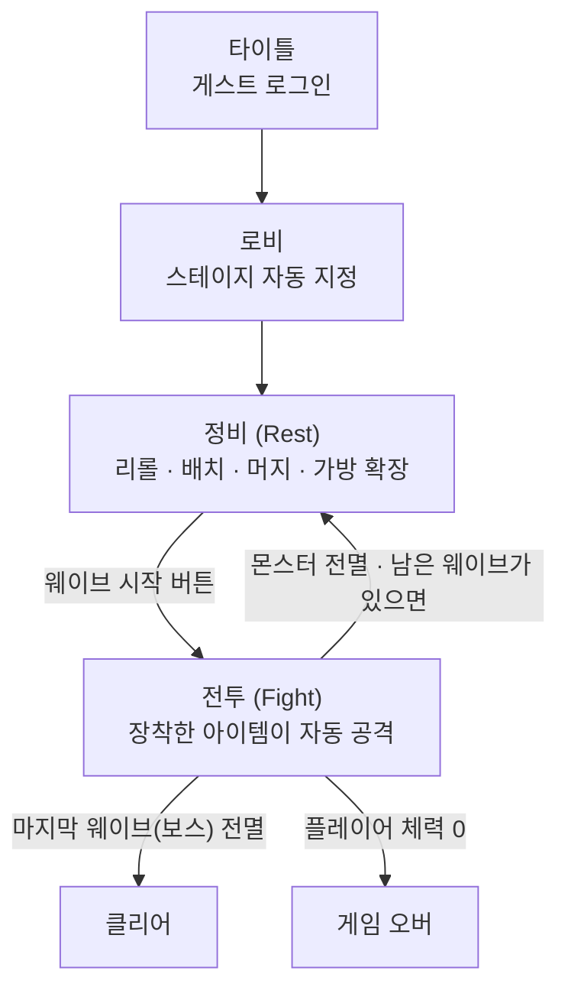

**게임 규칙 요약**

| 구분 | 규칙 |
|---|---|
| 가방 | 5×7 칸. 처음에는 가운데 3×3만 열려 있음. 슬롯 아이템(2×1)으로 **최대 25칸**까지 열림 |
| 리롤 | Rest마다 아이템 4개가 무작위로 나옴(중복 가능). 리롤 버튼으로 다시 뽑기 가능 |
| 배치 | 아이템을 끌어 가방의 빈칸에 놓음. 아이템마다 차지하는 칸 모양이 다름(1×1, 1×2, 2×1, 반대로 된 ㄱ자 3칸) |
| 가방 확장 | **슬롯 아이템**을 잠긴 칸에 놓으면 그 칸이 열림 |
| 머지 | 같은 아이템·같은 레벨끼리 겹치면 레벨 +1 (공격력 = 기본값 × 레벨, 쿨타임 레벨당 −10%) |
| 전투 | 가방에 장착한 아이템마다 전투 슬롯이 생겨, 쿨타임마다 가까운 몬스터를 자동 공격(던지기) 또는 회복 |
| 웨이브 | 스테이지당 7웨이브. 웨이브가 오를수록 몬스터 체력·공격력 +10%씩 |
| 종료 | 마지막 웨이브(보스 등장) 전멸 → 클리어 / 플레이어 체력 0 → 게임 오버 |

### 1.2 목표

| 목표 | 기준 | 지금 상태 |
|---|---|---|
| 목표한 경험 | 정비 턴에 가방을 정리하고, 그 결과로 전투 턴에 싸우는 루프 (2 · 4 · 5장) | 측정 빌드에서 1 · 2스테이지 모두 7웨이브까지 진행, 전투 최저 26.5fps (7.1) |
| 테트리스형 배치 | 모양이 다른 아이템을 손가락으로 끌어 끼워 넣고, 슬롯 아이템으로 가방을 넓힘 (3장) | 미리보기와 스냅으로 배치, 가방을 넓혀도 모양과 장착 위치가 유지됨 (7.1) |
| 데이터 기반 확장 | 아이템 모양 · 스테이지 · 몬스터를 코드 수정 없이 추가 (3.1 · 5.1) | 아이템 모양은 프리팹 설정, 스테이지 · 몬스터는 ScriptableObject (7.1) |

저는 **모바일에서 모양이 다른 아이템을 손가락으로 끌어 가방에 끼워 넣는 테트리스형 인벤토리를 직접 만들어 보는 것**을 목표로 했고, 가장 시간을 많이 쓴 곳도 이 인벤토리입니다.

가방 칸을 `GridLayoutGroup`으로 자동 정렬하는 UI로 만들었는데, **잠긴 칸을 숨기거나 가방이 커지는 순간 GridLayout이 칸을 다시 채워 정렬하면서 가방 모양 자체가 일그러지는 문제**가 계속 생겼습니다. 그래서 "**칸의 상태는 2차원 배열 하나가 원본이고, 화면의 칸은 그 배열을 비추는 거울**"이라는 원칙을 세웠습니다. 이 문서는 기능마다 **무엇을 원본으로 두고 무엇을 거울로 두었는지**를 중심으로 쓰고, 7.4에서 한데 모읍니다.

| 기능 | 만들며 부딪힌 것 | 이렇게 풀었다 |
|---|---|---|
| 가방 · 전투 나누기 (2장) | 손가락으로 정리하는 가방과 자동으로 싸우는 전투를 한 오브젝트에 두면 입력 · 해상도 · 전투 로직이 섞임 | 가방은 UI, 전투는 월드. 둘 사이는 **장착 기록** 하나로 넘김 |
| 테트리스형 가방 (3장) | GridLayout이 칸을 다시 채워 가방 모양이 일그러지고, 아이템이 엉뚱한 칸에 들어감 | **칸 상태의 원본은 배열 하나**, 화면은 거울. 가방 크기도 배열에서 계산 |
| 머지와 전투 (4장) | 놓기와 합치기가 동시에 가능한 순간이 있고, 머지 뒤 UI와 장착 기록이 어긋남 | 배치를 먼저 보고, **남는 쪽을 고정**해 장착 기록도 함께 갱신 |
| 웨이브와 몬스터 (5장) | 웨이브마다 다른 몬스터를 코드 수정 없이 내보내고, 프레임이 끊겨도 놓치지 않아야 함 | 스테이지 데이터 + 정렬해 둔 큐, 스폰 시각은 "지났는가"로 비교 |

---

## 2. 가방은 UI로, 전투는 월드로

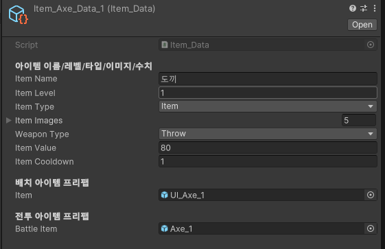

**정적 데이터**(아이템·스테이지·몬스터 스탯)는 ScriptableObject로 관리합니다. 로비의 `Robby_System`이 이번에 플레이할 스테이지를 정하고, 씬이 바뀌어도 남는 `Game_Manager`가 그 스테이지와 캐릭터 데이터를 인게임으로 넘깁니다.

인게임은 다시 **가방(UI)** 과 **전투(월드)** 로 나뉩니다. 가방 쪽은 "어디에 무엇을 놓았는가"만 알고, 전투 쪽은 가방이 남긴 **장착 기록(`OccupiedItemDatas`)** 만 보고 무기를 만듭니다. 그래서 아이템 데이터(`Item_Data`) 하나가 가방에 놓이는 UI 프리팹과 전투에서 날아가는 투사체 프리팹을 함께 가집니다.

```csharp
// Item_Data.cs — 한 아이템이 두 개의 프리팹을 가짐
[Header("배치 아이템 프리팹")]
public GameObject item;        // 가방에 놓이는 UI 오브젝트
[Header("전투 아이템 프리팹")]
public GameObject battleItem;  // 전투에서 날아가는 투사체
```

- 클래스마다 하는 일 · 하지 않는 일은 부록 A.1 표에 있습니다.

**가방은 UI(Canvas), 전투는 게임 오브젝트** 🧭 — 모바일에서 손가락으로 아이템을 끌어 정리하는 가방은, 게임 월드 안의 물건보다 **화면에 붙어 있는 UI에 가깝다**고 느껴 [B]를 골랐습니다. 그 결과 **"정비 턴에 가방을 정리하고, 전투 턴에는 그 결과로 싸운다"** 는 흐름도 분명하게 갈렸습니다.

| | [A] 가방까지 게임 오브젝트로 | **[B] 가방(UI) · 전투(게임 오브젝트) 분리** ✓ |
|---|---|---|
| 방식 | 가방 칸과 아이템도 월드의 스프라이트 오브젝트로 만들고, 그 오브젝트가 전투에도 쓰임 | 가방은 Canvas UI로 배치만 하고, 웨이브 시작 시 장착 기록으로 전투 슬롯·투사체를 새로 생성 |
| 장점 | 아이템이 한 종류의 오브젝트라 데이터가 한 곳에 있음 | 터치 드래그(`IDragHandler`)와 화면 크기 대응(Canvas Scaler)을 uGUI에 맡길 수 있음. 가방 코드가 전투를 몰라도 됨 |
| 단점 | 터치 입력·카메라 기준 위치·해상도 대응을 직접 처리해야 함. 배치 로직과 전투 로직이 한 오브젝트에 섞임 | 같은 아이템이 **UI 프리팹 / 전투 프리팹 / 장착 기록** 세 가지로 존재해 동기화가 필요 |

전투 중에는 가방을 닫아 두므로 배치 상태가 전투 도중 바뀌지 않습니다. 대신 머지로 레벨이 오르거나 아이템을 빼면 **UI 아이템과 장착 기록을 둘 다 고쳐야** 했고, 실제로 둘이 어긋나는 문제가 생겼습니다(4.1). 원본을 하나로 맞추는 일은 남은 과제입니다(7.3).

---

## 3. 테트리스형 가방

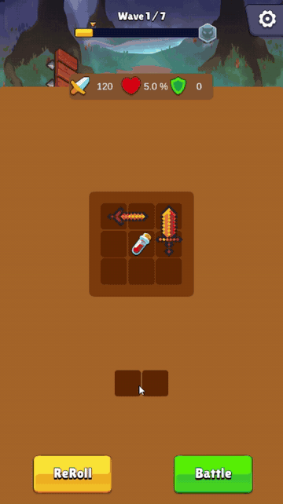

가방은 칸 35개(5×7)를 `GridLayoutGroup`으로 자동 정렬한 UI입니다. 처음에는 가운데 3×3만 열려 있고, 슬롯 아이템으로 잠긴 칸을 열어 가방을 넓힙니다.

문제는 **GridLayout이 "켜져 있는 자식만" 차례대로 채워 넣는다**는 점이었습니다. 잠긴 칸을 `SetActive(false)`로 숨기면 뒤의 칸들이 앞으로 당겨지고, 가방이 넓어지면 한 줄에 들어가는 칸 수가 바뀝니다. 그 결과 **화면의 칸 위치와 실제 데이터의 칸 위치가 어긋나** 가방 모양이 일그러지거나 아이템이 엉뚱한 칸에 들어갔습니다. 그래서 두 가지 원칙을 세웠고, 이 장의 모든 기능이 같은 배열을 읽습니다.

1. **칸 상태의 원본은 2차원 배열 `slots[x, y]` 하나**이고, 화면의 칸(`Slot_State`)은 그 배열을 비추는 거울이다.
2. **화면 좌표가 아니라 칸의 순번(sibling index)으로** 배열 좌표를 계산하고(`index = y × 5 + x`), 가방 크기와 칸 활성화도 배열에서 다시 계산한다.

### 3.1 칸 상태는 배열 하나에, 화면은 거울로

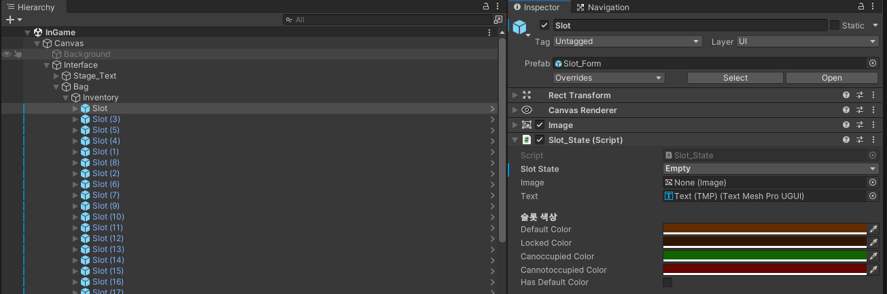

| 상태 | 의미 | 화면 표시 |
|---|---|---|
| `Empty` | 열린 빈칸 | 기본 색 |
| `Occupied` | 아이템이 차지함 | 기본 색 (아이템이 위에 놓임) |
| `Locked` | 잠긴 칸 | 열린 영역 밖: 비활성 / 열린 영역 안: **투명(알파 0)** |
| `None` | 범위 밖 | — |

처음에는 모두 Locked이고, 가운데 3×3만 Empty입니다.

**아이템 모양** — 아이템마다 가로·세로 칸 수를 정하고(기본은 모든 칸 사용), 쓰지 않을 칸만 끕니다. 칸 목록(`slotList`)은 위에서 아래로, 그다음 왼쪽에서 오른쪽 순서로 칸을 나타냅니다. 끈 칸은 오프셋을 `(-1, -1)`로 표시해 배치 검사에서 건너뜁니다.

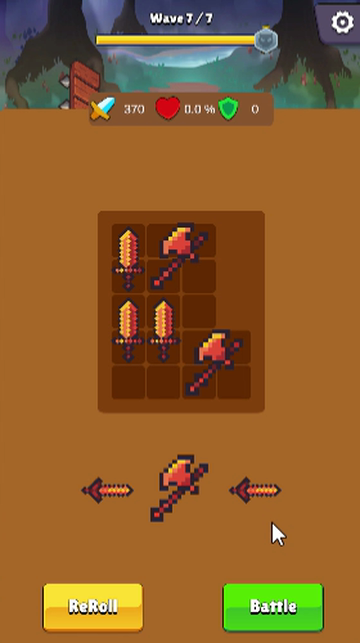

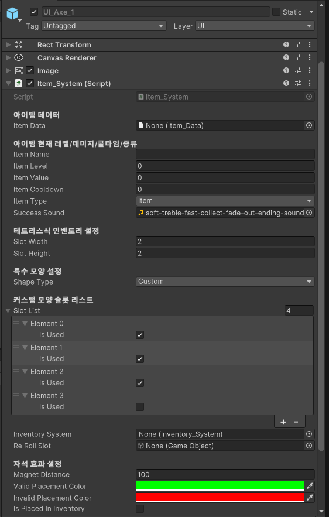

| 아이템 | 크기 | 모양 |
|---|---|---|
| 포션 | 1×1 | 한 칸 |
| 검 1 | 1×2 | 세로 2칸 |
| 검 2 / 슬롯 아이템 | 2×1 | 가로 2칸 |
| 도끼 | 2×2 중 3칸 | 반대로 된 ㄱ자 (`isUsed` 1,1,1,0 → 왼쪽 위 · 왼쪽 아래 · 오른쪽 위를 쓰고 오른쪽 아래만 끔) |

- 전체 코드: [Item_System.cs](https://github.com/NaJungWon/Inventory_Player/blob/main/Assets/Scripts/System/Item_System.cs) (`InitializeCustomShape` :118) · [Slot_State.cs](https://github.com/NaJungWon/Inventory_Player/blob/main/Assets/Scripts/System/Slot_State.cs)

**칸 상태는 칸 오브젝트가 아니라 배열 하나에** 🧭 — 처음에는 [A]처럼 칸 오브젝트가 자기 상태를 들고 있게 만들었다가, 가방 모양이 깨지는 문제(3.4)를 겪으며 [B]로 옮겼습니다. GridLayout을 쓰는 이상 **화면의 칸 위치는 언제든 바뀔 수 있는 값**이라, 흔들리지 않는 배열을 기준으로 삼고 화면은 그 결과만 보여 주게 했습니다.

| | [A] 칸 오브젝트마다 상태 보관 | **[B] 2차원 배열 원본 + 화면은 거울** ✓ |
|---|---|---|
| 방식 | 칸 UI(`Slot_State`)가 자기 상태를 가짐 | `slots[x, y]`가 원본, 칸 UI는 색만 표시 |
| 장점 | 칸이 자기 상태를 알아 직관적 | 배치 검사·가방 크기 계산이 배열 읽기로 끝남. GridLayout이 칸을 재배치해도 데이터는 그대로 |
| 단점 | 여러 칸짜리 아이템을 검사할 때 칸 오브젝트를 하나하나 찾아야 함. **GridLayout 재배치로 화면 위치가 바뀌면 좌표도 흔들림** | 배열과 화면을 맞추는 코드가 필요 (순번 규칙 관리) |

이제 배치 검사, 슬롯 해금, 가방 크기 계산이 모두 같은 배열을 보고, 화면 연출(색, 투명도)을 바꿔도 배치 규칙은 바뀌지 않습니다. 다만 [A]에서 쓰던 칸의 상태 필드(`Slot_State.slotState`)가 남아 있어, 원본이 아닌 상태 사본이 아직 한 곳에 있습니다(7.3).

### 3.2 드래그: 잡고, 끌고, 놓기

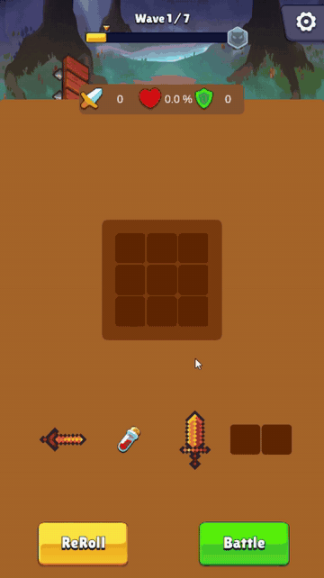

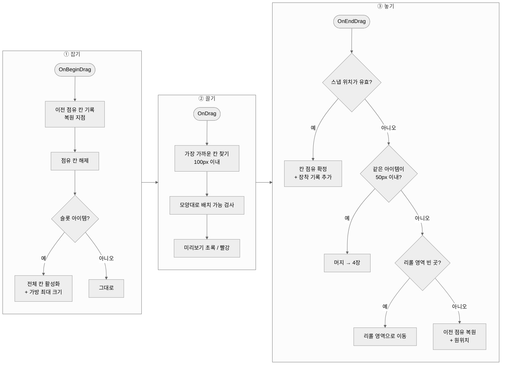

드래그를 시작하면 **원래 위치와 차지하던 칸을 복원 지점으로 남기고** 자기 자리를 비웁니다(그래야 같은 자리 근처로 옮길 수 있음). 끄는 동안에는 손가락에서 100px 안의 가장 가까운 칸을 기준점으로 잡고, 그 칸이 바뀔 때만 미리보기를 다시 그립니다. **실제 배치는 하지 않고 색만 바꿉니다.**

```csharp
// Item_System.cs:187 OnDrag() 안
transform.position = eventData.position;                     // 손가락을 따라 이동
Vector2Int snapPosition = FindNearestValidSlot(eventData.position);

if (snapPosition != currentSnapPosition)                     // 기준 칸이 바뀔 때만 갱신
{
    ClearPreview();
    currentSnapPosition = snapPosition;
    if (currentSnapPosition.x >= 0 && currentSnapPosition.y >= 0)
    {
        isValidPlacement = CanPlaceAtPosition(currentSnapPosition);
        ShowPreview(currentSnapPosition, isValidPlacement);  // 초록 / 빨강
    }
}
```

- 전체 코드: [Item_System.cs](https://github.com/NaJungWon/Inventory_Player/blob/main/Assets/Scripts/System/Item_System.cs) (`OnBeginDrag` :157 · `OnDrag` :187 · `OnEndDrag` :218)

**놓은 뒤 판정 대신 자석 스냅 + 미리보기** 🧭 — 처음에는 **들어갈 칸이 손가락에 가려 보이지 않았고, 아이템이 생각한 기준과 조금 다른 칸에 들어가는** 일이 잦았습니다. 그래서 놓기 전에 들어갈 칸을 색으로 보여 주고, 놓으면 차지한 칸들의 가운데에 붙도록(`CalculateItemCenterPosition`) 바꿨습니다. 미리보기는 **색만 바꾸고 배열은 건드리지 않아**, 배치 규칙에 버그를 만들지 않고 조작감만 개선할 수 있었습니다.

| | [A] 놓은 위치에서 바로 판정 | **[B] 자석 스냅 + 미리보기** ✓ |
|---|---|---|
| 방식 | 손가락을 뗀 곳의 칸에 배치 시도 | 드래그 중 가장 가까운 칸(100px 이내)을 기준점으로 잡고, 모양대로 초록/빨강 표시 |
| 장점 | 구현이 단순 | 놓기 전에 결과를 알 수 있음. 놓으면 차지한 칸들의 가운데에 정확히 붙음 |
| 단점 | 손가락이 아이템을 가려 **어느 칸에 들어갈지 보이지 않음** | 드래그 이벤트마다 35칸과 거리 계산 (칸 수가 적어 문제 없었음, 측정은 안 함) |

**만들며 생긴 문제 — 아이템을 뺐는데 칸이 계속 막혀 있음(유령 점유).**

| 단계 | 내용 |
|---|---|
| 증상 | 아이템을 뺐는데 칸이 계속 막혀 있거나, 놓았는데 칸이 비어 있음 |
| 원인 | 점유·해제가 여러 곳에서 따로 일어나고, 드래그 실패 시 해제만 되고 복원이 안 됨 |
| 해결 | 점유·해제를 `OccupySlots` / `ClearOccupiedSlots`로 통일. 드래그 시작 시 복원 지점을 남기고 실패하면 `RestorePreviousOccupationIfNeeded`로 복원. 문서를 쓰며 복원을 빠뜨린 실패 경로(`TryPlaceInInventory`) 하나를 더 찾아 고침 |
| 결과 | 드래그에 실패해도 이전에 차지하던 칸이 그대로 돌아옴 |

### 3.3 놓을 수 있는지는 배열만 보고 판단하기

배치 가능 여부는 **배열만 읽어서** 판단하고, 화면의 칸 오브젝트는 건드리지 않습니다.

```csharp
// Item_System.cs:412
bool CanPlaceItemAtPosition(Vector2Int position)
{
    for (int x = 0; x < slotWidth; x++)
        for (int y = 0; y < slotHeight; y++)
        {
            Vector2Int shapeOffset = slotShape[x, y];
            if (shapeOffset.x == -1 && shapeOffset.y == -1) continue; // 모양의 빈칸은 건너뜀

            Vector2Int checkPos = position + shapeOffset;

            // 1. 가방 범위 밖이면 불가
            if (checkPos.x < 0 || checkPos.x >= inventorySystem.inventoryMaxWidth ||
                checkPos.y < 0 || checkPos.y >= inventorySystem.inventoryMaxHeight)
                return false;

            // 2. 빈칸(Empty)이 아니면 불가 — Locked·Occupied 모두 여기서 걸림
            if (inventorySystem.slots[checkPos.x, checkPos.y] != Inventory_System.SlotState.Empty)
                return false;
        }
    return true;
}
```

- 전체 코드: [Item_System.cs](https://github.com/NaJungWon/Inventory_Player/blob/main/Assets/Scripts/System/Item_System.cs)

슬롯 아이템은 반대로 **잠긴 칸(Locked)에만** 놓을 수 있습니다(`CanPlaceSlotAtPosition`).

| 아이템 종류 | 놓을 수 있는 칸 | 놓으면 |
|---|---|---|
| 일반 아이템 | Empty | Empty → Occupied, 장착 기록 추가 |
| 슬롯 아이템 | Locked | Locked → Empty, 가방 크기 다시 계산, 아이템 소멸 |

### 3.4 가방이 커져도 모양이 깨지지 않게

GridLayout이 칸을 다시 채우더라도 모양이 유지되도록, **가방 크기와 켜 둘 칸을 배열에서 계산**합니다(맨 위 GIF).

1. 배열에서 열린 칸(Empty·Occupied)을 모두 감싸는 최소 사각형을 구합니다.
2. 가방 크기를 `(사각형 가로 + 1) × 100`, `(세로 + 1) × 100`으로 맞춥니다. 칸 크기가 100, 간격이 5이므로 **한 줄에 정확히 사각형 가로 칸 수만큼만 들어갑니다.**
3. 사각형 안의 칸은 잠겨 있어도 **끄지 않고 투명하게** 둡니다. 꺼 버리면 GridLayout이 뒤의 칸을 당겨 모양이 깨지기 때문입니다.

슬롯 아이템을 끄는 동안에는 잠긴 칸에 미리보기를 보여야 하므로, **35칸을 모두 켜고 가방을 최대 크기(600×800)로** 키웠다가 놓으면 다시 계산합니다.

```csharp
// Inventory_System.cs:331 UpdateInventoryAfterSlotPlacement() 안 — 사각형 안의 칸은 모두 켬
for (int x = minX; x <= maxX; x++)
    for (int y = minY; y <= maxY; y++)
    {
        int slotIndex = y * inventoryMaxWidth + x;
        Slot_State slot = inventoryBag.transform.GetChild(slotIndex).GetComponent<Slot_State>();
        slot.gameObject.SetActive(true);

        Color slotColor = GetSlotColor(slots[x, y], slot);
        if (slots[x, y] == SlotState.Locked) slotColor.a = 0f; // 자리는 차지하되 보이지 않게
        slot.image.color = slotColor;
    }

AdjustInventoryBagSizeForRange(minX, maxX, minY, maxY); // (범위 + 1) × 100
```

- 전체 코드: [Inventory_System.cs](https://github.com/NaJungWon/Inventory_Player/blob/main/Assets/Scripts/System/Inventory_System.cs)

**만들며 생긴 문제 — 가방을 넓히면 생긴 세 가지.**

| 문제 | 원인 | 해결 |
|---|---|---|
| 잠긴 칸을 숨기거나 가방이 커지면 칸 배치가 일그러짐 | GridLayout은 켜진 칸만 순서대로 채움. 칸을 끄면 뒤 칸이 당겨지고, 가방 너비가 바뀌면 한 줄 칸 수가 바뀜 | 열린 사각형 안의 잠긴 칸은 **투명하게 켜 두고**, 가방 크기를 사각형에 맞춰 한 줄 칸 수를 고정 (위 1~3) |
| 가방이 넓어진 뒤 이미 놓인 아이템이 칸과 어긋난 위치에 남음 | 가방 크기가 바뀌면 GridLayout이 **다음 프레임에** 칸을 다시 배치함. 아이템은 이전 좌표에 그대로 있음 | 한 프레임 기다린 뒤(`yield return null`) 각 아이템을 **점유한 칸들의 중심**으로 다시 이동 (`RepositionExistingItems`) |
| 슬롯 아이템을 **처음** 들 때만 잠긴 칸이 잠금 색이 아닌 기본 색으로 보임 | `Slot_State`가 `image` 참조를 `Start()`에서 채움. 꺼진 채 시작한 칸은 다시 켜도 `Start()`가 그 프레임 끝에야 실행되어, 색을 칠하는 순간 `image`가 `null` | `Start()` → `Awake()`. `Awake()`는 `SetActive(true)` 순간 실행됨 |

두 번째 문제에서, 아이템의 위치를 **좌표로 기억하지 말고 "어느 칸을 차지하는가"로 기억**해야 칸이 움직여도 아이템이 따라간다는 것을 배웠습니다. 시연 영상은 세 번째 문제를 고치기 전에 녹화해, 첫 확장 장면에 증상이 잠깐 보입니다.

---

## 4. 머지와 전투

같은 아이템·같은 레벨 두 개를 겹치면 하나로 합쳐져 레벨이 오릅니다. 가방에 장착한 아이템은 **장착 기록**으로 남고, 웨이브가 시작되면 그 기록마다 전투 슬롯이 생겨 자동으로 공격합니다.

| 아이템 | 기본 수치 | 기본 쿨타임 | 타입 |
|---|---|---|---|
| 도끼 | 80 | 1.0초 | 던지기 |
| 검 1 | 70 | 0.7초 | 던지기 |
| 검 2 | 50 | 0.5초 | 던지기 |
| 포션 | 50 | 2.0초 | 회복 |

### 4.1 머지: 같은 아이템 둘을 하나로

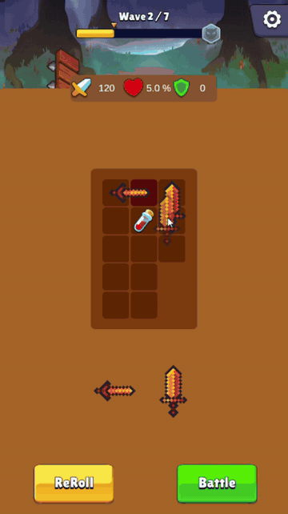

```csharp
// Item_System.cs:651
bool CanUpgrade(Item_System targetItem)
{
    // 슬롯 아이템은 합치지 않음
    if (this.itemType == Item_Data.ItemType.Slot || targetItem.itemType == Item_Data.ItemType.Slot)
        return false;

    return targetItem.itemData == this.itemData &&   // 같은 아이템
           targetItem.itemLevel == this.itemLevel && // 같은 레벨
           targetItem.itemLevel < targetItem.itemData.itemImages.Count; // 최대 레벨(아이콘 수) 미만
}

// Item_System.cs:666 UpgradeItem() 안 — 놓인 자리의 아이템(targetItem)이 남음
targetItem.itemLevel++;
targetItem.itemValue = (int)(targetItem.itemData.itemValue * targetItem.itemLevel); // 기본값 × 레벨
// ...
if (targetItem.isPlacedInInventory && inventorySystem != null)
    inventorySystem.UpdateOccupiedItemData(targetItem); // 장착 기록도 같은 레벨로
Destroy(gameObject); // 끌어온 아이템은 재료로 사라짐
```

- 전체 코드: [Item_System.cs](https://github.com/NaJungWon/Inventory_Player/blob/main/Assets/Scripts/System/Item_System.cs)

| 레벨 | 1 | 2 | 3 | 4 | 5 |
|---|---|---|---|---|---|
| 수치 배율 | ×1 | ×2 | ×3 | ×4 | ×5 |
| 쿨타임 | 100% | 90% | 80% | 70% | 60% |

수치는 플레이로 정한 레벨 디자인 값입니다. 최대 레벨은 숫자로 따로 두지 않고 **아이템마다 준비한 아이콘 수(5장)에서 읽어**, 5레벨끼리는 합쳐지지 않습니다(이 조건이 빠져 오류가 나던 것을 문서를 쓰며 발견해 고침).

**배치를 먼저, 놓을 수 없을 때만 머지** 🧭 — 드롭 한 번에 **"이 칸에 놓을 수 있다"와 "근처에 같은 아이템이 있다"가 동시에 참**인 경우가 있습니다. **먼저 놓아 보고, 놓을 수 없으면 같은 아이템 위인지 확인해 합치는** [A]를 골라, 놓기 전에 본 미리보기(3.2)와 결과가 어긋나지 않게 했습니다. 머지할 생각 없이 빈칸에 놓은 아이템이 옆 아이템과 합쳐지는 일도 없습니다.

| | **[A] 배치 우선** ✓ | [B] 머지 우선 |
|---|---|---|
| 순서 | 칸 배치 시도 → 놓을 수 없으면 같은 아이템 위인지 확인해 머지 | 머지 가능 여부 → 아니면 배치 |
| 장점 | 초록 미리보기가 뜨면 그대로 놓임 → **미리보기와 결과가 일치**. 같은 아이템 위는 이미 Occupied라 배치가 실패하고 자연스럽게 머지로 넘어감 | 같은 아이템 근처에 놓으면 항상 합쳐짐 |
| 단점 | 같은 아이템 바로 옆 빈칸에 놓으면 머지가 아니라 배치됨 | 초록 미리보기가 떠도 머지될 수 있어, 미리보기와 결과가 달라짐 |

놓을 수 없을 때는 ① 리롤 영역의 같은 아이템(50px 이내) → ② 가방에 장착된 같은 아이템 → ③ 손가락 아래 대상 → ④ 리롤 영역의 빈 곳 → ⑤ 원위치 복원 순서로 봅니다. 머지 대상을 **리롤 영역**과 **가방** 두 곳에서 따로 찾도록 나누자, 같은 아이템이 어느 쪽에 있느냐에 따라 머지가 되거나 안 되던 문제가 풀렸습니다. 대신 판정 단계가 늘어 `OnEndDrag` 하나가 150줄이 됐습니다(7.3).

**만들며 생긴 문제 — 머지 후 데이터가 어긋남.**

| 단계 | 내용 |
|---|---|
| 증상 | ① 두 오브젝트 중 **어느 쪽이 남고 어느 쪽이 사라지는지**가 분명하지 않아, 넘겨주는 과정에서 레벨·수치가 어긋남 ② 가방에 장착한 아이템을 머지하면 UI 아이템의 레벨은 올랐는데, 전투에서는 이전 레벨의 수치로 공격 |
| 원인 | ① 남는 쪽·사라지는 쪽의 역할이 정해져 있지 않음 ② UI 아이템과 장착 기록(`OccupiedItemDatas`)이 따로 있어, UI 아이템의 레벨만 오름 (2장의 대가) |
| 해결 | ① **놓인 자리의 아이템이 남고, 끌어온 아이템은 재료로 사라진다**로 고정. 값은 넘겨받지 않고 남는 쪽에서 레벨만 올린 뒤 `기본값 × 레벨`로 다시 계산 (위 코드) ② 머지할 때 같은 아이템 · 머지 전 레벨인 장착 기록을 찾아 레벨·수치·쿨타임을 함께 갱신 |
| 결과 | 머지한 아이템의 레벨·수치가 가방과 다음 웨이브의 전투 슬롯에 같은 값으로 반영됨 |

### 4.2 장착 기록으로 전투 슬롯 만들기

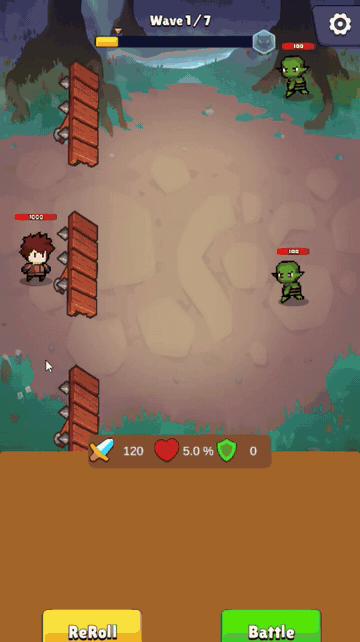

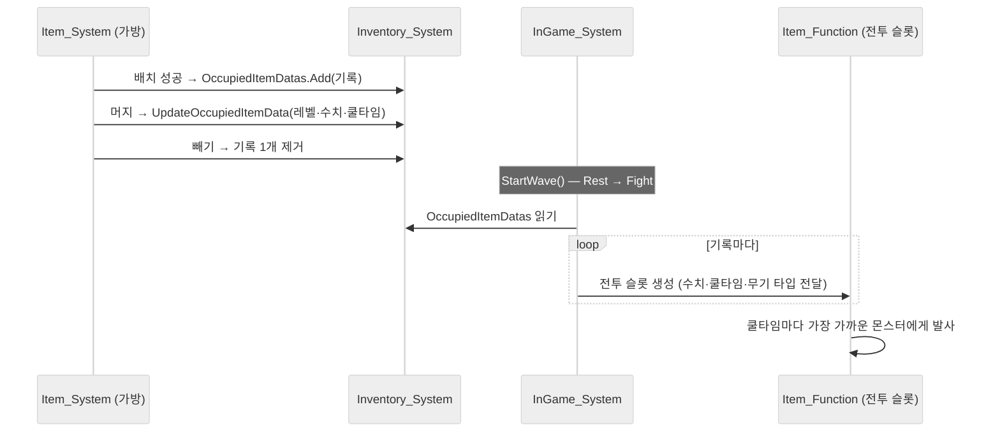

웨이브가 시작되면 `InGame_System`이 장착 기록마다 전투 슬롯(`Item_Function`)을 만들고, 기록의 레벨·수치·쿨타임을 그대로 넘깁니다. 전투 슬롯은 쿨타임 동안 슬롯 이미지의 `fillAmount`를 줄여 남은 시간을 보여 주고, 쿨타임이 끝나면 공격 범위 안에서 **살아 있는 가장 가까운 몬스터**를 찾아 투사체를 던집니다. 포션도 같은 조건으로, **공격 범위 안에 몬스터가 있을 때만** 플레이어에게 회복 투사체를 보냅니다.

- 전체 코드: [InGame_System.cs](https://github.com/NaJungWon/Inventory_Player/blob/main/Assets/Scripts/System/InGame_System.cs) (`OccupiedWeaponSetting` :336) · [Item_Function.cs](https://github.com/NaJungWon/Inventory_Player/blob/main/Assets/Scripts/Item/Item_Function.cs)

---

## 5. 웨이브와 몬스터

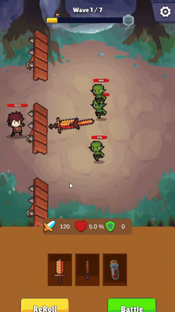

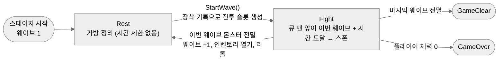

정비 턴에 정리한 가방은 웨이브가 오를수록 강해지는 몬스터(5.3)와 마지막 웨이브의 보스를 상대합니다. `InGameState`에는 이 밖에 `Pause`가 있습니다.

### 5.1 스테이지 데이터에 웨이브를 적어 두기

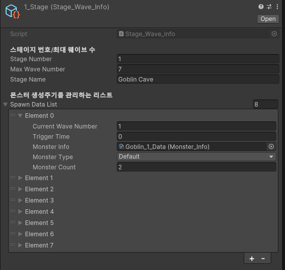

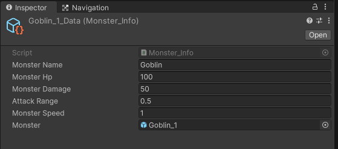

스테이지는 ScriptableObject 하나입니다. **"몇 번째 웨이브의, 몇 초에, 어떤 몬스터가, 몇 마리"** 를 목록으로 적어 두면 코드를 고치지 않고 스테이지를 만들 수 있습니다. 현재 스테이지 2개(각 7웨이브), 몬스터 11종(1스테이지 고블린 5종 · 2스테이지 스켈레톤 4종과 좀비 2종)이 있고, 보스는 마지막 웨이브에만 나옵니다.

```csharp
// Stage_Wave_Info.cs
[CreateAssetMenu(menuName = "Stage_Wave_Info")]
public class Stage_Wave_Info : ScriptableObject
{
    public int stageNumber;
    public int maxWaveNumber;
    public string stageName;
    public List<MonsterSpawnData> spawnDataList;

    [System.Serializable]
    public class MonsterSpawnData
    {
        public int currentWaveNumber;    // 몇 번째 웨이브
        public float triggerTime;        // 웨이브 시작 후 몇 초
        public Monster_Info monsterInfo; // 어떤 몬스터
        public MonsterType monsterType;  // None, Default, Boss
        public int MonsterCount;         // 몇 마리
    }
}
```

### 5.2 정렬해 둔 큐에서 차례대로 꺼내 스폰하기

스테이지가 시작되면 스폰 목록을 **웨이브 번호 → 시간 순**으로 한 번 정렬해 큐에 넣고, 매 프레임에는 **큐의 맨 앞 하나만** 확인합니다. 맨 앞 데이터가 다음 웨이브 것이면 이번 웨이브 스폰은 끝난 것이라, 몬스터가 모두 죽을 때까지 기다립니다(`isWaitingForMonstersToDie`).

- 전체 코드: [InGame_System.cs](https://github.com/NaJungWon/Inventory_Player/blob/main/Assets/Scripts/System/InGame_System.cs) (정렬 `InitializeSpawnDataQueue` :110, 매 프레임 확인 `ProcessMonsterSpawning` :143)

**매 프레임 전체 검사 대신 정렬 후 Queue** 🧭 — 스폰 데이터는 **앞에서부터 한 번씩 꺼내 쓰고 다시 보지 않는** 데이터라, 먼저 들어간 것이 먼저 나오는 Queue가 가장 자연스럽다고 판단했습니다. 웨이브 데이터는 플레이 중에 바뀌지 않으므로 시작할 때 한 번만 정렬하면 됩니다.

| | [A] 매 프레임 목록 전체 검사 | **[B] 정렬 후 Queue** ✓ |
|---|---|---|
| 방식 | 스폰 목록 전체를 돌며 이번 웨이브·이번 시간에 맞는 항목 찾기 | 시작할 때 한 번 정렬, 이후 맨 앞 하나만 `Peek` → 맞으면 `Dequeue` |
| 장점 | 목록 순서와 상관없이 동작 | 매 프레임 확인이 한 번. 한 번 쓴 데이터는 다시 볼 일이 없음 |
| 단점 | 목록이 길수록 매 프레임 비용 증가. 이미 스폰한 항목을 따로 표시해야 함 | 정렬이 맞지 않으면 순서가 꼬임 |

당시에는 자료구조 선택지를 넓게 비교하지 못했습니다. 정렬된 `List`와 인덱스 하나로도 같은 결과를 낼 수 있어, Queue는 "최적화"라기보다 **"한 번 쓰고 버린다"는 의도를 코드에 드러내는 선택**이었다고 봅니다.

> 몬스터·투사체·전투 슬롯은 모두 `Instantiate` / `Destroy`로 만들고 지웁니다. 한 웨이브의 몬스터 수와 한 번에 장착할 수 있는 무기 수가 많지 않아 **풀링은 일부러 넣지 않았고**, 빌드 측정에서도 동시 최대 7마리일 때 최저 26.5fps였습니다(7.1). 생성 · 삭제 때의 GC 할당까지 프로파일러로 보지는 않았습니다.

**만들며 생긴 문제 — 프레임이 끊기면 웨이브가 멈춤.**

| 단계 | 내용 |
|---|---|
| 증상 | 프레임이 끊기면 몬스터가 나오지 않고 웨이브가 진행되지 않음 |
| 원인 | 스폰 판정이 `Abs(타이머 − 시각) < 0.1초`. 한 프레임이 0.2초 이상 걸리면 그 구간을 지나쳐 영영 스폰되지 않음. 큐는 맨 앞만 보므로, 맨 앞이 막히면 **그 뒤의 모든 스폰이 막힘** |
| 해결 | `inGameTimer >= triggerTime`(시각을 지났는가)으로 변경 |
| 결과 | 측정용 빌드에서 1 · 2스테이지 모두 7웨이브까지 진행 |

### 5.3 웨이브가 오를수록 몬스터를 강하게

같은 몬스터라도 웨이브가 오를수록 강해집니다. 체력 · 공격력은 `기본값 + 기본값 × 10% × (웨이브 − 1)`로, 7웨이브에서는 기본값의 1.6배가 됩니다. 이동 속도 · 공격 사거리는 몬스터 데이터 값 그대로입니다. 값은 플레이로 정한 레벨 디자인입니다.

**만들며 생긴 문제 — 플레이할 때마다 몬스터 프리팹 원본의 체력 · 공격력이 바뀜.** 프리팹 에셋에 값을 쓴 뒤 `Instantiate`하고 있었습니다. 먼저 생성하고 **생성된 인스턴스에만** 값을 쓰도록 순서를 바꿨습니다. `Unit_Status` · `Monster_Setting`은 `Start`에서 초기화하므로, 생성 직후 넣은 값이 초기화보다 먼저 반영됩니다.

### 5.4 몬스터 이동: 장애물을 돌아서 다가오기

몬스터는 NavMeshPlus(2D용 NavMesh)로 플레이어를 추적하고, `stoppingDistance`(공격 사거리) 안에 들어오면 공격 애니메이션을 재생하며 데미지를 줍니다. 공격 간격은 `1 ÷ 이동 속도`초라, 빠른 몬스터일수록 자주 때립니다.

**직선 이동 대신 NavMeshPlus 경로 탐색** 🧭 — 맵에 장애물이 있어 직선 이동으로는 몬스터가 장애물에 걸렸습니다. Unity 기본 NavMesh는 3D(XZ 평면) 기준이라, **2D(XY 평면)에서 동작하는 GitHub 패키지 NavMeshPlus**를 찾아 적용했습니다(7.2).

| | [A] 플레이어 방향으로 직선 이동 | **[B] NavMeshPlus 경로 탐색** ✓ |
|---|---|---|
| 장점 | 구현이 가장 단순 | 장애물을 돌아서 접근. 속도·정지 거리를 데이터로 설정 |
| 단점 | 장애물이 있으면 끼거나 통과함 | 2D 맵용 NavMesh를 따로 구워야 함 |

```csharp
// Monster_Setting.cs:19 Start() 안 — 2D에서 NavMeshAgent가 스프라이트를 회전시키지 않도록
agent.updateRotation = false; // 2D에서는 회전 불필요
agent.updateUpAxis = false;   // NavMeshPlus에서 XY 평면 사용
```

---

## 6. UI 연출

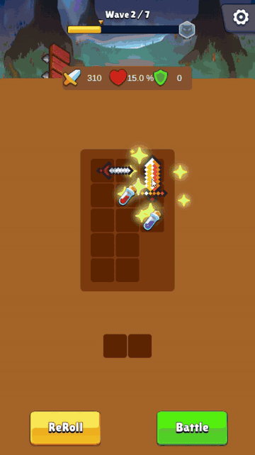

캐주얼 게임의 손맛을 위해 UI가 등장할 때 이징을 넣었습니다. 당시 DOTween을 배우기 전이라, **코루틴과 이징 함수를 직접 구현**했습니다. 인벤토리가 튕기며 올라오는 연출은 5장 GIF에서 볼 수 있습니다.

| 연출 | 대상 | 이징 | 시간 |
|---|---|---|---|
| 인벤토리 열기·닫기 | 가방 패널 Y 위치 (−1185 ↔ −120) | EaseOutBounce | 1초 |
| 웨이브 진행도 | 슬라이더 값 | Lerp (선형) | 1초 |
| 설정 팝업 | 크기 0 → 1 | EaseOutBack | 0.35초 |
| 버튼 클릭 | 크기 튕김 | EaseOutBack | 0.3초 |
| 아이템 장착·머지 | 크기 0.8 → 최대 1.15/1.3 → 1 | EaseOutBack | 0.4 / 0.5초 |

### 6.1 연출이 끝날 때까지 입력 막기

인벤토리가 움직이는 동안 아이템을 잡으면, 아이템 위치와 칸 위치가 어긋납니다. 그래서 **움직이기 전에 가방·리롤·장착 영역을 끄고, 이동이 끝난 콜백에서 다시 켭니다.** 연출이 진행 중일 때 다시 호출되면 이전 코루틴을 멈추고 새로 시작합니다.

```csharp
// InGame_UI.cs:72 openInventory() 안
if (inventorySlot != null && inventorySlot.activeSelf) inventorySlot.SetActive(false); // 움직이는 동안은 조작 불가
// ...
if (inventoryMoveCoroutine != null) StopCoroutine(inventoryMoveCoroutine); // 연출 겹침 방지
inventoryMoveCoroutine = StartCoroutine(MoveInventoryY(shownY, () =>
{
    // 도착한 뒤에만 다시 켬
    if (inventorySlot != null) inventorySlot.SetActive(true);
    if (reRollSlot != null) reRollSlot.SetActive(true);
    if (occupiedWeaponSlot != null) occupiedWeaponSlot.SetActive(true);
}));
```

- 전체 코드: [InGame_UI.cs](https://github.com/NaJungWon/Inventory_Player/blob/main/Assets/Scripts/UI/InGame_UI.cs) (`MoveInventoryY` :143 — `EaseOutBounce`로 Y 위치를 옮긴 뒤 끝 위치를 보정하고 콜백 호출)

전투 버튼도 같은 방식으로, 이동이 끝난 시점에 `Button.enabled`를 켜고 꺼서 연출 중 잘못 눌리지 않게 했습니다.

---

## 7. 회고

### 7.1 결과

**빌드 측정** — 실제 모바일 기기에서 Android 빌드로 1 · 2스테이지를 끝까지 플레이하며 측정했습니다. 측정용 스크립트가 웨이브마다 값을 파일로 남기게 하고, 측정이 끝난 뒤 원본에서는 뺐습니다.

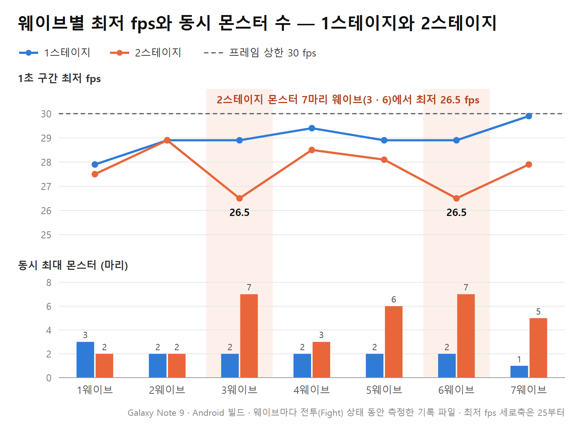

| 측정 환경 | |
|---|---|
| 기기 | Galaxy Note 9 (SM-N960N, 2018년 · Android 10 · RAM 6GB) |
| 프레임 상한 | 30fps (`targetFrameRate` 기본값 · vSync 1) |
| 측정 방법 | 전투(Fight) 상태 동안의 평균 fps, 1초 구간 최저 fps, 0.25초마다 센 동시 몬스터 수, Mono 메모리 |

| 항목 | 1스테이지 | 2스테이지 |
|---|---|---|
| 동시 최대 몬스터 | 3마리 | 7마리 |
| 전투 시간 (7웨이브 합) | 32.4초 | 37.4초 |
| 전투 평균 fps | 29.7 | 29.4 |
| 전투 최저 fps (1초 구간) | 27.9 | 26.5 |
| Mono 메모리 (첫 웨이브 → 마지막 웨이브) | 5.3 → 9.6 MB | 44.7 → 49.0 MB |

두 스테이지 모두 30fps 상한에 거의 붙어 유지됐고, 몬스터가 두 배 이상인 2스테이지에서도 최저 26.5fps였습니다. 최저치는 몬스터가 7마리까지 모인 3 · 6웨이브에서 나왔고, 몬스터가 1 ~ 3마리인 웨이브는 두 스테이지 모두 27.5fps 이상이었습니다. 두 측정은 앱을 따로 실행해 Mono 시작 값이 다르므로, 스테이지 안에서 늘어난 양(둘 다 약 4MB)만 비교합니다.

| 목표 (1.2) | 결과 | 절 |
|---|---|---|
| **목표한 경험** (1.1) | 정비 → 전투 루프가 측정 빌드에서 1 · 2스테이지 모두 7웨이브까지 진행되고, 전투 중 최저 26.5fps | 5장 · 7.1 |
| **테트리스형 배치** | 4종의 모양(1×1, 1×2, 2×1, 반대로 된 ㄱ자)을 가진 아이템을 미리보기와 스냅으로 배치하고, 슬롯 아이템으로 가방을 넓혀도 가방 모양과 장착 아이템 위치가 유지됩니다. | 3장 |
| 데이터 기반 확장 | 아이템 모양은 프리팹 설정, 스테이지·몬스터는 ScriptableObject라 코드 수정 없이 추가할 수 있습니다. | 3.1 · 5.1 |

### 7.2 AI와 일한 방식

오래된 프로젝트라 기억이 정확하지 않지만, **2D(XY 평면)에서 쓸 수 있는 NavMesh 패키지를 찾을 때(5.4)** 와 **UI를 손가락(마우스)으로 끌어 옮기는 방식을 고를 때(3.2)** AI와 대안을 주고받으며 찾았던 것으로 기억합니다.

### 7.3 남은 과제와 다음 계획

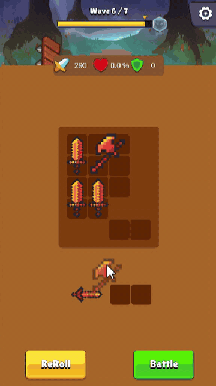

| 과제 | 근거 | 다음에 할 것 |
|---|---|---|
| **슬롯 아이템 배치 실패 시 가방 칸이 당겨짐** (2026.11 빌드에서 발견, 수정 전) | 위 GIF. 실패 경로(`RestoreSlotActivationForSlotItem`)는 잠긴 칸을 모두 끄고 끝나는데, 성공 경로(`UpdateInventoryAfterSlotPlacement`)는 열린 사각형 안의 잠긴 칸을 **투명하게 다시 켜서** 자리를 지킴 → 실패 때만 GridLayout이 꺼진 칸을 건너뛰어 뒤 칸이 당겨짐 | 실패 경로도 성공 경로와 같은 함수로 복원해, 두 경로가 같은 상태로 끝나게 함 |
| **같은 데이터의 이중 관리** | UI 아이템과 장착 기록이 따로 있어 배치·제거·머지마다 동기화 필요 (2장, 4.1). 칸의 상태 사본(`Slot_State.slotState`)도 남아 있음 (3.1) | 장착 기록을 원본으로 두고 UI 아이템은 기록을 참조. 칸의 상태 사본 제거 |
| **`Item_System` 1,150줄** | 드래그·스냅·검증·점유·머지·연출·사운드가 한 클래스에 있음. `OnEndDrag` 판정 순서도 하드코딩 (4.1) | 배치 검증, 머지, 연출을 별도 클래스로 분리 |
| **클리어 보상** | 골드·레벨·경험치 필드는 있지만 획득하는 곳이 없음 | 클리어 시 골드 지급 → 리롤 비용 등에 사용 |

**그 밖에 남은 작업** — 원거리 발사형 무기(`Shoot` 타입은 enum만 있음), 캐릭터별 가방 크기(지금은 캐릭터 하나 · 최대 25칸), 보스 처치를 따로 판정하기(지금은 마지막 웨이브 전멸 = 클리어), UI 구조 · 씬 설정에 묶인 코드(`GetChild(1)`, 가방 크기 공식 `(n+1)×100`)를 직접 참조 · 계산으로 바꾸기.

**문서를 쓰며 발견해 고친 것** — 이 문서를 쓰며 코드를 다시 읽다가 플레이에 직접 영향을 주는 오류 다섯 개를 찾아 고쳤습니다: 5레벨 머지 오류(4.1), 웨이브 멈춤(5.2), 배치 실패 시 유령 점유(3.2), 몬스터 프리팹 원본 수정(5.3), 첫 확장 미리보기 색(3.4). 모두 한두 줄로 고칠 수 있었고, 고친 뒤 빌드에서 직접 확인했습니다. 위 표 첫 줄은 그 뒤 측정 빌드를 플레이하다 찾았고 아직 고치지 않았습니다.

### 7.4 배운 점

**원본은 하나, 화면은 거울.**
GridLayout은 칸을 켜고 끄거나 크기가 바뀔 때마다 위치를 다시 계산하므로, 자동 배치 UI의 "화면 위치"는 믿을 수 없었습니다. 이 프로젝트에서 무엇을 원본으로 두었는지 모아 보면 아래와 같습니다.

| 데이터 | 원본 | 따라가는 쪽 (거울) | 지금 |
|---|---|---|---|
| 칸 상태 (3.1) | 배열 `slots[x, y]` | 칸 UI의 색 · 투명도 | ✅ 단, 예전 상태 사본(`slotState`)이 남음 |
| 아이템 위치 (3.4) | 차지한 칸 목록 | 화면 좌표 — 칸이 움직이면 칸들의 중심으로 다시 이동 | ✅ |
| 머지 결과 (4.1) | 놓인 자리의 아이템 | 끌어온 아이템은 재료로 사라짐 | ✅ |
| 장착 아이템 (2장) | UI 아이템과 장착 기록 **둘 다** | — | ⚠️ 원본이 둘이라 바뀔 때마다 맞춰야 함 (7.3) |

원본을 하나로 정한 곳은 문제가 정리됐고, 원본이 둘로 남은 곳에서는 끝까지 동기화 문제가 생겼습니다. 다음에는 같은 데이터를 두 곳에 두기 전에 **어느 쪽이 원본인지부터** 정하겠습니다.

**드래그 앤 드롭은 실패 경로가 더 중요합니다.**
성공하는 경우보다 "놓을 곳이 없을 때", "머지와 배치가 겹칠 때"를 정의하는 데 더 많은 시간이 들었습니다. 남은 버그(7.3)도 성공 경로와 실패 경로가 다른 상태로 끝나서 생긴 것입니다.

**문서를 쓰며 코드를 다시 보면 버그가 보입니다.**
위 다섯 오류는 모두 문서를 쓰면서 발견했습니다. 특히 "근처인가(±오차)"로 시각을 비교하면 프레임이 끊길 때 놓칠 수 있다는 점을 배웠습니다.

---

## 부록 A. 전체 구조

### A.1 전체 구조

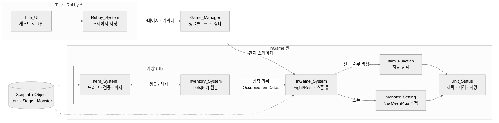

| 클래스 | 하는 일 | 하지 않는 일 |
|---|---|---|
| `Robby_System` | 스테이지 지정, 캐릭터 데이터 지정, 로비 UI 표시 (모두 깼으면 Locked 표시 후 시작 버튼을 막음) | 스테이지를 고르게 하지 않음 (진행도대로 자동) |
| `Game_Manager` | 씬 상태(Title/Robby/InGame), 스테이지·플레이어 데이터 전달 | 게임 규칙을 판정하지 않음 |
| `Inventory_System` | **칸 상태 2차원 배열의 원본**, 칸 활성화·가방 크기 계산, 리롤, 장착 기록 관리 | 드래그 입력을 받지 않음 |
| `Item_System` | 아이템 하나의 드래그·스냅·미리보기·배치 검증·점유/해제·머지 | 칸 배열을 새로 만들거나 가방 크기를 직접 정하지 않음 |
| `Slot_State` | 칸 하나의 화면 표시(색상) | 배치 가능 여부를 판단하지 않음 (배열이 원본) |
| `InGame_System` | Fight/Rest 상태, 스폰 큐, 웨이브 스케일링, 전멸 판정, 전투 슬롯 생성 | 가방 안의 배치를 알지 못함 (장착 기록만 읽음) |
| `Item_Function` | 전투 슬롯 하나의 쿨타임, 대상 탐색, 투사체·회복 발사 | 레벨을 바꾸지 않음 (기록의 레벨·쿨타임을 씀) |
| `Monster_Setting` / `Unit_Status` | 몬스터 추적·공격 / 플레이어·몬스터 공통 체력·피격·사망 | — |
| `InGame_UI` · `Robby_UI` · `Title_UI` | 화면 전환, 이징 연출, 버튼 입력 | — |

### A.2 호출 API

다른 코드가 무엇을 부르면 무엇이 나오는지 시스템별로 모았습니다.

**가방 (3장)** — 칸 상태 배열 `slots[x, y]`의 원본을 가진 `Inventory_System`이 가방을 관리합니다.

| 호출 | 결과 |
|---|---|
| `Inventory_System.InitializeInventory()` | 칸 상태 배열을 새로 만들고, 칸 활성화 · 가방 크기 계산 · 리롤까지 처음 상태로 |
| `RerollWeapon()` | 리롤 영역의 아이템을 지우고 새로 뽑기 (Rest로 돌아올 때 `InGame_System`이 호출) |
| `UpdateSlotActivation()` / `AdjustInventoryBagSize(useAllSlots)` | 배열에서 열린 칸만 보이게 하기 / 가방 크기 다시 계산 (`useAllSlots = true`면 5×7 전체 크기) |
| `ActivateAllSlotsForSlotItem()` / `RestoreSlotActivationForSlotItem()` | 슬롯 아이템을 잡으면 잠긴 칸까지 모두 펼치기 / 놓기를 취소하면 되돌리기 (`Item_System`이 호출) |
| `UpdateInventoryAfterSlotPlacement()` | 슬롯 아이템을 놓은 뒤 열린 범위를 다시 계산하고 가방 크기 조절 |
| `RepositionExistingItems()` | 가방 크기가 바뀐 뒤 장착 아이템마다 `Item_System.RepositionToSlots()`로 칸 위치에 다시 맞춤 |
| `UpdateOccupiedItemData(item)` | 머지로 레벨이 오른 아이템의 장착 기록(레벨 · 수치 · 쿨타임) 갱신 (4장) |
| `ResetInventoryToInitialState()` | 재시작 때 장착 아이템 · 장착 기록을 비우고 처음 상태로 |

**아이템 드래그 (3 · 4장)** — 아이템마다 붙은 `Item_System`이 uGUI 드래그 이벤트를 받습니다.

| 호출 | 결과 |
|---|---|
| `OnBeginDrag(eventData)` | 원래 위치 · 차지했던 칸을 복원용으로 남기고 칸을 비움. 슬롯 아이템이면 잠긴 칸까지 펼침 |
| `OnDrag(eventData)` | 가장 가까운 칸에 자석 스냅, 모양대로 초록 / 빨강 미리보기 (3.2) |
| `OnEndDrag(eventData)` | 배치 → (놓을 수 없으면) 머지 → 리롤 영역 → 원위치 순서로 판정 (4.1) |
| `RepositionToSlots()` | 지금 차지한 칸들의 가운데로 아이템 위치를 다시 맞춤 |

**전투 · 웨이브 (4 · 5장)**

| 호출 | 결과 |
|---|---|
| `InGame_System.StartWave()` | 웨이브 시작 버튼 — Rest → Fight, 장착 기록으로 전투 슬롯 생성 |
| `InGame_System.OccupiedWeaponSetting(inventory)` | 장착 기록(`OccupiedItemDatas`)마다 전투 슬롯(`Item_Function`)을 만듦 (4.2) |
| `InGame_System.InitializeSpawnDataQueue()` | 스테이지의 스폰 목록을 웨이브 · 시각 순으로 정렬해 Queue에 넣기 (시작 · 재시작 때, 5.2) |
| `Unit_Status.UnitTakeDamage(damage)` | 체력을 깎고 피격 연출, 0이면 사망 처리 (투사체 → 몬스터, 몬스터 → 플레이어 공통) |
