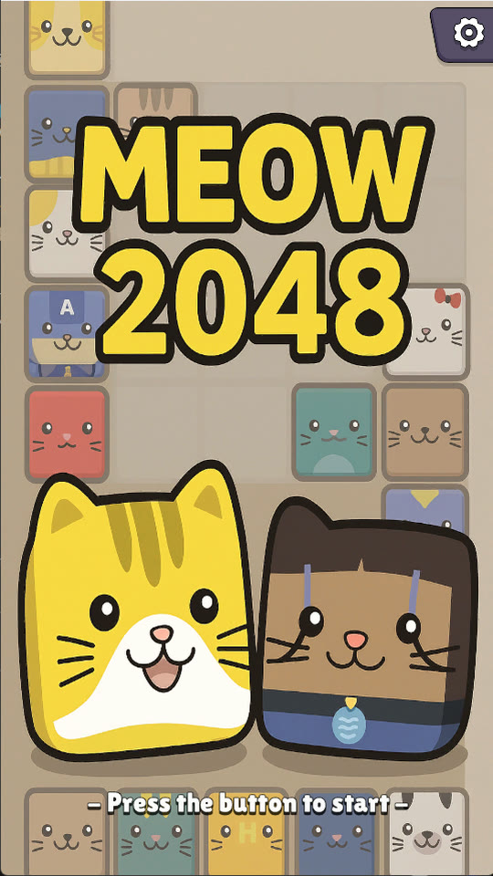
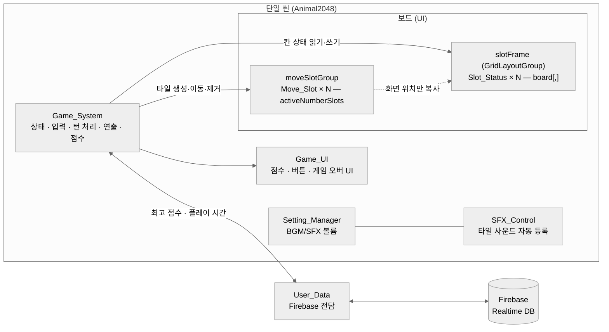
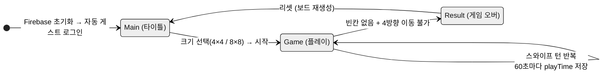
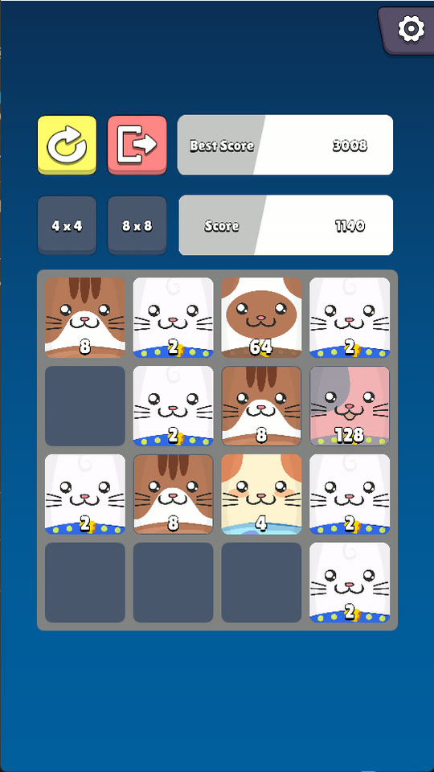
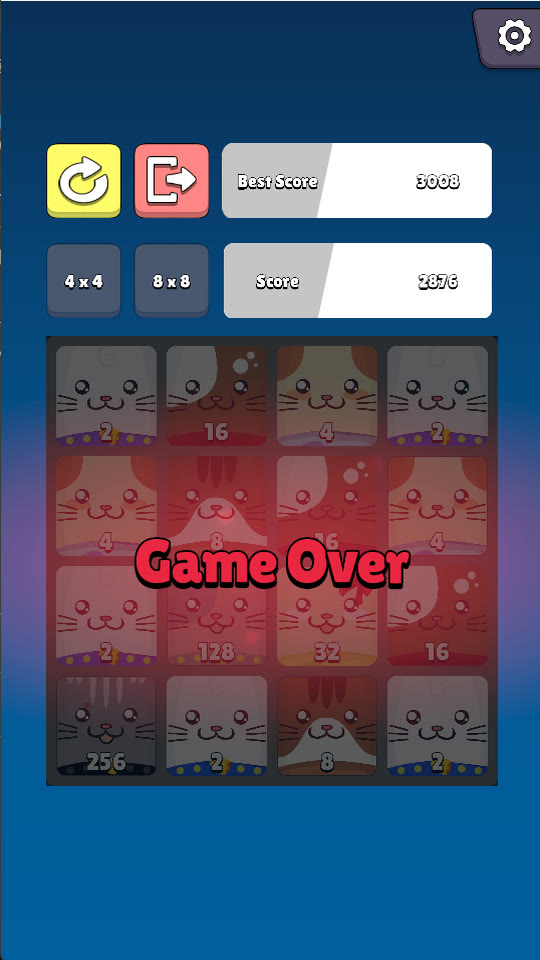
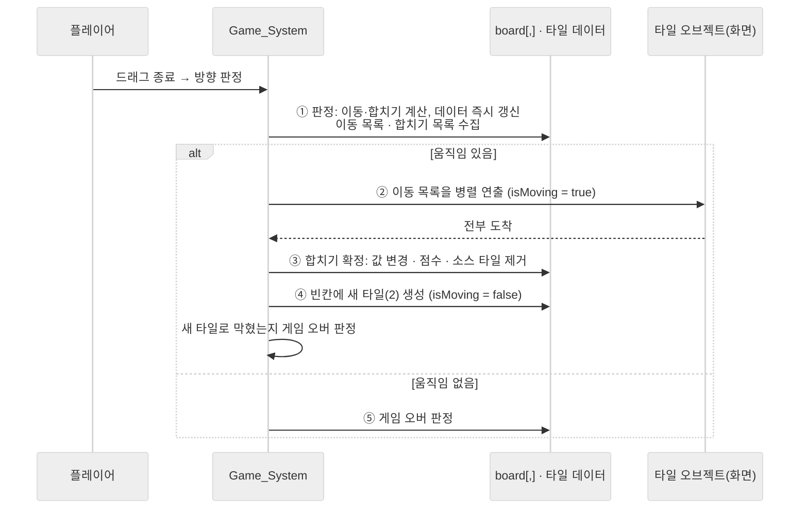
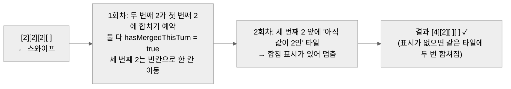
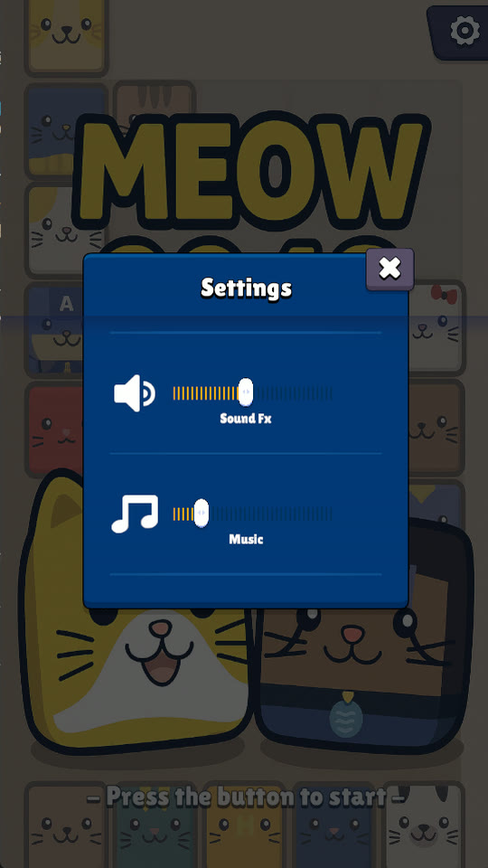
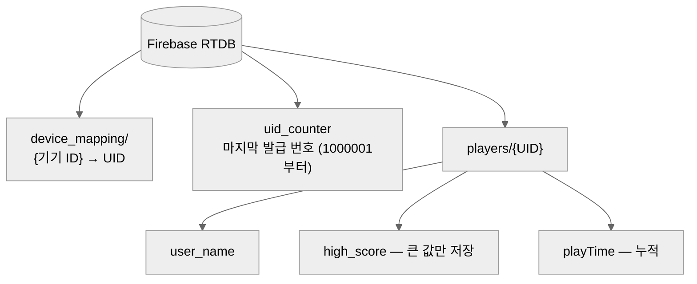
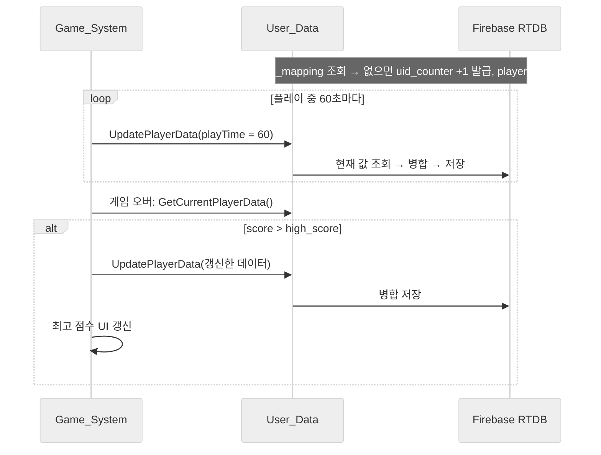

# Meow2048 기술 문서

---

## 1. 프로젝트 개요

🎬 [GIF·영상 필요] 4×4 보드에서 스와이프 몇 번 → 타일이 동시에 미끄러지고, 합쳐질 때 "톡" 튀는 연출 + 파티클 + 동물 소리까지 한 번에 보이는 5~10초 클립 (시연 영상 4×4 플레이 구간 ⟨영상 구간 확인⟩)

### 1.1 무엇을 만들었나 (What)

**「Meow2048」**은 고전 퍼즐 2048을 모바일용으로 만든 2D 캐주얼 퍼즐입니다. 숫자 대신 **동물 이미지 타일**이 합쳐지며 커지고, 4×4와 8×8 두 가지 보드를 고를 수 있습니다. 게임 오버 시 최고 점수를 Firebase에 저장합니다.



### 1.2 왜, 무엇에 집중했나 (Why)

「인벤토리 플레이어」를 만들던 기간에 **함께 만든 서브 프로젝트**입니다. 인벤토리와 같은 조건(**Firebase로 데이터를 유지하고, 모바일 기기에서 실행된다**)을 두고, 규칙이 단순한 게임으로 **"한 턴이 정확하게 돌아가는 퍼즐 루프"**를 끝까지 만드는 데 집중했습니다.

| 집중한 것 | 내용 |
|---|---|
| **턴 처리의 정확성 ★** | 스와이프 한 번에 여러 타일이 동시에 움직이고 합쳐져도, 2048 규칙(한 턴에 한 번만 합쳐짐)이 깨지지 않게 |
| **연출** | 트윈 라이브러리 없이 코루틴으로 병렬 이동과 탄성 스케일 연출을 직접 구현 |
| **기록 저장** | 서버를 만들지 않고, 기기별 게스트 계정으로 최고 점수와 플레이 시간을 클라우드에 유지 |

2048은 규칙은 단순하지만, 스와이프 한 번에 **이동·합치기·연출·새 타일 생성이 한꺼번에** 일어납니다. 이 순서가 섞이면 한 턴에 두 번 합쳐지거나, 사라질 타일이 계속 움직이는 문제가 생깁니다. 그래서 처음부터 **"보드 데이터를 먼저 끝까지 계산하고, 화면은 그 결과를 따라간다"**는 원칙으로 턴을 설계했습니다. 이 턴 처리가 이 프로젝트의 핵심입니다.

### 1.3 게임 규칙 요약

| 구분 | 규칙 |
|---|---|
| 흐름 | 타이틀(자동 게스트 로그인) → 보드 크기 선택 → 시작 → 플레이 → 게임 오버 → 리셋 |
| 보드 | 4×4 또는 8×8. 시작 버튼을 누르면 크기 버튼이 잠김 |
| 입력 | 화면을 드래그해 상하좌우 스와이프 |
| 이동 | 모든 타일이 스와이프 방향 끝까지 미끄러짐 |
| 합치기 | 같은 숫자 두 개가 부딪히면 하나로 합쳐짐. **한 턴에 한 타일은 한 번만** 합쳐짐 |
| 상한 | 2048 타일은 더 합쳐지지 않음 (준비한 동물 이미지 개수의 끝) |
| 새 타일 | 움직임이 있었던 턴마다 빈칸 하나에 **항상 2** 생성 |
| 점수 | 합쳐서 만든 숫자만큼 더함 (2+2 → +4) |
| 게임 오버 | 빈칸이 없고, 네 방향 어디로도 움직이거나 합칠 수 없음 |
| 기록 | 게임 오버 시 최고 점수 갱신, 플레이 중 60초마다 플레이 시간 누적 저장 |

### 1.4 개발 환경

| 항목 | 내용 |
|---|---|
| Engine | Unity 2022.3.62f3 (2D) |
| 플랫폼 | Android (세로 540×960, minSdk 22), PC 빌드 병행 |
| 백엔드 | Firebase Unity SDK 11.1.0 (Realtime Database) |
| 주요 패키지 | uGUI + TextMeshPro 3.0.7, UIParticleSystem(UI 에셋 팩 포함) |
| 연출 | 코루틴 + 이징 함수 직접 구현 (DOTween 미사용) |
| 기간 | 2025.09 ~ 2025.12 (약 15주, 「인벤토리 플레이어」와 같은 기간) |
| 형태 | 개인 프로젝트 |

### 1.5 링크

- 시연 영상: [YouTube](https://youtu.be/_ddYiKwi6YQ)
- 실행 파일: [Windows](https://drive.google.com/file/d/1OAPT0y5rDcTFP749rAGN4_4eXQJjMAhI/view?usp=drive_link) · [Android](https://drive.google.com/file/d/1dljWg_zfzrOo9sCURy_s_vqRm34iGEiZ/view?usp=drive_link)
- GitHub: ⟨링크 입력⟩

### 1.6 이 문서에서 다루는 내용

전체 구조(2장)를 먼저 보여 드린 뒤, 세 가지 시스템을 차례로 설명합니다. 이 프로젝트의 핵심인 **턴 처리: 이동·합치기**(3장), **연출: 병렬 이동·이징**(4장), **기록 저장: Firebase**(5장)입니다. 마지막으로 결과와 기술 부채, 배운 점(6장)을 정리합니다.

---

## 2. 전체 구조

### 2.1 아키텍처



씬은 하나이고, `Game_System`이 상태(Main / Game / Result)·입력·턴 처리·연출·점수를 모두 맡습니다. 보드는 **두 계층**으로 나뉩니다.

- **칸(프레임)**: `GridLayoutGroup` 아래에 깔린 배경 칸. 각 칸의 `Slot_Status`(Empty / Occupied)를 `board[x, y]` 배열로 들고 있습니다.
- **타일(숫자)**: 별도의 부모(`moveSlotGroup`) 아래에 있는 `Move_Slot`. 값(`slotNumber`)과 그리드 좌표(`gridX`, `gridY`)를 들고, 화면 위치는 해당 칸의 위치를 복사해 씁니다.

### 2.2 상태 흐름



상태마다 BGM이 바뀝니다(타이틀 / 인게임 / 게임 오버 3종, `Game_System.Update`).





📷 [이미지 필요] 8×8 플레이 화면 (노션 이미지에 없음)

### 2.3 클래스 역할

| 클래스 | 하는 일 | 하지 않는 일 |
|---|---|---|
| `Game_System` | 상태 전환, 스와이프 판정, 이동·합치기 판정, 연출 코루틴, 점수, 게임 오버 판정, 60초 저장 호출 | Firebase에 직접 접근하지 않음 (`User_Data` 호출) |
| `Slot_Status` | 칸 하나의 상태(Empty / Occupied). `board[,]`의 원소 | 숫자를 모름 |
| `Move_Slot` | 타일 하나의 값·그리드 좌표·이번 턴 합침 여부, 값에 맞는 이미지, 파티클·사운드 재생 | 자기가 어디로 갈지 판단하지 않음 |
| `User_Data` | Firebase 초기화, 기기 ID로 플레이어 조회, UID 발급, 필드 병합 저장 | 게임 규칙을 모름 |
| `Game_UI` | 점수 텍스트, 시작·크기 버튼, 게임 오버·설정 UI 참조 | 상태를 바꾸지 않음 |
| `Setting_Manager` / `SFX_Control` | BGM·SFX 볼륨 슬라이더 / 생성되는 타일 사운드를 매니저에 자동 등록·해제 | — |

> **설계 규칙: 판정은 데이터만 읽는다.** 이동·합치기·게임 오버 판정은 `board[,]`와 타일의 그리드 좌표·값만 봅니다. 타일의 화면 위치(`transform.position`)는 연출의 결과일 뿐 판정에 쓰지 않습니다.

### 2.4 고민과 선택: 타일을 칸 안에 넣을 것인가, 따로 둘 것인가

> **결정 대상**: 숫자 타일을 GridLayout 칸의 자식으로 넣을 것인가, 별도 레이어에 둘 것인가?

| | **[A] 타일을 칸의 자식으로** | **[B] 칸(프레임)과 타일 레이어 분리** ✓ |
|---|---|---|
| 방식 | 이동할 때마다 타일의 부모를 목표 칸으로 바꿈 | 칸은 GridLayout이 배치, 타일은 다른 부모 아래에서 칸 위치를 복사 |
| 장점 | 위치 계산이 필요 없음 | 타일을 자유롭게 움직일 수 있음(미끄러지는 연출). 칸 상태와 타일 값이 분리됨 |
| 단점 | 부모가 바뀌는 순간 위치가 순간이동해 이동 연출이 어려움 | 칸 상태와 타일 좌표를 **둘 다** 맞춰 줘야 함 |

**[최종 결정]** [B]를 선택했습니다. 2048의 재미는 타일이 **미끄러지는 모습**에 있는데, GridLayout은 자식의 위치를 직접 정하기 때문에 그 안에서는 자유로운 이동 연출을 만들기 어렵습니다. ⟨확인 필요: 당시 이 이유로 나눈 것이 맞는지⟩

```csharp
// Game_System.cs:201 InitializeSlots — 칸은 GridLayout이 배치
board = new Slot_Status[slotWidth, slotHeight];
// ...
slot.transform.SetParent(slotFrame.transform, false);   // GridLayout 아래
board[x, y] = slot.GetComponent<Slot_Status>();

// Game_System.cs:289 createNumber — 타일은 다른 부모 아래에서 칸 위치만 복사
number.transform.SetParent(moveSlotGroup.transform, false);
number.transform.position = targetTransform.position;
targetStatus.slotInfo = Slot_Status.slot_info.Occupied;
```

**[감수한 대가]** 타일이 움직일 때마다 **원래 칸은 Empty, 새 칸은 Occupied**로 직접 바꿔야 합니다. 이 일을 `MoveSlotToImmediate` 한 곳에서만 하도록 모았습니다(3.3).

### 2.5 보드 크기: 4×4 / 8×8

크기 버튼을 누르면 보드를 지우고 다시 만듭니다. 두 크기의 값은 고정값으로 나눴습니다.

| 값 | 4×4 | 8×8 | 위치 |
|---|---|---|---|
| 칸 크기 (cellSize) | 200 | 100 | `Game_System.cs:232-243` |
| 칸 간격 (spacing) | 20 | 10 | 〃 |
| 타일 크기 | 200 | 100 | `createNumber` |
| 글자 크기 | 50 | 25 | `createNumber` |

지원하는 크기가 두 개뿐이라 **비율 계산 대신 크기별 값을 직접 정해** 각각 보기 좋게 맞췄습니다. 크기를 하나 더 추가하면 분기가 늘어나는 점은 기술 부채로 남겼습니다(6.3).

---

## 3. 시스템 ① 턴 처리: 이동·합치기 ★

### 3.1 개요

스와이프 한 번이 한 턴입니다. 한 턴은 아래 순서로 진행되고, **판정(1)은 그 자리에서 끝까지 계산하고, 연출(2~3)은 그 결과를 따라갑니다.**



### 3.2 핵심 기능 ①: 스와이프 입력

드래그를 스와이프로 바꾸는 규칙은 세 가지입니다.

| 값 | 수치 | 이유 |
|---|---|---|
| 최소 드래그 거리 | 50px | 탭이나 손떨림을 스와이프로 오인하지 않게 |
| 방향 결정 | `|Δx| > |Δy|`면 좌우, 아니면 상하 | 대각선 입력도 더 많이 움직인 축으로 확정 |
| 입력 쿨다운 | 0.15초 | 한 번의 손동작이 연속 입력으로 들어가지 않게 |
| 연출 중 입력 | 무시 (`isMoving`) | 다음 턴이 이전 턴 연출 도중에 시작되지 않게 (6.1 트러블슈팅) |

```csharp
// Game_System.cs:382 HandleMouseDragInput (발췌)
if (isMoving) return;                                    // 연출 중이면 입력 무시
// ...
if (Input.GetMouseButtonUp(0) && isDragging)
{
    if (Time.time < nextInputAllowedTime) { isDragging = false; return; } // 쿨다운
    Vector2 delta = (Vector2)Input.mousePosition - dragStartPos;
    isDragging = false;
    if (delta.magnitude < dragThreshold) return;         // 50px 미만은 무시

    SwipeDirection dir = Mathf.Abs(delta.x) > Mathf.Abs(delta.y)
        ? (delta.x > 0 ? SwipeDirection.Right : SwipeDirection.Left)
        : (delta.y > 0 ? SwipeDirection.Up : SwipeDirection.Down);

    StartCoroutine(OnSwipeCoroutine(dir));
    nextInputAllowedTime = Time.time + inputCooldown;
}
```

마우스 입력(`GetMouseButton`)으로 만들었고, 모바일에서는 Unity가 터치를 마우스 입력으로 함께 전달하므로 같은 코드로 동작합니다.

### 3.3 핵심 기능 ②: 이동 판정 — 한 칸씩 밀기를 반복

스와이프 방향에 따라 줄(행 또는 열)마다 타일을 **앞쪽부터** 정렬하고, 각 타일을 **한 칸만** 앞으로 밀어 봅니다. 한 바퀴 돌았을 때 하나라도 움직였으면 다시 처음부터 반복하고, 아무것도 안 움직이면 끝냅니다.

```csharp
// Game_System.cs:724 ProcessMoveWithAnimation (발췌)
foreach (Move_Slot slot in activeNumberSlots)
    slot.hasMergedThisTurn = false;                 // 턴 시작: 합침 기록 초기화

while (movedThisRound)                              // 더 이상 못 움직일 때까지 반복
{
    movedThisRound = false;
    switch (direction)
    {
        case SwipeDirection.Left:
            for (int y = 0; y < slotHeight; y++)    // 줄마다 앞쪽(왼쪽)부터 정렬해 한 칸씩
                if (ProcessRowStepWithAnimation(y, 0, 1, direction, movesToAnimate, mergesToProcess))
                    movedThisRound = true;
            break;
        // ... Up / Down / Right 동일
    }
    if (movedThisRound) anyMoved = true;
}
```

한 칸 앞을 보고 내리는 판단은 세 가지입니다.

| 앞 칸 | 처리 |
|---|---|
| 비어 있음 | 이동 목록에 추가(같은 타일이면 최종 목적지로 덮어씀), **보드 데이터 즉시 갱신** |
| 같은 숫자 + 둘 다 이번 턴에 안 합쳐짐 + 2048 미만 | 합치기 목록에 추가, **두 타일 모두 합침 표시**, 소스 타일을 앞 칸으로 이동 처리 |
| 다른 숫자 · 벽 | 멈춤 |

```csharp
// Game_System.cs:837 ProcessSlotsLineStepWithAnimation (발췌)
Move_Slot targetSlot = GetSlotAt(targetX, targetY);

if (targetSlot == null)                                    // 빈칸 → 이동
{
    int existingIndex = movesToAnimate.FindIndex(m => m.slot == currentSlot);
    if (existingIndex >= 0) movesToAnimate[existingIndex] = moveInfo; // 최종 위치로 갱신
    else movesToAnimate.Add(moveInfo);

    MoveSlotToImmediate(currentSlot, targetX, targetY);   // 데이터만 즉시 이동
    moved = true;
}
else if (targetSlot.slotNumber == currentSlot.slotNumber
         && !targetSlot.hasMergedThisTurn && !currentSlot.hasMergedThisTurn
         && currentSlot.slotNumber < 2048)                 // 같은 숫자 → 합치기 예약
{
    mergesToProcess.Add(new SlotMergeInfo {
        targetSlot = targetSlot, sourceSlot = currentSlot,
        mergedValue = targetSlot.slotNumber + currentSlot.slotNumber });

    targetSlot.hasMergedThisTurn = true;                   // 이번 턴에 더는 합쳐지지 않음
    currentSlot.hasMergedThisTurn = true;

    movesToAnimate.Add(/* 소스 → 타깃 칸 */);
    MoveSlotToImmediate(currentSlot, targetX, targetY);
    moved = true;
}
```

`MoveSlotToImmediate`는 **원래 칸 Empty → 좌표 변경 → 새 칸 Occupied** 세 가지만 하고, 화면 위치는 건드리지 않습니다(`Game_System.cs:974`). 화면 이동은 4장의 연출이 맡습니다.

### 3.4 핵심 기능 ③: 한 턴에 한 번만 합치기

합치기는 **예약만 하고 값은 바꾸지 않습니다.** 값은 연출이 끝난 뒤 `ProcessMerges`에서 바뀝니다. 그래서 판정 도중에는 합쳐질 타일의 값이 아직 2로 남아 있고, 이때 `hasMergedThisTurn`이 없으면 세 번째 타일이 같은 타일에 또 합쳐집니다.



```csharp
// Game_System.cs:681 ProcessMerges — 이동 연출이 끝난 뒤 실행 (발췌)
foreach (var mergeInfo in merges)
{
    if (mergeInfo.targetSlot == null || mergeInfo.sourceSlot == null) continue;

    mergeInfo.targetSlot.slotNumber = mergeInfo.mergedValue;  // 이제 값 변경 (2+2 → 4)
    mergeInfo.targetSlot.text.text = mergeInfo.mergedValue.ToString();
    mergeInfo.targetSlot.UpdateImage();                       // 값에 맞는 동물 이미지

    score += mergeInfo.mergedValue;                           // 점수 = 합쳐진 값
    gameUI.currentScoreText.text = score.ToString();

    StartCoroutine(AnimateSlotScale(mergeInfo.targetSlot.gameObject)); // 탄성 연출 + 파티클
    activeNumberSlots.Remove(mergeInfo.sourceSlot);
    Destroy(mergeInfo.sourceSlot.gameObject);                 // 소스 타일 제거
}
```

🎬 [GIF·영상 필요] 한 줄에 같은 숫자 세 개(예: 2·2·2)를 만든 뒤 스와이프 → 두 개만 합쳐지고 하나는 남는 장면

### 3.5 핵심 기능 ④: 게임 오버 판정

게임 오버는 **두 조건이 모두** 참일 때입니다. ① 빈칸이 없다. ② 네 방향 모두 움직이거나 합칠 수 없다.

```csharp
// Game_System.cs:1123 CheckGameOver (발췌)
if (HasEmptySlot()) return;                                  // 조건 ①

bool canMoveUp    = CanMoveInDirection(SwipeDirection.Up);   // 조건 ②
bool canMoveDown  = CanMoveInDirection(SwipeDirection.Down);
bool canMoveLeft  = CanMoveInDirection(SwipeDirection.Left);
bool canMoveRight = CanMoveInDirection(SwipeDirection.Right);

if (!canMoveUp && !canMoveDown && !canMoveLeft && !canMoveRight)
{
    gameState = Game_State.Result;
    gameUI.gameOverUI.SetActive(true);
    // ... 최고 점수 저장 (5.3)
}
```

`CanMoveInDirection`은 타일을 실제로 움직이지 않고 **경로만 훑어** 빈칸이나 합칠 수 있는 같은 숫자가 있는지 봅니다(`Game_System.cs:1025`). 보드를 바꾸지 않는 질문용 함수로 따로 둔 덕분에, 판정하다가 보드가 바뀌는 일이 없습니다.

이 판정은 두 곳에서 실행됩니다. ① 새 타일을 만든 직후, ② 스와이프했는데 아무것도 움직이지 않았을 때입니다. 처음에는 ②에서만 실행해서, 마지막 빈칸이 새 타일로 채워져 막힌 뒤에도 한 번 더 스와이프해야 게임 오버 화면이 나왔습니다. 문서를 쓰며 발견해 ①을 추가했습니다(6.3).

🎬 [GIF·영상 필요] 보드가 꽉 찬 상태에서 스와이프 → 게임 오버 UI가 뜨고 최고 점수가 갱신되는 장면 (시연 영상 게임 오버 구간 ⟨영상 구간 확인⟩)

### 3.6 고민과 선택: 보드 데이터를 언제 바꿀 것인가

> **결정 대상**: 타일 위치 데이터를 애니메이션이 끝난 뒤에 바꿀 것인가, 판정할 때 바로 바꿀 것인가?

| | **[A] 애니메이션이 끝난 뒤 갱신** | **[B] 판정 때 즉시 갱신, 화면은 뒤따라감** ✓ |
|---|---|---|
| 방식 | 타일이 도착하면 그때 칸 상태와 좌표를 바꿈 | 판정에서 데이터를 최종 상태까지 계산, 이동·합치기 목록만 넘겨 연출 |
| 장점 | 화면 순서와 코드 순서가 같아 이해하기 쉬움 | 판정이 연출 시간·프레임과 무관. 연출 도중에도 데이터는 항상 최종 상태 |
| 단점 | 연출 도중 데이터가 중간 상태라, 다른 판정이 끼어들면 틀린 값을 읽음 | 이동 목록·합치기 목록을 따로 모으는 구조가 필요 |

**[최종 결정]** 처음부터 [B]로 설계했습니다. 스와이프 한 번에 타일 수십 개(8×8은 최대 64개)가 동시에 움직이는데, 각 타일이 언제 도착하느냐에 판정이 기대면 규칙이 화면 속도에 따라 달라지기 때문입니다. **"데이터가 먼저 맞고, 화면은 따라간다"**를 원칙으로 두었습니다.

**[감수한 대가]** 판정이 끝난 시점에는 합쳐질 두 타일이 같은 좌표에 겹쳐 있고 값도 아직 안 바뀐 상태입니다. 이 중간 상태 때문에 `hasMergedThisTurn` 표시(3.4)와, 사라질 타일을 이동 목록에서 빼는 처리(4.2)가 따로 필요했습니다.

### 3.7 고민과 선택: 한 줄을 한 번에 계산할 것인가, 한 칸씩 밀 것인가

> **결정 대상**: 줄 하나의 최종 결과를 한 번에 계산할 것인가, 한 칸씩 밀기를 반복할 것인가?

| | **[A] 줄 단위 일괄 계산** | **[B] 한 칸씩 밀기 반복** ✓ |
|---|---|---|
| 방식 | 줄에서 빈칸을 빼고 붙인 뒤, 앞에서부터 짝을 지어 합침 | 앞쪽 타일부터 한 칸씩 밀고, 움직임이 없을 때까지 반복 |
| 장점 | 계산 횟수가 적음 | "앞이 비면 간다, 같으면 합친다, 아니면 멈춘다"라는 규칙이 코드에 그대로 드러남 |
| 단점 | 합침 순서·한 턴 1회 제한 같은 예외를 계산식 안에서 따로 처리해야 함 | 같은 줄을 여러 번 훑음 |

**[최종 결정]** [B]를 선택했습니다. 2048 규칙을 **그대로 옮기는 것**이 목표였고, 무엇보다 여러 타일이 연속으로 와다다 밀릴 때 **순서가 섞이지 않게** 하고 싶었습니다. 앞쪽 타일부터 처리하므로 뒤 타일은 항상 앞 타일이 자리를 잡은 뒤에 움직입니다.

**[감수한 대가]** 반복 비용은 보드가 최대 8×8이라 문제가 되지 않았습니다. 대신 칸 조회(`GetSlotAt`)가 매번 타일 목록 전체를 훑는 방식이라, 반복 횟수만큼 비용이 곱해집니다(6.3). 연출은 각 타일의 **최종 목적지**로 한 번만 재생하므로, 한 칸씩 반복하는 과정은 화면에 보이지 않습니다.

### 3.8 고민과 선택: 새 타일과 상한

| 결정 | 선택 | 이유 |
|---|---|---|
| 새 타일 값 | **항상 2** (원작은 2 또는 4). 2/4 랜덤 코드는 주석으로 남아 있음 (`Game_System.cs:353-354`) | 난이도 조절. 4가 섞이면 보드가 빨리 차서 캐주얼하게 즐기기 어렵다고 판단 |
| 합치기 상한 | **2048 이상은 합치지 않음** (판정 `< 2048` 조건 3곳) | 준비한 동물 이미지가 2048까지라서. 이미지 인덱스는 `log2(값) − 1`로 계산 (`Move_Slot.cs:57`) |

---

## 4. 시스템 ② 연출: 병렬 이동·이징

### 4.1 개요

트윈 라이브러리(DOTween 등) 없이 **코루틴만으로** 세 가지 연출을 만들었습니다.

| 연출 | 방식 | 시간 |
|---|---|---|
| 타일 이동 | 모든 타일을 동시에 선형 이동(`Lerp`), 전부 도착할 때까지 대기 | 0.15초 (모든 타일 동일) |
| 생성 · 합치기 | 스케일을 0(생성) 또는 1.2배(합치기)에서 원래 크기로, **EaseOutElastic** | 0.6초 |
| 피드백 | 생성·합치기 순간 파티클 + 동물 소리 재생 | — |

이동은 빠르게, 생성·합치기는 크게 튀게 나눴습니다. 이동은 다음 입력까지의 대기 시간이라 짧고 정직해야 하고, 합치기는 보상이라 과장해도 된다고 봤습니다.

### 4.2 핵심 기능 ①: 병렬 이동과 완료 대기

```csharp
// Game_System.cs:520 AnimateSlots — 모든 타일을 동시에 출발시키고 전부 도착할 때까지 대기
int completedCount = 0;
int totalCount = 0;                          // 실제로 시작한 코루틴 수만 센다

foreach (var moveInfo in moves)
{
    if (moveInfo.slot != null)
    {
        totalCount++;
        StartCoroutine(AnimateSingleSlot(moveInfo, () => { completedCount++; }));
    }
}

while (completedCount < totalCount)
    yield return null;                       // '이동이 끝났다'는 시점을 명확하게
```

```csharp
// Game_System.cs:550 AnimateSingleSlot (발췌)
float duration = moveDuration;               // 모든 타일이 같은 시간(0.15초)에 도착

while (elapsed < duration)
{
    if (moveInfo.slot == null || moveInfo.slot.transform == null)
    {
        onComplete?.Invoke();                // 파괴된 타일이어도 완료는 알림
        yield break;
    }
    elapsed += Time.deltaTime;
    moveInfo.slot.transform.position = Vector3.Lerp(startPos, endPos, Mathf.Clamp01(elapsed / duration));
    yield return null;
}
onComplete?.Invoke();
```

턴 코루틴(`OnSwipeCoroutine`)은 이 대기가 끝난 뒤에 합치기를 확정하고 새 타일을 만듭니다. 그래서 화면에서는 항상 **"다 움직인 다음 합쳐지고, 그다음 새 타일이 나온다"**는 순서가 지켜집니다.

이동 시간은 모든 타일이 같은 `moveDuration`(씬 설정값 0.15초)입니다. 멀리 가는 타일은 빠르게, 가까운 타일은 느리게 움직여 **모두 동시에 도착**합니다. 원래는 `거리 / moveSpeed`와 상한 중 작은 값을 쓰는 코드였습니다. 그런데 Canvas가 Screen Space Overlay라 거리가 픽셀 단위여서 계산값이 항상 상한보다 컸고, 속도 설정은 실제로 쓰이지 않고 있었습니다. 문서를 쓰며 발견해, 실제 동작(고정 시간)에 맞게 코드를 정리했습니다(6.3).

🎬 [GIF·영상 필요] 8×8 보드에서 많은 타일이 동시에 미끄러졌다가 한꺼번에 합쳐지는 장면 (시연 영상 8×8 구간 ⟨영상 구간 확인⟩)

### 4.3 핵심 기능 ②: EaseOutElastic 직접 구현

```csharp
// Game_System.cs:593 EaseOutElastic
private float EaseOutElastic(float t)
{
    const float c4 = (2f * Mathf.PI) / 3f;   // 진동 주기

    if (t == 0f) return 0f;
    else if (t == 1f) return 1f;
    // 지수 감쇠 × 사인 진동 → 목표를 살짝 넘었다가 출렁이며 멈춤
    return Mathf.Pow(2f, -10f * t) * Mathf.Sin((t * 10f - 0.75f) * c4) + 1f;
}
```

```csharp
// Game_System.cs:614 AnimateSlotScale (발췌)
if (isNewSlot) { startScale = Vector3.zero; slotTransform.localScale = Vector3.zero; yield return null; }
else           { startScale = originalScale * 1.2f; slotTransform.localScale = startScale; }

slotObject.GetComponent<Move_Slot>()?.PlayParticle();      // 시작 순간 파티클 + 동물 소리

while (elapsed < duration)                                  // 0.6초
{
    if (slotObject == null) yield break;
    elapsed += Time.deltaTime;
    float easedT = EaseOutElastic(Mathf.Clamp01(elapsed / duration));
    slotTransform.localScale = Vector3.Lerp(startScale, originalScale, easedT);
    yield return null;
}
```

새 타일은 0에서 "톡" 튀어나오고, 합쳐진 타일은 1.2배에서 출렁이며 원래 크기로 돌아옵니다.

📷 [이미지 필요] EaseOutElastic 곡선 그래프 (t: 0→1, 값이 1을 넘었다가 돌아오는 모양). easings.net 같은 곳의 그림 대신 직접 그린 그래프 권장

### 4.4 핵심 기능 ③: 사운드·볼륨

- **BGM**: 상태별 3종(타이틀 / 인게임 / 게임 오버)을 `Game_System.Update`에서 상태에 맞게 전환합니다.
- **SFX 자동 등록**: 타일은 계속 생성·파괴되므로 볼륨 매니저에 미리 등록해 둘 수 없습니다. 그래서 타일의 `SFX_Control`이 **활성화될 때 스스로 `Setting_Manager`에 등록**하고, 비활성화될 때 해제합니다. 새로 생긴 타일도 현재 SFX 볼륨을 바로 따릅니다.

```csharp
// SFX_Control.cs — 생성되는 타일이 스스로 볼륨 매니저에 등록
void OnEnable()
{
    AudioSource audioSource = GetComponent<AudioSource>();
    audioSource.volume = Setting_Manager.Instance.SFXslider.value;  // 현재 볼륨 즉시 적용
    Setting_Manager.Instance.RegisterSFX(gameObject);
}
void OnDisable() => Setting_Manager.Instance.UnregisterSFX(gameObject);
```



📷 [이미지 필요] Setting_Manager 인스펙터의 BGM 리스트 (노션 '옵션'에는 코드 캡처만 있음)

### 4.5 고민과 선택: 트윈 라이브러리를 쓸 것인가

> **결정 대상**: DOTween 같은 트윈 라이브러리를 쓸 것인가, 코루틴으로 직접 만들 것인가?

| | **[A] 트윈 라이브러리** | **[B] 코루틴 + 이징 직접 구현** ✓ |
|---|---|---|
| 장점 | 이징·시퀀스·완료 콜백이 준비되어 있음. 코드가 짧음 | 외부 의존 없음. 이징이 어떻게 계산되는지 직접 이해 |
| 단점 | 당시 사용해 본 적이 없어 학습 비용이 듦 | 완료 대기, 파괴된 오브젝트 처리를 모두 직접 해야 함 |

**[최종 결정]** [B]를 선택했습니다. 당시 DOTween을 다뤄 보지 않았고, 이 게임에 필요한 연출은 **이동과 스케일 두 종류**뿐이었습니다. 라이브러리를 익히기보다 필요한 함수 몇 개를 직접 만들면서 원리를 이해하는 쪽이 이 프로젝트의 목적(학습)에 맞다고 판단했습니다.

**[감수한 대가]** 파괴된 타일을 코루틴이 계속 건드리는 문제(6.1)처럼, 라이브러리가 대신 처리해 주는 일을 직접 처리해야 했습니다. 연출 종류가 늘어나는 프로젝트라면 라이브러리를 먼저 검토하겠습니다.

---

## 5. 시스템 ③ 기록 저장: Firebase

### 5.1 개요

「인벤토리 플레이어」와 같은 구조를 썼습니다. 서버를 따로 만들지 않고, **기기 ID로 플레이어를 찾고, 처음 온 기기에는 순번 UID를 발급**합니다. 앱이 시작되면 Firebase 초기화 → 자동 게스트 로그인 → 최고 점수 표시까지 진행됩니다.





### 5.2 핵심 기능 ①: 필드별 병합 저장

저장할 때 넘긴 객체로 서버 데이터를 통째로 덮어쓰지 않고, **서버의 현재 값을 읽은 뒤 필드마다 정해진 규칙으로 합쳐서** 저장합니다.

```csharp
// User_Data.cs:371 UpdatePlayerData (발췌)
PlayerData currentData = await GetCurrentPlayerData();      // 1. 서버의 현재 값
if (currentData == null) return;

if (!string.IsNullOrEmpty(newData.user_name))               // 2. 필드별 규칙
    currentData.user_name = newData.user_name;              //    이름: 값이 있을 때만
if (newData.high_score > currentData.high_score)
    currentData.high_score = newData.high_score;            //    최고 점수: 더 클 때만
if (newData.playTime > 0)
    currentData.playTime += newData.playTime;               //    플레이 시간: 누적

string json = JsonUtility.ToJson(currentData);              // 3. 합친 결과 저장
await dbref.Child("players").Child(playerUID).SetRawJsonValueAsync(json);
```

호출하는 쪽은 **바꾸고 싶은 필드만** 담아 넘깁니다. 60초 저장은 `new PlayerData { playTime = 60f }`만 넘기므로 `high_score`가 0이어도 최고 점수가 지워지지 않습니다.

### 5.3 핵심 기능 ②: 최고 점수와 플레이 시간

| 값 | 저장 시점 | 규칙 | 위치 |
|---|---|---|---|
| 최고 점수 | 게임 오버 때, 현재 점수가 서버 값보다 클 때만 | 큰 값만 | `Game_System.cs:1144-1161` |
| 플레이 시간 | 플레이(Game 상태) 중 60초마다 | 60초씩 누적 | `Game_System.cs:75-83` |

플레이 시간을 60초마다 보내는 이유는, 간단한 게임이라 **기록을 자주 보낼 필요가 없다**고 봤기 때문입니다. 앱이 비정상 종료되면 마지막 1분 이내의 시간만 잃습니다.

📷 [이미지 필요] Firebase 콘솔의 `players/{UID}` 데이터 화면 (high_score · playTime이 보이게)

### 5.4 고민과 선택: 기록을 어디에, 어떻게 저장할 것인가

> **결정 대상 ①**: 최고 점수를 기기 안(PlayerPrefs)에 둘 것인가, 클라우드(Firebase)에 둘 것인가?

**[최종 결정]** Firebase Realtime Database를 선택했습니다. 이유는 「인벤토리 플레이어」와 같습니다. **"Firebase로 데이터를 유지하고, 모바일 기기에서 실행된다"**를 개발 조건으로 정했고, 이 프로젝트도 모바일 빌드를 목표로 만들었습니다. 같은 저장 구조(`User_Data`)를 두 프로젝트에서 그대로 썼습니다.

> **결정 대상 ②**: 저장할 때 데이터를 통째로 덮어쓸 것인가, 필드별로 합칠 것인가?

| | **[A] 통째로 덮어쓰기** | **[B] 필드별 병합** ✓ |
|---|---|---|
| 장점 | 구현이 단순 | 일부 필드만 저장해도 나머지가 안전. 규칙이 저장 계층 한 곳에 모임 |
| 단점 | 플레이 시간만 저장하려다 최고 점수를 0으로 덮어쓸 수 있음 | 저장 전에 항상 한 번 읽어야 함 |

**[최종 결정]** [B]를 선택했습니다. 60초마다 **플레이 시간만** 저장하는 일이 계속 일어나는데, 덮어쓰기라면 그때마다 최고 점수가 지워질 위험이 있습니다.

**[감수한 대가]** 저장할 때마다 읽기가 한 번 더 들어갑니다. 그리고 **"바꿀 필드만 넘긴다"는 약속을 호출하는 쪽이 지켜야** 합니다. 실제로 게임 오버 때 최고 점수를 저장하는 코드가 이 약속을 어기고 서버에서 받은 전체 데이터를 넘기고 있어, 플레이 시간이 두 배가 되는 버그가 있었습니다. 문서를 쓰며 발견해 고쳤습니다(6.3).

---

## 6. 결과 · 회고

### 6.1 문제 해결 (Troubleshooting)

| 증상 | 원인 | 해결 | 결과 |
|---|---|---|---|
| 연출 도중 다음 스와이프가 들어와 두 턴이 섞임 | 이동 코루틴이 끝나기 전에 새 턴 코루틴이 시작됨 | 연출 중 입력 무시(`isMoving`) + 입력 쿨다운 0.15초 | 한 턴이 끝나야 다음 턴 시작 |
| 한 턴에 같은 타일이 연속으로 합쳐짐 | 합치기 값이 연출 뒤에 바뀌어, 판정 중에는 이미 합쳐질 타일을 다른 타일이 같은 숫자로 봄 (3.4) | `hasMergedThisTurn`을 판정 단계에서 두 타일 모두에 표시 | 한 턴에 한 번만 합쳐짐 ⟨확인 필요: 당시 실제 증상(예: 2·2·2 → 6, 2·2·4 → 8)⟩ |
| 합쳐져 사라진 타일을 코루틴이 계속 움직임 (`MissingReferenceException` 위험) | 소스 타일은 이동이 끝나자마자 `Destroy`되는데, 이동·스케일 코루틴은 따로 돌고 있음 | 코루틴이 매 프레임 `null` 확인 후 종료, 완료 콜백은 반드시 호출. 합치기 전에 소스 타일을 이동 목록에서 제거 | 예외 없이 턴 종료 |
| Android 빌드에서 Firebase 연동 실패 | 「인벤토리 플레이어」와 같은 원인. `google-services.json`이 Gradle 실행 전에 빌드 폴더에 복사되지 않음 | 빌드 직전에 실행되는 에디터 스크립트로 설정 파일을 미리 복사 + `launcherTemplate.gradle`에 google-services 플러그인 적용 | 기기에서 로그인·저장 동작 |
| 합치기 때 파티클이 재생되지 않음 | **원인을 찾지 못함** | ⟨확인 필요: 해결했는지, 해결했다면 무엇을 바꿨는지⟩ | ⟨확인 필요⟩ |

**자세히: 파괴된 타일과 코루틴**

합치기에서 소스 타일은 "타깃 칸까지 이동 → 사라짐" 순서를 거칩니다. 그런데 이동 연출과 파괴가 서로 다른 흐름에서 일어나기 때문에, 코루틴이 이미 사라진 타일의 `transform`을 건드릴 수 있었습니다.

```csharp
// Game_System.cs:472-488 OnSwipeCoroutine (발췌)
yield return StartCoroutine(AnimateSlots(movesToAnimate));     // 1. 모든 이동 끝까지 대기

foreach (var mergeInfo in mergesToProcess)                      // 2. 사라질 타일은 이동 목록에서 제거
    movesToAnimate.RemoveAll(m => m.slot == mergeInfo.sourceSlot);

ProcessMerges(mergesToProcess);                                 // 3. 그다음 파괴
```

여기에 더해 이동·스케일 코루틴 모두 매 프레임 대상이 살아 있는지 확인하고, 이동 코루틴은 중간에 끝나더라도 **완료 콜백을 반드시 호출**합니다. 콜백을 빠뜨리면 `AnimateSlots`의 완료 카운트가 모자라 턴이 영영 끝나지 않기 때문입니다.

**배운 점** — 코루틴은 자기가 다루는 오브젝트보다 오래 살 수 있습니다. 수명이 다른 비동기 작업에는 매 프레임 유효성 검사와 "끝났다는 신호"를 확실히 보내는 처리가 필요합니다.

**자세히: Android 빌드의 Firebase 연동** — 「인벤토리 플레이어」 기술 문서 3.5와 같은 문제이고 같은 방법(`Editor/CopyGoogleServicesJson.cs`, `Plugins/Android/launcherTemplate.gradle`)으로 해결했습니다. 이 문서에서는 반복하지 않습니다.

### 6.2 결과

측정 도구로 수치(fps, 메모리)를 남기지는 못해, 결과는 기능 단위로 정리합니다.

| 집중한 것 | 결과 |
|---|---|
| **턴 처리의 정확성** | 스와이프 → 판정 → 병렬 이동 → 합치기 → 새 타일 순서가 매 턴 지켜지고, 한 턴에 한 번만 합쳐지는 규칙이 4×4·8×8 모두에서 동작합니다. |
| **연출** | 트윈 라이브러리 없이 병렬 이동, 탄성 스케일, 파티클·동물 소리 피드백을 만들었습니다. |
| **기록 저장** | 앱을 켜면 기기별 계정으로 자동 로그인되고, 최고 점수와 누적 플레이 시간이 클라우드에 남습니다. Android 기기에서 동작합니다. |

### 6.3 아쉬운 점과 개선 계획

**문서를 쓰며 발견해 수정한 것**

| 문제 | 증상 | 원인 | 수정 |
|---|---|---|---|
| **최고 점수를 갱신하면 플레이 시간이 두 배가 됨** | 기록을 깰 때마다 서버의 누적 플레이 시간이 두 배로 늘어남 | 게임 오버 때 서버에서 받은 **전체 데이터**(`playTime` 포함)를 그대로 `UpdatePlayerData`에 넘김. 병합 규칙이 그 `playTime`을 서버 값에 한 번 더 더함(`User_Data.cs:400`) | 바꿀 필드만 넘김: `new PlayerData { high_score = score }` (`Game_System.cs:1154`) |
| **막힌 뒤 한 번 더 스와이프해야 게임 오버** | 마지막 빈칸이 새 타일로 채워져 막혀도 결과 화면이 바로 뜨지 않음 | 게임 오버 판정을 "움직임이 없는 스와이프" 때만 실행 | 새 타일을 만든 직후에도 `CheckGameOver()` 호출 (`Game_System.cs:498`) |
| **이동 완료 대기가 끝나지 않을 수 있음** | 지금 흐름에서는 증상 없음. 이동 목록에 이미 사라진 타일이 섞이면 턴이 끝나지 않아 입력이 막힘 | 완료 목표 수를 목록 전체 개수로 잡았는데, 사라진 타일은 코루틴을 시작하지 않아 완료 신호가 오지 않음 | 실제로 시작한 코루틴 수만 셈 (`Game_System.cs:520`) |
| **이동 속도 설정이 실제로 쓰이지 않음** | 없음 (모든 이동이 0.15초) | 거리가 픽셀 단위라 `거리 / moveSpeed(50)`가 항상 상한 0.15초보다 큼 | 실제 동작에 맞춰 고정 시간으로 정리하고 `moveSpeed` 제거 (4.2) |
| **쓰지 않는 이전 이동 코드** | 없음. 같은 규칙이 두 곳에 있어 헷갈림 | 애니메이션 버전을 만든 뒤 이전 버전(`ProcessMove` 계열, `MoveSlotTo`)을 지우지 않음 | 약 230줄 삭제 (`Game_System` 1,402줄 → 1,167줄) |
| **볼륨을 두 번 갱신** | 없음 | `Setting_Manager`가 슬라이더 이벤트와 `Update` 폴링을 함께 사용 | `Update` 폴링을 지우고 이벤트만 사용 |

```csharp
// 최고 점수 저장 — 수정 전
currentData.high_score = score;
await userData.UpdatePlayerData(currentData);   // playTime까지 넘어가 한 번 더 누적됨

// 수정 후 (Game_System.cs:1154): 바꿀 필드만 넘기고, 나머지는 병합 규칙에 맡김
await userData.UpdatePlayerData(new User_Data.PlayerData { high_score = score });
```

```csharp
// OnSwipeCoroutine (Game_System.cs:495-498) — 새 타일 생성 직후에도 게임 오버 확인
createNumber();
CheckGameOver();   // 추가: 새 타일이 마지막 빈칸을 채워 막혔을 수 있음
```

⟨확인 필요: Unity에서 플레이로 확인 — 막히는 즉시 게임 오버 화면이 뜨는지, 기록 갱신 뒤 Firebase의 playTime이 두 배가 되지 않는지⟩

**남은 기술 부채**

| 문제 | 원인·당시 판단 | 개선 계획 |
|---|---|---|
| **`Game_System` 1,167줄 한 클래스** | 상태·입력·판정·연출·점수·저장 호출이 모두 한 곳에 있음 | 입력 / 보드 판정(순수 C#) / 연출 / 저장 연동으로 분리. 판정을 순수 클래스로 빼면 단위 테스트도 가능 |
| **칸 조회가 매번 전체 순회** | `GetSlotAt`이 타일 목록을 처음부터 훑음(`Game_System.cs:943`). 한 칸씩 반복하는 판정(3.7)에서 횟수만큼 곱해짐 | 판정 시작 때 `Move_Slot[,]` 배열을 만들어 바로 조회 |
| **프리팹 자식 순서에 의존** | 파티클을 `GetChild(1)`, 이미지 크기를 `GetChild(0)`으로 찾음 (`Move_Slot.cs:25`, `Game_System.cs:343`) | `[SerializeField]` 직접 참조로 교체 |
| **보드 크기별 고정값** | 칸 크기 200/100, 간격 20/10, 글자 50/25를 `if (slotWidth == 4)`로 나눔 (2.5) | 보드 크기별 값을 데이터로 분리하거나 화면 폭 기준으로 계산 |
| **기기 ID 식별, DB 보안 규칙 개방** | 「인벤토리 플레이어」와 같은 구조. 인증 없이 기기 ID로 구분해 DB 규칙을 열어 둠. 전체 데이터를 지우는 `Delete()`가 클라이언트 코드에 남아 있음(`User_Data.cs:257`, 씬에는 연결 안 됨) | Firebase 익명 인증으로 UID 발급, 보안 규칙을 `auth.uid` 기준으로 제한, `Delete()` 제거 |
| **UID 발급이 원자적이지 않음** | `uid_counter`를 읽고 +1 해서 쓰는 두 단계라 동시 가입 시 같은 UID가 나올 수 있음 | `RunTransaction` 사용, 또는 Auth UID로 대체 |

**일부러 하지 않은 것**

| 항목 | 이유 |
|---|---|
| 오브젝트 풀링 | 타일은 많아야 64개(8×8)이고 한 턴에 생성은 1개, 파괴는 합친 수만큼이라 `Instantiate` / `Destroy`로 충분하다고 판단. 프로파일러로 확인하지는 않았으므로, 보드를 키울 때 측정 후 결정 |

### 6.4 배운 점

- **턴제 게임은 "데이터 먼저, 화면은 나중"이 기본입니다.** 판정을 연출과 떼어 두자, 연출 시간이나 프레임과 상관없이 규칙이 항상 같게 동작했습니다. 대신 판정과 연출 사이의 **중간 상태**(값은 안 바뀌었는데 위치는 겹친 타일)를 따로 관리해야 한다는 것도 배웠습니다.
- **규칙의 예외는 코드에 이름으로 남겨야 합니다.** "새로 합쳐진 타일은 이번 턴에 다시 합쳐지지 않는다"는 2048의 규칙을 `hasMergedThisTurn`이라는 표시로 드러내자, 버그를 고치는 것과 동시에 코드가 규칙을 설명하게 됐습니다.
- **코루틴은 오브젝트보다 오래 살 수 있습니다.** 파괴된 타일을 건드리는 문제를 겪으며, 비동기 작업에는 대상이 살아 있는지 확인하고 끝났다는 신호를 확실히 보내야 한다는 것을 배웠습니다.
- **함수 이름보다 호출하는 쪽의 약속이 중요합니다.** "바꿀 필드만 넘긴다"는 병합 저장을 만들어 두고도, 정작 최고 점수 저장에서 그 약속을 어겨 플레이 시간이 두 배가 되는 버그를 문서를 쓰며 발견해 고쳤습니다. 규칙을 저장 계층에 모은 것만으로는 부족하고, 잘못 쓰기 어려운 형태(예: 필드별 메서드)로 만들어야 한다는 것을 배웠습니다.
