# Meow2048 기술 문서

| 항목 | 내용 |
|---|---|
| 장르 | 모바일 2D 캐주얼 퍼즐 (고전 퍼즐 2048) |
| Engine | Unity 2022.3.62f3 (2D) |
| 플랫폼 | Android (minSdk 22, 화면 자동 회전), PC 빌드 병행 (창 540×960). UI 기준 해상도 1080×1920 |
| 주요 패키지 | uGUI + TextMeshPro 3.0.7, UIParticleSystem(UI 에셋 팩 포함) |
| 연출 | 코루틴 + 이징 함수 (DOTween 미사용) |
| AI 활용 | 이징 함수(EaseOutElastic), 그리드 좌표와 실제 칸 위치를 맞춰 타일을 그 칸으로 옮기는 부분 (5.2) |
| 기간 | 2025.09 ~ 2025.12 (4학년 2학기, 약 15주, 「인벤토리 플레이어」와 같은 기간) |
| 형태 | 개인 프로젝트 |
| 링크 | [시연 영상](https://youtube.com/shorts/FWoEDiwHP30) · [전체 영상](https://youtu.be/j3z04k8qnvg) · 실행 파일 [Windows](https://github.com/NaJungWon/2048_project/releases/download/1.0.1/Meow2048_Windows_1.0.1.zip) · [Android](https://github.com/NaJungWon/2048_project/releases/download/1.0.1/Meow2048_Android_1.0.1.zip) · [GitHub](https://github.com/NaJungWon/2048_project) |

---

## 1. 개요

### 1.1 게임 소개

| 4×4 | 8×8 |
|---|---|
| 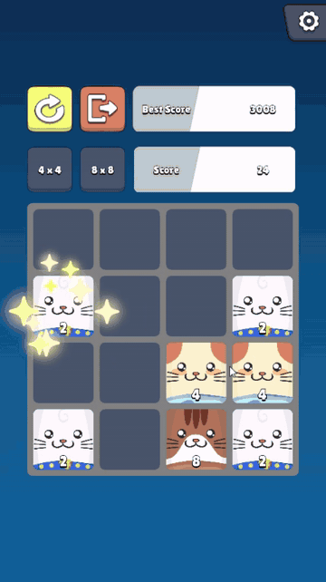 | 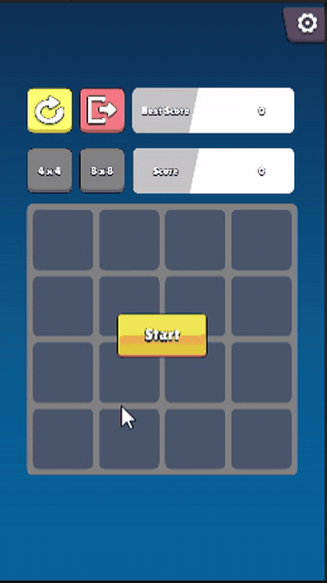 |

「**Meow2048**」은 고전 퍼즐 2048을 모바일용으로 만든 2D 캐주얼 퍼즐입니다. 숫자 대신 **동물 이미지 타일**이 합쳐지며 커지고, 4×4와 8×8 두 가지 보드를 고를 수 있습니다.

**목표한 경험** — 스와이프 한 번에 **모든 타일이 함께 미끄러지고, 합쳐질 때 톡 튀며 동물 소리가 나는** 손맛을, 2048 규칙이 한 번도 어긋나지 않는 턴 위에서 느끼는 것입니다.

**게임 흐름**

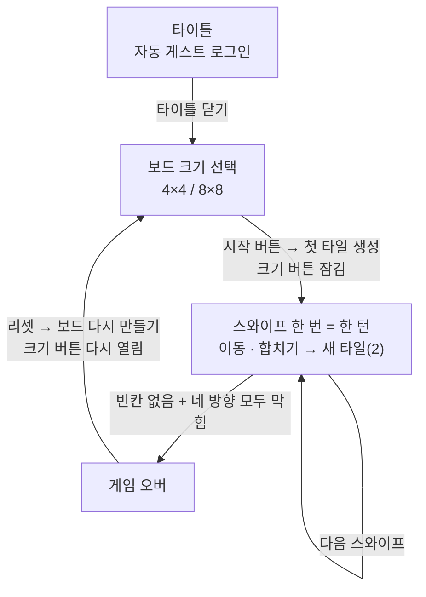

**게임 규칙 요약**

| 구분 | 규칙 |
|---|---|
| 보드 | 4×4 또는 8×8. 시작 버튼을 누르면 크기 버튼이 잠김 |
| 입력 | 화면을 드래그해 상하좌우 스와이프 |
| 이동 | 모든 타일이 스와이프 방향 끝까지 미끄러짐 |
| 합치기 | 같은 숫자 두 개가 부딪히면 하나로 합쳐짐. **한 턴에 한 타일은 한 번만** 합쳐짐 |
| 상한 | 2048 타일은 더 합쳐지지 않음 (준비한 동물 이미지 개수의 끝) |
| 새 타일 | 움직임이 있었던 턴마다 빈칸 하나에 **항상 2** 생성 |
| 점수 | 합쳐서 만든 숫자만큼 더함 (2+2 → +4) |
| 게임 오버 | 빈칸이 없고, 네 방향 어디로도 움직이거나 합칠 수 없음 |

### 1.2 목표

| 목표 | 기준 | 지금 상태 |
|---|---|---|
| 목표한 경험 | 스와이프 한 번에 타일이 함께 미끄러지고, 합쳐질 때 톡 튀며 동물 소리가 남 (4장) | 측정 빌드에서 4×4 한 판을 게임 오버까지 평균 29.9fps (5.1) |
| **턴 처리의 정확성 ★** | 여러 타일이 동시에 움직이고 합쳐져도 2048 규칙(한 턴에 한 번만 합쳐짐)이 깨지지 않음 (3장) | 4×4 · 8×8 모두에서 한 턴에 한 번만 합쳐짐 (5.1) |
| 연출 | 트윈 라이브러리 없이 코루틴으로 병렬 이동과 탄성 스케일 (4장) | 병렬 이동 · 탄성 스케일 · 파티클 · 동물 소리 (5.1) |

「인벤토리 플레이어」를 만들던 기간에 **함께 만든 서브 프로젝트**입니다. 인벤토리와 같은 조건(**모바일 기기에서 실행된다**)을 두고, 규칙이 단순한 게임으로 "**한 턴이 정확하게 돌아가는 퍼즐 루프**"를 끝까지 만드는 데 집중했습니다.

2048은 규칙은 단순하지만, 스와이프 한 번에 **입력 → 판정 → 이동 연출 → 합치기 → 새 타일 · 게임 오버**가 한꺼번에 일어납니다. 이 순서가 섞이면 한 턴에 두 번 합쳐지거나, 사라질 타일이 계속 움직이는 문제가 생깁니다. 그래서 "**판정은 보드 데이터만 보고 먼저 끝까지 계산하고, 화면은 그 결과를 따라간다**"는 원칙으로 턴을 설계했습니다. 이 문서는 기능마다 **한 턴의 어느 단계를 맡고, 무엇이 섞이면 규칙이 깨지는지**를 중심으로 쓰고, 5.4에서 한데 모읍니다.

| 기능 | 한 턴에서 맡는 단계 | 만들며 부딪힌 것 | 이렇게 풀었다 |
|---|---|---|---|
| 칸과 타일 두 겹 (2장) | 판정이 읽는 데이터 | 타일을 칸 안에 넣으면 미끄러지는 연출을 만들 수 없음 | 칸은 GridLayout, 타일은 다른 레이어. 타일은 **그리드 좌표로 칸 위치를 찾아** 이동 |
| 한 턴의 순서 (3장) | ① 입력 · ② 판정 · ⑤ 새 타일 · 게임 오버 | 값이 아직 안 바뀐 타일 때문에 연달아 합쳐지고, 게임 오버가 한 턴 늦게 뜸 | 판정은 데이터만 보고, **합침 표시**를 남기고, 새 타일 직후에도 게임 오버 판정 |
| 미끄러지고 톡 튀게 (4장) | ③ 이동 연출 · ④ 합치기 확정 | 합쳐져 사라질 타일을 코루틴이 계속 움직임 | **전부 도착할 때까지 기다린 뒤** 합치기를 확정 |

---

## 2. 칸과 타일 두 겹

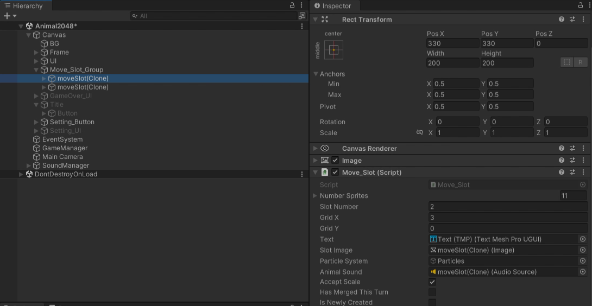

씬은 하나이고, `Game_System`이 상태 · 입력 · 턴 처리 · 연출 · 점수를 모두 맡습니다. 보드는 **두 겹**입니다.

- **칸(프레임)**: `GridLayoutGroup`이 배치하는 배경 칸. 칸마다 `Slot_Status`(Empty / Occupied)가 있고, 이를 `board[x, y]` 배열로 들고 있습니다.
- **타일(숫자)**: 다른 부모(`Move_Slot_Group`) 아래의 `Move_Slot`. 값(`slotNumber`)과 그리드 좌표(`gridX`, `gridY`, 왼쪽 위가 0, 0)를 들고 있습니다.

**판정은 데이터만 읽습니다.** 이동 · 합치기 · 게임 오버 판정은 `board[,]`와 타일의 그리드 좌표 · 값만 보고, 타일의 화면 위치(`transform.position`)는 연출의 결과일 뿐 판정에 쓰지 않습니다. 화면 위치는 **그리드 좌표로 그 칸의 실제 위치를 찾아** 옮겨 놓습니다.

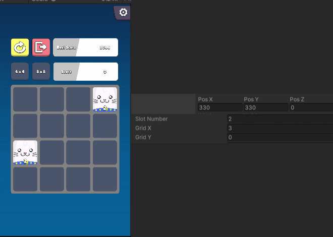

```csharp
// Game_System.cs:958 GetTargetPosition — 그리드 좌표 → 그 칸의 실제 위치
Slot_Status targetStatus = board[x, y];
return targetStatus.transform.position;

// Game_System.cs:874 판정 중 — 목적지 칸의 위치를 이동 목록에 담아 연출에 넘김
Vector3 targetPosition = GetTargetPosition(targetX, targetY);
```

- 전체 코드: [Game_System.cs](https://github.com/NaJungWon/2048_project/blob/main/Assets/Scripts/Game_System.cs) (`InitializeSlots` :201 · `createNumber` :289 · `MoveSlotToImmediate` :974) · [Move_Slot.cs](https://github.com/NaJungWon/2048_project/blob/main/Assets/Scripts/Move_Slot.cs) · [Slot_Status.cs](https://github.com/NaJungWon/2048_project/blob/main/Assets/Scripts/Slot_Status.cs)

**타일은 칸 안이 아니라 다른 레이어에** 🧭 — 먼저 **보드 데이터**(칸의 상태 · 타일의 값과 좌표)를 정하고 그 데이터로 이동 처리를 만들었기 때문에, 칸과 타일을 나눠 두는 쪽이 자연스러웠습니다. GridLayout 안에서는 자식의 위치를 GridLayout이 직접 정해서, 2048의 재미인 **미끄러지는 연출**을 만들기 어렵습니다.

| | [A] 타일을 칸의 자식으로 | **[B] 칸(프레임)과 타일 레이어 분리** ✓ |
|---|---|---|
| 방식 | 이동할 때마다 타일의 부모를 목표 칸으로 바꿈 | 칸은 GridLayout이 배치, 타일은 다른 부모 아래에서 칸 위치를 찾아 이동 |
| 장점 | 위치 계산이 필요 없음 | 타일을 자유롭게 움직일 수 있음(미끄러지는 연출). 칸 상태와 타일 값이 분리됨 |
| 단점 | 부모가 바뀌는 순간 위치가 순간이동해 이동 연출이 어려움 | 칸 상태와 타일 좌표를 **둘 다** 맞춰 줘야 함 |

그 대가로 타일이 움직일 때마다 **원래 칸은 Empty, 새 칸은 Occupied**로 직접 바꿔야 합니다. 이 일은 `MoveSlotToImmediate` 한 곳에서만 합니다(3.2).

**보드 크기** — 크기 버튼을 누르면 보드를 지우고 다시 만듭니다. 크기가 두 개뿐이라 비율 계산 대신 크기별 값을 직접 정했습니다(크기가 늘면 분기도 늘어남, 5.3).

| 값 | 4×4 | 8×8 |
|---|---|---|
| 칸 · 타일 크기 | 200 | 100 |
| 칸 간격 (spacing) | 20 | 10 |
| 글자 크기 | 50 | 25 |

---

## 3. 한 턴의 순서

스와이프 한 번이 한 턴입니다. **판정(②)은 그 자리에서 끝까지 계산하고, 연출(③ · ④)은 그 결과를 따라갑니다.**

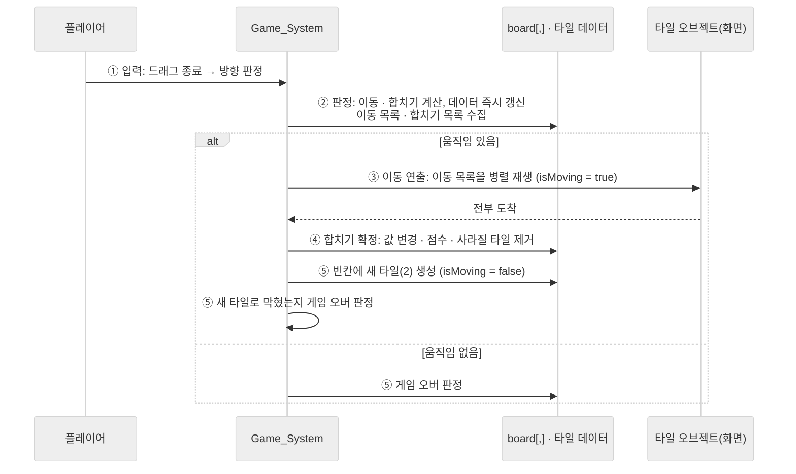

판정을 먼저 끝까지 계산하고 화면은 그 결과를 따라가게 해서, 연출 속도나 프레임과 상관없이 규칙이 같게 동작합니다.

- 전체 코드: [Game_System.cs](https://github.com/NaJungWon/2048_project/blob/main/Assets/Scripts/Game_System.cs) (`OnSwipeCoroutine` :447)

### 3.1 스와이프: 드래그를 네 방향으로

| 값 | 수치 | 이유 |
|---|---|---|
| 최소 드래그 거리 | 50px | 탭이나 손떨림을 스와이프로 오인하지 않게 |
| 방향 결정 | `\|Δx\| > \|Δy\|`면 좌우, 아니면 상하 | 비스듬히 끌어도 더 많이 움직인 쪽으로 정해, 방향은 항상 상하좌우 네 가지 |
| 입력 쿨다운 | 0.15초 | 한 번의 손동작이 연속 입력으로 들어가지 않게 |
| 연출 중 입력 | 무시 (`isMoving`) | 다음 턴이 이전 턴 연출 도중에 시작되지 않게 |

```csharp
// Game_System.cs:382 HandleMouseDragInput (발췌)
if (isMoving) return;                                    // 연출 중이면 입력 무시
// ...
if (Time.time < nextInputAllowedTime) { isDragging = false; return; } // 쿨다운
if (delta.magnitude < dragThreshold) return;             // 50px 미만은 무시

SwipeDirection dir = Mathf.Abs(delta.x) > Mathf.Abs(delta.y)
    ? (delta.x > 0 ? SwipeDirection.Right : SwipeDirection.Left)
    : (delta.y > 0 ? SwipeDirection.Up : SwipeDirection.Down);
StartCoroutine(OnSwipeCoroutine(dir));
```

마우스 입력(`GetMouseButton`)으로 만들었고, 모바일에서는 Unity가 터치를 마우스 입력으로 함께 전달하므로 같은 코드로 동작합니다.

**만들며 생긴 문제 — 연출 도중 다음 스와이프가 들어와 두 턴이 섞임.** 이동 코루틴이 끝나기 전에 새 턴 코루틴이 시작됐습니다. 연출 중 입력을 무시하고(`isMoving`) 0.15초 쿨다운을 두어, 한 턴이 끝나야 다음 턴이 시작되게 했습니다.

### 3.2 이동: 한 칸씩 밀기

스와이프 방향에 따라 줄(행 또는 열)마다 타일을 **앞쪽부터** 정렬하고, 각 타일을 **한 칸만** 앞으로 밀어 봅니다. 한 바퀴 돌았을 때 하나라도 움직였으면 처음부터 다시 반복하고, 아무것도 안 움직이면 끝냅니다. 한 칸 앞을 보고 내리는 판단은 세 가지입니다.

| 앞 칸 | 처리 |
|---|---|
| 비어 있음 | 이동 목록에 추가(같은 타일이면 최종 목적지로 덮어씀), **보드 데이터 즉시 갱신** |
| 같은 숫자 + 둘 다 이번 턴에 안 합쳐짐 + 2048 미만 | 합치기 목록에 추가, **두 타일 모두 합침 표시**, 소스 타일을 앞 칸으로 이동 처리 |
| 다른 숫자 · 벽 | 멈춤 |

```csharp
// Game_System.cs:837 ProcessSlotsLineStepWithAnimation (발췌)
if (targetSlot == null)                                    // 빈칸 → 이동
{
    int existingIndex = movesToAnimate.FindIndex(m => m.slot == currentSlot);
    if (existingIndex >= 0) movesToAnimate[existingIndex] = moveInfo; // 최종 위치로 갱신
    else movesToAnimate.Add(moveInfo);
    MoveSlotToImmediate(currentSlot, targetX, targetY);   // 데이터만 즉시 이동
}
else if (targetSlot.slotNumber == currentSlot.slotNumber
         && !targetSlot.hasMergedThisTurn && !currentSlot.hasMergedThisTurn
         && currentSlot.slotNumber < 2048)                 // 같은 숫자 → 합치기 예약
{
    mergesToProcess.Add(/* 타깃 · 소스 · 합친 값 */);
    targetSlot.hasMergedThisTurn = true;                   // 이번 턴에 더는 합쳐지지 않음
    currentSlot.hasMergedThisTurn = true;
    MoveSlotToImmediate(currentSlot, targetX, targetY);
}
```

- 전체 코드: [Game_System.cs](https://github.com/NaJungWon/2048_project/blob/main/Assets/Scripts/Game_System.cs) (`ProcessMoveWithAnimation` :724 · `ProcessSlotsLineStepWithAnimation` :837)

`MoveSlotToImmediate`는 **원래 칸 Empty → 좌표 변경 → 새 칸 Occupied** 세 가지만 하고, 화면 위치는 건드리지 않습니다. 화면 이동은 4장의 연출이 맡습니다.

**판정 때 데이터를 바로 바꾸고, 화면은 뒤따라가게** 🧭 — 처음부터 이 방식으로 설계했습니다. 스와이프 한 번에 타일 수십 개(8×8은 최대 64개)가 동시에 움직이는데, 각 타일이 언제 도착하느냐에 판정이 기대면 규칙이 화면 속도에 따라 달라지기 때문입니다.

| | [A] 애니메이션이 끝난 뒤 갱신 | **[B] 판정 때 즉시 갱신, 화면은 뒤따라감** ✓ |
|---|---|---|
| 방식 | 타일이 도착하면 그때 칸 상태와 좌표를 바꿈 | 판정에서 데이터를 최종 상태까지 계산, 이동 · 합치기 목록만 넘겨 연출 |
| 장점 | 화면 순서와 코드 순서가 같아 이해하기 쉬움 | 판정이 연출 시간 · 프레임과 무관. 연출 도중에도 데이터는 항상 최종 상태 |
| 단점 | 연출 도중 데이터가 중간 상태라, 다른 판정이 끼어들면 틀린 값을 읽음 | 이동 목록 · 합치기 목록을 따로 모으는 구조가 필요 |

대신 판정이 끝난 시점에는 합쳐질 두 타일이 같은 좌표에 겹쳐 있고 값도 아직 안 바뀐 **중간 상태**가 생깁니다. 이 때문에 합침 표시(3.3)와, 사라질 타일을 이동 목록에서 빼는 처리(4.1)가 따로 필요했습니다.

**한 줄을 한 번에 계산하지 않고 한 칸씩 밀기** 🧭 — 2048 규칙을 **그대로 옮기는 것**이 목표였고, 여러 타일이 연속으로 밀릴 때 **순서가 섞이지 않게** 하고 싶었습니다. 앞쪽 타일부터 처리하므로 뒤 타일은 항상 앞 타일이 자리를 잡은 뒤에 움직입니다.

| | [A] 줄 단위 일괄 계산 | **[B] 한 칸씩 밀기 반복** ✓ |
|---|---|---|
| 방식 | 줄에서 빈칸을 빼고 붙인 뒤, 앞에서부터 짝을 지어 합침 | 앞쪽 타일부터 한 칸씩 밀고, 움직임이 없을 때까지 반복 |
| 장점 | 계산 횟수가 적음 | "앞이 비면 간다, 같으면 합친다, 아니면 멈춘다"라는 규칙이 코드에 그대로 드러남 |
| 단점 | 합침 순서 · 한 턴 1회 제한 같은 예외를 계산식 안에서 따로 처리해야 함 | 같은 줄을 여러 번 훑음 |

반복 비용은 보드가 최대 8×8이라 문제가 되지 않았습니다. 다만 칸 조회(`GetSlotAt`)가 매번 타일 목록 전체를 훑어서, 반복 횟수만큼 비용이 곱해집니다(5.3). 연출은 각 타일의 **최종 목적지**로 한 번만 재생하므로, 한 칸씩 반복해도 화면은 한 번에 미끄러집니다.

### 3.3 한 턴에 한 번만 합치기

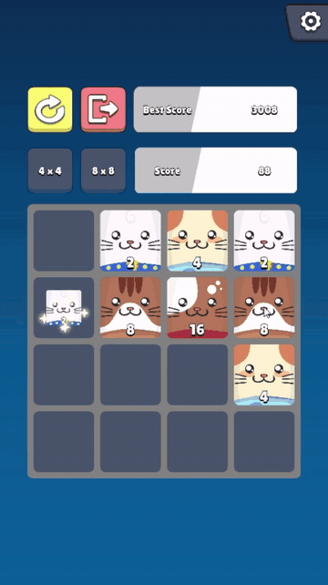

합치기는 **예약만 하고 값은 바꾸지 않습니다.** 값은 이동 연출이 끝난 뒤 `ProcessMerges`에서 바뀝니다(④). 그래서 판정 도중에는 합쳐질 타일의 값이 아직 2로 남아 있고, 표시가 없으면 세 번째 타일이 같은 타일에 또 합쳐집니다.

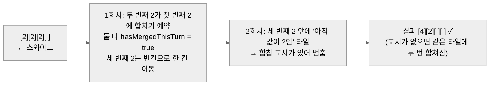

- 전체 코드: [Game_System.cs](https://github.com/NaJungWon/2048_project/blob/main/Assets/Scripts/Game_System.cs) (`ProcessMerges` :681 — 값 변경 · 점수 · 탄성 연출 · 사라질 타일 제거)

**만들며 생긴 문제 — 같은 줄의 타일이 한 턴에 연달아 합쳐짐.** 합치기 값이 연출 뒤에 바뀌어, 판정 중에는 이미 합쳐질 타일을 다른 타일이 같은 숫자로 봤습니다. `hasMergedThisTurn`을 판정 단계에서 **두 타일 모두에** 표시해 한 턴에 한 번만 합쳐지게 했습니다.

### 3.4 새 타일과 2048 상한

합치기는 **2048에서 멈춥니다.** 준비한 동물 이미지가 2048까지라서 판정에 `< 2048` 조건을 세 곳 두었고, 이미지 인덱스는 `log2(값) − 1`로 계산합니다.

**새 타일은 항상 2** 🧭 — 난이도 조절을 위해서입니다. 4가 섞이면 보드가 빨리 차서 캐주얼하게 즐기기 어렵다고 판단했습니다. 2 / 4 랜덤 코드는 주석으로 남아 있습니다.

| | [A] 2 또는 4 (원작) | **[B] 항상 2** ✓ |
|---|---|---|
| 방식 | 원작처럼 2 또는 4 중 하나를 생성 | 움직임이 있었던 턴마다 빈칸 하나에 항상 2 생성 |

### 3.5 게임 오버

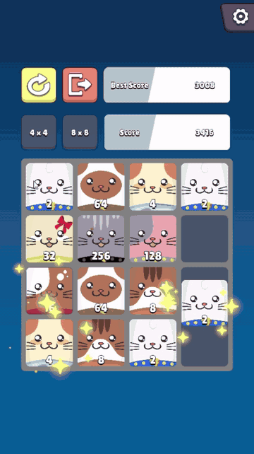

게임 오버는 ① 빈칸이 없고 ② 네 방향 모두 움직이거나 합칠 수 없을 때입니다. `CanMoveInDirection`은 타일을 실제로 움직이지 않고 **경로만 훑어** 빈칸이나 합칠 수 있는 같은 숫자가 있는지 봅니다. 보드를 바꾸지 않는 질문용 함수로 따로 둔 덕분에, 판정하다가 보드가 바뀌는 일이 없습니다.

```csharp
// Game_System.cs:1123 CheckGameOver (발췌)
if (HasEmptySlot()) return;                                  // 조건 ①
bool canMoveUp    = CanMoveInDirection(SwipeDirection.Up);   // 조건 ②
bool canMoveDown  = CanMoveInDirection(SwipeDirection.Down);
bool canMoveLeft  = CanMoveInDirection(SwipeDirection.Left);
bool canMoveRight = CanMoveInDirection(SwipeDirection.Right);

if (!canMoveUp && !canMoveDown && !canMoveLeft && !canMoveRight)
{
    gameState = Game_State.Result;
    gameUI.gameOverUI.SetActive(true);
}
```

- 전체 코드: [Game_System.cs](https://github.com/NaJungWon/2048_project/blob/main/Assets/Scripts/Game_System.cs) (`CanMoveInDirection` :1025 · `CheckGameOver` :1123)

**만들며 생긴 문제 — 막힌 뒤 한 번 더 스와이프해야 게임 오버가 뜸.** 처음에는 "아무것도 움직이지 않은 스와이프" 때만 판정해서, 마지막 빈칸이 새 타일로 채워져 막혀도 결과 화면이 바로 뜨지 않았습니다. 문서를 쓰며 발견해, **새 타일을 만든 직후에도** `CheckGameOver()`를 부르도록 고쳤고 플레이로 확인했습니다.

---

## 4. 미끄러지고 톡 튀게

트윈 라이브러리(DOTween 등) 없이 **코루틴만으로** 연출을 만들었습니다. 이동은 다음 입력까지의 대기 시간이라 짧고 정직하게, 합치기는 보상이라 크게 튀게 나눴습니다.

| 연출 | 방식 | 시간 |
|---|---|---|
| 타일 이동 | 모든 타일을 동시에 선형 이동(`Lerp`), 전부 도착할 때까지 대기 | 0.15초 (모든 타일 동일) |
| 생성 · 합치기 | 스케일을 0(생성) 또는 1.2배(합치기)에서 원래 크기로, **EaseOutElastic** | 0.6초 |
| 피드백 | 생성 · 합치기 순간 파티클 + 동물 소리 재생 | — |

### 4.1 병렬 이동: 함께 출발해 함께 도착


판정이 넘긴 이동 목록의 타일을 **모두 동시에 출발**시키고, 전부 도착할 때까지 기다린 뒤에야 합치기를 확정하고(④) 새 타일을 만듭니다(⑤). 그래서 화면에서는 항상 "**다 움직인 다음 합쳐지고, 그다음 새 타일이 나온다**"는 순서가 지켜집니다.

```csharp
// Game_System.cs:520 AnimateSlots — 모든 타일을 동시에 출발시키고 전부 도착할 때까지 대기
int completedCount = 0;
int totalCount = 0;                          // 실제로 시작한 코루틴 수만 센다

foreach (var moveInfo in moves)
{
    if (moveInfo.slot != null)
    {
        totalCount++;
        StartCoroutine(AnimateSingleSlot(moveInfo, () => { completedCount++; }));
    }
}

while (completedCount < totalCount)
    yield return null;                       // '이동이 끝났다'는 시점을 명확하게
```

- 전체 코드: [Game_System.cs](https://github.com/NaJungWon/2048_project/blob/main/Assets/Scripts/Game_System.cs) (`AnimateSlots` :520 · `AnimateSingleSlot` :550)

이동 시간은 모든 타일이 같은 0.15초라, 멀리 가는 타일은 빠르게, 가까운 타일은 느리게 움직여 **모두 동시에 도착**합니다. 원래는 `거리 / moveSpeed`와 상한 중 작은 값을 쓰는 코드였는데, Canvas가 Screen Space Overlay라 거리가 픽셀 단위여서 계산값이 항상 상한보다 컸습니다. 문서를 쓰며 발견해 실제 동작(고정 시간)에 맞게 정리했습니다.

**만들며 생긴 문제 — 합쳐져 사라진 타일을 코루틴이 계속 움직임.** 합치기의 소스 타일은 "타깃 칸까지 이동 → 사라짐"을 거치는데, 파괴와 이동 · 스케일 코루틴이 따로 돌아 이미 사라진 타일의 `transform`을 건드릴 수 있었습니다(`MissingReferenceException` 위험).

| 순서 | 처리 |
|---|---|
| 1 | 모든 이동이 끝날 때까지 기다림 |
| 2 | 사라질 타일을 이동 목록에서 뺌 |
| 3 | 그다음 합치기를 확정하고 파괴 |
| + | 이동 · 스케일 코루틴은 매 프레임 대상이 살아 있는지 확인하고, 중간에 끝나도 **완료 콜백을 반드시 호출** (빠뜨리면 완료 카운트가 모자라 턴이 영영 끝나지 않음) |

### 4.2 탄성 스케일 (AI 활용)


새 타일은 0에서 "톡" 튀어나오고, 합쳐진 타일은 1.2배에서 출렁이며 원래 크기로 돌아옵니다. 목표를 살짝 넘었다가 출렁이며 멈추는 곡선(EaseOutElastic)입니다.

당시에는 DOTween 같은 트윈 라이브러리를 몰랐고, 이징이라는 것이 있다는 것만 알고 있어서 이징 함수는 AI를 활용해 만들었습니다(5.2). 연출 종류가 늘어나는 프로젝트라면 트윈 라이브러리를 먼저 검토하겠습니다.

- 전체 코드: [Game_System.cs](https://github.com/NaJungWon/2048_project/blob/main/Assets/Scripts/Game_System.cs) (`EaseOutElastic` :593 · `AnimateSlotScale` :614)

### 4.3 파티클 · 소리

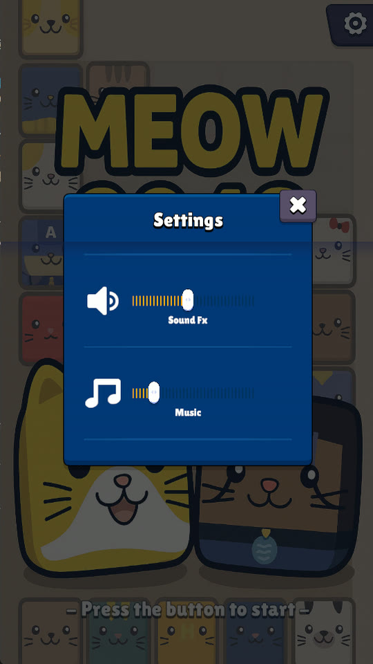

- **BGM**: 상태별 3종(타이틀 / 인게임 / 게임 오버)을 `Game_System.Update`에서 상태에 맞게 바꿉니다.
- **타일 소리**: 타일은 계속 생성 · 파괴되므로 볼륨 매니저에 미리 등록해 둘 수 없습니다. 그래서 타일의 `SFX_Control`이 **활성화될 때 스스로 `Setting_Manager`에 등록**하고 비활성화될 때 해제해, 새로 생긴 타일도 현재 SFX 볼륨을 바로 따릅니다.

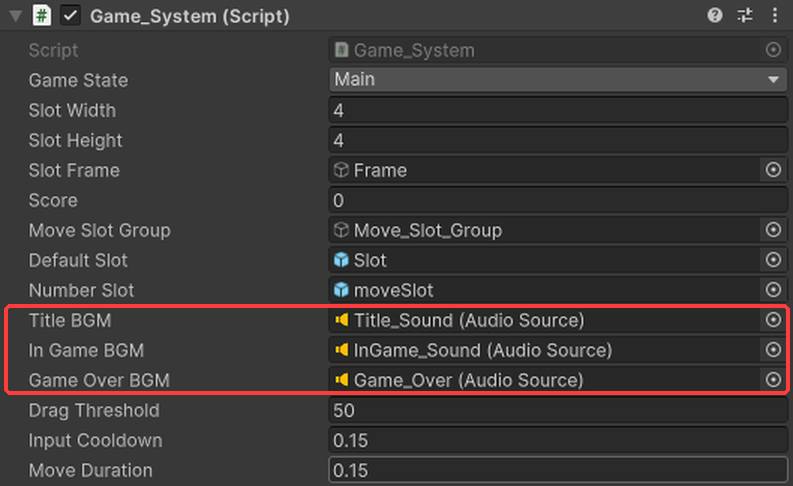

- 전체 코드: [SFX_Control.cs](https://github.com/NaJungWon/2048_project/blob/main/Assets/Scripts/SFX_Control.cs) · [Setting_Manager.cs](https://github.com/NaJungWon/2048_project/blob/main/Assets/Scripts/Setting_Manager.cs) · [Move_Slot.cs](https://github.com/NaJungWon/2048_project/blob/main/Assets/Scripts/Move_Slot.cs) (`PlayParticle`)

**만들며 생긴 문제 — 합치기 때 파티클이 재생되지 않음.** 파티클을 초기화하지 않고 `Play()`만 호출해 오류가 났습니다. 재생 전에 초기화하도록 바꿨습니다 — 파티클 참조가 비어 있으면 자식에서 다시 찾고, 이전 재생을 멈추고 지운 뒤 다시 재생(`Stop(true, StopEmittingAndClear)` → `Play()`)합니다.

---

## 5. 회고

### 5.1 결과

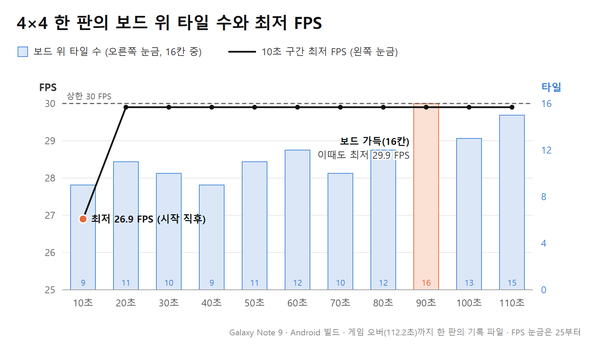

**빌드 측정** — 실제 모바일 기기에서 Android 빌드로 4×4 보드 한 판을 게임 오버까지 플레이하며 측정했습니다. 측정용 스크립트가 10초마다 값을 파일로 남기게 하고, 측정이 끝난 뒤 원본에서는 뺐습니다.

| 측정 환경 | |
|---|---|
| 기기 | Galaxy Note 9 (SM-N960N, 2018년 · Android 10 · RAM 6GB) |
| 프레임 상한 | 30fps (`targetFrameRate` 기본값 · vSync 1) |
| 측정 방법 | 시작 버튼부터 게임 오버까지 한 판의 평균 fps, 1초 구간 최저 fps, 보드 위 타일 수 |

| 항목 | 4×4 한 판 |
|---|---|
| 플레이 시간 | 112.2초 (게임 오버까지) |
| 점수 | 2,668 |
| 최대 타일 수 | 16개 (보드 가득) |
| 평균 fps | 29.9 |
| 최저 fps (1초 구간) | 26.9 (첫 10초 구간. 이후 10초 구간은 모두 29.9) |

보드가 가득 찰 때까지 30fps 상한에 붙어 유지됐습니다. 8×8 보드는 측정하지 않았습니다.

| 목표 (1.2) | 결과 | 절 |
|---|---|---|
| 목표한 경험 | 스와이프 한 번에 타일이 함께 미끄러지고, 합쳐질 때 탄성 스케일 · 파티클 · 동물 소리가 나며, 한 판 내내 평균 29.9fps | 4장 · 5.1 |
| **턴 처리의 정확성** | 입력 → 판정 → 이동 연출 → 합치기 → 새 타일 · 게임 오버 순서가 매 턴 지켜지고, 한 턴에 한 번만 합쳐지는 규칙이 4×4 · 8×8 모두에서 동작합니다. | 3장 |
| 연출 | 트윈 라이브러리 없이 병렬 이동, 탄성 스케일, 파티클 · 동물 소리 피드백을 만들었습니다. | 4장 |

### 5.2 AI와 일한 방식

가장 많이 도움을 받은 곳은 두 곳입니다.

| 기능 | AI와 함께 한 것 | 제가 한 것 |
|---|---|---|
| 탄성 스케일 (4.2) | 이징 함수(EaseOutElastic) 작성 | 생성은 0에서, 합치기는 1.2배에서 튀게 하고 시간(0.6초)을 정함 |
| 좌표 → 칸 위치 (2장) | 타일의 그리드 좌표(배열)와 실제 칸 위치를 맞춰, 타일이 그 좌표의 칸 위치로 이동하게 만드는 부분 | 칸과 타일을 두 겹으로 나누고, 판정은 데이터만 본다는 턴 구조를 정함 |

### 5.3 남은 과제와 다음 계획

| 과제 | 근거 | 다음에 할 것 |
|---|---|---|
| **시작 버튼 전부터 Game 상태** | 보드를 만드는 `InitializeSlots()`가 상태를 Game으로 바꿈. 타이틀을 닫거나 리셋하면 시작 버튼을 누르기 전에 인게임 BGM이 나옴 | 상태 변경을 `StartGame()` 한 곳으로 모으고, 보드 생성은 상태를 건드리지 않게 분리. 리셋은 Main으로 돌아가게 |
| **`Game_System` 1,167줄 한 클래스** | 상태 · 입력 · 판정 · 연출 · 점수가 모두 한 곳에 있음 | 입력 / 보드 판정(순수 C#) / 연출로 분리. 판정을 순수 클래스로 빼면 단위 테스트도 가능 |
| **칸 조회 비용 (8×8)** | `GetSlotAt`이 타일 목록을 처음부터 훑음. 한 칸씩 반복하는 판정(3.2)에서 횟수만큼 곱해지고, 8×8 보드는 측정하지 않음 (5.1) | 8×8 한 판을 측정하고, 판정 시작 때 `Move_Slot[,]` 배열을 만들어 바로 조회 |

**그 밖에 남은 작업** — 파티클 · 이미지 크기를 `GetChild(1)` · `GetChild(0)`으로 찾는 프리팹 자식 순서 의존을 `[SerializeField]` 직접 참조로, 보드 크기별 고정값(`if (slotWidth == 4)`로 나눔, 2장)을 데이터나 화면 폭 기준 계산으로 바꾸기. 오브젝트 풀링은 타일이 많아야 64개(8×8)이고 한 턴에 생성이 1개라 넣지 않았고, 보드를 키울 때 측정 후 정하겠습니다.

**문서를 쓰며 발견해 정리한 것** — 이동 완료 대기의 목표 수를 실제로 시작한 코루틴 수로 고침(4.1) · 쓰이지 않던 이동 속도 설정을 고정 시간으로 정리(4.1) · 쓰지 않는 이전 이동 코드(`ProcessMove` 계열, `MoveSlotTo`) 삭제 · 볼륨을 슬라이더 이벤트와 `Update` 폴링으로 두 번 갱신하던 것을 이벤트만 쓰게 정리.

### 5.4 배운 점

**한 턴의 순서가 곧 규칙입니다.**
이 프로젝트에서 겪은 문제 다섯 개 중 네 개는 한 턴 안의 순서가 섞여서 생겼습니다. 단계마다 지켜야 할 것을 모으면 아래와 같습니다.

| 턴 단계 | 지켜야 할 것 | 섞였을 때 생긴 문제 | 지킨 방법 |
|---|---|---|---|
| ① 입력 (3.1) | 한 턴이 끝나야 다음 턴 | 연출 중 스와이프로 두 턴이 섞임 | 연출 중 입력 무시 + 쿨다운 0.15초 |
| ② 판정 (3.3) | 한 타일은 한 턴에 한 번만 합침 | 값이 아직 안 바뀐 타일에 연달아 합쳐짐 | 판정 단계에서 두 타일 모두 합침 표시 |
| ③ 이동 연출 (4.1) | 전부 도착해야 다음 단계 | 사라질 타일을 코루틴이 계속 움직임 | 전부 도착 대기 → 이동 목록에서 빼기 → 파괴 |
| ④ 합치기 확정 (4.3) | 값 · 이미지 · 파티클은 이동 뒤에 | 파티클이 재생되지 않음 (순서가 아니라 초기화 누락) | 재생 전에 초기화 |
| ⑤ 새 타일 · 게임 오버 (3.5) | 새 타일 직후에도 막혔는지 확인 | 막혀도 한 번 더 스와이프해야 게임 오버 | 새 타일 생성 직후 판정 |

**판정은 데이터만, 화면은 뒤따라가게 하면 규칙이 화면 속도와 무관해집니다.** 대신 판정과 연출 사이의 **중간 상태**(값은 안 바뀌었는데 위치는 겹친 타일)를 따로 관리해야 한다는 것도 배웠습니다.

**규칙의 예외는 코드에 이름으로 남깁니다.** "새로 합쳐진 타일은 이번 턴에 다시 합쳐지지 않는다"는 규칙을 `hasMergedThisTurn`이라는 표시로 드러내자, 버그를 고치는 것과 동시에 코드가 규칙을 설명하게 됐습니다.

---

## 부록 A. 전체 구조

### A.1 전체 구조

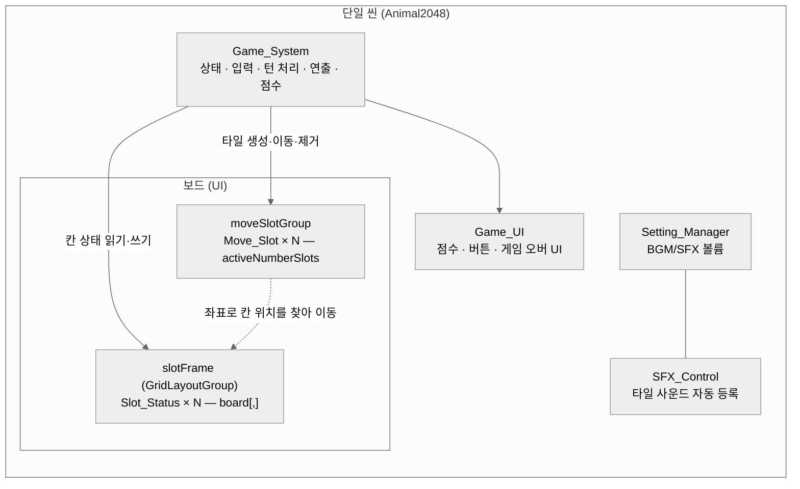

| 클래스 | 하는 일 | 하지 않는 일 |
|---|---|---|
| `Game_System` | 상태 전환, 스와이프 판정, 이동 · 합치기 판정, 연출 코루틴, 점수, 게임 오버 판정 | — |
| `Slot_Status` | 칸 하나의 상태(Empty / Occupied). `board[,]`의 원소 | 숫자를 모름 |
| `Move_Slot` | 타일 하나의 값 · 그리드 좌표 · 이번 턴 합침 여부, 값에 맞는 이미지, 파티클 · 사운드 재생 | 자기가 어디로 갈지 판단하지 않음 |
| `Game_UI` | 점수 텍스트, 시작 · 크기 버튼, 게임 오버 · 설정 UI 참조 | 상태를 바꾸지 않음 |
| `Setting_Manager` / `SFX_Control` | BGM · SFX 볼륨 슬라이더 / 생성되는 타일 사운드를 매니저에 자동 등록 · 해제 | — |

### A.2 호출 API

다른 코드가 무엇을 부르면 무엇이 나오는지 모았습니다. 스와이프 한 턴은 `Game_System` 안의 `OnSwipeCoroutine(direction)`(private)이 판정 → 이동 → 합치기 → 새 타일까지 처리합니다(3장).

**게임 흐름** — 모두 `Game_System`의 함수이고, 화면 버튼에서 부릅니다(`InitializeSlots` · `createNumber` 제외).

| 호출 | 결과 |
|---|---|
| `Title()` | 타이틀을 닫고 보드 만들기(`InitializeSlots`) |
| `GameScale4x4()` / `GameScale8x8()` | 보드 크기를 4×4 / 8×8로 정하고 다시 만들기 |
| `StartGame()` | 시작 버튼 — Game 상태로 바꾸고 첫 타일 생성, 크기 버튼 잠금 |
| `ResetGame()` | 리셋 버튼 — 점수 · 타일을 지우고 크기 버튼을 연 뒤 보드 다시 만들기 |
| `InitializeSlots()` | 보드 생성 — GridLayout 설정, 빈 칸 만들기. 지금은 상태도 Game으로 바꿈 (5.3 과제) |
| `createNumber()` | 빈칸 하나에 2 생성 (시작 때 · 움직임이 있던 턴 끝마다) |

**타일 · 사운드 (4장)**

| 호출 | 결과 |
|---|---|
| `Move_Slot.UpdateImage()` | 값에 맞는 동물 이미지로 바꾸기 (생성 · 합치기 때) |
| `Move_Slot.PlayParticle()` | 파티클 재생 — 재생 전에 초기화 (4.3) |
| `Move_Slot.SetFontSize(size)` | 보드 크기에 맞는 글자 크기 (2장) |
| `Setting_Manager.RegisterSFX(obj)` / `UnregisterSFX(obj)` | 타일 사운드를 볼륨 목록에 등록 / 해제 — 타일의 `SFX_Control`이 `OnEnable`에서 등록하고 `OnDisable`에서 해제 (4.3) |
