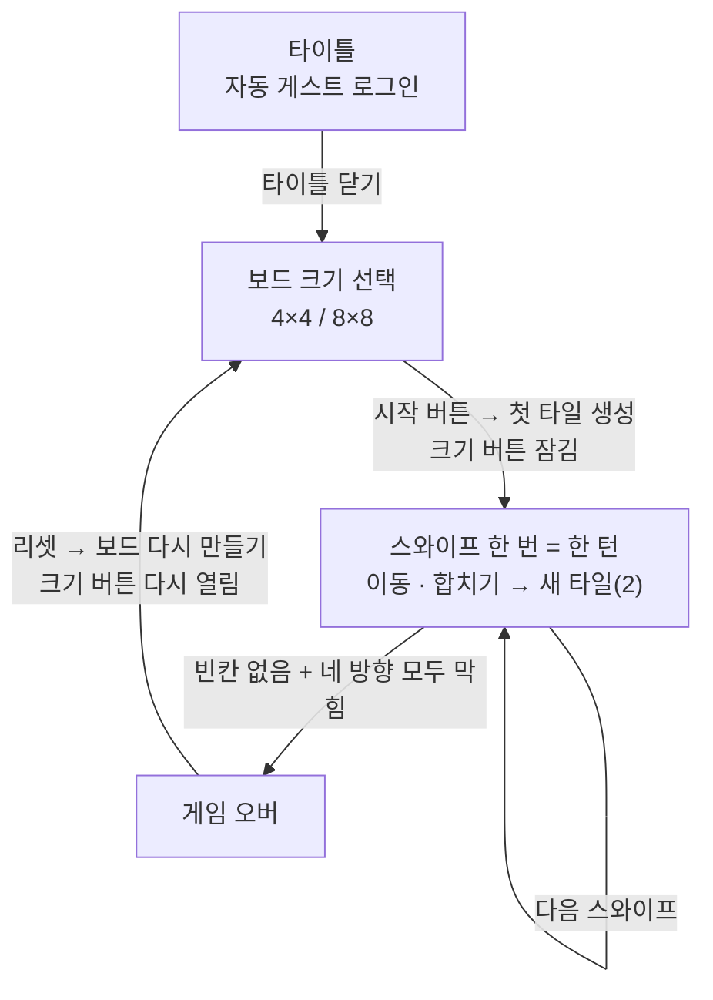
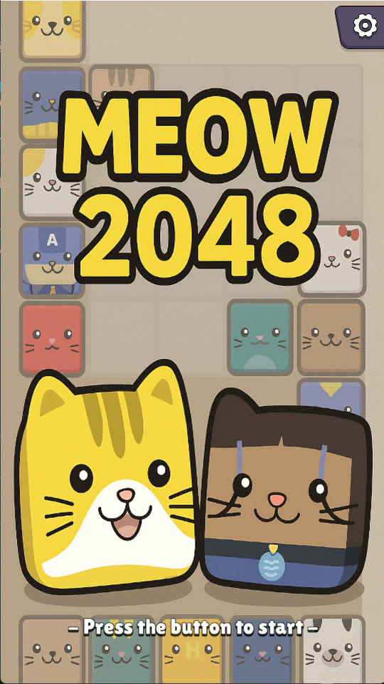
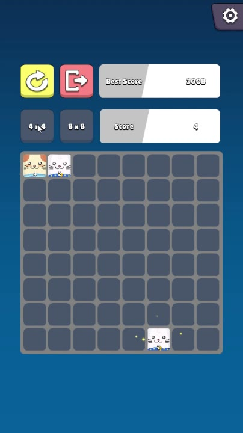
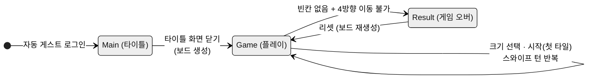
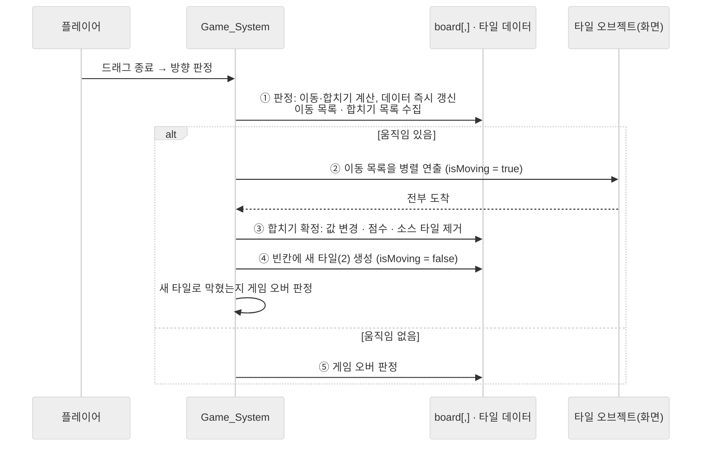
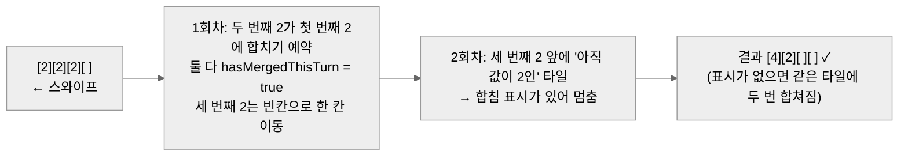
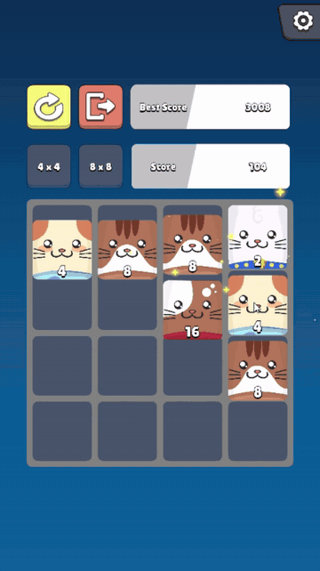
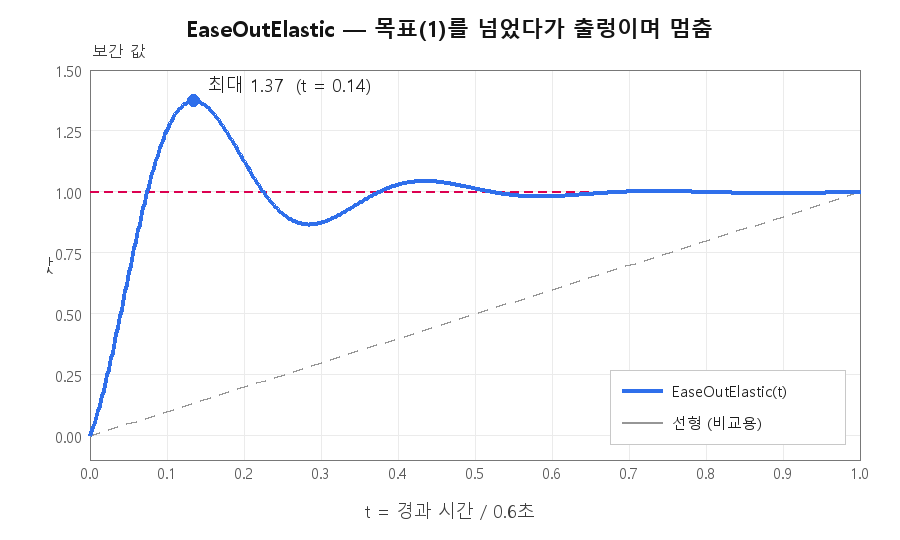

# Meow2048 기술 문서

| 항목 | 내용 |
|---|---|
| 장르 | 모바일 2D 캐주얼 퍼즐 (고전 퍼즐 2048) |
| Engine | Unity 2022.3.62f3 (2D) |
| 플랫폼 | Android (minSdk 22, 화면 자동 회전), PC 빌드 병행 (창 540×960). UI 기준 해상도 1080×1920 |
| 주요 패키지 | uGUI + TextMeshPro 3.0.7, UIParticleSystem(UI 에셋 팩 포함) |
| 연출 | 코루틴 + 이징 함수 (AI 활용, DOTween 미사용) |
| 기간 | 2025.09 ~ 2025.12 (4학년 2학기, 약 15주, 「인벤토리 플레이어」와 같은 기간) |
| 형태 | 개인 프로젝트 |
| 링크 | [시연 영상](https://youtube.com/shorts/FWoEDiwHP30) · [전체 영상](https://youtu.be/j3z04k8qnvg) · 실행 파일 [Windows](https://drive.google.com/file/d/1OAPT0y5rDcTFP749rAGN4_4eXQJjMAhI/view?usp=drive_link) · [Android](https://drive.google.com/file/d/1dljWg_zfzrOo9sCURy_s_vqRm34iGEiZ/view?usp=drive_link) · [GitHub](https://github.com/NaJungWon/2048_project) |

---

## 1. 개요

### 1.1 게임 소개


「**Meow2048**」은 고전 퍼즐 2048을 모바일용으로 만든 2D 캐주얼 퍼즐입니다. 숫자 대신 **동물 이미지 타일**이 합쳐지며 커지고, 4×4와 8×8 두 가지 보드를 고를 수 있습니다.

**게임 흐름**







**게임 규칙 요약**

| 구분 | 규칙 |
|---|---|
| 흐름 | 타이틀(자동 게스트 로그인) → 보드 크기 선택 → 시작 → 플레이 → 게임 오버 → 리셋 |
| 보드 | 4×4 또는 8×8. 시작 버튼을 누르면 크기 버튼이 잠김 |
| 입력 | 화면을 드래그해 상하좌우 스와이프 |
| 이동 | 모든 타일이 스와이프 방향 끝까지 미끄러짐 |
| 합치기 | 같은 숫자 두 개가 부딪히면 하나로 합쳐짐. **한 턴에 한 타일은 한 번만** 합쳐짐 |
| 상한 | 2048 타일은 더 합쳐지지 않음 (준비한 동물 이미지 개수의 끝) |
| 새 타일 | 움직임이 있었던 턴마다 빈칸 하나에 **항상 2** 생성 |
| 점수 | 합쳐서 만든 숫자만큼 더함 (2+2 → +4) |
| 게임 오버 | 빈칸이 없고, 네 방향 어디로도 움직이거나 합칠 수 없음 |

### 1.2 목표

「인벤토리 플레이어」를 만들던 기간에 **함께 만든 서브 프로젝트**입니다. 인벤토리와 같은 조건(**모바일 기기에서 실행된다**)을 두고, 규칙이 단순한 게임으로 "**한 턴이 정확하게 돌아가는 퍼즐 루프**"를 끝까지 만드는 데 집중했습니다.

| 집중한 것 | 내용 |
|---|---|
| **턴 처리의 정확성 ★** | 스와이프 한 번에 여러 타일이 동시에 움직이고 합쳐져도, 2048 규칙(한 턴에 한 번만 합쳐짐)이 깨지지 않게 |
| **연출** | 트윈 라이브러리 없이 코루틴으로 병렬 이동과 탄성 스케일 연출 구현 (이징 함수는 AI 활용) |

2048은 규칙은 단순하지만, 스와이프 한 번에 **이동·합치기·연출·새 타일 생성이 한꺼번에** 일어납니다. 이 순서가 섞이면 한 턴에 두 번 합쳐지거나, 사라질 타일이 계속 움직이는 문제가 생깁니다. 그래서 처음부터 "**보드 데이터를 먼저 끝까지 계산하고, 화면은 그 결과를 따라간다**"는 원칙으로 턴을 설계했습니다. 이 턴 처리가 이 프로젝트의 핵심입니다.

### 1.3 이 문서에서 다루는 내용

먼저 보드를 칸과 타일 두 겹으로 나눈 구조(2장)를 설명하고, 이 프로젝트의 핵심인 **턴 처리: 이동 · 합치기**(3장)와 **연출: 병렬 이동 · 이징**(4장)을 차례로 설명합니다. 마지막으로 결과와 기술 부채, 배운 점(5장)을 정리합니다.

---

## 2. 칸과 타일을 어떻게 나눠 둘 것인가

씬은 하나이고, `Game_System`이 상태(Main / Game / Result)·입력·턴 처리·연출·점수를 모두 맡습니다. 보드는 **두 계층**으로 나뉩니다.

- **칸(프레임)**: `GridLayoutGroup` 아래에 깔린 배경 칸. 각 칸의 `Slot_Status`(Empty / Occupied)를 `board[x, y]` 배열로 들고 있습니다.
- **타일(숫자)**: 별도의 부모(`moveSlotGroup`) 아래에 있는 `Move_Slot`. 값(`slotNumber`)과 그리드 좌표(`gridX`, `gridY`)를 들고, 화면 위치는 해당 칸의 위치를 복사해 씁니다.


| 클래스 | 하는 일 | 하지 않는 일 |
|---|---|---|
| `Game_System` | 상태 전환, 스와이프 판정, 이동·합치기 판정, 연출 코루틴, 점수, 게임 오버 판정 | — |
| `Slot_Status` | 칸 하나의 상태(Empty / Occupied). `board[,]`의 원소 | 숫자를 모름 |
| `Move_Slot` | 타일 하나의 값·그리드 좌표·이번 턴 합침 여부, 값에 맞는 이미지, 파티클·사운드 재생 | 자기가 어디로 갈지 판단하지 않음 |
| `Game_UI` | 점수 텍스트, 시작·크기 버튼, 게임 오버·설정 UI 참조 | 상태를 바꾸지 않음 |
| `Setting_Manager` / `SFX_Control` | BGM·SFX 볼륨 슬라이더 / 생성되는 타일 사운드를 매니저에 자동 등록·해제 | — |

> **설계 규칙: 판정은 데이터만 읽는다.** 이동·합치기·게임 오버 판정은 `board[,]`와 타일의 그리드 좌표·값만 봅니다. 타일의 화면 위치(`transform.position`)는 연출의 결과일 뿐 판정에 쓰지 않습니다.

### 2.1 상태 흐름: 보드가 준비되면 Game으로



상태 값은 **보드가 준비됐는지**를 기준으로 바뀝니다. 보드를 만드는 `InitializeSlots()`가 상태를 Game으로 바꾸고, 타이틀 닫기(`Title()`) · 크기 선택(`GameScale4x4/8x8()`) · 리셋(`ResetGame()`)이 모두 이 함수를 부릅니다. 그래서 **시작 버튼은 상태를 바꾸지 않고 첫 타일을 만드는 역할**이고, 리셋은 Main으로 잠깐 돌렸다가 같은 프레임에 다시 Game이 됩니다. 시작 전 보드는 비어 있어 스와이프해도 아무 일도 일어나지 않지만, 인게임 BGM은 이때부터 나옵니다(5.3 남은 기술 부채).

상태마다 BGM이 바뀝니다(타이틀 / 인게임 / 게임 오버 3종, `Game_System.Update`).

### 2.2 타일은 칸 밖에서 칸 위치만 따라가기

칸은 `GridLayoutGroup`이 배치하고, 타일은 다른 부모(`moveSlotGroup`) 아래에서 칸의 위치만 복사합니다.

```csharp
// Game_System.cs:201 InitializeSlots — 칸은 GridLayout이 배치
board = new Slot_Status[slotWidth, slotHeight];
// ...
slot.transform.SetParent(slotFrame.transform, false);   // GridLayout 아래
board[x, y] = slot.GetComponent<Slot_Status>();

// Game_System.cs:289 createNumber — 타일은 다른 부모 아래에서 칸 위치만 복사
number.transform.SetParent(moveSlotGroup.transform, false);
number.transform.position = targetTransform.position;
targetStatus.slotInfo = Slot_Status.slot_info.Occupied;
```

#### 2.2.1 타일을 칸 안에 넣을 것인가, 따로 둘 것인가

| | [A] 타일을 칸의 자식으로 | **[B] 칸(프레임)과 타일 레이어 분리** ✓ |
|---|---|---|
| 방식 | 이동할 때마다 타일의 부모를 목표 칸으로 바꿈 | 칸은 GridLayout이 배치, 타일은 다른 부모 아래에서 칸 위치를 복사 |
| 장점 | 위치 계산이 필요 없음 | 타일을 자유롭게 움직일 수 있음(미끄러지는 연출). 칸 상태와 타일 값이 분리됨 |
| 단점 | 부모가 바뀌는 순간 위치가 순간이동해 이동 연출이 어려움 | 칸 상태와 타일 좌표를 **둘 다** 맞춰 줘야 함 |

**[최종 결정]** [B]. 먼저 **보드 데이터**(칸의 상태 · 타일의 값과 좌표)를 정하고, 그 데이터를 기준으로 이동 처리를 만들었기 때문에 칸과 타일을 나눠 두는 쪽이 자연스러웠습니다. 타일이 GridLayout 밖에 있으니 2048의 재미인 **미끄러지는 연출**도 자유롭게 만들 수 있었습니다. GridLayout 안에서는 자식의 위치를 GridLayout이 직접 정하기 때문에 이런 이동 연출을 만들기 어렵습니다.

**[감수한 대가]** 타일이 움직일 때마다 **원래 칸은 Empty, 새 칸은 Occupied**로 직접 바꿔야 합니다. 이 일을 `MoveSlotToImmediate` 한 곳에서만 하도록 모았습니다(3.2).

### 2.3 보드 크기: 4×4 / 8×8

크기 버튼을 누르면 보드를 지우고 다시 만듭니다. 두 크기의 값은 고정값으로 나눴습니다.

| 값 | 4×4 | 8×8 |
|---|---|---|
| 칸 크기 (cellSize) | 200 | 100 |
| 칸 간격 (spacing) | 20 | 10 |
| 타일 크기 | 200 | 100 |
| 글자 크기 | 50 | 25 |

지원하는 크기가 두 개뿐이라 **비율 계산 대신 크기별 값을 직접 정해** 각각 보기 좋게 맞췄습니다. 크기를 하나 더 추가하면 분기가 늘어나는 점은 기술 부채로 남겼습니다(5.3).

---

## 3. 한 턴이 정확하게 돌아가게 하려면

스와이프 한 번이 한 턴입니다. 한 턴은 아래 순서로 진행되고, **판정(1)은 그 자리에서 끝까지 계산하고, 연출(2~3)은 그 결과를 따라갑니다.**



### 3.1 스와이프 입력: 드래그를 네 방향으로 바꾸기

드래그를 스와이프로 바꾸는 규칙은 네 가지입니다.

| 값 | 수치 | 이유 |
|---|---|---|
| 최소 드래그 거리 | 50px | 탭이나 손떨림을 스와이프로 오인하지 않게 |
| 방향 결정 | `|Δx| > |Δy|`면 좌우, 아니면 상하 | 대각선 입력도 더 많이 움직인 축으로 확정 |
| 입력 쿨다운 | 0.15초 | 한 번의 손동작이 연속 입력으로 들어가지 않게 |
| 연출 중 입력 | 무시 (`isMoving`) | 다음 턴이 이전 턴 연출 도중에 시작되지 않게 (3.6) |

```csharp
// Game_System.cs:382 HandleMouseDragInput (발췌)
if (isMoving) return;                                    // 연출 중이면 입력 무시
// ...
if (Input.GetMouseButtonUp(0) && isDragging)
{
    if (Time.time < nextInputAllowedTime) { isDragging = false; return; } // 쿨다운
    Vector2 delta = (Vector2)Input.mousePosition - dragStartPos;
    isDragging = false;
    if (delta.magnitude < dragThreshold) return;         // 50px 미만은 무시

    SwipeDirection dir = Mathf.Abs(delta.x) > Mathf.Abs(delta.y)
        ? (delta.x > 0 ? SwipeDirection.Right : SwipeDirection.Left)
        : (delta.y > 0 ? SwipeDirection.Up : SwipeDirection.Down);

    StartCoroutine(OnSwipeCoroutine(dir));
    nextInputAllowedTime = Time.time + inputCooldown;
}
```

마우스 입력(`GetMouseButton`)으로 만들었고, 모바일에서는 Unity가 터치를 마우스 입력으로 함께 전달하므로 같은 코드로 동작합니다.

### 3.2 이동 판정: 한 칸씩 밀기를 반복

스와이프 방향에 따라 줄(행 또는 열)마다 타일을 **앞쪽부터** 정렬하고, 각 타일을 **한 칸만** 앞으로 밀어 봅니다. 한 바퀴 돌았을 때 하나라도 움직였으면 다시 처음부터 반복하고, 아무것도 안 움직이면 끝냅니다.

```csharp
// Game_System.cs:724 ProcessMoveWithAnimation (발췌)
foreach (Move_Slot slot in activeNumberSlots)
    slot.hasMergedThisTurn = false;                 // 턴 시작: 합침 기록 초기화

while (movedThisRound)                              // 더 이상 못 움직일 때까지 반복
{
    movedThisRound = false;
    switch (direction)
    {
        case SwipeDirection.Left:
            for (int y = 0; y < slotHeight; y++)    // 줄마다 앞쪽(왼쪽)부터 정렬해 한 칸씩
                if (ProcessRowStepWithAnimation(y, 0, 1, direction, movesToAnimate, mergesToProcess))
                    movedThisRound = true;
            break;
        // ... Up / Down / Right 동일
    }
    if (movedThisRound) anyMoved = true;
}
```

한 칸 앞을 보고 내리는 판단은 세 가지입니다.

| 앞 칸 | 처리 |
|---|---|
| 비어 있음 | 이동 목록에 추가(같은 타일이면 최종 목적지로 덮어씀), **보드 데이터 즉시 갱신** |
| 같은 숫자 + 둘 다 이번 턴에 안 합쳐짐 + 2048 미만 | 합치기 목록에 추가, **두 타일 모두 합침 표시**, 소스 타일을 앞 칸으로 이동 처리 |
| 다른 숫자 · 벽 | 멈춤 |

```csharp
// Game_System.cs:837 ProcessSlotsLineStepWithAnimation (발췌)
Move_Slot targetSlot = GetSlotAt(targetX, targetY);

if (targetSlot == null)                                    // 빈칸 → 이동
{
    int existingIndex = movesToAnimate.FindIndex(m => m.slot == currentSlot);
    if (existingIndex >= 0) movesToAnimate[existingIndex] = moveInfo; // 최종 위치로 갱신
    else movesToAnimate.Add(moveInfo);

    MoveSlotToImmediate(currentSlot, targetX, targetY);   // 데이터만 즉시 이동
    moved = true;
}
else if (targetSlot.slotNumber == currentSlot.slotNumber
         && !targetSlot.hasMergedThisTurn && !currentSlot.hasMergedThisTurn
         && currentSlot.slotNumber < 2048)                 // 같은 숫자 → 합치기 예약
{
    mergesToProcess.Add(new SlotMergeInfo {
        targetSlot = targetSlot, sourceSlot = currentSlot,
        mergedValue = targetSlot.slotNumber + currentSlot.slotNumber });

    targetSlot.hasMergedThisTurn = true;                   // 이번 턴에 더는 합쳐지지 않음
    currentSlot.hasMergedThisTurn = true;

    movesToAnimate.Add(/* 소스 → 타깃 칸 */);
    MoveSlotToImmediate(currentSlot, targetX, targetY);
    moved = true;
}
```

`MoveSlotToImmediate`는 **원래 칸 Empty → 좌표 변경 → 새 칸 Occupied** 세 가지만 하고, 화면 위치는 건드리지 않습니다. 화면 이동은 4장의 연출이 맡습니다.

#### 3.2.1 보드 데이터를 언제 바꿀 것인가

| | [A] 애니메이션이 끝난 뒤 갱신 | **[B] 판정 때 즉시 갱신, 화면은 뒤따라감** ✓ |
|---|---|---|
| 방식 | 타일이 도착하면 그때 칸 상태와 좌표를 바꿈 | 판정에서 데이터를 최종 상태까지 계산, 이동·합치기 목록만 넘겨 연출 |
| 장점 | 화면 순서와 코드 순서가 같아 이해하기 쉬움 | 판정이 연출 시간·프레임과 무관. 연출 도중에도 데이터는 항상 최종 상태 |
| 단점 | 연출 도중 데이터가 중간 상태라, 다른 판정이 끼어들면 틀린 값을 읽음 | 이동 목록·합치기 목록을 따로 모으는 구조가 필요 |

**[최종 결정]** [B]. 처음부터 이 방식으로 설계했습니다. 스와이프 한 번에 타일 수십 개(8×8은 최대 64개)가 동시에 움직이는데, 각 타일이 언제 도착하느냐에 판정이 기대면 규칙이 화면 속도에 따라 달라지기 때문입니다. "**데이터가 먼저 맞고, 화면은 따라간다**"를 원칙으로 두었습니다.

**[감수한 대가]** 판정이 끝난 시점에는 합쳐질 두 타일이 같은 좌표에 겹쳐 있고 값도 아직 안 바뀐 상태입니다. 이 중간 상태 때문에 `hasMergedThisTurn` 표시(3.3)와, 사라질 타일을 이동 목록에서 빼는 처리(4.1)가 따로 필요했습니다.

#### 3.2.2 한 줄을 한 번에 계산할 것인가, 한 칸씩 밀 것인가

| | [A] 줄 단위 일괄 계산 | **[B] 한 칸씩 밀기 반복** ✓ |
|---|---|---|
| 방식 | 줄에서 빈칸을 빼고 붙인 뒤, 앞에서부터 짝을 지어 합침 | 앞쪽 타일부터 한 칸씩 밀고, 움직임이 없을 때까지 반복 |
| 장점 | 계산 횟수가 적음 | "앞이 비면 간다, 같으면 합친다, 아니면 멈춘다"라는 규칙이 코드에 그대로 드러남 |
| 단점 | 합침 순서·한 턴 1회 제한 같은 예외를 계산식 안에서 따로 처리해야 함 | 같은 줄을 여러 번 훑음 |

**[최종 결정]** [B]. 2048 규칙을 **그대로 옮기는 것**이 목표였고, 무엇보다 여러 타일이 연속으로 와다다 밀릴 때 **순서가 섞이지 않게** 하고 싶었습니다. 앞쪽 타일부터 처리하므로 뒤 타일은 항상 앞 타일이 자리를 잡은 뒤에 움직입니다.

**[감수한 대가]** 반복 비용은 보드가 최대 8×8이라 문제가 되지 않았습니다. 대신 칸 조회(`GetSlotAt`)가 매번 타일 목록 전체를 훑는 방식이라, 반복 횟수만큼 비용이 곱해집니다(5.3). 연출은 각 타일의 **최종 목적지**로 한 번만 재생하므로, 한 칸씩 반복하는 과정은 화면에 보이지 않습니다.

### 3.3 한 턴에 한 번만 합치기

합치기는 **예약만 하고 값은 바꾸지 않습니다.** 값은 연출이 끝난 뒤 `ProcessMerges`에서 바뀝니다. 그래서 판정 도중에는 합쳐질 타일의 값이 아직 2로 남아 있고, 이때 `hasMergedThisTurn`이 없으면 세 번째 타일이 같은 타일에 또 합쳐집니다.



```csharp
// Game_System.cs:681 ProcessMerges — 이동 연출이 끝난 뒤 실행 (발췌)
foreach (var mergeInfo in merges)
{
    if (mergeInfo.targetSlot == null || mergeInfo.sourceSlot == null) continue;

    mergeInfo.targetSlot.slotNumber = mergeInfo.mergedValue;  // 이제 값 변경 (2+2 → 4)
    mergeInfo.targetSlot.text.text = mergeInfo.mergedValue.ToString();
    mergeInfo.targetSlot.UpdateImage();                       // 값에 맞는 동물 이미지

    score += mergeInfo.mergedValue;                           // 점수 = 합쳐진 값
    gameUI.currentScoreText.text = score.ToString();

    StartCoroutine(AnimateSlotScale(mergeInfo.targetSlot.gameObject)); // 탄성 연출 + 파티클
    activeNumberSlots.Remove(mergeInfo.sourceSlot);
    Destroy(mergeInfo.sourceSlot.gameObject);                 // 소스 타일 제거
}
```


### 3.4 새 타일과 합치기 상한

합치기는 **2048에서 멈춥니다.** 준비한 동물 이미지가 2048까지라서, 판정에 `< 2048` 조건을 세 곳 두었습니다. 이미지 인덱스는 `log2(값) − 1`로 계산합니다.

#### 3.4.1 새 타일을 2와 4 중 무엇으로 만들 것인가

| | [A] 2 또는 4 (원작) | **[B] 항상 2** ✓ |
|---|---|---|
| 방식 | 원작처럼 2 또는 4 중 하나를 생성 | 움직임이 있었던 턴마다 빈칸 하나에 항상 2 생성 |

**[최종 결정]** [B]. 난이도 조절을 위해서입니다. 4가 섞이면 보드가 빨리 차서 캐주얼하게 즐기기 어렵다고 판단했습니다. 2/4 랜덤 코드는 주석으로 남아 있습니다.

### 3.5 게임 오버 판정

게임 오버는 **두 조건이 모두** 참일 때입니다. ① 빈칸이 없다. ② 네 방향 모두 움직이거나 합칠 수 없다.

```csharp
// Game_System.cs:1123 CheckGameOver (발췌)
if (HasEmptySlot()) return;                                  // 조건 ①

bool canMoveUp    = CanMoveInDirection(SwipeDirection.Up);   // 조건 ②
bool canMoveDown  = CanMoveInDirection(SwipeDirection.Down);
bool canMoveLeft  = CanMoveInDirection(SwipeDirection.Left);
bool canMoveRight = CanMoveInDirection(SwipeDirection.Right);

if (!canMoveUp && !canMoveDown && !canMoveLeft && !canMoveRight)
{
    gameState = Game_State.Result;
    gameUI.gameOverUI.SetActive(true);
}
```

`CanMoveInDirection`은 타일을 실제로 움직이지 않고 **경로만 훑어** 빈칸이나 합칠 수 있는 같은 숫자가 있는지 봅니다. 보드를 바꾸지 않는 질문용 함수로 따로 둔 덕분에, 판정하다가 보드가 바뀌는 일이 없습니다.

이 판정은 두 곳에서 실행됩니다. ① 새 타일을 만든 직후, ② 스와이프했는데 아무것도 움직이지 않았을 때입니다. 처음에는 ②에서만 실행해서, 마지막 빈칸이 새 타일로 채워져 막힌 뒤에도 한 번 더 스와이프해야 게임 오버 화면이 나왔습니다. 문서를 쓰며 발견해 ①을 추가했습니다(3.8).


### 3.6 트러블슈팅: 연출 도중 다음 스와이프가 들어와 두 턴이 섞이는 문제

| 단계 | 내용 |
|---|---|
| 증상 | 연출 도중 다음 스와이프가 들어와 두 턴이 섞임 |
| 원인 | 이동 코루틴이 끝나기 전에 새 턴 코루틴이 시작됨 |
| 해결 | 연출 중 입력 무시(`isMoving`) + 입력 쿨다운 0.15초 (3.1) |
| 결과 | 한 턴이 끝나야 다음 턴 시작 |

### 3.7 트러블슈팅: 같은 줄의 타일이 한 턴에 연달아 합쳐지는 문제

| 단계 | 내용 |
|---|---|
| 증상 | 한 턴에 한 번만 합쳐져야 하는데, 같은 줄의 타일이 연달아 한꺼번에 합쳐짐 |
| 원인 | 합치기 값이 연출 뒤에 바뀌어, 판정 중에는 이미 합쳐질 타일을 다른 타일이 같은 숫자로 봄 (3.3) |
| 해결 | `hasMergedThisTurn`을 판정 단계에서 두 타일 모두에 표시 |
| 결과 | 한 턴에 한 번만 합쳐짐 |

### 3.8 트러블슈팅: 막힌 뒤 한 번 더 스와이프해야 게임 오버가 뜨는 문제

| 단계 | 내용 |
|---|---|
| 증상 | 마지막 빈칸이 새 타일로 채워져 막혀도 결과 화면이 바로 뜨지 않음 |
| 원인 | 게임 오버 판정을 "움직임이 없는 스와이프" 때만 실행 |
| 발견 | 문서를 쓰며 발견 |
| 해결 | 새 타일을 만든 직후에도 `CheckGameOver()` 호출 |
| 결과 | 막히는 즉시 게임 오버 화면이 뜸 (플레이로 확인) |

```csharp
// OnSwipeCoroutine (Game_System.cs:495-498) — 새 타일 생성 직후에도 게임 오버 확인
createNumber();
CheckGameOver();   // 추가: 새 타일이 마지막 빈칸을 채워 막혔을 수 있음
```

---

## 4. 여러 타일이 함께 미끄러지고 톡 튀게 하려면

트윈 라이브러리(DOTween 등) 없이 **코루틴만으로** 세 가지 연출을 만들었습니다. 탄성 스케일의 이징 함수는 AI를 활용해 만들었습니다(4.2).

| 연출 | 방식 | 시간 |
|---|---|---|
| 타일 이동 | 모든 타일을 동시에 선형 이동(`Lerp`), 전부 도착할 때까지 대기 | 0.15초 (모든 타일 동일) |
| 생성 · 합치기 | 스케일을 0(생성) 또는 1.2배(합치기)에서 원래 크기로, **EaseOutElastic** | 0.6초 |
| 피드백 | 생성·합치기 순간 파티클 + 동물 소리 재생 | — |

이동은 빠르게, 생성·합치기는 크게 튀게 나눴습니다. 이동은 다음 입력까지의 대기 시간이라 짧고 정직해야 하고, 합치기는 보상이라 과장해도 된다고 봤습니다.

### 4.1 병렬 이동: 모든 타일을 동시에 출발시키고 전부 도착할 때까지 기다리기

```csharp
// Game_System.cs:520 AnimateSlots — 모든 타일을 동시에 출발시키고 전부 도착할 때까지 대기
int completedCount = 0;
int totalCount = 0;                          // 실제로 시작한 코루틴 수만 센다

foreach (var moveInfo in moves)
{
    if (moveInfo.slot != null)
    {
        totalCount++;
        StartCoroutine(AnimateSingleSlot(moveInfo, () => { completedCount++; }));
    }
}

while (completedCount < totalCount)
    yield return null;                       // '이동이 끝났다'는 시점을 명확하게
```

```csharp
// Game_System.cs:550 AnimateSingleSlot (발췌)
float duration = moveDuration;               // 모든 타일이 같은 시간(0.15초)에 도착

while (elapsed < duration)
{
    if (moveInfo.slot == null || moveInfo.slot.transform == null)
    {
        onComplete?.Invoke();                // 파괴된 타일이어도 완료는 알림
        yield break;
    }
    elapsed += Time.deltaTime;
    moveInfo.slot.transform.position = Vector3.Lerp(startPos, endPos, Mathf.Clamp01(elapsed / duration));
    yield return null;
}
onComplete?.Invoke();
```

턴 코루틴(`OnSwipeCoroutine`)은 이 대기가 끝난 뒤에 합치기를 확정하고 새 타일을 만듭니다. 그래서 화면에서는 항상 "**다 움직인 다음 합쳐지고, 그다음 새 타일이 나온다**"는 순서가 지켜집니다.

이동 시간은 모든 타일이 같은 `moveDuration`(씬 설정값 0.15초)입니다. 멀리 가는 타일은 빠르게, 가까운 타일은 느리게 움직여 **모두 동시에 도착**합니다. 원래는 `거리 / moveSpeed`와 상한 중 작은 값을 쓰는 코드였습니다. 그런데 Canvas가 Screen Space Overlay라 거리가 픽셀 단위여서 계산값이 항상 상한보다 컸고, 속도 설정은 실제로 쓰이지 않고 있었습니다. 문서를 쓰며 발견해, 실제 동작(고정 시간)에 맞게 코드를 정리했습니다(5.3).



### 4.2 탄성 스케일: 목표를 살짝 넘었다가 출렁이며 멈추기 (AI 활용)

새 타일은 0에서 "톡" 튀어나오고, 합쳐진 타일은 1.2배에서 출렁이며 원래 크기로 돌아옵니다.

당시에는 DOTween 같은 트윈 라이브러리를 몰랐고, 이징이라는 것이 있다는 것만 알고 있어서 이징 함수(EaseOutElastic)는 AI를 활용해 만들었습니다. 연출 종류가 늘어나는 프로젝트라면 트윈 라이브러리를 먼저 검토하겠습니다.



### 4.3 사운드 · 볼륨: 생성되는 타일이 스스로 볼륨 매니저에 등록하기

- **BGM**: 상태별 3종(타이틀 / 인게임 / 게임 오버)을 `Game_System.Update`에서 상태에 맞게 전환합니다.
- **SFX 자동 등록**: 타일은 계속 생성·파괴되므로 볼륨 매니저에 미리 등록해 둘 수 없습니다. 그래서 타일의 `SFX_Control`이 **활성화될 때 스스로 `Setting_Manager`에 등록**하고, 비활성화될 때 해제합니다. 새로 생긴 타일도 현재 SFX 볼륨을 바로 따릅니다.

```csharp
// SFX_Control.cs — 생성되는 타일이 스스로 볼륨 매니저에 등록
void OnEnable()
{
    AudioSource audioSource = GetComponent<AudioSource>();
    audioSource.volume = Setting_Manager.Instance.SFXslider.value;  // 현재 볼륨 즉시 적용
    Setting_Manager.Instance.RegisterSFX(gameObject);
}
void OnDisable() => Setting_Manager.Instance.UnregisterSFX(gameObject);
```


### 4.4 트러블슈팅: 합쳐져 사라진 타일을 코루틴이 계속 움직이는 문제

| 단계 | 내용 |
|---|---|
| 증상 | 합쳐져 사라진 타일을 코루틴이 계속 움직임 (`MissingReferenceException` 위험) |
| 원인 | 소스 타일은 이동이 끝나자마자 `Destroy`되는데, 이동·스케일 코루틴은 따로 돌고 있음 |
| 해결 | 코루틴이 매 프레임 `null` 확인 후 종료, 완료 콜백은 반드시 호출. 합치기 전에 소스 타일을 이동 목록에서 제거 |
| 결과 | 예외 없이 턴 종료 |
| 배운 점 | 코루틴은 자기가 다루는 오브젝트보다 오래 살 수 있습니다. 수명이 다른 비동기 작업에는 매 프레임 유효성 검사와 "끝났다는 신호"를 확실히 보내는 처리가 필요합니다. |

합치기에서 소스 타일은 "타깃 칸까지 이동 → 사라짐" 순서를 거칩니다. 그런데 이동 연출과 파괴가 서로 다른 흐름에서 일어나기 때문에, 코루틴이 이미 사라진 타일의 `transform`을 건드릴 수 있었습니다.

```csharp
// Game_System.cs:472-488 OnSwipeCoroutine (발췌)
yield return StartCoroutine(AnimateSlots(movesToAnimate));     // 1. 모든 이동 끝까지 대기

foreach (var mergeInfo in mergesToProcess)                      // 2. 사라질 타일은 이동 목록에서 제거
    movesToAnimate.RemoveAll(m => m.slot == mergeInfo.sourceSlot);

ProcessMerges(mergesToProcess);                                 // 3. 그다음 파괴
```

여기에 더해 이동·스케일 코루틴 모두 매 프레임 대상이 살아 있는지 확인하고, 이동 코루틴은 중간에 끝나더라도 **완료 콜백을 반드시 호출**합니다. 콜백을 빠뜨리면 `AnimateSlots`의 완료 카운트가 모자라 턴이 영영 끝나지 않기 때문입니다.

### 4.5 트러블슈팅: 합치기 때 파티클이 재생되지 않는 문제

| 단계 | 내용 |
|---|---|
| 증상 | 합치기 때 파티클이 재생되지 않음 |
| 원인 | 파티클을 초기화하지 않고 `Play()`만 호출해 오류가 남 |
| 해결 | 재생 전에 초기화 — 파티클 참조가 비어 있으면 자식에서 다시 찾고, 이전 재생을 멈추고 지운 뒤 다시 재생(`Stop(true, StopEmittingAndClear)` → `Play()`) |
| 결과 | 생성 · 합치기 때마다 파티클과 동물 소리가 재생됨 |

---

## 5. 회고

### 5.1 결과

**빌드 측정** — 실제 모바일 기기에서 Android 빌드로 4×4 보드 한 판을 게임 오버까지 플레이하며 측정했습니다. 측정용 스크립트가 값을 파일로 남기게 하고, 측정이 끝난 뒤 원본에서는 뺐습니다.

| 측정 환경 | |
|---|---|
| 기기 | Galaxy Note 9 (SM-N960N, 2018년 · Android 10 · RAM 6GB) |
| 프레임 상한 | 30fps (`targetFrameRate` 기본값 · vSync 1) |
| 측정 방법 | 시작 버튼부터 게임 오버까지 한 판의 평균 fps, 1초 구간 최저 fps, 보드 위 타일 수 |

| 항목 | 4×4 한 판 |
|---|---|
| 플레이 시간 | 112.2초 (게임 오버까지) |
| 점수 | 2,668 |
| 최대 타일 수 | 16개 (보드 가득) |
| 평균 fps | 29.9 |
| 최저 fps (1초 구간) | 26.9 (첫 10초 구간. 이후 10초 구간은 모두 29.9) |

보드가 가득 찰 때까지 30fps 상한에 붙어 유지됐습니다. 8×8 보드는 측정하지 않았습니다.

결과를 기능 단위로 정리하면 다음과 같습니다.

| 집중한 것 | 결과 |
|---|---|
| **턴 처리의 정확성** | 스와이프 → 판정 → 병렬 이동 → 합치기 → 새 타일 순서가 매 턴 지켜지고, 한 턴에 한 번만 합쳐지는 규칙이 4×4·8×8 모두에서 동작합니다. |
| **연출** | 트윈 라이브러리 없이 병렬 이동, 탄성 스케일, 파티클·동물 소리 피드백을 만들었습니다. |

### 5.2 겪은 문제와 해결

| # | 문제 | 원인 | 해결 / 개선 | 결과 |
|---|---|---|---|---|
| 1 | 연출 도중 다음 스와이프가 들어와 **두 턴이 섞임** | 이동 코루틴이 끝나기 전에 새 턴 코루틴이 시작됨 | 연출 중 입력 무시(`isMoving`) + 입력 쿨다운 0.15초 (3.6) | ✅ |
| 2 | 같은 줄의 타일이 **한 턴에 연달아 합쳐짐** | 판정 중에는 이미 합쳐질 타일을 다른 타일이 같은 숫자로 봄 | `hasMergedThisTurn`을 두 타일 모두에 표시 (3.7) | ✅ |
| 3 | 막힌 뒤 **한 번 더 스와이프해야 게임 오버** | 게임 오버 판정을 움직임이 없는 스와이프 때만 실행 | 새 타일을 만든 직후에도 판정 (3.8) | ✅ |
| 4 | 사라진 타일을 **코루틴이 계속 움직임** | 파괴와 이동 · 스케일 코루틴이 따로 돎 | 매 프레임 `null` 확인 · 완료 콜백 · 이동 목록에서 제거 (4.4) | ✅ |
| 5 | 합치기 때 **파티클이 재생되지 않음** | 초기화 없이 `Play()`만 호출 | 재생 전에 초기화 (4.5) | ✅ |

> 각 문제의 자세한 과정은 괄호 안 절에 있습니다.

### 5.3 아쉬운 점과 다음 계획

**문서를 쓰며 발견해 정리한 것**

| 문제 | 증상 | 원인 | 수정 |
|---|---|---|---|
| **이동 완료 대기가 끝나지 않을 수 있음** | 지금 흐름에서는 증상 없음. 이동 목록에 이미 사라진 타일이 섞이면 턴이 끝나지 않아 입력이 막힘 | 완료 목표 수를 목록 전체 개수로 잡았는데, 사라진 타일은 코루틴을 시작하지 않아 완료 신호가 오지 않음 | 실제로 시작한 코루틴 수만 셈 |
| **이동 속도 설정이 실제로 쓰이지 않음** | 없음 (모든 이동이 0.15초) | 거리가 픽셀 단위라 `거리 / moveSpeed(50)`가 항상 상한 0.15초보다 큼 | 실제 동작에 맞춰 고정 시간으로 정리하고 `moveSpeed` 제거 (4.1) |
| **쓰지 않는 이전 이동 코드** | 없음. 같은 규칙이 두 곳에 있어 헷갈림 | 애니메이션 버전을 만든 뒤 이전 버전(`ProcessMove` 계열, `MoveSlotTo`)을 지우지 않음 | 이전 버전 메서드를 삭제 (`Game_System`은 지금 1,167줄) |
| **볼륨을 두 번 갱신** | 없음 | `Setting_Manager`가 슬라이더 이벤트와 `Update` 폴링을 함께 사용 | `Update` 폴링을 지우고 이벤트만 사용 |

**남은 기술 부채**

| 문제 | 원인·당시 판단 | 개선 계획 |
|---|---|---|
| **시작 버튼 전부터 Game 상태** | 보드를 만드는 `InitializeSlots()`가 상태를 Game으로 바꿈. 타이틀을 닫거나 리셋하면 시작 버튼을 누르기 전에 인게임 BGM이 나옴 | 상태 변경을 `StartGame()` 한 곳으로 모으고, 보드 생성은 상태를 건드리지 않게 분리. 리셋은 Main으로 돌아가게 |
| **`Game_System` 1,167줄 한 클래스** | 상태·입력·판정·연출·점수가 모두 한 곳에 있음 | 입력 / 보드 판정(순수 C#) / 연출로 분리. 판정을 순수 클래스로 빼면 단위 테스트도 가능 |
| **칸 조회가 매번 전체 순회** | `GetSlotAt`이 타일 목록을 처음부터 훑음. 한 칸씩 반복하는 판정(3.2.2)에서 횟수만큼 곱해짐 | 판정 시작 때 `Move_Slot[,]` 배열을 만들어 바로 조회 |
| **프리팹 자식 순서에 의존** | 파티클을 `GetChild(1)`, 이미지 크기를 `GetChild(0)`으로 찾음 | `[SerializeField]` 직접 참조로 교체 |
| **보드 크기별 고정값** | 칸 크기 200/100, 간격 20/10, 글자 50/25를 `if (slotWidth == 4)`로 나눔 (2.3) | 보드 크기별 값을 데이터로 분리하거나 화면 폭 기준으로 계산 |

**일부러 하지 않은 것**

| 항목 | 이유 |
|---|---|
| 오브젝트 풀링 | 타일은 많아야 64개(8×8)이고 한 턴에 생성은 1개, 파괴는 합친 수만큼이라 `Instantiate` / `Destroy`로 충분하다고 판단. 프로파일러로 확인하지는 않았으므로, 보드를 키울 때 측정 후 결정 |

### 5.4 배운 점

- **턴제 게임은 "데이터 먼저, 화면은 나중"이 기본입니다.** 판정을 연출과 떼어 두자, 연출 시간이나 프레임과 상관없이 규칙이 항상 같게 동작했습니다. 대신 판정과 연출 사이의 **중간 상태**(값은 안 바뀌었는데 위치는 겹친 타일)를 따로 관리해야 한다는 것도 배웠습니다.
- **규칙의 예외는 코드에 이름으로 남겨야 합니다.** "새로 합쳐진 타일은 이번 턴에 다시 합쳐지지 않는다"는 2048의 규칙을 `hasMergedThisTurn`이라는 표시로 드러내자, 버그를 고치는 것과 동시에 코드가 규칙을 설명하게 됐습니다.
- **코루틴은 오브젝트보다 오래 살 수 있습니다.** 파괴된 타일을 건드리는 문제를 겪으며, 비동기 작업에는 대상이 살아 있는지 확인하고 끝났다는 신호를 확실히 보내야 한다는 것을 배웠습니다.
