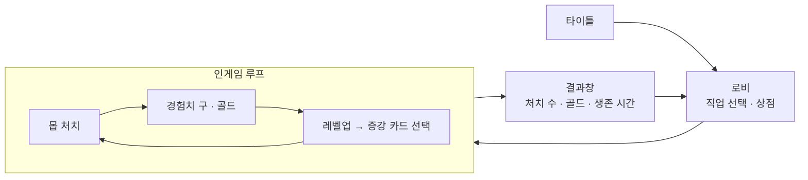
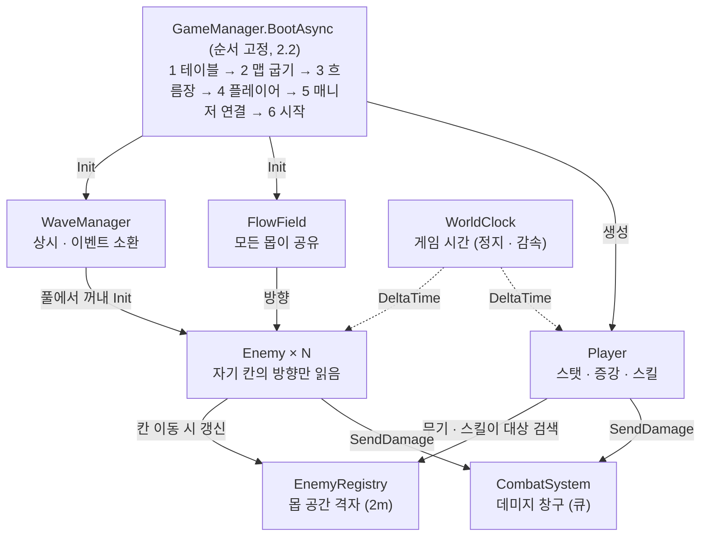
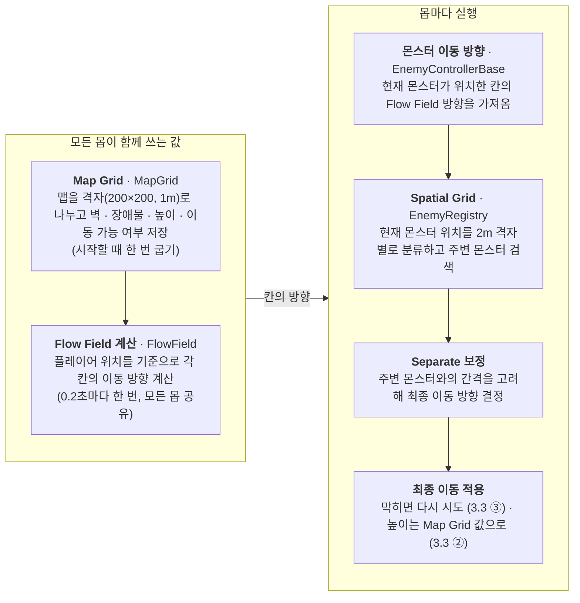
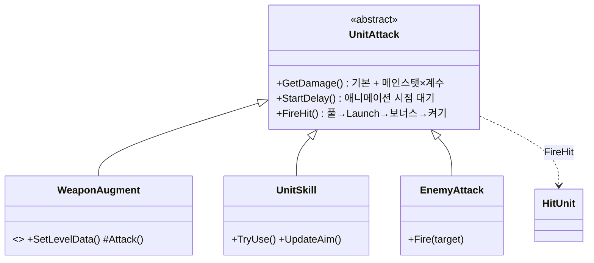
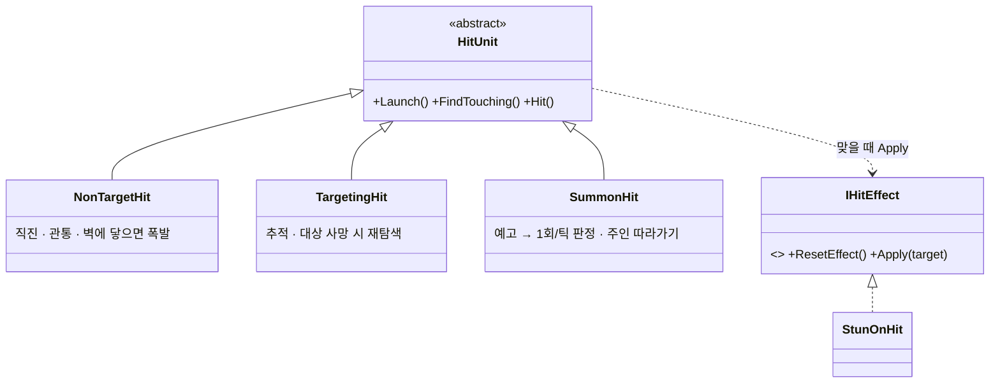
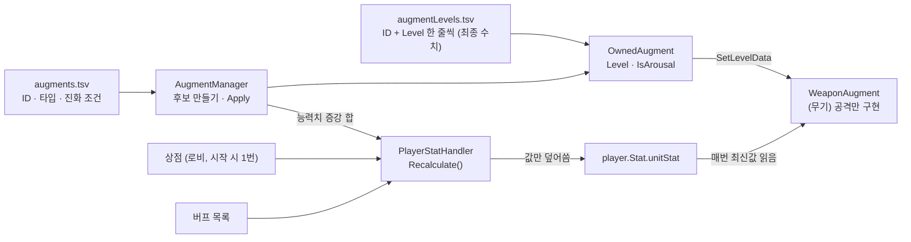
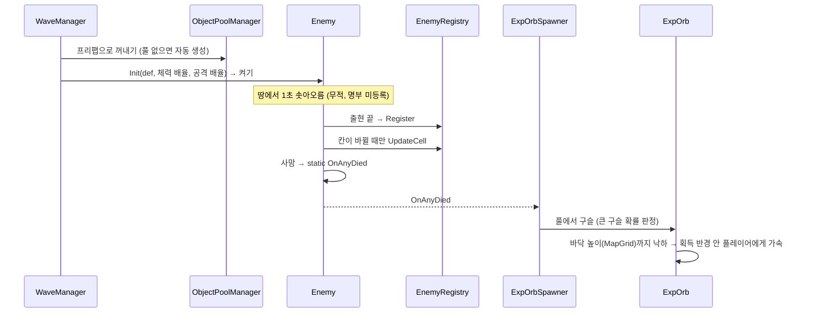

# PROJECT3D — 몹 1000마리를 위한 3D 뱀서라이크 구조 재설계 기술 문서

**상태**: **제작 중** — 2주 동안 프로토타입을 만들었고, 3주 더 진행할 예정입니다. 이 문서는 **2026.11.14 기준**이며 구조가 바뀔 수 있습니다.

**다루는 범위**: DGS(팀 졸업작품)를 1인으로 다시 만들면서 **"몹 1000마리 · 최대 4인"을 버티도록 바꾼 구조**와, 그 과정의 고민을 다룹니다.

**만든 방식**: 설계 기준과 데이터 구조는 제가 정하고, AI(Claude Code)와 대안을 주고받으며 더 나은 구조가 있는지 시스템 단위로 비교한 뒤 골랐습니다. 구현은 AI와 주고받으며 진행했습니다.

| # | 시스템 | 한 줄 요약 | 핵심 키워드 |
|---|---|---|---|
| A | 맵 · 몹 이동 | NavMeshAgent 대신 **미리 구운 격자 + 흐름장 하나를 모든 몹이 공유** | `MapGrid` · `FlowField` · 공간 격자 |
| B | 전투 판정 | 콜라이더 없이 **피격 원통 + 수학 판정**, 투사체 · 범위를 부모 하나로 | `CombatEntity` · `HitUnit` · `IHitEffect` |
| C | 증강 · 스탯 | 증강 수치를 **TSV 표**로, 스탯은 출처별로 모아 **매번 처음부터 다시 계산** | `AugmentManager` · `PlayerStatHandler` |
| D | 웨이브 · 경험치 · 구조물 | **상시 소환 + 이벤트 소환**을 섞고, 경험치 구는 물리 없이 이동 | `WaveManager` · `ExpOrb` · `EnemyRegistry` |
| E | 조작 · 카메라 | 점프 · 낙하를 이벤트로, 조준 카메라 전환, 스킬 중 기본 공격 | `CharacterController3D` · Cinemachine |

공통 기반(2장): 초기화 순서를 한 곳에 적는 `GameManager.BootAsync`, `Time.timeScale` 대신 게임 시계 `WorldClock`

---

## 1. 프로젝트 개요

### 1.1 What — 무엇을 만들었나

**PROJECT3D**는 리그 오브 레전드 '집중포화' 모드와 '메가봉크'를 모티브로 한 PC용 **3인칭 3D 뱀서라이크**입니다.
플레이어는 직업(전사 · 마법사)을 고르고, 기본 무기 · 스킬 2개(E · Q) · 패시브 1개를 가지고 시작해 몰려오는 몬스터를 처치합니다.
레벨업마다 증강 카드를 골라 무기와 능력치를 키우고, 맵에 솟아오르는 구조물(회복 · 자석)을 활용하며 버팁니다.

**시점과 맵** — 메가봉크처럼 캐릭터 뒤에서 보는 3인칭 시점이고, 모든 공격 · 스킬은 화면 정중앙을 기준으로 조준합니다(조준 스킬은 누르는 동안 줌인 카메라, 7장).
맵은 평평한 바닥이 아니라 높이가 있는 3D 지형입니다. 200×200m 맵에 원을 겹친 모양의 고원(높이 18m)과 비탈(최대 33.7°), 장애물이 있고, 플레이어는 점프로 오르내리며 높은 곳에서 뛰어내리면 낙하 데미지를 받습니다. 땅 몹은 비탈을 따라 오르내리고, 공중 몹은 장애물 위로 고도를 올려 넘어옵니다.

높이가 있는 맵에서 몹 1000마리를 움직여야 해서, 몹 이동 · 공격 판정 · 경험치 구 낙하까지 모두 높이를 다뤄야 했습니다. 3장의 "맵을 격자로 한 번 굽고 높이까지 저장하는" 구조가 여기서 나왔습니다.



| 레퍼런스 | 가져온 것 | 내 프로젝트에서 다른 점 |
|---|---|---|
| 롤 집중포화 | 증강 카드 · 무기 진화 · 상점 영구 강화 | 3D 지형(고원 · 비탈)에서 높이가 있는 전투 |
| 메가봉크 | 3인칭 3D 맵, 레벨업 시 좌우에 진화 목록 · 스탯 창 | 직업별 E/Q 스킬, 화면 정중앙 조준 |
| DGS(이전 팀 프로젝트) | 증강 · 진화 규칙, 몹 공격 방식 | **구조를 처음부터 다시 설계** (아래 1.2) |

### 1.2 Why — 왜 다시 만들었나

DGS는 완성 후 빌드를 측정해 보니 **몬스터 100마리 이상 · 경험치 구가 쌓이는 후반에 최저 20.7 FPS**까지 떨어졌습니다.
원인은 생성 비용이 아니라 **살아 있는 오브젝트 하나하나가 매 프레임 드는 비용**(몹마다 NavMeshAgent 경로 · Rigidbody · 트리거 Collider)이었습니다.
이 프로젝트는 그 측정 결과에서 출발했습니다.

| 문제 상황 (DGS) | 결과적으로 생기는 비용 | 해결 방향 |
|---|---|---|
| 몹마다 NavMeshAgent가 경로를 계산 | 몹 수만큼 경로 비용이 쌓임 | 맵을 **격자로 한 번 굽고**, 흐름장 **하나를 모든 몹이 공유** (3장) |
| 몹 · 투사체 · 경험치 구가 모두 물리 콜라이더 | 겹침 검사 · 물리 비용이 개수만큼 쌓임 | 콜라이더 없이 **공간 격자 + 수학 판정** (4장) |
| 무기 수치를 이름으로 찾아 주입, 진화 판정이 흩어짐 | 무기가 늘수록 수정할 곳이 늘어남 | 공통 부모 `WeaponAugment` + **TSV 레벨 표** (5장) |
| `Time.timeScale`로 일시정지 | UI 연출까지 같이 멈추고, 멀티에서 쓸 수 없음 | 별도 **게임 시계** `WorldClock` (2장) |
| "몇 프레임 뒤면 초기화가 끝났겠지" 대기 | 초기화 순서가 코드에 드러나지 않음 | `GameManager.BootAsync`에서 **순서를 한 줄씩 명시** (2장) |

목표는 두 가지입니다.

- **몹 1000마리 · 최대 4인**을 기준으로 설계한다 (지금 실제 동시 상한은 300마리, 멀티는 구조만 준비 — 8장).
- 연수 과정에서 배운 범위(2D 기초 프로젝트 · 3D 수업 프로젝트)의 패턴만으로, **제가 읽고 설명할 수 있는 코드**로 만든다.

### 1.3 개발 환경

| 항목 | 내용 |
|---|---|
| Engine | Unity **6000.3.15f1** · URP 17.3 |
| Language | C# (네임스페이스 `PROJECT3D`) |
| 데이터 | **TSV 표 10종** (`StreamingAssets/Table/PROJECT3D`) + JSON 저장 |
| 주요 패키지 | UniTask, DOTween, Cinemachine 3.1.7, Input System, DTT Area of Effect Regions(범위 표시), lilToon |
| 규모 | 본인 스크립트 136개 · 약 16,200줄 (그중 맵 에디터 툴 약 3,200줄) |
| 기간 · 형태 | 2주 (프로토타입, 제작 중) · 3주 더 진행 예정 · 1인 개인 프로젝트 |
| 개발 방식 | 설계 기준 · 데이터 구조는 직접 정하고, AI(Claude Code)와 대안을 비교한 뒤 선택. 구현은 AI와 주고받으며, 검수는 직접 (1.4) |
| 링크 | GitHub: https://github.com/KooHoo-Dev/3rd_3D_1-3D-Project-NaJungWon · 시연 영상 ⟨확인 필요⟩ |

### 1.4 AI와 일하는 방식

이 프로젝트는 **설계 기준 세우기 → AI와 대안 비교 → 제가 선택 → 구현은 AI와 함께** 순서로 만들었습니다. "몹 1000마리 · 최대 4인", "배운 범위 안의 코드"라는 기준을 먼저 세우고, 구조마다 AI와 대안을 주고받으며 더 나은 구조가 있는지 시스템 단위로 따져 본 뒤 골랐습니다(각 장의 「고민과 선택」 표). 그리고 "AI가 짜 준 코드를 내가 설명할 수 있는가"를 지키려고 규칙을 먼저 정했습니다.

| 규칙 | 이유 |
|---|---|
| 연수생 수준 코드, **과설계 금지**, 내가 제안한 방식을 우선 구현 | 배운 범위(2D 기초 프로젝트 MiniDefense · MiniFarm · Platformer, 3D 수업 FPS) 밖의 기법이 섞이면 나중에 직접 고칠 수 없음 |
| for · if/else · 일반 switch, `def.X = dto.X` 한 줄씩. **LINQ · 튜플 · 제네릭 헬퍼 금지**, `get{}` 프로퍼티 대신 일반 함수 | 내가 읽고 디버깅할 수 있는 문법만 |
| 수정한 곳에 `// 새로 추가` · `// [변경]` 표시 | "나중에 검수해야 하니까" — 표시가 남아 있으면 아직 안 본 코드 |
| 코드는 채팅으로 받고, 반영은 요청할 때만. **"직접 반영해"는 그 작업 한 번에만** 유효 | 무엇이 바뀌는지 직접 보고 붙여 넣기 위해. 프로토타입 마감(11.04) 직전에만 직접 수정을 허용하고 표시로 나중에 검수 |
| AI가 넘기기 전에 **컴파일 확인** (실제 Unity 어셈블리 참조, `UNITY_EDITOR` 정의 있을 때 · 없을 때 둘 다) | 붙여 넣고 나서 에러를 찾는 시간을 줄이기 위해. 단, 컴파일 통과 ≠ 플레이 확인 |
| 위치 · 방향 계산은 **기존 시스템(MapGrid · EnemyRegistry · CombatSystem) 재사용** 우선 | 같은 계산이 여러 벌 생기지 않게 |
| 기능을 한 번에 다 만들지 않고 단계별로 (투사체 → 스킬 → 증강) | 한 번에 다 하면 대화가 길어져 토큰만 먹고, 바뀌는 범위도 이해하기 어려움 |
| 핑퐁으로 쌓인 코드는 **다시 검수**하고 단계마다 커밋 | 11.01 · 11.04에 미검토 스크립트 목록(새 파일 11 · 동작 변경 40 · 정리만 66)을 만들어 검토했고, 11.14부터는 9단계로 나눠 변수 정리 · 책임 분리 |

실제로 AI가 복잡하게 제안한 것을 제가 더 단순하게 바꾼 경우가 여러 번 있었습니다. 이 문서의 「고민과 선택」에서 **🧭**는 제가 정한 것, **🤝**는 AI와 주고받으며 정한 것, **🔍**는 AI의 처음 제안을 제가 바꾼 것입니다.

### 1.5 이 문서에서 다루는 내용

공통 기반(2장)을 먼저 보여 드린 뒤, 다섯 시스템을 차례로 설명합니다. **맵 · 몹 이동**(3장), **전투 판정**(4장), **증강 · 스탯**(5장), **웨이브 · 경험치 · 구조물**(6장), **조작 · 카메라**(7장)입니다. 마지막으로 현재 상태와 문제 해결, 남은 과제(8장)를 정리합니다.

---

## 2. 공통 기반 — 부팅 순서와 게임 시계

### 2.1 전체 구조



> 실선 = 직접 호출 · 값 전달, 점선 = 모든 게임 로직이 읽는 공용 시계.

| 클래스 | 하는 일 | 하지 않는 일 |
|---|---|---|
| `GameManager` | 초기화 순서 실행, 패배 처리 | 게임 규칙을 판정하지 않음 |
| `TableLoader` | TSV 10종을 한 번만 읽어 Def로 보관 | 씬마다 다시 읽지 않음 |
| `WorldClock` | 게임 시간(정지 · 보통 · 감속 · 배속), 경과 시간 | `Time.timeScale`을 바꾸지 않음 |
| `ObjectPoolManager` | 몹 · 투사체 · 이펙트 · 경험치 구 · 구조물을 **프리팹 이름 키**로 풀링 | 종류별 풀 클래스를 따로 두지 않음 |
| `CombatSystem` | 데미지 · 회복 이벤트를 큐에 모아 **그 프레임 시작 때 쌓인 개수만큼** 처리, 크리티컬 판정 | 누가 맞았는지 찾지 않음 (4장) |
| `GameSession` · `SaveService` | 로비 상태(선택 직업 · 상점 · 골드), JSON 저장 | 인게임 수치를 계산하지 않음 |

### 2.2 핵심 기능: 초기화 순서를 한 곳에 적기

**규칙** — 각 매니저는 `Awake`에서 자기 참조(Instance)만 잡고, 데이터는 `Init`으로 받으며, `Init` 전에는 `Update`에서 바로 return합니다. **기다리는 관계는 `GameManager` 한 곳에만** 둡니다.

```csharp
// GameManager.cs:43 — 부팅 순서 (로그 · 일부 줄 생략)
private async UniTaskVoid BootAsync(CancellationToken token)
{
    WorldClock.Instance.ResetClock();
    EnemyRegistry.Clear();  // 정적 명부는 씬이 바뀌어도 남아서, 이전 판 기록을 지운다
    PlayerRegistry.Clear();

    TableLoader.Instance.LoadData();       // 1. 테이블
    await UniTask.Yield(token);
    await mapGrid.BakeAllAsync(token);     // 2. 맵 굽기 (여러 프레임에 나눠서)
    flowFieldManager.Init(mapGrid);        // 3. 흐름장
    Player player = playerSpawner.SpawnPlayers(); // 4. 플레이어

    flowFieldManager.AddPlayer(player.transform); // 5. 매니저 연결
    AugmentManager.Instance.Init(player, player.BodyPivot);
    WaveManager.Instance.Init(mapGrid);
    inGameUI.Init(player); // 증강 매니저가 준비된 뒤에 연결 (보유 증강 표시)
    player.OnDead += HandlePlayerDead;

    IsReady = true;                        // 6. 시작
    OnGameReady?.Invoke();
    WaveManager.Instance.StartWaves();
    structureManager.StartSpawn();
}
```

**게임 시계** — 게임 로직은 모두 `WorldClock.Instance.DeltaTime`을 씁니다.

```csharp
// WorldClock.cs:24 — 0번 정지, 1번 보통, 2번 감속(연출), 3번 배속
[SerializeField] private float[] timeScales = { 0f, 1f, 0.3f, 2f };
public float Scale => timeScales[ScaleStep];
// Time.timeScale은 건드리지 않기로 했으므로, 그 값과 상관없이 흐르는 시계
public float DeltaTime => Time.unscaledDeltaTime * Scale;
```

카드 선택 창 · 사망 연출 · 옵션 창은 `WorldClock.Pause()`로 게임만 멈추고, UI 연출은 실제 시간으로 움직입니다. DOTween도 `DOTween.timeScale`을 게임 배율에 맞춥니다.

### 2.3 고민과 선택 ①: 일시정지를 무엇으로 할 것인가 🧭

| | [A] `Time.timeScale = 0` | **[B] 게임 시계 `WorldClock`** ✓ |
|---|---|---|
| 방식 | 엔진 전체 시간을 멈춤 | 게임 로직만 자체 배율이 곱해진 시간을 씀 |
| 장점 | 한 줄로 끝남 | 멈출 대상이 분명함. 감속(연출) 단계도 같은 방식 |
| 단점 | UI 연출까지 멈춤. **멀티에서는 한 사람이 멈출 수 없음** | 모든 `deltaTime`을 바꿔야 하고, Animator · 파티클은 따로 맞춰야 함 |

**[최종 결정]** [B]. DGS에서 `timeScale`로 멈추면서 "UI만 움직이고 전투는 멈춤"을 따로 제어하기 어려웠고, 수업에서 `timeScale`을 직접 건드리는 건 좋지 않다고 배웠습니다. 2D 기초 프로젝트(MiniFarm)의 게임 시계 구조를 줄여서 가져왔습니다. 배속은 쓸 일이 거의 없지만 **감속은 연출에 쓸 계획**이라 단계표로 두었습니다.

### 2.4 고민과 선택 ②: 비동기 대기를 어디에 둘 것인가 🤝

| | [A] 각 매니저가 각자 `await` | **[B] `GameManager` 한 곳에서 순서대로** ✓ |
|---|---|---|
| 장점 | 매니저가 스스로 준비를 기다림 | 순서가 위에서 아래로 한눈에 읽힘 |
| 단점 | 누가 누구를 기다리는지 흩어짐 | `GameManager`가 모든 매니저를 알아야 함 |

**[최종 결정]** 처음에는 제가 "맵 → 테이블 → 플레이어 순서로, 플레이어 컨트롤러도 비동기로" 하자고 했는데, AI가 **테이블이 맵을 정할 수 있으니 테이블이 먼저**이고, 기다림은 한 곳에 모으는 편이 읽기 쉽다고 했습니다. DGS의 "몇 프레임 기다리면 되겠지"를 없애는 것이 목적이었으므로 [B]로 정했습니다.

맵과 테이블을 `UniTask.WhenAll`로 동시에 처리하는 안도 있었지만, 테이블 읽기는 동기 파일 읽기라 실제로 겹치지 않아 버렸습니다. 맵 굽기는 Physics 검사가 메인 스레드에서만 되므로, 스레드로 넘기지 않고 **한 프레임에 20줄씩** 나눠 굽습니다.

### 2.5 고민과 선택 ③: 데미지를 한 프레임에 몇 개 처리할 것인가 🤝

데미지는 바로 깎지 않고 `CombatSystem` 큐에 넣었다가 처리합니다(2D 수업 Platformer의 `CombatSystem.To` 방식). 처음에는 **프레임당 10개**로 제한했습니다.

| | [A] 프레임당 10개 | [B] 큐가 빌 때까지 | **[C] 프레임 시작 때 쌓인 개수만큼** ✓ |
|---|---|---|---|
| 문제 | 범위기 한 방에 50마리가 맞으면 데미지가 5프레임에 나뉨. 그 사이 풀로 돌아갔다 다시 나온 몹이 **예전 데미지를 받을 수 있음** | 폭발 몹이 연쇄로 터지면 처리 중에 이벤트가 계속 추가돼 한 프레임이 끝나지 않을 수 있음 | — |
| 결과 | — | — | 한 번에 맞은 것은 같은 프레임에 들어가고, 처리 중에 생긴 연쇄는 다음 프레임으로 |

---

## 3. 기능 A — 맵 · 몹 이동: 격자를 굽고 흐름장을 공유

### 3.1 개요

맵을 200×200칸(1칸 1m) 격자로 **시작할 때 한 번 굽고**, 플레이어 위치를 목표로 하는 흐름장(Flow Field) 하나를 0.2초마다 다시 계산합니다.
몹은 경로를 직접 찾지 않고 **자기가 선 칸에 적힌 방향**만 읽습니다. 몹이 1000마리여도 경로 계산은 한 번입니다.

### 3.2 시스템 구조

몹 하나가 한 프레임에 움직이는 순서입니다. 위 두 단계(Map Grid · Flow Field)는 **모든 몹이 함께 쓰는 값**이고, 아래 네 단계만 몹마다 실행합니다.



| 칸(`Tile`)에 굽는 값 | 쓰는 곳 |
|---|---|
| `Kind` (Walkable / Blocked) | 흐름장 · 스폰 위치 · 구조물 위치 |
| `GroundHeight` · `GroundNormal` | 몹 높이 · 기울기, 경험치 구 낙하, 범위 스킬 바닥 |
| `SurfaceHeight` (바닥 + 장애물 꼭대기) | 공중 몹 고도, 포격 착탄 높이 |
| `Distance` · `Direction` | 흐름장 결과 (몹 이동 방향) |

| 맵 규칙 | 값 | 이유 |
|---|---|---|
| 몹이 오를 수 있는 경사 | 40° | 맵 비탈은 최대 33.7°로 만들어 항상 오를 수 있게 |
| 한 칸 오르기 / 내려가기 | 1m / 7m | `CanMove`에서 칸 사이 높이차 검사 |
| 위가 튀어나온 지형 금지 | — | 칸마다 **위에서 아래로만** 레이를 쏘므로(바닥 · 표면) 2층 아래 공간을 표현할 수 없음 |

### 3.3 핵심 기능

**① 흐름장 만들기** — 플레이어 칸에서 시작해 BFS로 거리를 채우고, 각 칸은 거리가 가장 작은 이웃을 가리킵니다.

```csharp
// FlowField.cs:28
public void Build(List<Vector3> targets)
{
    ResetTiles();
    AddTargets(targets);           // 플레이어가 선 칸들 (멀티면 여러 개)
    FillDistances();
    AddUnreachedTargets(targets);  // 몹이 못 오르는 곳에 플레이어가 있을 때 (3.5)
    FillDirections();
}

// FlowField.cs:149
private void FillDistances()
{
    while (searchQueue.Count > 0)
    {
        Tile current = searchQueue.Dequeue();
        foreach (MoveDirection direction in GridDirection.All)
        {
            Tile neighbor = grid.GetNeighborOrNull(current, direction);
            if (neighbor == null || neighbor.Distance != -1) continue;
            // 실제 몹은 이웃에서 현재 칸으로 와야 하므로 반대로 검사한다.
            if (!map.CanMove(neighbor, current)) continue;
            neighbor.Distance = current.Distance + 1;
            searchQueue.Enqueue(neighbor);
        }
    }
}
```

**② 몹 높이 — 레이 대신 구워 둔 값을 4칸 보간** (11.14 교체)

```csharp
// MapGrid.cs:128 — 몹 위치의 바닥 높이를 주변 4칸으로 보간 (일부 줄 합침)
public bool TryGetGroundHeight(Vector3 position, out float height, out Vector3 normal)
{
    Tile own = Grid.GetTileOrNull(position);
    float fx = (position.x - Grid.Origin.x) / Grid.CellSize - 0.5f;
    float fz = (position.z - Grid.Origin.z) / Grid.CellSize - 0.5f;
    int x0 = Mathf.FloorToInt(fx); int z0 = Mathf.FloorToInt(fz);
    float tx = fx - x0; float tz = fz - z0;
    // 막혔거나 maxStepUp보다 높이차가 큰 절벽 칸은 섞지 않고 내 칸 값으로 대체
    Tile t00 = GetBlendTile(own, x0, z0);     Tile t10 = GetBlendTile(own, x0 + 1, z0);
    Tile t01 = GetBlendTile(own, x0, z0 + 1); Tile t11 = GetBlendTile(own, x0 + 1, z0 + 1);
    float bottom = Mathf.Lerp(t00.GroundHeight, t10.GroundHeight, tx);
    float top    = Mathf.Lerp(t01.GroundHeight, t11.GroundHeight, tx);
    height = Mathf.Lerp(bottom, top, tz);
    // ... normal도 같은 방식
}
```

**③ 막혔을 때 빠져나오기** — `EnemyControllerBase.ApplyMovement`는 이동이 막히면 **(막힌 칸에 끼었으면) 가까운 이동 가능 칸으로 탈출 → 원래 방향 → 추격 방향만 → 다음 칸 중심 → 축 하나씩 미끄러지기 → 정지** 순서로 다시 시도합니다.

**④ 공중 몹** — 흐름장을 쓰지 않고 플레이어에게 직진합니다. 목표 고도는 "발밑 표면 + 비행 높이"와 "앞쪽 장애물 꼭대기 + 여유"(접지한 플레이어보다 위) 중 큰 값이고, 앞이 높으면 수평 이동을 멈추고 먼저 올라갑니다. 처음 코드는 장애물을 옆으로 돌아가는 방식이었는데, 지그재그로 움직이는 원인이라 "높으면 올라가서 넘는다"로 바꿨습니다.

**⑤ 몸 기울기** — 본체는 위치와 좌우 회전만, 자식 모델(플레이어는 `BodyPivot`, 몹은 `Model`)만 경사에 맞춰 기울입니다(최대 30°, Slerp).

### 3.4 고민과 선택

**결정 1. 몹 추적 방식: NavMesh → 콜라이더 · 레이 → 격자 + 흐름장** 🧭

추적 방식은 세 번 바뀌었습니다.

| | [A] 몹마다 NavMeshAgent (DGS) | [B] 콜라이더 · 레이 기반 추적 (수업에서 배운 방식) | **[C] MapGrid + 흐름장 하나 공유** ✓ |
|---|---|---|---|
| 방식 | 엔진 AI Navigation이 몹마다 경로 계산 | 몹이 플레이어 쪽으로 이동하며 콜라이더 · 레이로 장애물을 감지해 피함 | 맵을 격자로 한 번 굽고, 플레이어 칸에서 퍼져 나간 방향을 모든 몹이 읽음 |
| 경로 계산 | 몹 수만큼 | 몹 수만큼 (매 프레임 감지) | 0.2초마다 **한 번** |
| 장점 | 엔진 기능 그대로, 정확한 경로 | 구현이 단순, 배운 범위 | 몹 수가 늘어도 경로 비용이 그대로. 수업에서 배운 맵 그리드 · 타일 추적 방식 |
| 단점 | 몹이 많으면 경로 · 회피 비용이 쌓임 (DGS 실측 최저 20.7 FPS) | 몹마다 물리 검사가 쌓이고, 막다른 곳에서 길을 못 찾음 | 칸 단위라 방향이 각져서 보간이 필요. 흐름장 밖(못 오르는 곳)을 따로 처리해야 함 |

**[최종 결정]** [C]. DGS 빌드 측정에서 병목이 "살아 있는 몹마다 드는 비용"이었기 때문에, 몹 하나하나가 길을 찾지도, 물리로 주변을 감지하지도 않게 하는 쪽을 골랐습니다. 칸 단위 방향 때문에 회전이 어색한 문제는 방향을 지수 보간(`1 - Exp(-속도 × dt)`)해서 줄였습니다. 그 뒤 몹끼리 겹치는 문제를 풀려고 밀어내기(separation) 방식을 여러 가지 비교했고, 그 과정에서 처음 설계에는 없던 **공간 격자(`EnemyRegistry`)를 추가**했습니다(결정 2). 최종 구조는 3.2의 그림과 같습니다.

**결정 2. 몹끼리 밀어내기(분리): 전체 비교 vs 공간 격자 (나중에 추가)** 🧭

| | [A] 모든 몹끼리 비교 | **[B] 2m 공간 격자 (`EnemyRegistry`)** ✓ |
|---|---|---|
| 비교 횟수 (1000마리) | 1000 × 1000 = 약 100만 번 / 프레임 | 주변 9칸만 → 수천 번 수준 (계산상) |
| 단점 | 몹 수의 제곱으로 늘어남 | 몹이 칸을 옮길 때마다 갱신해야 함 |

**[최종 결정]** [B]. 칸 크기 2m는 분리 거리(1.5m)보다 크게 잡아 **주변 9칸만 보면 되도록** 했습니다. 2D 기초 프로젝트(MiniDefense)의 `EnemyRegistry`와 사용법을 똑같이 맞춰, 배운 범위 안에서 쓸 수 있게 했습니다. 이 격자는 이후 **공격 판정 · 가장 가까운 적 찾기**에도 그대로 재사용했습니다(4장).

**결정 3. 몹 높이: 매 프레임 레이 vs 구워 둔 격자 값** 🔍

| | [A] 몹마다 매 프레임 아래로 레이 | **[B] MapGrid 4칸 쌍선형 보간** ✓ |
|---|---|---|
| 1000마리 비용 | 레이 1000번 / 프레임 | 배열 읽기 4번 × 1000 |
| 정확도 | 정확 | 칸 중심값 기준이라 경사 시작 · 끝에서 오차 |
| 한계 | — | **1층 · 2층 사이 터널은 표현 불가**, 칸보다 가는 장애물은 빠질 수 있음 |

**[최종 결정]** 이 결정은 한 번 뒤집혔습니다. 10.24에는 칸 높이를 쓰는 분기가 있었는데, AI가 "격자로는 걸을 수 있는 높은 칸을 놓친다, 레이 하나로 통일하자"고 해서 레이로 바꿨습니다. 10.31에 AI가 "몹 1000마리 레이는 비싸다"고 말을 바꿨습니다. 제가 "몹 1000마리 · 4인이 처음부터 목표인데 지금 설계는 그게 아니라는 거냐"고 짚었고, 정리해 보니 큰 틀(흐름장 · 공간 격자 · 풀링 · 맵 굽기)은 맞고 **몹별 매 프레임 레이만 어긋나 있었습니다**. 프로토타입 마감이 급해 "이후에 무조건 바꾼다"고 미뤄 두었다가, 11.14에 "장애물 배치는 안 바뀌니 처음 구울 때 높이도 같이 저장하면 된다"고 판단해 [B]로 바꿨고, 공중 몹 고도 · 포격 착탄 높이까지 같은 값(`SurfaceHeight`)으로 통일했습니다. 절벽처럼 높이차가 큰 곳은 보간하지 않고 기존처럼 멈췄다가 올라가게 했습니다. 플레이어(최대 4명)는 CharacterController의 충돌 normal을 그대로 씁니다.

**결정 4. 장애물 콜라이더: 큐브 근사 vs 에셋 메쉬 그대로** 🧭

| | [A] 큐브 · 원통으로 근사 | [B] 부피 비율로 Box · 원통 · Mesh 자동 선택 | **[C] 에셋 자체 콜라이더 그대로** ✓ |
|---|---|---|---|
| 장점 | 판정이 단순 | 모양에 가까운 단순 콜라이더 | 에셋 제작자가 맞춘 모양 그대로 |
| 단점 | **보이는 장애물과 막히는 위치가 달라** 이동 불가 지점이 생김 | 원래 콜라이더를 지우고 다시 넣다 보니 영역이 이상하게 잡힘 | MeshCollider 비용 |

**[최종 결정]** 큐브 근사 → AI의 자동 선택(B)을 거쳐, 제가 "원래 콜라이더를 지우고 다시 넣는 이상한 상황"이라며 **[C] 에셋 콜라이더를 그대로 켜는 방식**(`SetupColliders`)으로 정했습니다. 격자는 시작할 때 한 번만 굽고, 몹 1000마리는 격자로만 움직여 콜라이더를 보지 않습니다. 매 프레임 콜라이더를 쓰는 건 플레이어 4명, 투사체의 벽 충돌 레이, 조준 레이 정도라 정지 MeshCollider로 충분하다고 판단했습니다. 캡슐 콜라이더는 쓰지 않고, 나무만 줄기 원통(높이 10m 이상, 2단 점프 7.5m 고려)으로 막았습니다.

**결정 5. 맵 제작: 화이트박스 재활용 vs 처음부터 다시** 🧭

AI는 화이트박스 콜라이더 위에 아트만 덮자고 제안했지만, 저는 "기존 배치를 그대로 가져가지 말고 컨셉만" 가져가 에셋 메쉬로 바닥부터 다시 만들기로 했습니다(Terrain 대신 메쉬 오브젝트 기반, 메가봉크처럼). 맵 생성은 에디터 툴(`DragonNestMapBuilder`, 시드 고정)로 만들고, 아래 규칙을 툴에 넣었습니다.

| 규칙 | 이유 |
|---|---|
| 걸을 수 있는 지형 = Ground(10), 장애물 · 나무 = Obstacle(11), 풀 · 꽃만 Default | 격자 굽기가 레이어로 칸을 판정 |
| 위가 튀어나온 지형 금지, 비탈 34° 이하 · 고원마다 오르내리는 길 2개 이상 | 칸마다 위에서 레이를 쏘는 격자 규칙, 몹 경사 한계 40° |
| 고원은 원 여러 개를 겹친 모양 | "2층 지형이 전부 원형이라 어색하다"는 판단 |
| 바깥은 큰 바위 대신 보이지 않는 벽 | 원형 맵 경계를 단순하게 |

### 3.5 트러블슈팅: 플레이어가 비탈 위에 있으면 몹이 멈춤

| 단계 | 내용 |
|---|---|
| 증상 | 몹이 오를 수 없는 경사나 장애물 위에 플레이어가 있으면 땅의 몹이 제자리에 멈춤 |
| 원인 | 흐름장에서 길이 없는 칸은 방향이 0. 장애물 칸은 "가장 가까운 걸을 수 있는 칸"으로 목표를 옮기고 있었지만, **가파른 Ground 칸은 걸을 수 있는 칸으로 분류돼** 목표가 옮겨지지 않았음 |
| 해결 | AI는 처음에 "길이 없으면 플레이어 쪽으로 직진"을 넣었는데, 제가 **장애물 위에서 쓰던 "근처로 모이기"를 그대로 재사용**하자고 했습니다. 플레이어 주변 10칸 안에서 아직 길이 없는 칸 중 가장 가까운 칸을 보조 목표로 추가(`AddUnreachedTargets`, 끊긴 땅 덩어리 최대 4개) |
| 결과 | 몹이 멈추지 않고, 오를 수 없는 비탈 아래 · 플레이어 근처로 모여듦 (장애물 위에 있을 때와 같은 설계 동작) |
| 배운 점 | 예외 상황마다 새 규칙을 만들기보다, **이미 있는 규칙이 왜 이 경우를 못 잡는지**를 먼저 보면 코드가 늘지 않습니다 |

---

## 4. 기능 B — 전투 판정: 콜라이더 없이 수학으로

### 4.1 개요

몹에는 물리 콜라이더가 없습니다. 모든 유닛(`CombatEntity`)은 **피격 원통**(반경 · 반높이)을 갖고, 공격은 모양(구 · 기둥 · 직육면체)과 크기만 들고 와서 `IsHitBy` 하나로 판정합니다.
후보는 공간 격자로 좁히고(3장), 정밀 판정만 수학으로 합니다.

### 4.2 시스템 구조

**① 언제 · 누구에게 쏘는가 — `UnitAttack` 계열**



**② 어떻게 움직이고 맞히는가 — `HitUnit` 계열과 추가 효과**



| 구분 | 역할 | 기준 |
|---|---|---|
| `UnitAttack` 계열 | **언제 · 누구에게** 쏘는가 (쿨타임, 대상 탐색, 수치 계산) | 몹 공격 · 무기 증강 · 스킬 공통 부모 |
| `HitUnit` 계열 | 생성된 뒤 **어떻게 움직이고 맞히는가** | 직진 / 추적 / 지정 위치 소환 |
| `IHitEffect` | 맞은 대상에 **추가 효과** (스턴 등) | 프리팹에 컴포넌트로 붙임 |

> 한 줄로: **"쏘는 방법은 합치고, 언제 · 왜 쏘는지는 나눈다."**

### 4.3 핵심 기능

**① 판정 후보 찾기** — 몹이 쏜 것은 플레이어(최대 4명)를 전부 검사하고, 플레이어가 쏜 것은 공간 격자로 좁힙니다.

```csharp
// HitUnit.cs:122
protected List<CombatEntity> FindTouching()
{
    touching.Clear();
    if (owner is Enemy)
    {
        IReadOnlyList<Player> players = PlayerRegistry.All; // 최대 4명이라 전부 검사
        for (int i = 0; i < players.Count; i++)
        {
            if (players[i].Stat.IsDead) continue;
            if (players[i].IsHitBy(transform.position, currentHitRadius, hitShape, hitHeight,
                                   transform.rotation, currentHitDepth))
                touching.Add(players[i]);
        }
        return touching;
    }
    EnemyRegistry.FindHitTargets(transform.position, currentHitRadius, hitShape, hitHeight,
                                 transform.rotation, currentHitDepth, ref enemyBuffer);
    for (int i = 0; i < enemyBuffer.Count; i++) touching.Add(enemyBuffer[i]);
    return touching;
}

// HitUnit.cs:151 — 맞히기: 데미지 → 피격 이펙트 → 추가 효과
protected void Hit(CombatEntity target)
{
    CombatSystem.Instance.SendDamage(owner, target, damage, transform.position);
    if (impactEffect != null) ObjectPoolManager.PlayEffect(impactEffect, GetImpactPoint(target));
    for (int i = 0; i < hitEffects.Length; i++) hitEffects[i].Apply(target); // 스턴 등
}
```

**② 이펙트 책임 규칙** — 처음에는 폭발 이펙트가 투사체 · 범위 · 돌진에 제각각 붙어 있었습니다. 11.14 검수에서 아래처럼 정리했습니다.

| 이펙트 | 위치 | 언제 |
|---|---|---|
| `impactEffect` | 모든 `HitUnit` | 맞은 **대상마다**, 피격 원통 표면에서 |
| `explodeEffect` | `SummonHit`(범위) | **첫 판정 순간** 한 번 (따라가기형이면 이펙트도 주인을 따라감) |
| 자식 파티클 | 범위 프리팹 | 처음부터 계속 보일 것 (경고 원 · 장판) |
| `explodePrefab` | `NonTargetHit` | 벽 · 적에 닿으면 **범위(`SummonHit`)를 만들고**, 폭발은 범위가 터뜨림 |

### 4.4 고민과 선택

**결정 1. 피격 모양: 구 vs 캡슐 vs 원통** 🧭

| | [A] 구 | [B] 캡슐 | **[C] 원통** ✓ |
|---|---|---|---|
| 장점 | 계산이 가장 단순 | 사람 모양에 가까움 | **너비와 높이를 따로** 정할 수 있음 |
| 단점 | 키 큰 몹 · 납작한 몹을 표현 못 함 | 너비를 늘리면 위아래 길이도 같이 문제 | 판정식이 구보다 조금 김 |

**[최종 결정]** [C]. AI가 먼저 '피격 구'로 만들었는데, 제가 "원통 형태로 하는 게 좋을 것 같다"고 해서 바꿨습니다. 판정을 각 유닛(`CombatEntity`) 쪽에 두고, 기즈모로 원통을 그려 크기를 눈으로 맞추게 했습니다. 저는 그 이유로 "구가 비용이 많이 든다"고 생각했는데, AI가 비용 차이가 아니라 **너비 · 높이를 따로 정할 수 있다는 점**이 원통의 진짜 이유라고 정정해 줬습니다.

"콜라이더 없이 범위를 정하는 방식은 OBB밖에 없는 줄 알았다"는 질문에는, 판정이 **① 후보 고르기(공간 격자) + ② 정밀 판정(모양 계산)** 두 단계로 나뉘고, 느린 진짜 이유는 모양이 아니라 **전부를 검사하는 것**이라는 답을 얻었습니다. 격자 칸은 몹의 발 위치로 나누는데 피격 원통은 몸 중심에 있으므로, 후보는 "발 → 원통 중심 거리 + 원통 대각선" 중 가장 큰 값(`maxHitReach`)만큼 넉넉히 가져온 뒤 정밀 판정으로 거릅니다.

**결정 2. 수평으로 쏜 탄이 공중 몹을 못 맞히는 문제 — 고치지 않음** 🧭

AI는 "바닥 반경 + 높이차"로 판정을 통일해 수평 탄도 공중 몹을 맞히게 하자고 제안했습니다. 저는 **의도된 사항**이라고 판단했습니다.

| | [A] 높이 무시하고 맞힘 | **[B] 높이까지 판정 (공중 몹은 따로 처리)** ✓ |
|---|---|---|
| 플레이 | 공중 몹도 기본 공격으로 정리됨 | 범위 증가 · 스킬 · 타겟팅 증강으로 잡아야 함 |
| 의도 | — | 공중 몹은 **적게 나오는 대신 처리하기 귀찮게** 해서 증강 선택에 이유를 줌 |

대신 **범위 증가 스탯이 투사체 명중 반경에도 적용**되게 해서, 범위를 키우면 공중 몹도 맞힐 수 있게 했습니다. 기본은 구(Sphere)이고, 돌진(플레이어 스킬 · 돌진 몹)과 접촉 데미지는 기둥(Column), 전사의 베기 · 검기는 직육면체(Cube)를 씁니다. 판정 모양은 공격마다 고정이 아니라 **검사할 때마다 넘기는 값**이라 한 공격 안에서도 섞어 쓸 수 있습니다.

직육면체는 처음에 AI가 검기 전용 판정 클래스를 따로 만들었는데, 제가 "판정 모양에 사각형을 추가해서 논타겟 투사체로 처리하면 되잖아, 왜 이렇게 어렵게 해"라고 해서 `HitShape`에 추가했습니다 🔍. 회전값은 직육면체일 때만 쓰고, 기존 호출부는 고치지 않도록 회전 없는 함수를 그대로 남겼습니다. 몹 공격은 전부 논타겟입니다 — 몹이 타겟팅 공격을 하면 피할 수 없기 때문입니다.

**결정 3. 투사체: 플레이어용 · 몹용을 나눌 것인가** 🔍

| | [A] 플레이어 투사체 / 몹 투사체 따로 | **[B] 하나로 합치고 주인(Owner)으로 대상 판별** ✓ |
|---|---|---|
| 장점 | 각자 필요한 기능만 | 직진 · 추적 · 소환 동작을 한 벌만 관리 |
| 단점 | 같은 이동 코드가 두 벌 | 몹 쪽에 안 쓰는 값이 있음 (0으로 둠) |

**[최종 결정]** 제가 "둘 다 CombatEntity인데 굳이 나눌 필요가 있나?"라고 물어 [B]로 합쳤고, "EnemyAttack도 UnitAttack으로" 바꿔 몹 공격도 같은 부모를 쓰게 했습니다. 이후 투사체 구조는 다섯 번 바뀌었고, 마지막 두 번은 제 제안이었습니다.

| 순서 | 구조 | 계기 |
|---|---|---|
| ① | 투사체 하나에 관통 수 · 유도 켜고 끄기 | AI 첫 구현 |
| ② | 논타겟 / 타겟팅 클래스 두 개 | AI |
| ③ | 한 클래스 안에서 enum으로 분기 | AI |
| ④ | 부모 + 직진 · 추적 · 지정 소환 자식 셋 | 제가 "코드가 너무 무거워진다. 타겟팅 / 논타겟팅 / 지정 소환식으로" |
| ⑤ | **`HitUnit` + 자식 셋, 생성은 `UnitAttack.FireHit` 입구 하나** (풀 → `Launch` → 보너스 → 켜기, 자식은 `Launch`만 override) | 제가 "HitUnit으로 이름 바꾸고 Launch 부분은 override" |

2D 수업 MiniDefense의 "공격 방식과 타겟팅 방식을 나눠 만든다"를 근거로 삼았습니다. 기준은 **"생성된 뒤 어떻게 움직이는가"** 입니다. 새 종류가 생기면 자식만 추가하면 됩니다. 입구 이름을 `Fire`가 아니라 `FireHit`로 한 것은 `EnemyAttack.Fire` 안에서 `Fire`를 부르는 모양이 헷갈리기 때문입니다.

투사체 동작 규칙도 직접 정했습니다. 논타겟은 "맞으면 사라짐" 또는 "관통 무제한, 지형 · 장애물에서만 소멸", 타겟팅은 "대상이 죽으면 범위 안에서 가장 가까운 적으로 다시 찾고, 없으면 소멸, 맞히는 횟수는 무기가 정함"입니다.

**결정 4. 몹 공격 방식: override vs Strategy vs 컴포넌트** 🧭

| | [A] 컨트롤러에서 `ProcessAttack` override | [B] enum + Strategy + Factory | **[C] 공격 컴포넌트 (FPS 수업의 Weapon 방식)** ✓ |
|---|---|---|---|
| 수치 위치 | 컨트롤러 자식 클래스 | 일반 클래스라 인스펙터에 안 보임 | **공격 프리팹 인스펙터** |
| 사망 효과 여러 개 | 어려움 | Factory 분기 추가 | 컴포넌트를 여러 개 붙이면 됨 |
| 판정 위치 | — | — | 쿨타임 · 사거리 판정은 컨트롤러, 공격 컴포넌트는 발사만 (`Update`는 공격 시점을 기다리는 동안만 일함) |

**[최종 결정]** [C]. 세 번 바뀌었습니다. AI는 처음에 MiniDefense의 Strategy + Factory를 권했고, 제가 "몬스터별로 스크립트를 따로 만들어 수치를 override하겠다"고 하자 override로 판단을 바꿨습니다(Strategy는 일반 클래스라 수치가 인스펙터에 안 보이고, 몹 1종에 공격 1종이라 재사용 이득이 적음). 이어서 제가 3D 수업 FPS 프로젝트의 `weapon.Fire()` 구조를 꺼냈고, 비교해 보니 **프리팹에 붙인 컴포넌트가 곧 선택**이라 enum · Factory가 필요 없고 사망 효과도 여러 개 붙일 수 있어 확정했습니다. 다만 **돌진**은 여러 프레임에 걸친 "이동"이라 공격 컴포넌트가 아니라 컨트롤러(`Dash`, `EnemyController.Dash.cs`)에 두고, 돌진 판정은 범위(`SummonHit`)에 맡겼습니다.

**결정 5. 스턴 같은 추가 효과: 부모 필드 vs 인터페이스** 🧭

| | [A] `HitUnit`에 스턴 필드 | **[B] `IHitEffect` 컴포넌트** ✓ |
|---|---|---|
| 장점 | 바로 쓸 수 있음 | 둔화 · 화상이 늘어도 부모가 그대로 |
| 단점 | 스턴은 진화 무기 두 개(전격 · 빙결 마법)만 쓰는데 **모든 투사체에 필드가 생김** | 효과마다 컴포넌트 하나 |

**[최종 결정]** [B]. "스턴은 인터페이스로 다른 기능으로 빼서 적용하는 게 맞다"고 판단했고, 풀링 인터페이스(`IObjectPoolItem`)처럼 **MonoBehaviour 옆에 붙이는 방식**으로 했습니다. `HitUnit`은 `Awake`에서 `GetComponents<IHitEffect>()`로 모아 두고, 발사 때 초기화 · 맞을 때 적용만 합니다.

### 4.5 트러블슈팅: 몹 원거리 공격이 플레이어에게 안 맞음

| 단계 | 내용 |
|---|---|
| 증상 | 피격 판정을 `CombatEntity`로 옮긴 뒤부터 플레이어 피격 로그가 아예 안 뜸 |
| 원인 | 플레이어 체력이 0이라 **이미 죽은 것으로 판정돼** 피격이 건너뛰어짐. 체력이 0이었던 이유는 두 가지: ① `TableLoader`에서 유닛 표 로드가 주석 처리돼 최대 체력부터 0 ② `LocalPlayer.Awake`가 부모 `Player.Awake`를 **가려서** 체력을 채우는 코드가 실행되지 않음. 예전 투사체는 사망 검사가 없어 드러나지 않았음 |
| 해결 | 1차(10.25): 부모 `Awake`를 `virtual`로 열고 자식에서 `base.Awake()` 호출. 2차(10.27, 스탯 합산 구조를 만들며): 체력을 채우는 일을 `Awake`에서 빼서 `Player.Init` → `StatHandler.Init`에서 하도록 옮김 → 자식 클래스가 `Awake`를 따로 가져도 체력 초기화가 빠지지 않음 |
| 결과 | 플레이어가 살아 있는 상태로 시작해 몹 원거리 공격이 정상적으로 맞음 |
| 배운 점 | 판정을 옮겨서 생긴 버그가 아니라, **옮기면서 추가한 검사(사망 여부)가 숨어 있던 버그를 드러낸 것**이었습니다. 초기화는 Unity 생명주기 함수가 아니라 **순서가 보이는 `Init`** 에 두는 편이 안전했습니다 |

---

## 5. 기능 C — 증강 · 스탯: 표로 관리하고 매번 다시 계산

### 5.1 개요

| 증강 ID | 구분 | 예 |
|---|---|---|
| 0 ~ 99 | 직업 전용 무기 (`OwnerUnitID` 열 = 유닛 ID) | 0 검기(전사), 1 전격(마법사) |
| 100 ~ 199 | 공용 무기 | 100 바운스, 101 빛의 화살, 102 빙결 마법 |
| 200 ~ 299 | 능력치 | 200 공격력 ~ 204 투사체 |
| 300 ~ | 특수 (후보가 없을 때) | 300 회복 25%, 301 골드 150 |

> ID 구간은 표를 쓸 때의 규칙이고, 전용 무기 판정은 코드에서 `OwnerUnitID` 열로 합니다.

무기 5칸 · 능력치 6칸 슬롯, 무기 만렙 + 짝이 되는 능력치를 가지면 진화(Arousal) — DGS의 규칙을 그대로 가져오고 **구조만** 바꿨습니다.
진화 카드는 레벨업 카드가 아니라 **상자 카드**(`BuildChestOffers`)로만 나옵니다. 상자를 얻는 경로는 아직 없어 에디터에서만 시험하고 있습니다(8.3).

### 5.2 시스템 구조



### 5.3 핵심 기능

**① 증강 적용** — 카드 종류만 나누고, 적용한 뒤에는 능력치를 처음부터 다시 합칩니다.

```csharp
// AugmentManager.cs:108
public void Apply(AugmentOffer offer)
{
    switch (offer.Kind)
    {
        case OfferKind.New:     AddAugment(offer.Def);   break;
        case OfferKind.LevelUp: offer.Target.LevelUp();  break; // → Weapon.SetLevelData
        case OfferKind.Arousal: offer.Target.Arousal();  break; // isArousal = true → 무기별 분기
        case OfferKind.Special: ApplySpecial(offer.Def); break;
    }
    RefreshAbilityStat();          // 능력치 증강 합 → PlayerStatHandler.Recalculate()
    OnAugmentChanged?.Invoke();    // HUD 슬롯 갱신
}
```

**② 스탯 합산** — 출처별로 따로 보관하고, 바뀔 때마다 처음부터 계산합니다.

```csharp
// PlayerStatHandler.cs:94 (요약)
StatClass sum = new StatClass();
sum.Add(ChrStat);      // 캐릭터 기본
sum.Add(AbilityStat);  // 능력치 증강
sum.Add(SkillStat);    // 스킬 · 패시브
for (int i = 1; i < (int)StatType.Count; i++)
{
    StatType type = (StatType)i;
    float baseValue = sum.Get(type);
    // 수치형(체력 · 공격력 · 공속 · 방어력 · 이속) : 기본값 × (1 + 상점%) × (1 + 버프%)
    if (IsMultiplyStat(type)) final.Set(type, baseValue * Rate(shop) * Rate(buff));
    else final.Set(type, baseValue + shop + buff); // %형 · 개수 : 그냥 더한다
}
```

**③ 무기 데미지** — `UnitAttack.GetDamage()` = 공격 기본 데미지 + **주인의 메인 스탯 × 계수**. 지금 무기는 모두 공격력을 메인 스탯으로 쓰고, 방어력 · 체력을 메인 스탯으로 쓰는 탱커형 무기를 넣을 수 있게 열어 두었습니다.

### 5.4 고민과 선택

**결정 1. 증강 레벨 데이터: 증가량 vs 레벨마다 한 줄** 🤝

처음(10.25)에는 DGS처럼 무기 프리팹 인스펙터에 **레벨당 증가량** 목록을 두고 최대 레벨은 상수 5였습니다. 수치를 이름(문자열)으로 찾아 넣던 리플렉션도 이때 `StatClass.Add(StatType, 값)`으로 바꿨습니다. 그 뒤 제가 "레벨마다 한 줄씩 두고 `level - 1`로 꺼내자"고 제안했고, AI가 두 가지를 보완했습니다: **증가량이 아니라 그 레벨의 최종 수치**를 적을 것, 표를 기본 정보(`augments`)와 레벨 수치(`augmentLevels`)로 나눌 것. 최대 레벨은 상수가 아니라 **줄 수**로 정해집니다.

| | [A] ScriptableObject (DGS) | **[B] TSV 표** ✓ |
|---|---|---|
| 장점 | 인스펙터에서 바로 수정 | **엑셀로 모든 무기 수치를 한 화면에서** 비교 · 수정 |
| 단점 | 무기가 늘수록 에셋을 하나씩 열어야 함 | 열이 빠지거나 이름이 틀리면 **오류 없이 0으로 읽힘** (8.2 #3) |

**결정 2. 공격 수치 계산 위치: 무기마다 vs 주인(Owner) vs 공통 부모** 🔍

제가 처음에는 "상위인 Owner에 넣어서 Owner에서 가져오게" 하자고 했습니다. AI가 **주인은 하나인데 무기는 여러 개이고 무기마다 수치가 다르다**는 점을 짚어, 계산식은 공통 부모 `UnitAttack`에 두고 주인은 최종 스탯만 들고 있게 했습니다. 무기 · 스킬 · 몹이 계산식 하나를 같이 씁니다.

계산 함수는 제가 `GetStat(int)` + switch 하나로 묶자고 했다가, **스탯마다 계산식이 다르고(곱하기 · 더하기 · 배율) 반환형도 섞여** 이름 붙인 함수 5개(`GetDamage` · `GetAttackSpeed` · `GetProjectileCount` · `RangeRate` · `DurationRate`)로 나눴습니다. 기준은 "규칙이 같은 스탯이 많으면 `StatType` + for/switch, 계산이 다르면 이름 붙인 함수"입니다. 스탯은 매번 주인에게서 읽으므로 **값을 필드에 저장해 두지 않는다**는 규칙도 이때 정했습니다(능력치 증강이 바로 반영되게).

**결정 2-1. 공격 범위는 누가 정하는가** 🔍

처음 코드는 대상을 찾는 범위를 **투사체**가 들고 있었습니다. 제가 "상위 증강에서 범위를 찾고 범위에 있으면 쏴야 하는데 순서가 거꾸로"라고 짚어, 탐색 범위(`searchRange`)를 무기로 옮겼습니다. 플레이어의 공격 범위 스탯은 **모든 무기의 사거리 · 투사체 크기 · 명중 반경을 함께 키우는 배율**(`RangeRate = 1 + (무기% + 플레이어%) / 100`)로 정리했고, 아이템 획득 범위는 플레이어에 하나, 구조물은 각자 상호작용 거리를 가집니다. 이 과정에서 유닛 표의 공격 범위 3 · 5가 %로 잘못 읽히고 있던 것도 0으로 바로잡았습니다.

**결정 3. 상점 강화: 더하기 vs 곱하기 (스탯마다)** 🧭

| 스탯 | 방식 | 이유 |
|---|---|---|
| 체력 · 공격력 · 공속 · 이속 | 곱하기 | 상점 강화가 증강 성장과 함께 커지도록 |
| **방어력** | **곱하기** | DGS처럼 능력치 증강으로 얻은 방어력까지 상점 배율이 붙어야 상점 강화의 의미가 있다고 판단. 크게 오르는 만큼 받는 데미지는 빼기가 아니라 `데미지 × 100 / (100 + 방어력)` 비율식으로 바꿀 예정 (8.3) |
| 치명 · 범위 등 % 스탯, 체력 재생(초당 회복량), 투사체 개수 | 더하기 | %는 곱하면 단위가 섞이고, 재생 · 개수는 작은 고정 수치라 더하는 편이 예측하기 쉬움 |

상점 스탯은 로비에서 사고 **게임 시작 때 한 번만** 반영합니다. 최대 체력은 증가만 하고, 늘어날 때 현재 체력을 회복시키지 않습니다 🔍 — AI는 "최대 체력이 늘면 현재 체력도 채워야 한다"며 빠진 버그라고 두 번 넣으려 했지만, 체력 증강이 회복 수단이 되지 않도록 제가 빼기로 정했습니다.

스탯 원본(표의 캐릭터 스탯)은 **복사해서** 씁니다. 처음에는 참조를 그대로 넘겨, 4인 멀티에서 같은 캐릭터를 고른 플레이어끼리 스탯이 섞일 수 있었습니다. 스탯 계산기(`PlayerStatHandler`)도 싱글톤이었다가 **플레이어 프리팹의 컴포넌트**로 바꿨습니다(싱글톤이면 4인이어도 스탯이 하나).

**결정 4. 버프: 줄 때 더하고 뺄 때 빼기 vs 목록 + 다시 계산** 🤝

제 처음 생각은 버프를 받을 때 계산해서 넣고 끝날 때 빼는 것이었습니다. AI가 **빼는 값이 어긋나거나, 순서에 따라 결과가 달라지는** 문제를 짚어, 버프를 목록으로 들고 있다가 바뀔 때마다 처음부터 다시 계산하는 쪽으로 정했습니다.

**결정 5. 공격 속도 단위 통일 — 간격(초) vs 초당 횟수** 🧭

처음에는 같은 `AttackInterval`이라는 이름이 몹에서는 "초당 횟수", 플레이어에서는 "+%", 무기에서는 "초"로 세 가지 뜻으로 쓰이고 있었습니다. 그래서 롤처럼 "공속 2.5 = 초당 2.5번"으로 **유닛 · 몹 · 무기 전체를 `AttackSpeed`로 통일**했습니다(표 헤더까지, 무기 레벨 표는 값도 1 ÷ 간격으로 변환). 스킬 쿨타임은 처음에 공속으로 표현하려다, "스킬은 18초 · 20초처럼 크게 나와야 표기하기 편하다"는 이유로 따로 `Cooldown`(초) 열을 두고, 실제 쿨타임 = 표의 쿨타임 ÷ **공속이 오른 비율**(지금 공속 ÷ 캐릭터 기본 공속)로 계산합니다. 시작할 때는 직업과 상관없이 표의 쿨타임 그대로이고, 공속이 오른 만큼만 줄어듭니다. 문서를 쓰며 코드를 다시 보다가 최종 공속으로 바로 나누고 있어 **기본 공속 0.8인 마법사는 시작부터 쿨타임이 표보다 긴**(10초 → 12.5초) 것을 발견해 고쳤습니다(`UnitSkill.cs`, 공속이 오른 비율로 나누는 `GetAttackSpeedRate`). AI는 공속이 딜과 쿨타임을 동시에 올려 공속만 고르게 될 수 있다고 우려했지만, 쿨감 효과를 공속에 묶는 쪽으로 제가 정했습니다(밸런스는 8.3 과제).

**결정 6. 진화로 공격 방식이 크게 바뀌는 무기** 🤝

대화에서는 "수치만 바뀌면 `isArousal` 분기, 공격 방식이 크게 바뀌면 진화 무기 프리팹으로 교체"를 함께 정리했지만, **지금은 다섯 무기 모두 `isArousal` 분기**로 처리합니다(바운스: 진화 튕김 횟수 · 속도 ×1.5, 빛의 화살: 공속 ×2.5, 전격 · 빙결 마법: 스턴). 진화로 공격 방식이 완전히 바뀌는 무기가 생기면 그때 프리팹 교체를 넣을 계획입니다(8.3).

---

## 6. 기능 D — 웨이브 · 경험치 · 구조물

### 6.1 개요

| 시스템 | 방식 | 표 |
|---|---|---|
| 상시 소환 | 시간 구간마다 몹 종류 · 주기 · 수, **최소 / 최대 생존 수** 유지 | `spawnRules.tsv` (구간 18개) |
| 이벤트 소환 | 특정 시각에 몹 무리 (예: 600초에 지상 몹 150 · 돌진 40 · 공중 40 · 포격 15) | `waves.tsv` (23줄) |
| 시간 강화 | 분마다 몹 체력 ×1.2, 공격력 ×1.15 (복리) | `WaveManager` |
| 경험치 구 | 물리 없이 직접 이동 · 낙하 · 흡수, 큰 구슬 확률은 분당 +2% (최대 80%) | `levels.tsv` (Lv 1~40) |
| 구조물 | 회복(최대 체력 30%) · 자석(모든 구 흡수), F키 1.5초 홀드 | `structures.tsv` |

### 6.2 시스템 구조



### 6.3 고민과 선택

**결정 1. 몹 소환: 웨이브 반복 vs 상시 소환 vs 둘 다** 🤝

프로토타입 마감(11.04)까지 보스를 만들 시간이 없어 **무한런**으로 방향을 바꾸면서 생긴 고민입니다. 저는 "뱀서류는 특정 주기마다 특정 몹을 소환하는 코드가 따로 있지 않나"라고 물었고, AI가 상시 소환(최소 생존 수 유지)과 이벤트 소환을 비교했습니다. **둘을 섞어 쓰기로** 정했고, 웨이브 반복은 없앴습니다. 시간 강화를 더하기가 아니라 곱하기로 한 것은 플레이어 성장이 몹 성장을 따라잡지 않게 하기 위해서입니다.

**결정 2. 경험치 구 바닥 찾기: 레이 vs 격자 높이** 🔍

공중 몹이 죽으면 구가 공중에 뜨는 문제가 있었습니다. AI는 아래로 레이를 쏘자고 했지만, 제가 "생성됐을 때 격자 지형 높이를 확인해서 현재보다 낮으면 거기까지 떨어지면 된다"고 해서 **레이 없이** `Tile.GroundHeight`까지 `MoveTowards`로 떨어뜨렸습니다.

**결정 3. 큰 구슬 확률 vs 시간당 경험치 배율** 🤝

메가봉크처럼 큰 구슬을 일정 확률로 떨어뜨리고, 확률은 시간이 지날수록 오르게 했습니다. 여기에 "시간당 경험치 배율"까지 넣으려다, **큰 구슬 확률 증가가 이미 평균 경험치를 올리는 효과**라 변수가 4개가 되면 원인을 추적하기 어렵다고 보고 빼고, 대신 최대 확률 상한을 두었습니다. 확률은 몹이 아니라 Spawner가 판정합니다(몹은 경험치 양만 앎).

**결정 4. 경험치 · 골드 · 킬 분배 (멀티 대비)** 🧭

| 항목 | 규칙 |
|---|---|
| 경험치 | 모든 플레이어가 **바 하나를 공유**(합산), 동시에 레벨업 |
| 골드 · 킬 | **막타 친 플레이어만**, 본인의 골드 획득 증가율 적용 |
| 골드 계산 위치 | `Player.AddGold` 한 곳 (몹 처치 · 골드 증강 두 경로 공통) |

**결정 5. 저장 시점** 🧭

획득할 때마다 저장 → 끝날 때 저장 → 보스 처치 후 저장으로 네 번 바꾼 끝에, **씬을 이동할 때(로비 ↔ 인게임), 인게임 옵션 창의 "게임 종료", 인게임이 아닐 때 종료하면** 저장하는 것으로 정했습니다. 인게임 도중 비정상 종료하면 그 판 골드는 버립니다. 매 킬마다 저장하면 몹 1000마리 기준 파일 쓰기가 너무 잦기 때문입니다. 에디터에서는 세이브 파일을 프로젝트 안 `SaveData/`에 두어 지우기 쉽게, 빌드는 `persistentDataPath`를 씁니다.

### 6.4 트러블슈팅: 최대 몹 수가 적용되지 않고 상시 소환이 끝없이 나옴

| 단계 | 내용 |
|---|---|
| 증상 | 최대 몹 수(`maxAliveEnemies`)를 넘어도 계속 소환됨 — 제가 "최대수가 전혀 적용이 안 되는 것 같다"고 발견 |
| 원인 | `EnemyRegistry.UpdateCell`이 칸을 옮길 때 `Unregister`(몹 수 −1)를 부르고 다시 더하지 않음 → **몹이 움직일수록 몹 수가 줄어듦** → 최소 생존 수 조건이 항상 참이 되어 매 프레임 소환 |
| 해결 | 칸을 옮길 때는 이전 칸 리스트에서만 빼고 몹 수는 건드리지 않음 |
| 결과 | 생존 수가 실제와 같아져 최대 · 최소 생존 수 규칙이 동작 |

```csharp
// EnemyRegistry.cs:69
public static void UpdateCell(Enemy enemy)
{
    Vector2Int now = ToCell(enemy.transform.position);
    if (now == enemy.RegistryCell) return; // 같은 칸이면 할 일 없음

    // Unregister(enemy) → 이전 칸 리스트에서만 빼기
    //  Unregister는 몹 수(Count)도 줄여서, 칸을 옮길 때마다 Count가 1씩 줄었다
    if (cells.TryGetValue(enemy.RegistryCell, out List<Enemy> oldList)) oldList.Remove(enemy);
    enemy.RegistryCell = now;
    GetOrCreateCell(now).Add(enemy);
}
```

**배운 점** — 같은 함수(`Unregister`)를 "완전히 빼기"와 "칸만 옮기기"에 같이 쓰면, 함수가 하는 부수 효과(몹 수 감소)까지 따라옵니다. 이름이 같은 일을 하는지 확인하고 재사용해야 합니다.

---

## 7. 기능 E — 조작 · 카메라

### 7.1 개요

| 기능 | 방식 |
|---|---|
| 점프 · 낙하 | 이동 컨트롤러는 **사실만 이벤트로**(점프 시작 · 낙하 시작 · 착지), 판단은 `PlayerController` |
| 낙하 데미지 | 공중 **최고점 − 착지점** 기준, 15m 넘으면 1m당 5 (고원 18m에서 뛰어내리면 데미지) |
| 스킬 조준 | 모든 스킬은 화면 정중앙 기준. 조준 스킬은 누르고 있는 동안 줌인 카메라 |
| 공격 시점 | 애니메이션 진행률(0~1) 또는 초 단위 지연 후 발사, 시점 값은 공격 프리팹 인스펙터 |

### 7.2 고민과 선택

**결정 1. 접지 · 낙하 판단을 어디서 할 것인가** 🤝

2D 기초 프로젝트(Platformer)의 구조를 떠올려, "컨트롤러는 이동만 하고, 점프했는지 떨어지는 중인지까지 판단해야 하나?"라고 질문했습니다. 이동 컨트롤러(`CharacterController3D`)는 **사실**(접지 여부 · 수직 속도)만 알리고, 판단(애니메이션 · 낙하 데미지)은 `PlayerController`가 하도록 나눴습니다. 그리고 "점프 시작과 끝을 이벤트로 알리고, 최고점에서 −로 바뀌는 순간을 낙하 시작으로" 하자고 해서 `OnJumpStart` · `OnFallStart` · `OnLanded(낙차)` 세 이벤트 구조가 됐습니다. 매 프레임 이전 접지값을 비교하던 코드가 없어지고 2단 점프도 자연스럽게 처리됩니다.

AI가 처음에는 이동 컨트롤러 안에 "떨어지는 중" 판단을 넣었는데, 제가 역할이 섞였다고 짚어 위처럼 나눴습니다. 반대로 AI에게 정정받은 부분도 있습니다. 낙하 데미지 기준을 저는 "떨어지기 시작한 좌표 − 착지 좌표"로 하자고 했는데, 그러면 점프해서 높은 곳에 올라설 때 값이 음수가 되고 점프 최고점이 빠집니다. 그래서 **공중 최고점 − 착지점**으로 바꿨습니다. 점프인지 낙하인지도 높이 비교(한 프레임 더 기다려야 함) 대신 수직 속도로 판단합니다. 낙하 데미지는 `CombatSystem.SendDamage(자신, 자신)`으로 보내 무적 · 방어 · 사망 처리를 공유하고, 킬 · 골드로는 세지 않습니다.

**결정 2. 조준 카메라: 1대 값 보간 vs 2대 Priority 전환** 🤝

| | [A] 카메라 1대 거리 · 오프셋 보간 | **[B] Cinemachine 카메라 2대 + Priority** ✓ |
|---|---|---|
| 장점 | 카메라가 하나 | 블렌드가 자동, 인스펙터로 조절 |
| 단점 | 보간을 직접 짜야 하고 출렁임 | 카메라 오브젝트가 둘 |

**[최종 결정]** [B]. 처음에는 조준 카메라 오브젝트를 켜고 끄는(`SetActive`) 방식이었는데, 제가 "굳이 카메라 2개를 써야 하나"를 묻고 3D 수업 내용을 참고해 달라고 한 뒤, Cinemachine 실습(Priority 전환)과 같은 방식으로 바꿨습니다. 조준 중에는 이동속도 50%, 몸을 똑바로 세우고(경사에서 조준선이 흔들리지 않게), 차징 데미지 증가는 넣지 않았습니다. 4인 멀티라 조준 중 슬로우 모션도 넣지 않았습니다.

**결정 2-1. 콜라이더 없는 몹을 화면 중앙으로 어떻게 조준할 것인가** 🔍

제가 "몹은 콜라이더가 없어서 화면 중앙 레이에 맞지 않으면 아무 의미 없는 거 아닌가"를 짚었습니다. 몹에 콜라이더를 붙이는 대신 "이미 있는 방식을 재사용"하자고 해서, **레이를 따라 두께 0인 직육면체를 눕혀 공간 격자 판정(`FindHitTargets`)에 그대로 넣고** 가장 가까운 몹의 몸 중심을 노리게 했습니다(40m까지, 지형 레이가 맞은 거리 안만 → 벽 뒤 몹 제외). 레이 시작점은 발사 위치 깊이로 옮겨 어깨 카메라 시차를 줄였습니다.

**결정 3. 스킬 모션 중 기본 공격** 🧭

| | [A] 스킬이 끝날 때까지 대기 후 발사 | **[B] 공격은 그대로 나가고 모션만 생략** ✓ |
|---|---|---|
| 장점 | 모션이 깔끔 | 딜 손실 없음 |
| 단점 | 조준 · 스킬 중 공격이 멈춰 **스킬을 안 쓰게 됨** | 모션 없이 투사체만 나감 |

두 번 번복한 끝에 [B]. 뱀서에서 자동 공격은 딜과 생존의 대부분이라, 스킬 때문에 공격이 멈추면 스킬 자체를 쓰지 않게 된다고 판단했습니다.

**결정 4. 공격 애니메이션 레이어** 🔍

AI가 처음에는 공속에 맞춰 애니메이션 배속을 "모션 길이 ÷ (간격 × 0.8)"로 계산하는 복잡한 구현을 넣었습니다. 제가 "유닛어택에 온갖 변수를 다 만들었는데, 전용 증강일 때만 레이어 가중치만 바꾸면 되는 거 아니냐, 너무 어렵게 짰다"고 짚어 **전부 롤백**하고, 레이어 · 마스크는 직접 설정한 뒤 코드는 `WeaponAugment`에서 가중치와 공속 파라미터만 바꾸도록 단순화했습니다. 애니메이션에 영향을 주는 건 **캐릭터마다 하나뿐인 기본 무기 증강**이고, 공용 증강은 애니메이션과 무관하기 때문입니다.

**결정 5. 공격이 나가는 시점을 애니메이션에 맞추기** 🧭

3D 수업에서는 애니메이션 상태에 신호를 보내는 쪽(Sender)을 달고, 스크립트가 그 신호를 받는(Listener) 방식으로 공격 시점을 맞췄습니다. 그런데 저는 **기본 컨트롤러 하나 + Override Controller**로 직업 · 몹마다 클립만 바꿔 쓰고 있어서, 이 방식을 그대로 쓸 수 없었습니다.

| | [A] 수업 방식: 상태에 Sender, 시점도 상태에 | [B] 클립마다 Animation Event | **[C] 공통 Sender + 시점 값은 공격 쪽 인스펙터** ✓ |
|---|---|---|---|
| 방식 | 상태(State)에 붙은 Sender가 정해진 시점에 신호 | 클립의 특정 프레임에 이벤트를 찍음 | 기본 컨트롤러의 공격 상태에 `AttackTimingSender` 하나, **시점(0~1)은 각 공격(`UnitAttack`)이 들고 있음** |
| 장점 | 배운 방식 그대로 | 클립마다 정확한 프레임 | 클립을 바꿔도 시점을 캐릭터 · 몹마다 따로 줄 수 있음 |
| 단점 | 상태는 기본 컨트롤러에 하나뿐이라 **Override로 클립을 바꿔도 시점은 못 바꿈** | 클립(FBX)마다 이벤트를 찍어야 하고, 같은 클립을 쓰는 공격끼리 시점을 다르게 못 줌 | 공격 쪽에 설정 칸이 늘어남 |

**[최종 결정]** [C]. Sender는 "지금 애니메이션이 몇 % 진행됐는지"만 보고, **그 공격이 기다리는 시점을 넘었을 때만** 신호를 보냅니다. 공격 쪽에는 애니메이션 설정 칸을 따로 두었습니다.

```csharp
// UnitAttack.cs:34 — 공격마다 갖는 애니메이션 설정 칸
[SerializeField] private AnimationSlot animationSlot = AnimationSlot.None; // 재생할 공격 애니메이션 (None = 재생 안 함)
[SerializeField] private bool useAnimationTiming = false;                  // 켜면 : 애니메이션 진행률(0~1)에서 공격 / 끄면 : attackDelay(초) 후 공격
[SerializeField] [Range(0f, 1f)] private float animationTiming = 0.5f;     // 공격 애니메이션의 이 지점(0~1)에서 공격
[SerializeField] private float attackDelay = 0f;                           // 토글을 끈 경우 : 공격까지 시간(초)
```

처음에는 스킬에만 지연 시간을 넣었는데, **몹도 공격 모션을 한 뒤 투사체를 쏘기 때문에** 공통 부모 `UnitAttack`으로 옮겼습니다. 그래서 무기 · 스킬 · 몹 공격이 같은 설정 칸을 씁니다. 애니메이션이 없는 공용 무기는 `None` + 초 지연으로 처리합니다.

---

## 8. 결과 및 배운 점

### 8.1 현재 상태 (2026.11.14)

| 목표 | 상태 |
|---|---|
| 몹 1000마리 기준 구조 | 흐름장 공유 · 공간 격자 · 구운 높이 · 공용 풀 · 콜라이더 없는 판정 **적용 완료**. 실제 동시 상한은 300마리(레벨 디자인 값) |
| 최대 4인 멀티 | **구조만 준비** — 흐름장 다중 목표, `PlayerSlot`, `PlayerRegistry`(4명), 경험치 공유 · 골드 개인 규칙. 네트워크 코드는 없음 (`RemotePlayer`는 빈 클래스, 몹 대상은 아직 로컬 플레이어) |
| 게임 루프 | 타이틀 → 로비(직업 · 상점) → 인게임(무한런) → 결과창 → 로비, 저장까지 동작 |
| 콘텐츠 | 직업 2 · 스킬 4 + 패시브 1(전사, 마법사 패시브는 제작 전) · 무기 증강 5 · 능력치 5 · 몹 6종(지상 · 공중 · 포격 · 돌진 + 테스트용 더미 2) · 구조물 2 |
| DGS 기술 부채 | 이동 상태 분리(DGS 9.3 l)를 뺀 나머지를 이 프로젝트에서 바꿈 (DGS 문서 9.4) |

**측정값** — ⟨확인 필요: 아직 측정하지 않았습니다. 몹 300 / 1000마리에서 빌드 FPS · Profiler(스크립트 · 물리 · 렌더링 비율)를 재고, 몹 높이를 레이 → 격자 값으로 바꾼 전후를 비교할 예정입니다. AI와의 대화에서 나온 "레이 1000번 제거" 같은 효과는 **계산상 추정**이라 이 문서에서 결과로 쓰지 않았습니다.⟩

### 8.2 문제 해결 경험 (Troubleshooting)

| # | 증상 | 원인 | 해결 | 발견 |
|---|---|---|---|---|
| 1 | 최대 몹 수 무시, 상시 소환 폭주 | 칸 이동마다 몹 수 감소 (6.4) | 이전 칸 리스트에서만 제거 | 🧭 |
| 2 | 몹 원거리 공격이 안 맞음 | 자식 `Awake`가 부모 `Awake`를 가려 체력 0 (4.5) | 체력 초기화를 `Init`으로 옮김 | 🧭 증상 · 🤝 원인 |
| 3 | 경험치 구 · 골드가 안 나옴 | `enemies.tsv`에 Exp · Gold 열이 없어 **조용히 0으로 읽힘** | 열 추가 | 🧭 |
| 4 | 이벤트 웨이브 3개 누락 | `waves.tsv` ID가 모두 0이라 Dictionary에서 덮어씀 | ID를 0부터 연속 · 시간 순으로 (표 규칙) | 🧭 |
| 5 | 줌인 후 발사 위치가 틀어짐 | 발사 시점에 화면 중앙 레이를 계산 → 그때 카메라가 이미 복귀 중 | 스킬을 쓴 순간(조준 스킬은 키를 뗀 순간, 카메라 복귀 전)의 레이를 저장해 발사에 사용 | 🧭 |
| 6 | 범위 공격 이펙트가 한 명에게만 보임 | 범위 중심 한 곳에 겹쳐 생성 · 큰 몹은 몸에 묻힘 | 몹 중심 / 파티클만 따로 그리는 카메라 / 범위 공격만 표면 / 전부 표면을 비교한 뒤, 맞은 대상마다 **피격 원통 표면**에 생성 | 🧭 |
| 7 | 풀에서 재사용한 이펙트가 두 번째부터 안 보임 | 자식에 붙은 `ParticleEffect`가 재생 후 **자기 오브젝트를 끔** | 자식에서 컴포넌트 제거 | 🧭 |
| 8 | 빛의 화살 궤적이 꺾여 보임 | 풀 재사용 시 `TrailRenderer` 점이 남음 | `OnEnable`에서 `Clear()` | 🧭 |
| 9 | 타이틀마다 저장 파일을 두 번 읽음 | 싱글톤 getter가 `AddComponent`(→ Awake 초기화) 후 초기화를 한 번 더 호출 | 원인 확인, **수정 전** (8.3) | 🧭 의심 · 🤝 로그로 확인 |
| 10 | 레벨이 오를수록 무기가 느려지고, 공격력 증강만 먹어도 공속 2.25배, 상점 공속 +10%에 무기가 11배 빨라짐 | 공속 단위를 간격 → 초당 횟수로 바꾸면서 **이름만 바꾸고 표 값은 그대로**(간격 1 · 0.9 …), 한 값은 다른 줄에 들어감, 공속이 곱하기 스탯 목록에 빠짐 | 값을 1 ÷ 간격으로 변환, 곱하기 스탯에 공속 추가 | 🤝 |
| 11 | 자폭 몹의 사망 효과가 한 번도 실행되지 않음 | `GetComponents`는 없으면 null이 아니라 **빈 배열**을 돌려주는데 `== null`로 검사 | 조건 제거 | 🤝 |
| 12 | 레벨업 카드 파티클을 넣은 뒤 투사체가 UI 위에 그려지고, 파티클 크기가 왜곡되고, 일부 UI(게임오버 창)가 안 보임 | 카드 파티클을 UI에 띄우려고 캔버스를 Overlay → Screen Space - Camera로 바꾸면서 **UI와 인게임이 같은 카메라**를 씀 | 카메라를 **인게임 · UI 두 대로 분리**(UI 카메라를 인게임 카메라 스택에 올림), UI 오브젝트를 UI 레이어로 정리 | 🧭 |

> 표의 대부분은 **제가 플레이하다 증상을 발견**하고, 원인 추적을 AI와 함께 한 것입니다. 원인이 "데이터 표"나 "엔진의 생명주기"에 있는 경우가 많았습니다.

### 8.3 아쉬운 점 · 남은 과제

| 항목 | 현재 | 계획 |
|---|---|---|
| **측정 없음** | 구조는 1000마리 기준이지만 실측 없음 | 300 / 1000마리 빌드 측정 → 병목 확인 후 다음 작업 결정 (8.1) |
| **멀티** | 구조만 준비, 몹 대상은 로컬 플레이어 고정 | 네트워크 방식 결정 후 `GetTargetOrNull`을 "가장 가까운 플레이어"로. 모든 클라이언트가 투사체를 돌리면 데미지가 인원수만큼 중복되므로 **판정은 호스트만** (판정이 `HitUnit` 한 곳에 모여 있어 조건 한 줄로 막을 수 있음) |
| 방어력 공식 | 방어력이 곱하기 스탯이라 크게 오름 | 빼기식 대신 `데미지 × 100 / (100 + 방어력)` 비율식 |
| **플레이 검증 부족** | 핑퐁으로 만든 코드가 많아 컴파일만 확인한 부분이 있음 | 9단계 검수 진행 중 (5단계까지 완료, 11.14) |
| **[추후] 예고 표시 인터페이스 `IWarningRegion`** | 원형 · 선형 예고(포격 · 돌진)를 각자 처리 | 지금은 선형 예고 길이(돌진 거리)를 범위 프리팹이 모르고, 대기 시간을 두 곳에서 관리하게 되어 보류. 예고 종류가 늘면 인터페이스로 분리 |
| **[추후] 버프 / 디버프** | 플레이어 쪽 버프 목록만 있고, 몹 쪽 버프 처리 없음 | 거는 쪽(`IHitEffect`) / 걸리는 쪽(`AddBuff`)으로 나눠 방어력 감소 · 이속 감소를 공통 처리 |
| 공속의 쿨감 효과 | 공속이 딜과 스킬 쿨타임을 동시에 올림 | 밸런스 테스트 후 유지 여부 결정 |
| 보스 | 없음 (무한런) | 대형 보스는 공간 격자 밖에서 별도 처리 |
| 마법사 패시브 | 표에 ID(05)만 있고 패시브 자체는 아직 없음 | 전사의 처치 회복처럼 `PassiveSkill`을 상속해 추가 |
| 진화 상자 | 진화 카드는 상자로만 나오는데 상자를 얻는 경로가 없음 (에디터 메뉴로만 시험) | 보스 · 구조물 보상으로 상자 지급 |
| 진화 프리팹 교체 | 다섯 무기 모두 `isArousal` 분기 | 공격 방식이 완전히 바뀌는 진화 무기가 생기면 프리팹 교체 방식 추가 |
| 싱글톤 초기화 두 번 | getter로 처음 만들어질 때 `OnInitialize`가 두 번 불림 (8.2 #9) | getter에서 `AddComponent`한 경우 초기화 호출 생략 |
| 격자 높이의 한계 | 1층 · 2층 터널 구조 불가, 가는 장애물 누락 가능 | 맵 규칙으로 막아 둠 (위가 튀어나온 지형 금지) |

### 8.4 배운 점

- **최적화는 측정에서 시작한다.** 이 프로젝트의 구조 대부분은 DGS 빌드 측정(최저 20.7 FPS, 병목은 살아 있는 오브젝트 수)에서 나왔습니다. 다음 단계도 이 프로젝트를 측정해서 정할 것입니다.
- **같은 일을 하는 코드는 한 곳에.** 투사체 · 범위 · 돌진의 판정과 이펙트가 흩어져 있던 것을 `HitUnit` 하나로 모으자, 몹 돌진에 이펙트를 붙이는 일이 프리팹 교체로 끝났습니다.
- **AI의 제안은 "내가 설명할 수 있는가"로 거른다.** AI가 복잡하게 짠 애니메이션 배속 계산 · 지상 몹 앞쪽 검사 · 사각 판정 전용 클래스를 제가 더 단순한 방식으로 되돌렸고, 반대로 버프 재계산 · 계산 위치처럼 AI가 짚어 준 문제로 제 설계를 고친 경우도 있었습니다. 판단 근거를 직접 말할 수 있는 쪽을 골랐습니다.
- **핑퐁으로 빨리 만든 코드는 반드시 다시 검수한다.** 11.14부터 9단계로 나눠 변수 정리 · 책임 분리를 하면서, 쓰이지 않는 변수 · 표시되지 않는 `[Header]` · 같은 이름의 다른 의미 변수 같은 것들이 나왔습니다.
